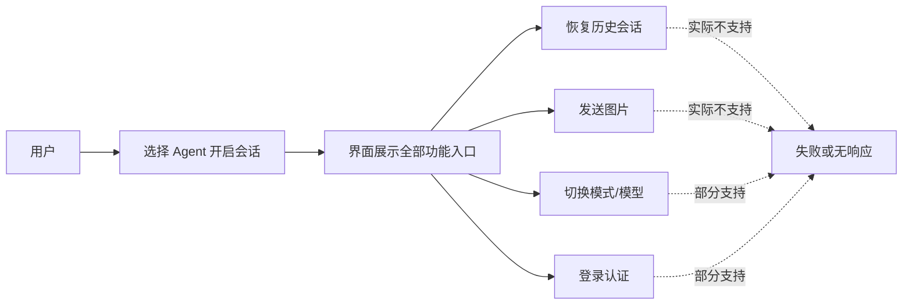
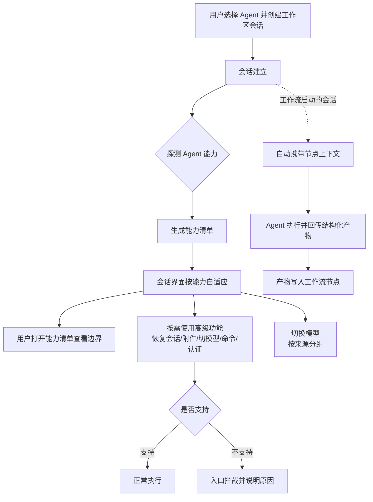

# ACP 协议增强

**功能名称**: ACP 协议能力透明化与扩展互通
**PRD 版本**: v1.0
**创建日期**: 2026-10-21
**作者**: ZeroAsh

## 背景与目标

### 1.1 背景

平台通过 ACP（Agent Client Protocol）协议接入多家编码 Agent（OpenCode、GitHub Copilot、Claude Code、Gemini CLI、Codex、MiMo Code、Kimi Code 等），会话的全部能力都来自各 Agent 在连接时声明的能力集合。随着接入的 Agent 越来越多、各家 Agent 能力差异越来越大，暴露出三类问题：

1. **能力不透明，入口"名不副实"**。不同 Agent 支持的能力差异很大：有的支持恢复历史会话、有的支持图片输入、有的支持登录认证、有的全部不支持。但平台界面对所有 Agent 一视同仁地展示全部入口，用户点击后才发现不可用，或者操作被静默忽略，体验不可预期：

2. **平台与 Agent 之间信息单薄**。平台掌握的信息（模型来自哪个供应商、会话属于哪次工作流的哪个节点、会话的业务标签）无法传给 Agent；Agent 掌握的信息也无法完整回传平台。典型例子：会话内「切换模型」列表只有模型名，用户无法区分哪些是平台内置模型、哪些来自自己的配置，无法按来源分组展示。

3. **协议持续演进，跟进成本高**。ACP 在同一主版本内以「能力协商 + 扩展机制」方式持续新增稳定特性，平台此前每次跟进都需要整链路改造，缺少一套可持续的接入与降级机制。

### 1.2 目标

- **能力透明**：用户在会话中能清楚看到当前 Agent 支持哪些能力、哪些不可用及原因，功能入口按实际能力自适应显示，杜绝"点了才知道不行"。
- **信息互通**：建立平台与 Agent 之间的补充信息通道，平台侧信息（模型来源、会话标签、工作流上下文等）可以随会话传递给 Agent，Agent 侧信息可以结构化回传平台；不支持该通道的 Agent 完全不受影响。
- **重点 Agent 体验拉满**：以 OpenCode 为首选 Agent，把其支持的进阶能力（会话恢复与发现、命令集、多模态、认证、子会话动态等）完整转化为平台体验。
- **兼容可演进**：任何 Agent（含旧版本）都不会因为不支持新能力而功能异常；后续 ACP 新增能力可以按同一套机制低成本接入。

### 1.3 成功标准

- 任一 Agent 会话内均可查看「能力清单」，清单与实际行为一致：不支持的能力入口隐藏或禁用并给出明确提示（如当前 Agent 不支持图片输入时，附件入口给出提示而非发送后丢失）。
- 会话内「切换模型」列表按来源分组展示（如「平台内置」「Agent 自带」等），来源信息可核对；来源信息缺失时有明确的兜底分组规则，不出现空白分组。
- 工作流启动的会话中，Agent 能感知当前节点上下文（需求名、节点任务等），并可将结构化产物回传平台，形成闭环；上下文传递失败不阻塞会话本身。
- 任意不支持扩展能力的 Agent（含旧版本）会话功能零退化：原有会话、消息、工具调用、权限、模式/模型切换行为不变。
- 能力探测与降级行为有自动化测试覆盖，Agent 升级导致能力变化时可被回归测试发现。

## 用户分析

### 2.1 目标用户

- **前台用户（开发者）**：在平台中选择 Agent 进行编码会话的终端用户，关注"这个 Agent 能干什么、怎么用得顺手"。
- **工作流使用者**：通过工作流节点驱动 Agent 会话的用户，关注上下文传递与产物闭环。
- **平台运营/管理员**：管理 Agent 接入与能力策略，关注各家 Agent 能力差异与兼容性。

### 2.2 用户场景

| 场景 | 用户角色 | 目标 | 痛点 |
|--|--|--|--|
| 选择 Agent 开会话 | 前台用户 | 一眼判断该 Agent 能干什么 | 能力差异完全不可见，入口一刀切 |
| 会话中使用高级功能 | 前台用户 | 恢复历史会话/发图片/切模型/登录 | 不支持时失败或静默无效，不知道是功能问题还是 Agent 限制 |
| 会话内切换模型 | 前台用户 | 快速找到想要的模型 | 模型列表混杂、无来源区分，无法分组 |
| 工作流节点驱动会话 | 工作流使用者 | Agent 带着需求上下文干活，产物自动回收 | 上下文靠人工粘贴，产物靠人工搬运 |
| 接入新 Agent | 平台运营 | 尽快上线且不影响存量 Agent | 缺能力差异依据与降级规则，每次接入都是全量改造 |

## 功能需求

### 3.1 功能概述

为 ACP 会话体系补齐「能力透明、信息互通、差异适配、兼容降级」四块能力：让用户看得懂当前 Agent 的能力边界，让平台与 Agent 之间可以互通标准协议之外的补充信息，让重点 Agent 的能力完整落地为产品体验，并保证任何 Agent 都不因新能力而退化。

### 3.2 功能列表

#### 功能点 1: Agent 能力清单与透明度

- **描述**: 会话建立后，展示当前 Agent 的「能力清单」：支持、部分支持、不支持三档能力逐项列出（如会话恢复、历史会话发现与删除、图片/音频输入、登录认证、模式与模型切换、命令集、结构化追问等），不支持项附一句话原因（来自 Agent 自身声明）。会话中的功能入口旁对不支持项给出轻量提示。
- **用户价值**: 用户在使用前即知道该 Agent 能干什么，避免试错；运营排查"功能不可用"时能立刻区分是平台问题还是 Agent 能力限制。
- **验收标准**:
  - [ ] 会话内可打开能力清单，逐项展示支持状态与说明，清单内容与该 Agent 实际能力声明一致
  - [ ] 至少覆盖：会话恢复、历史会话列表/删除、图片输入、音频输入、登录认证、登出、模式切换、模型切换、命令集、结构化追问（表单/链接）、附加工作区目录
  - [ ] 同一 Agent 版本升级后能力清单随之更新，不残留旧能力

#### 功能点 2: 能力驱动的功能适配

- **描述**: 会话界面按当前 Agent 的能力自适应：不支持的功能入口隐藏或禁用（附提示），部分支持的功能降级展示（如仅支持图片不支持音频时，只展示图片入口），避免出现"可点击但必然失败"的入口。
- **用户价值**: 界面所见即所得，操作不会白点；跨 Agent 切换时交互预期一致。
- **验收标准**:
  - [ ] 恢复历史会话、历史会话管理、图片/音频附件、登录/登出、模式与模型切换等入口均按能力自适应
  - [ ] 禁用态入口有原因说明（如「当前 Agent 不支持音频输入」）
  - [ ] 能力不支持时用户操作被拦截在入口处，不会发出后被静默丢弃

#### 功能点 3: 平台扩展信息互通

- **描述**: 平台与 Agent 之间建立补充信息通道，用于传递标准协议之外的信息，本期打通三类：
  1. **模型来源**：会话内「切换模型」的每个模型带有来源标识，列表按来源分组展示（如「平台内置」「Agent 自带」），来源缺失时按统一兜底规则归组；
  2. **会话标签与上下文**：会话可携带平台侧标签（如归属需求、业务标识），并随会话传递给 Agent；
  3. **工作流上下文**：工作流节点启动的会话自动携带节点上下文（需求名称、节点任务说明等），Agent 执行结果可结构化回传平台作为节点产物。
- **用户价值**: 模型列表可读性大幅提升；工作流会话免去人工粘贴上下文、搬运产物；为后续平台级信息互通打下通道。
- **验收标准**:
  - [ ] 会话内模型列表按来源分组，分组与模型来源一致；来源缺失时按兜底规则归组且有据可查
  - [ ] 工作流节点会话中 Agent 能获取节点上下文（可用回显或产物验证），上下文传递失败不影响会话可用性
  - [ ] Agent 回传的结构化产物可作为节点产物写入工作流，闭环可验证
  - [ ] 不支持信息通道的 Agent：上述功能安全降级（模型列表不分组或按兜底分组、上下文不传递、产物走人工），会话功能零退化

#### 功能点 4: 重点 Agent（OpenCode）差异能力接入

- **描述**: 针对 OpenCode 等能力较全的 Agent，把其独有或领先的能力转化为平台体验：命令集展示与执行入口、会话恢复与历史发现/删除、登录认证引导、子会话动态呈现、推理档位（思考强度）调节等；对 Agent 明确不支持的内置命令（如撤销/重做类命令）给出提示而非无效入口。
- **用户价值**: 能力强的 Agent 在平台上用起来更强，形成正向的 Agent 选择激励。
- **验收标准**:
  - [ ] OpenCode 会话中命令集可见、可执行，命令增减实时反映
  - [ ] 会话恢复、历史发现与删除在 OpenCode 上完整可用
  - [ ] 认证未完成时给出明确引导，完成后能力清单/入口状态同步更新
  - [ ] Agent 明确不支持的命令有提示，不出现无效入口

#### 功能点 5: 扩展兼容性与协议演进保障

- **描述**: 所有新能力都以「探测不到即降级」为原则接入：Agent 未声明的能力一律按不支持处理；双方不识别的扩展信息安全忽略；平台保留能力探测结果用于回归比对，Agent 升级引起的能力变化可被发现。
- **用户价值**: 存量 Agent 无感升级，新 Agent 可低成本接入；协议演进不再触发全量改造。
- **验收标准**:
  - [ ] 旧版本 Agent（不支持扩展信息）会话功能与现状完全一致，零退化
  - [ ] 未声明的能力一律按不支持处理，无"假入口"
  - [ ] 能力探测结果留存可查，可用于回归比对

### 3.3 用户操作流程

### 3.4 页面/界面描述

| 页面 | 描述 | 关键元素 |
|------|------|---------|
| 会话主界面 | 能力自适应的会话界面 | 功能入口（附件/命令/模型/模式/认证）按能力显示、禁用与提示；模型切换列表按来源分组 |
| 会话信息（能力面板） | 展示当前 Agent 能力清单 | 能力三档状态（支持/部分支持/不支持）、逐项说明、Agent 名称与版本 |
| 工作流节点会话 | 携带节点上下文的会话 | 上下文卡片（需求名、节点任务）、产物回传状态 |
| Agent 选择界面 | 创建会话前选择 Agent | 各 Agent 能力摘要（支持能力数量/关键能力有无） |

### 3.5 异常与边界情况

| 情况 | 预期行为 |
|------|---------|
| Agent 未声明任何能力（旧版本） | 全部进阶能力按不支持处理，仅保留基线会话能力，功能零退化 |
| Agent 升级后能力变化 | 能力清单与入口自适应更新，不残留旧能力状态 |
| Agent 声明能力但实际调用失败 | 给出明确错误提示并记录，不静默吞掉 |
| 模型来源信息缺失 | 按统一兜底规则归组展示，分组名可识别为兜底分组 |
| 工作流上下文传递失败 | 会话正常可用，上下文以提示形式告知用户可手动补充 |
| Agent 回传产物解析失败 | 节点不误判为已完成，提示用户检查产物格式 |
| 双方扩展信息不识别 | 安全忽略，不影响会话与消息收发 |
| 会话中途切换 Agent 类型 | 以新 Agent 能力重新生成清单并自适应入口 |

## 四、非功能需求

### 4.1 性能要求

- 能力探测随会话建立完成，不增加用户可感知的会话启动时长（≤ 100ms 额外开销）。
- 能力自适应渲染不引起界面卡顿；模型列表分组不增加明显加载时间。

### 4.2 安全性要求

- 平台向 Agent 传递的扩展信息只包含业务上下文，不包含密钥、令牌等敏感凭据；Agent 回传内容按不可信输入处理，展示前做转义与长度限制。

### 4.3 兼容性要求

- 存量 Agent、存量会话、存量界面行为零退化；新能力一律以能力探测为前提，未探测到即降级。
- 扩展信息采用双方可忽略的承载方式，不改变标准协议消息结构，保证与任何遵循 ACP 标准的 Agent 互通。

## 五、依赖与约束

### 5.1 依赖

- 各 ACP Agent 的能力声明与实现程度（尤其 OpenCode 的能力广播）。
- 会话、模型、工作流等既有平台能力的稳定性。

### 5.2 约束

- 不改变平台对 ACP 标准协议的遵循方式：扩展只走协议允许的扩展通道，不得破坏与标准 Agent/Client 的互通。
- 不引入对单一 Agent 私有能力的硬依赖：Agent 专有能力必须有降级路径。
- 终端能力（在用户侧执行命令）维持既有的不实施决策。

## 六、相关文档

- 技术提案：`docs/engineering/proposals/20261021-feat-acp-protocol-enhancement.md`
- 相关 PRD：`docs/product/released/20260803-acp-v1-completion.md`（ACP v1 协议补全）、`docs/product/released/20260705-acp-server-extend.md`（ACP Server 支持扩展）、`docs/product/released/20260721-acp-server-mimo-kimi.md`（多 Agent 接入）
- 参考：ACP v1 协议文档 <https://agentclientprotocol.com/protocol/v1/>、扩展机制 <https://agentclientprotocol.com/protocol/v1/extensibility>、OpenCode ACP 支持 <https://opencode.ai/docs/acp/>
