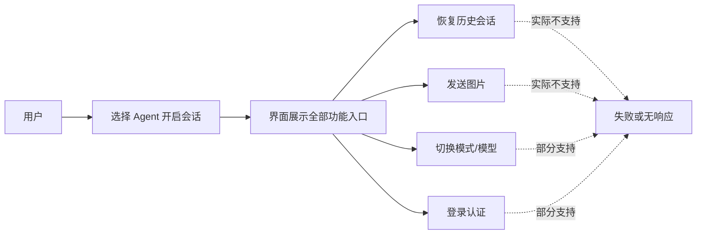
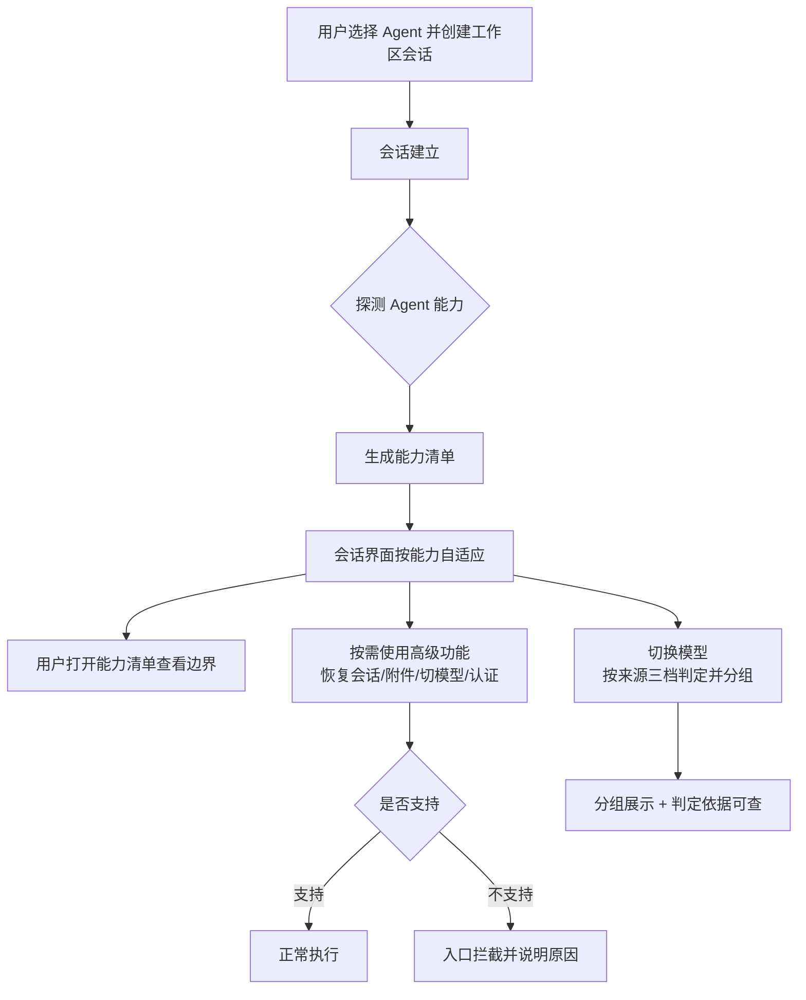

# ACP 协议增强

**功能名称**: ACP 协议能力透明化与模型来源分组
**PRD 版本**: v1.2
**创建日期**: 2026-10-21
**作者**: ZeroAsh
**版本说明**:
- v1.0（2026-10-21）初版：能力透明、信息互通、差异适配、兼容降级四块能力。
- v1.1（2026-10-21，返工修订）按下游评审收敛范围：**保留**能力快照归一化、模型来源三档推断、前端能力门控与能力面板；**移除**平台扩展信息通道（agentgear）、工作流上下文与产物闭环、OpenCode 差异能力接入（移至后续需求候选）；新增「Agent 回传内容形态与平台呈现一致性」的现状梳理要求（见 §1.1、§3.2 功能点 4）。
- v1.2（2026-10-21，返工修订）按下游评审补充 **Elicitation（结构化问询）**：明确列入能力清单覆盖项，新增「结构化问询弹窗链路可用」的成功标准与验收（回应打回疑问「是否忘记在能力列表中传入 Elicitation」——经核查能力列表已声明、Agent 亦会发起问询，弹窗未出现为链路/触发问题，列为修复项）。

## 背景与目标

### 1.1 背景

平台通过 ACP（Agent Client Protocol）协议接入多家编码 Agent（OpenCode、GitHub Copilot、Claude Code、Gemini CLI、Codex、MiMo Code、Kimi Code 等），会话的全部能力都来自各 Agent 在连接时声明的能力集合。随着接入的 Agent 越来越多、各家 Agent 能力差异越来越大，暴露出三类问题：

1. **能力不透明，入口"名不副实"**。不同 Agent 支持的能力差异很大：有的支持恢复历史会话、有的支持图片输入、有的支持登录认证、有的全部不支持。但平台界面对所有 Agent 一视同仁地展示全部入口，用户点击后才发现不可用，或者操作被静默忽略，体验不可预期：

2. **模型列表无来源区分**。会话内「切换模型」只有模型名，用户无法区分哪些是平台内置模型、哪些来自 Agent 自带、哪些是自己的配置，无法按来源分组展示（此前「内建API渠道一期上线后问题修复」需求已明确该缺口，因协议侧无来源字段而遗留）。

3. **Agent 回传内容形态多样，平台呈现口径不一**。Agent 经协议回传的内容形态很多（流式文本、推理片段、工具调用及其结果、图片/资源、命令集、配置变更、用量等），平台各层对不同形态的处理与呈现存在差异；哪些形态被完整呈现、哪些被合并或忽略，目前没有一份可核对的现状说明，排查问题与评估新能力都缺少依据。

4. **协议持续演进，跟进成本高**。ACP 在同一主版本内以「能力协商」方式持续新增稳定特性，平台此前每次跟进都需要整链路改造，缺少一套可持续的接入与降级机制。

### 1.2 目标

- **能力透明**：用户在会话中能清楚看到当前 Agent 支持哪些能力、哪些不可用及原因，功能入口按实际能力自适应显示，杜绝"点了才知道不行"。
- **模型可分组**：会话内「切换模型」按来源分组展示（如「平台内置」「Agent 自带」「自定义」），来源判定有统一规则、结果可核对。
- **呈现口径可核对**：形成「Agent 回传内容形态 → 平台存储处理 → 前端呈现」的现状对照说明，作为能力展示与后续需求的共同事实基础。
- **兼容可演进**：任何 Agent（含旧版本）都不会因为不支持新能力而功能异常；后续 ACP 新增能力可以按同一套机制低成本接入。

### 1.3 成功标准

- 任一 Agent 会话内均可查看「能力清单」，清单与实际行为一致：不支持的能力入口隐藏或禁用并给出明确提示（如当前 Agent 不支持图片输入时，附件入口给出提示而非发送后丢失）。
- **结构化问询（Elicitation）弹窗端到端可用**：Agent 发起问询后用户可见弹窗、可提交/拒绝、回复送达 Agent；问询未弹出时有兜底提示与可查记录，不再出现「上线后未见弹出」的静默现象。
- 会话内「切换模型」列表按来源分组展示，来源判定可核对；来源无法判定时归入明确的兜底分组，不出现空白分组。
- 形成「回传形态 → 落库处理 → 前端渲染」对照说明（随技术方案交付），逐形态标注现状处理口径，缺口登记为观察项。
- 任意不支持新能力的 Agent（含旧版本）会话功能零退化：原有会话、消息、工具调用、权限、模式/模型切换行为不变。
- 能力探测与降级行为有自动化测试覆盖，Agent 升级导致能力变化时可被回归测试发现。

## 用户分析

### 2.1 目标用户

- **前台用户（开发者）**：在平台中选择 Agent 进行编码会话的终端用户，关注"这个 Agent 能干什么、模型怎么选得明白"。
- **平台运营/管理员**：管理 Agent 接入与能力策略，关注各家 Agent 能力差异与兼容性。

### 2.2 用户场景

| 场景 | 用户角色 | 目标 | 痛点 |
|--|--|--|--|
| 选择 Agent 开会话 | 前台用户 | 一眼判断该 Agent 能干什么 | 能力差异完全不可见，入口一刀切 |
| 会话中使用高级功能 | 前台用户 | 恢复历史会话/发图片/切模型/登录 | 不支持时失败或静默无效，不知道是功能问题还是 Agent 限制 |
| 会话内切换模型 | 前台用户 | 快速找到想要的模型 | 模型列表混杂、无来源区分，无法分组 |
| 排查"内容没显示/显示不对" | 前台用户/运营 | 判断是协议形态、存储处理还是渲染问题 | 缺少各形态处理口径的现状说明，排查靠翻代码 |
| 接入新 Agent | 平台运营 | 尽快上线且不影响存量 Agent | 缺能力差异依据与降级规则，每次接入都是全量改造 |

## 功能需求

### 3.1 功能概述

为 ACP 会话体系补齐三块能力并完成一项现状梳理：**能力透明**（能力清单与入口自适应）、**模型可分组**（来源三档判定与分组展示）、**兼容可演进**（探测不到即降级、零退化），以及**「回传形态 → 落库处理 → 前端渲染」现状对照梳理**，让用户看得懂当前 Agent 的能力边界、模型来源分组可读，并让平台各层处理口径可核对。

### 3.2 功能列表

#### 功能点 1: Agent 能力清单与透明度

- **描述**: 会话建立后，展示当前 Agent 的「能力清单」：支持、部分支持、不支持三档能力逐项列出（如会话恢复、历史会话发现与删除、图片/音频输入、登录认证、模式与模型切换、命令集、结构化追问等），不支持项附一句话原因（来自 Agent 自身声明）。会话中的功能入口旁对不支持项给出轻量提示。
- **用户价值**: 用户在使用前即知道该 Agent 能干什么，避免试错；运营排查"功能不可用"时能立刻区分是平台问题还是 Agent 能力限制。
- **验收标准**:
  - [ ] 会话内可打开能力清单，逐项展示支持状态与说明，清单内容与该 Agent 实际能力声明一致
  - [ ] 至少覆盖：会话恢复、历史会话列表/删除、图片输入、音频输入、登录认证、登出、模式切换、模型切换、命令集、**结构化问询（表单/链接，Elicitation）**、附加工作区目录
  - [ ] **结构化问询（Elicitation）状态项与弹窗实际行为一致**：清单显示支持时弹窗链路必须可用（发起 → 弹窗 → 回复送达），显示不支持时问询入口隐藏/提示
  - [ ] 同一 Agent 版本升级后能力清单随之更新，不残留旧能力

#### 功能点 2: 能力驱动的功能适配

- **描述**: 会话界面按当前 Agent 的能力自适应：不支持的功能入口隐藏或禁用（附提示），部分支持的功能降级展示（如仅支持图片不支持音频时，只展示图片入口），避免出现"可点击但必然失败"的入口。
- **用户价值**: 界面所见即所得，操作不会白点；跨 Agent 切换时交互预期一致。
- **验收标准**:
  - [ ] 恢复历史会话、历史会话管理、图片/音频附件、登录/登出、模式与模型切换、结构化问询等入口均按能力自适应
  - [ ] 禁用态入口有原因说明（如「当前 Agent 不支持音频输入」）
  - [ ] 能力不支持时用户操作被拦截在入口处，不会发出后被静默丢弃

#### 功能点 3: 模型来源识别与分组展示

- **描述**: 会话内「切换模型」的每个模型判定来源并按来源分组展示。来源判定按统一的三档规则依次尝试：① 解析模型标识中的来源段（如「供应商/模型」形式的命名）；② 与平台侧模型库（平台内置、用户自定义）比对；③ 无法判定时归入兜底分组。判定结果可核对、可解释（每组展示判定依据）。
- **用户价值**: 模型列表可读性大幅提升，用户一眼区分「平台内置 / Agent 自带 / 自定义」；遗留的"模型列表无来源"缺口就此关闭。
- **验收标准**:
  - [ ] 会话内模型列表按来源分组，分组结果与判定规则一致
  - [ ] 每个分组可查看判定依据（如「按标识前缀判定」「按平台模型库比对」）
  - [ ] 无法判定来源的模型归入兜底分组（明确标注「来源未知」），不出现空白或遗漏
  - [ ] 同一模型在不同会话中的来源判定结果一致

#### 功能点 4: 能力探测与兼容保障（含现状对照梳理）

- **描述**:
  1. 所有新能力都以「探测不到即降级」为原则接入：Agent 未声明的能力一律按不支持处理；平台保留能力探测结果用于回归比对，Agent 升级引起的能力变化可被发现。
  2. 形成「Agent 回传内容形态 → 平台存储处理 → 前端呈现」的现状对照说明：逐形态（流式文本、推理片段、工具调用及其结果、多模态内容、命令集、配置变更、用量等）标注当前处理与呈现口径，不一致或缺失处登记为观察项，作为后续需求候选。
- **用户价值**: 存量 Agent 无感升级、新 Agent 可低成本接入；内容呈现类问题有据可查，不再逐个翻代码排查。
- **验收标准**:
  - [ ] 旧版本 Agent（不声明新能力）会话功能与现状完全一致，零退化
  - [ ] 未声明的能力一律按不支持处理，无"假入口"
  - [ ] 能力探测结果留存可查，可用于回归比对
  - [ ] 对照说明随技术方案交付，覆盖 Agent 回传的全部内容形态并逐层（存储/渲染）标注现状

### 3.3 用户操作流程

### 3.4 页面/界面描述

| 页面 | 描述 | 关键元素 |
|------|------|---------|
| 会话主界面 | 能力自适应的会话界面 | 功能入口（附件/模型/模式/认证/会话恢复）按能力显示、禁用与提示；模型切换列表按来源分组 |
| 会话信息（能力面板） | 展示当前 Agent 能力清单 | 能力三档状态（支持/部分支持/不支持）、逐项说明、Agent 名称与版本 |
| 模型分组弹层 | 切换模型选择 | 来源分组（平台内置/Agent 自带/自定义/来源未知）、组内模型列表、判定依据入口 |
| Agent 选择界面 | 创建会话前选择 Agent | 各 Agent 能力摘要（支持能力数量/关键能力有无） |

### 3.5 异常与边界情况

| 情况 | 预期行为 |
|------|---------|
| Agent 发起结构化问询但界面未弹窗 | 兜底提示可见（待处理问询入口/提示条），问询记录可查（含未弹出原因），不得静默丢失；能力清单显示支持而弹窗失败时提示「问询链路异常」并记录 |
| 结构化问询超时未响应 | 明确提示「已过期/已取消」，Agent 侧得到取消结果，不悬挂 |
| Agent 未声明任何能力（旧版本） | 全部进阶能力按不支持处理，仅保留基线会话能力，功能零退化 |
| Agent 升级后能力变化 | 能力清单与入口自适应更新，不残留旧能力状态 |
| Agent 声明能力但实际调用失败 | 给出明确错误提示并记录，不静默吞掉 |
| 模型标识无来源段且平台库比对不上 | 归入「来源未知」兜底分组，判定依据标注「无法判定」 |
| 同一模型名在多来源出现 | 按判定规则优先级归组，不重复出现在多个分组 |
| 某内容形态平台未呈现/被合并 | 对照说明中登记为观察项；会话功能不受影响 |
| 会话中途切换 Agent 类型 | 以新 Agent 能力重新生成清单并自适应入口 |

## 四、非功能需求

### 4.1 性能要求

- 能力探测随会话建立完成，不增加用户可感知的会话启动时长（≤ 100ms 额外开销）。
- 能力自适应渲染不引起界面卡顿；模型列表分组不增加明显加载时间。

### 4.2 安全性要求

- 能力清单与来源判定依据仅展示 Agent 声明与平台判定结果，不暴露平台内部实现细节。

### 4.3 兼容性要求

- 存量 Agent、存量会话、存量界面行为零退化；新能力一律以能力探测为前提，未探测到即降级。
- 不改变平台与 Agent 之间的协议交互方式，保持与任何遵循 ACP 标准的 Agent 互通。

## 五、依赖与约束

### 5.1 依赖

- 各 ACP Agent 的能力声明与实现程度（尤其 OpenCode 的能力广播）。
- 平台侧模型库（平台内置渠道模型、用户自定义模型）的数据准确性。

### 5.2 约束

- 不引入对单一 Agent 私有能力的硬依赖；本期不实施协议扩展通道、工作流上下文透传与 Agent 专有差异能力（列为后续需求候选）。
- 终端能力（在用户侧执行命令）维持既有的不实施决策。
- 现状对照梳理以「如实记录」为原则：本期只登记缺口，不顺手修改既有存储/渲染行为。

## 六、相关文档

- 技术提案：`docs/engineering/proposals/20261021-feat-acp-protocol-enhancement.md`
- 调研附录：`docs/engineering/proposals/20261021-feat-acp-protocol-enhancement-opencode-support.md`（OpenCode ACP 支持清单调研）
- 相关 PRD：`docs/product/released/20260803-acp-v1-completion.md`（ACP v1 协议补全）、`docs/product/released/20260705-acp-server-extend.md`（ACP Server 支持扩展）、`docs/product/released/20260721-acp-server-mimo-kimi.md`（多 Agent 接入）
- 参考：ACP v1 协议文档 <https://agentclientprotocol.com/protocol/v1/>、扩展机制 <https://agentclientprotocol.com/protocol/v1/extensibility>、OpenCode ACP 支持 <https://opencode.ai/docs/acp/>
