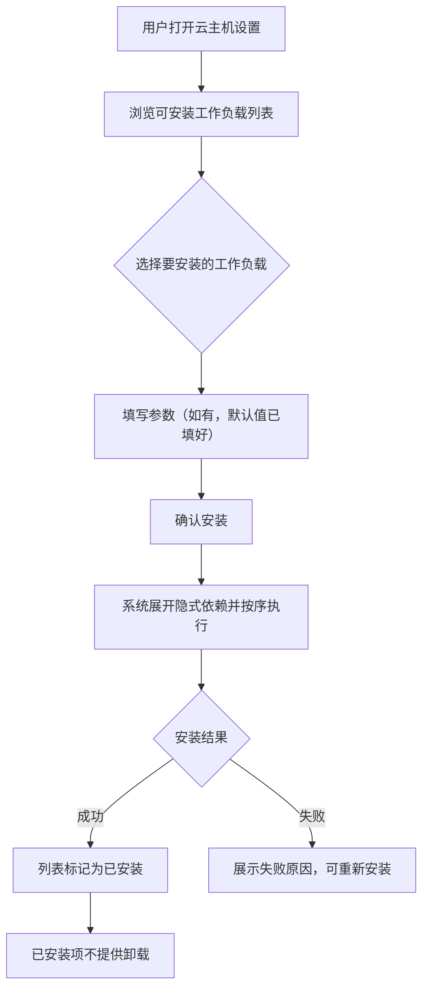
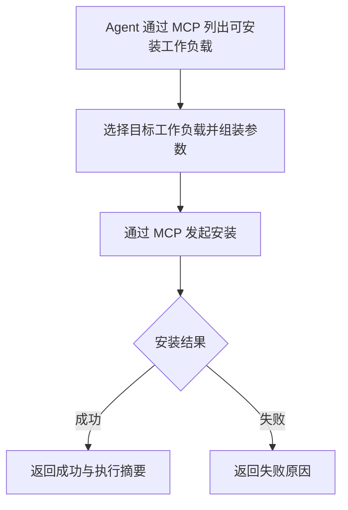
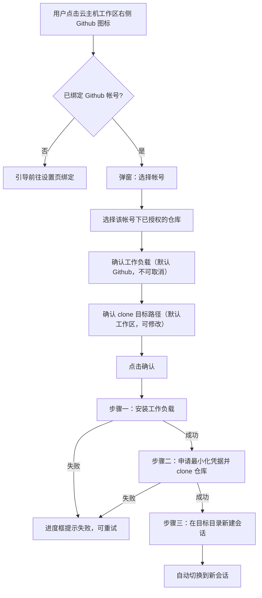

# Github 工作负载与云主机 Git 项目设置

**功能名称**: Github 工作负载与云主机 Git 项目设置
**PRD 版本**: v1.1
**创建日期**: 2026-10-21
**作者**: ZeroAsh Agent

> v1.1 变更（评审返工）：Git 凭据不再由系统一次性下发，改为**云主机向系统申请凭据并写入 gh 认证配置**：设置 Git 项目时申请首次凭据，此后每 50 分钟自动申请新凭据更新 gh 配置（凭据有效期约 1 小时），保证容器内 gh/git 操作长期可用；同步修订 §1.2/§1.3/§3.2 功能点 5/功能点 6/§3.3/§3.5/§4.2。

## 背景与目标

### 1.1 背景

平台已具备两块相互独立的能力：

1. **Github 帐号绑定**：前台用户可以在设置页绑定 Github 帐号，并选择授权的仓库（见 [[20260709-github-account-binding]]）。
2. **工作负载体系**：管理员可以维护带参数、带依赖的工作负载，在启动云端工作容器时挂载执行，并内置了 Docker、Node.js、.NET、Aspire 等预制工作负载（见 [[20261017-cloud-controller-workload]]、[[20261018-workload-phase1]]）。

但目前两块能力没有打通，且工作负载的使用方式存在明显缺口：

1. **工作负载只能在容器启动时由管理员挂载**。容器拉起后，前台用户无法按需补充环境（例如临时需要 gh CLI），只能销毁重建或进入容器手工操作。
2. **系统中的 Agent 无法感知和安装工作负载**。工作负载的列表与安装能力没有提供给 Agent 使用，Agent 在容器内遇到缺失的环境时束手无策。
3. **在云主机上开发 Github 仓库的路径长且易错**。用户需要手工安装 gh、配置凭据、clone 仓库、再手动创建会话，每一步都可能出错，且涉及凭据处理，存在误用平台总凭据的风险。

因此本期将工作负载能力向「容器拉起后安装 + MCP 开放」演进，并以此为底座提供「Github 工作负载 + 云主机一键设置 Git 项目」的完整体验。

### 1.2 目标

- 工作负载支持在容器拉起后安装：前台用户可以在云主机的设置中安装工作负载；已安装的工作负载不支持卸载。
- 工作负载的安装、列表能力作为 MCP 提供到系统中，Agent 可以列出可安装的工作负载并发起安装。
- 新增「Github」预制工作负载，提供 gh CLI 环境。
- 云主机工作区提供「设置 Github 项目」入口：选择已授权的帐号与仓库、确定 clone 目标路径后，系统自动完成工作负载安装、使用用户授权的凭据拉取仓库，并在目标目录新建会话且切换到该会话。
- 云主机使用的凭据最小化：仅是该用户授权的、限定到目标仓库的凭据，不下放平台总凭据；凭据由云主机主动向系统申请并写入 gh 认证配置，在临近过期前自动申请新凭据更新，容器内 gh/git 操作长期可用。

### 1.3 成功标准

- 前台用户可以在云主机设置中看到可安装的工作负载列表并完成安装；安装过程有明确状态反馈；已安装的工作负载在列表中标记为已安装且不提供卸载入口。
- Agent 通过 MCP 可以获取工作负载列表并对云主机发起安装，安装结果可查询。
- 「Github」预制工作负载在升级后自动出现在工作负载列表中（与既有预制工作负载规则一致），选择安装后容器内 gh 命令可用。
- 用户在云主机工作区点击 Github 图标，在弹窗中完成「选帐号 → 选仓库 → 确认路径」后，无需任何手工操作即可进入一个位于仓库目录中的新会话。
- 整个设置过程（工作负载安装 → Git 项目设置 → 会话创建）在弹窗中有逐步状态展示，失败时能定位到具体步骤与原因。
- 容器内用于拉取仓库的凭据只对该用户授权的对应仓库有效；凭据不出现在执行日志与界面中；凭据到期前由云主机自动续期，无需用户介入。

## 用户分析

### 2.1 目标用户

- **前台注册用户**：在云主机上进行开发，希望直接把已授权的 Github 仓库拉取到云主机并开始工作。
- **Agent（系统内）**：在容器内执行任务时需要感知与补齐环境能力（通过 MCP 列出/安装工作负载）。
- **平台管理员**：维护「Github」预制工作负载脚本（与既有预制工作负载管理方式一致）。

### 2.2 用户场景

| 场景 | 用户角色 | 目标 | 痛点 |
|--|--|--|--|
| 把授权仓库拉到云主机开发 | 前台用户 | 一键完成 gh 环境、凭据、clone、建会话 | 手工步骤多，凭据配置易错 |
| 容器拉起后补装环境 | 前台用户 | 在云主机设置中随时安装工作负载 | 只能启动时挂载，错过就要重建容器 |
| Agent 自主补齐环境 | Agent | 发现缺少工具时自行安装对应工作负载 | 工作负载能力未对 Agent 开放 |
| 确认设置进度 | 前台用户 | 实时看到安装与 clone 进行到哪一步 | 过程黑盒，失败不知道卡在哪 |
| 凭据安全 | 前台用户 | 容器里只有自己仓库的凭据 | 担心平台总凭据被下放、泄露面扩大 |

## 功能需求

### 3.1 功能概述

本期包含两条主线：

1. **工作负载能力演进**：工作负载从「仅启动时挂载」升级为「容器拉起后也可安装」，面向前台用户提供云主机设置中的安装入口（已安装不可卸载），并将工作负载的列表与安装能力以 MCP 形式开放给系统内的 Agent。
2. **Github 工作负载与 Git 项目设置**：新增「Github」预制工作负载（安装 gh CLI）；云主机工作区提供「设置 Github 项目」弹窗，串联「安装工作负载 → 使用用户授权凭据 clone 仓库 → 在目标目录新建会话并切换」的完整流程。

### 3.2 功能列表

#### 功能点 1: 工作负载容器拉起后安装

- **描述**: 已经在线的云主机支持追加安装工作负载：
  - 前台用户在云主机的设置中可以浏览可安装的工作负载列表，并对当前云主机发起安装。
  - 安装过程中云主机展示「初始化中」的状态语义与当前执行的工作负载（与启动时挂载的进度呈现一致）。
  - 工作负载支持参数与依赖：拉起后安装同样遵循既有的参数填写、隐式依赖展开、「每个工作负载只执行一次」等规则。
  - 已安装的工作负载**不支持卸载**；列表中明确标识已安装状态。
  - 重复安装同一工作负载时，脚本幂等执行（已成功的能力不应被破坏）。
- **用户价值**: 环境能力随用随装，不再需要为了补一个工具而重建容器。
- **验收标准**:
  - [ ] 云主机设置中展示可安装工作负载列表，含名称、参数说明与已安装标识
  - [ ] 对在线云主机发起安装后，安装进度可见，完成后标记为已安装
  - [ ] 已安装的工作负载不提供卸载入口
  - [ ] 带参数的工作负载安装时可填写参数（默认值已填好）；带依赖的自动补齐依赖
  - [ ] 重复安装同一工作负载不产生副作用
  - [ ] 安装失败的反馈可见，且不影响云主机其余能力
  - [ ] 仅云主机支持拉起后安装；本地/自定义主机不出现该入口

#### 功能点 2: 工作负载列表与安装的 MCP 提供

- **描述**: 工作负载的列表查询与安装能力以 MCP 工具的形式提供到系统中，Agent 在会话内可以：
  - 列出当前可安装的工作负载（名称、说明、参数）；
  - 对当前所在的云主机发起工作负载安装，并获取安装结果。
- **用户价值**: Agent 可以自主补齐环境，工作负载从「人的工具」变成「人与 Agent 共同的工具」。
- **验收标准**:
  - [ ] Agent 通过 MCP 可获取工作负载列表（与前台可见范围一致）
  - [ ] Agent 通过 MCP 可对当前云主机发起安装并拿到成功/失败结果
  - [ ] MCP 安装与前台安装共享同一套执行与记录机制，执行记录中可区分触发来源
  - [ ] MCP 安装同样遵循参数校验、依赖展开与不可卸载约束

#### 功能点 3: 「Github」预制工作负载

- **描述**: 新增内置预制工作负载「Github」，随升级自动出现在工作负载列表中（遵循既有预制工作负载的一次性迁移规则：只增不改、管理员可改可删、不被覆盖）：
  - 初始化脚本：添加内部 apt 代理源（`https://nexus.internal.fffdan.com/repository/github-cli-apt-proxy/`，key-ring 为 `https://nexus.internal.fffdan.com/repository/github-cli-apt-proxy/githubcli-archive-keyring.gpg`），更新 apt 后安装 `gh`；脚本幂等（gh 已可用时直接成功）。
  - 清理脚本：无。
  - 工作负载参数：
    - 仓库 qualified name（`xxx/repo` 格式文本）；
    - clone 目标路径（文本，默认 `/root/workspaces/{repo}`）。
- **用户价值**: gh 环境开箱即装，来源可信（内部代理），且与后续「设置 Github 项目」流程复用同一份工作负载。
- **验收标准**:
  - [ ] 升级后工作负载列表出现「Github」预制工作负载，带预制标识，且只出现一次
  - [ ] 安装该工作负载后容器内 `gh` 命令可用
  - [ ] 安装来源为内部 apt 代理，不访问不可信外部源
  - [ ] 重复执行脚本幂等成功
  - [ ] 管理员修改/删除后不被系统自动覆盖或恢复
  - [ ] 参数（仓库名、目标路径）可在安装时填写并随执行记录留档

#### 功能点 4: 云主机工作区「设置 Github 项目」弹窗

- **描述**: 云主机的工作区右侧显示「Github」图标，点击后弹出「设置 Github 项目」弹窗：
  - 选择已授权的 Github 帐号；选择帐号后展示该帐号已授权的仓库列表，选择一个仓库（两个参数：帐号、仓库）。
  - 弹窗中可勾选需要设置的工作负载：默认勾选「Github」且不可取消。
  - 可设置将仓库 clone 到哪里，默认是云主机的默认工作区（`/root/workspace`），可修改。
  - 弹窗中默认选中当前云主机，且只能选择云主机（无法选择本地/自定义主机）。
  - 未绑定 Github 帐号时，弹窗引导用户前往设置页完成绑定。
  - 点击「确认」后，先设置（安装）工作负载，然后进行 Git 项目的设置。
- **用户价值**: 把「装环境 + 配凭据 + 拉仓库」收敛为一次确认。
- **验收标准**:
  - [ ] 云主机工作区右侧可见 Github 图标入口
  - [ ] 弹窗中帐号下拉仅展示当前用户已绑定的帐号；选择帐号后仓库列表仅展示该帐号已授权的仓库
  - [ ] 工作负载勾选默认选中「Github」且不可取消
  - [ ] clone 目标路径默认填好默认工作区路径，可编辑
  - [ ] 目标主机固定为当前云主机，不提供其他类型主机选项
  - [ ] 未绑定帐号时展示绑定引导，无法进行下一步
  - [ ] 未选择帐号或仓库时「确认」不可用

#### 功能点 5: 设置过程状态可视

- **描述**: 点击「确认」后弹出进度对话框，逐步展示整个设置过程的状态（参照管理后台工作负载执行记录的呈现方式）：
  - 第一步：工作负载设置（展开后的执行顺序、当前执行项、成功/失败状态）；
  - 第二步：Git 项目设置（凭据申请与仓库拉取进度、成功/失败状态）；
  - 第三步：会话创建结果。
  - 任一步骤失败时对话框停留在失败步骤，展示可读原因，并提供「重试」与「关闭」；已成功的前序步骤在重试时不重复执行（幂等）。
- **用户价值**: 过程透明、失败可定位、可恢复。
- **验收标准**:
  - [ ] 进度对话框分步展示三个步骤的状态
  - [ ] 工作负载安装阶段能看到当前执行的工作负载与其状态
  - [ ] 失败时提示具体失败步骤与原因
  - [ ] 重试时已完成步骤不重复执行
  - [ ] 全部成功后自动进入新建会话（见功能点 6）

#### 功能点 6: Git 项目设置与凭据最小化

- **描述**: 工作负载设置完成后，云主机使用用户授权给我们的凭据完成 Git 项目设置：
  - 云主机使用的凭据**只对该用户授权的对应仓库生效**（权限范围可控、可限定到单个仓库），而不是把平台总凭据下放给容器内的 gh 命令；
  - 凭据由**云主机向系统申请**获得并写入容器内 gh 的认证配置，然后完成目标仓库的 clone（clone 到弹窗中指定的目标路径）；系统不向云主机一次性下发凭据；
  - 凭据写入 gh 认证配置后供 gh 与 git 操作长期使用；凭据存在有效期，云主机在凭据临近过期时**自动向系统申请新凭据并更新 gh 配置**（约每 50 分钟一次），用户无感知；
  - 凭据不出现在任何界面、执行日志与持久化记录中；clone 输出中的凭据信息需被遮蔽。
- **用户价值**: 用户无需手工处理凭据，且凭据泄露面最小、长期可用。
- **验收标准**:
  - [ ] 容器内获得的凭据仅能对目标仓库进行操作，对其他未授权仓库无效
  - [ ] clone 完成后目标路径下存在完整的仓库工作副本
  - [ ] 凭据不出现在执行记录、日志与前端界面中
  - [ ] 凭据到期前自动续期并更新 gh 配置，续期后容器内 gh/git 操作持续可用，无需用户介入
  - [ ] 自动续期失败或授权被撤销时给出明确提示，并支持重新设置
  - [ ] 目标路径已存在同内容仓库时幂等处理（直接复用或给出明确提示）

#### 功能点 7: 自动新建会话并切换

- **描述**: Git 项目设置完成后，系统自动在目标目录（clone 目标路径）新建一个会话，并将前台界面切换到该会话，用户可以直接开始工作。
- **用户价值**: 设置完成即进入工作状态，无需再手动建会话、选目录。
- **验收标准**:
  - [ ] 设置完成后自动创建会话，会话工作目录为 clone 目标路径
  - [ ] 前台自动切换到新会话
  - [ ] 会话创建失败时设置流程仍视为完成（仓库已就绪），并给出手动创建会话的引导

### 3.3 用户操作流程

#### 云主机拉起后安装工作负载

#### Agent 通过 MCP 安装工作负载

#### 设置 Github 项目

### 3.4 页面/界面描述

| 页面 | 描述 | 关键元素 |
|------|------|---------|
| 云主机工作区 | 云主机的工作区视图 | 右侧「Github」图标入口、工作区内容 |
| 云主机设置 | 云主机的设置区域 | 可安装工作负载列表（名称、参数说明、已安装标识）、安装入口、安装状态 |
| 设置 Github 项目弹窗 | 一键设置 Git 项目 | 帐号下拉、仓库列表、工作负载勾选（Github 默认且不可取消）、clone 目标路径输入（默认工作区）、目标主机（固定当前云主机）、确认/取消 |
| 设置进度对话框 | 展示设置全过程 | 分步状态（工作负载设置 / Git 项目设置 / 会话创建）、当前执行项、失败原因、重试/关闭 |
| Github 绑定设置页 | 既有页面 | 未绑定时从弹窗引导至此 |

### 3.5 异常与边界情况

| 情况 | 预期行为 |
|------|---------|
| 云主机不在线 | 不允许发起安装/设置，提示等待云主机在线 |
| 安装的工作负载带隐式依赖 | 自动补齐依赖并各执行一次，进度中可见 |
| 重复安装同一工作负载 | 脚本幂等执行，结果仍为已安装 |
| 已安装工作负载尝试卸载 | 不提供卸载入口 |
| 未绑定 Github 帐号 | 弹窗展示绑定引导，无法确认 |
| 帐号下无已授权仓库 | 仓库列表为空并提示前往设置页授权仓库 |
| 凭据已过期或被撤销 | 设置阶段失败并提示重新授权/重试；运行期间由自动续期兜住，续期失败或授权被撤销时提示用户重新设置 |
| 凭据自动续期失败（系统侧临时故障） | 在凭据有效期内重试续期；超过有效期仍未成功时，容器内 gh/git 操作失效并提示用户重新设置 |
| clone 目标路径已存在同名仓库 | 幂等处理：内容一致则直接复用进入下一步；不一致则提示用户修改路径 |
| clone 失败（网络/权限/仓库不存在） | Git 项目设置步骤失败，展示可读原因，可重试 |
| 工作负载安装成功但 clone 失败 | 重试时跳过工作负载安装，仅重试 Git 项目设置 |
| 会话创建失败 | 流程视为完成，提示仓库已就绪并引导手动创建会话 |
| 容器内凭据被尝试用于未授权仓库 | 操作被 Git 平台拒绝；平台不下放可访问其他仓库的凭据 |
| 内部 apt 代理不可达 | Github 工作负载安装失败并留档，可重试 |
| 选择非云主机（本地/自定义主机） | 不提供该能力，目标主机固定为当前云主机 |

## 四、非功能需求

### 4.1 性能要求

- 可安装工作负载列表查询响应不超过 2 秒（200 条规模）。
- 「设置 Github 项目」全流程在正常网络下分钟级内完成；进度状态刷新延迟不超过 3 秒。
- Github 帐号与仓库列表加载不超过 3 秒。

### 4.2 安全性要求

- 云主机使用的 Git 凭据必须最小化：仅限该用户授权、限定到目标仓库、具备有效期；禁止下放平台级总凭据。
- 凭据加密存储；凭据由云主机主动申请并写入 gh 认证配置（含每次自动续期），传输过程加密；凭据不出现在界面、执行记录与日志中（必要遮蔽）。
- 凭据申请仅允许云主机获取其自身绑定的仓库凭据，无法凭此换取其他仓库或其他用户的凭据。
- 工作负载安装与 Git 项目设置仅允许操作当前用户自己的云主机。
- 工作负载脚本仍仅管理员可维护；安装来源使用内部代理，避免访问不可信外部源。

### 4.3 兼容性要求

- 未使用本期能力的云主机行为与现状一致；启动时挂载工作负载的既有流程不受影响。
- 仅支持 Github.com（Github Enterprise 暂不支持）。
- 仅云主机支持拉起后安装与「设置 Github 项目」；本地/自定义主机不出现入口。
- 存量云主机升级后可直接使用拉起后安装能力。

## 五、依赖与约束

### 5.1 依赖

- 已上线的 Github 帐号绑定能力（[[20260709-github-account-binding]]）：帐号绑定、仓库授权与凭据管理。
- 已上线的工作负载体系（[[20261017-cloud-controller-workload]]、[[20261018-workload-phase1]]、[[20261018-workload-phase3]]、[[20261018-workload-phase4]]）：参数、依赖、预制负载、执行记录。
- 内部 apt 代理源 `github-cli-apt-proxy` 可用（gh 安装来源）。
- 云主机访问 Github 的网络通道（clone 与 gh 命令访问 Github），需在实施前确认内网代理方案。

### 5.2 约束

- 已安装的工作负载不支持卸载。
- 「设置 Github 项目」中工作负载固定包含「Github」，不可取消。
- 目标主机仅支持云主机，不支持本地/自定义主机。
- 会话创建固定发生在 clone 目标路径。
- 一期不支持 Github Enterprise、不支持同时设置多个仓库。

## 六、相关文档

- [[20260709-github-account-binding]] — Github 帐号绑定 PRD
- [[20261017-cloud-controller-workload]] — 云控制器工作负载功能 PRD
- [[20261018-workload-phase1]] — 工作负载一期 PRD（参数、依赖与预制工作负载）
- [[20261018-workload-phase3]] — 工作负载三期 PRD（必须工作负载）
- [[20261018-workload-phase4]] — 工作负载四期 PRD（基础环境瘦身）
- [[20261014-cloud-agent-phase2]] — 云Agent二期（K8s 云端工作容器）
- 技术提案：`docs/engineering/proposals/20261021-feat-github-workload.md`
