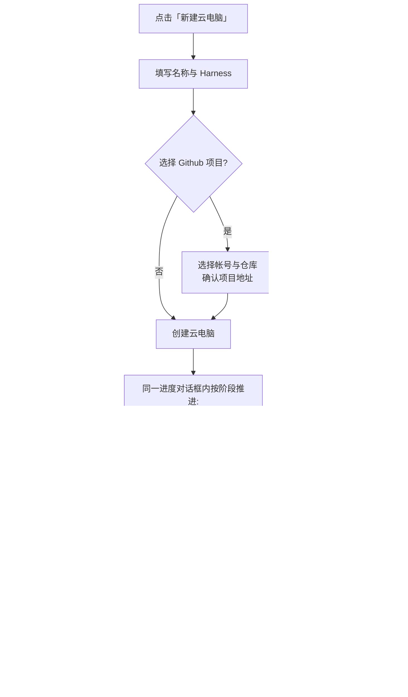
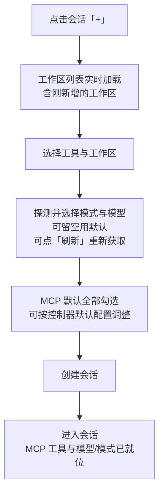

# 云容器优化一期

**功能名称**: 云容器优化一期
**PRD 版本**: v1.1
**创建日期**: 2026-10-22
**作者**: ZeroAsh Agent

> v1.1 变更（评审返工）：① 云电脑创建与 Github 项目准备的进度统一收进同一个进度对话框，云电脑创建作为其中第一个阶段展示；② 模式/模型选项改为短时有效（分钟级），模型库新增/启用/禁用/删除后立即失效，并在新建会话与工作流节点配置两处提供「刷新」按钮手动重取。

## 背景与目标

### 1.1 背景

云电脑（云端工作容器）已经具备「Git 项目设置」「MCP 工具」「Agent 工作流」「模型与模式切换」等能力，但一期使用中暴露出若干体验断点：

1. **新增内容「看不见」**：用户在「Git 项目设置」成功添加工作区后，回到会话点击「+」新建会话，下拉里找不到刚新增的工作区；同样，通过 MCP 智能助手创建了已配置工作流/工作流模板后，点击工作流的「+」也找不到刚创建的条目。用户必须整页刷新才能看到，容易误以为操作失败。
2. **初始化路径割裂**：拉起云容器（新建云电脑）时只能先建出一台空机器，Github 项目必须等机器就绪后再手动走一次「Git 项目设置」，无法在创建时就指定「这台机器要用来做哪个项目」。
3. **MCP 装配默认值缺失**：新建会话时 MCP 默认不装配，用户每建一个会话都要手动勾选一遍常用的 MCP 工具；「Git 项目设置」自动创建的会话更是完全拿不到 MCP，需要二次手工处理。
4. **模型与模式只能事后选**：拉起会话前无法预知这个工具下有哪些可用模式与模型，必须等会话起来后才能切换，选错成本高（尤其一个控制器上挂多个工具时）。

### 1.2 目标

- 新增的工作区、已配置工作流、工作流模板，在对应「+」对话框打开时即可看到最新列表，无需刷新页面。
- 新建云电脑时可以直接选择一个 Github 项目作为工作区，机器就绪后自动完成项目准备并创建会话。
- 新建会话默认注入 MCP（系统中的 MCP 默认全部启用），并在控制器设置中提供「默认注入 MCP」的选择能力；「Git 项目设置」自动创建的会话遵循同一设置。
- 拉起会话前即可探测并选择可用的模式与模型，与工作流节点配置使用同一套探测能力。

### 1.3 成功标准

- 在「Git 项目设置」添加工作区成功后，不刷新页面直接点会话「+」，能在工作区列表中选到该工作区并成功建会话。
- 通过 MCP 创建已配置工作流/工作流模板成功后，不刷新页面直接点工作流「+」，能在列表中看到并成功实例化。
- 新建云电脑时选择 Github 项目后，全过程无需再次打开「Git 项目设置」，且全程在同一进度对话框内可见，就绪即进入该项目的会话。
- 新建会话时 MCP 默认全部勾选（可调整），会话创建后 MCP 工具直接可用；「Git 项目设置」自动创建的会话同样带出默认 MCP。
- 新建会话对话框能在选定工具后展示可用模式与模型供前置选择，且与工作流节点配置看到的选项一致；模型库变化后立即可取到最新选项，并可手动刷新。

## 用户分析

### 2.1 目标用户

- 使用云电脑（云端工作容器）进行日常开发的个人开发者。
- 依赖 MCP 工具与 Agent 工作流完成多步骤任务的高级用户。
- 同一台机器上使用多个智能助手工具、需要精确选择模型与模式的开发者。

### 2.2 用户场景

| 场景 | 用户角色 | 目标 | 痛点 |
|--|--|--|--|
| 用「Git 项目设置」把 Github 仓库拉进云电脑后立即开工 | 云电脑开发者 | 马上为该项目建会话 | 会话「+」里看不到新工作区，被迫刷新页面 |
| 想让新云电脑一开机就绑定 Github 项目 | 云电脑开发者 | 创建即项目就绪 | 只能先建空机器，再补一次「Git 项目设置」 |
| 每天新建多个会话、都要用同一批 MCP 工具 | MCP 重度用户 | 新会话默认带上 MCP | 每个会话手动勾选，自动创建的会话更是没有 MCP |
| 拉起会话前想先指定模型与模式 | 多工具开发者 | 会话一开始就跑在正确的模型/模式上 | 只能等会话起来再切，浪费一次对话 |
| 让助手建好工作流模板后立刻实例化 | 工作流用户 | 顺手把流程跑起来 | 工作流「+」里看不到新建条目，误以为创建失败 |

## 功能需求

### 3.1 功能概述

本期围绕云容器的「拉起 → 选工作区 → 装 MCP → 选模型/模式 → 用工作流」链路做体验优化：让所有「+」对话框打开即最新、让云电脑创建即绑定 Github 项目、让 MCP 默认注入并可按控制器配置、让模型与模式在拉起会话前即可选择。

### 3.2 功能列表

#### 功能点 1: 会话「+」工作区列表实时刷新

- **描述**: 打开新建会话对话框时，工作区列表按最新数据加载；「Git 项目设置」成功添加的工作区立即出现在列表中，无需刷新页面。
- **用户价值**: 消除「加完工作区却找不到」的困惑，衔接上一步操作。
- **验收标准**:
  - [ ] 「Git 项目设置」成功后直接打开会话「+」，列表包含新增工作区，可选中并创建会话
  - [ ] 同一对话框反复打开，列表始终反映当前最新工作区（含删除后不再出现）
  - [ ] 列表刷新过程中不打断用户已填写的对话框内容

#### 功能点 2: 新建云电脑时初始化 Github 项目工作区

- **描述**: 「新建云电脑」对话框支持可选地直接选择一个 Github 项目作为工作区（选择帐号与仓库、确认项目地址）；提交后按「启动云电脑 → 工作负载设置 → Git 项目设置 → 会话创建」顺序自动推进，全程在同一个进度对话框中展示（云电脑创建是其中第一个阶段），完成后自动进入该项目会话，效果等同于创建后再执行一次「Git 项目设置」。
- **用户价值**: 一步到位，「创建云电脑 = 创建项目工作环境」，省去机器就绪后的二次操作与等待；进度只在一个对话框里，不用在多个界面间来回确认。
- **验收标准**:
  - [ ] 不选择项目时创建流程与现状完全一致
  - [ ] 选择项目后，四个阶段（启动云电脑 → 工作负载设置 → Git 项目设置 → 会话创建）在同一进度对话框内依次可见，完成后自动进入该项目会话
  - [ ] 云电脑启动阶段失败时明确提示并给出重建入口；项目准备阶段失败时云电脑仍可用，可就地重试或手动「Git 项目设置」，并可手动创建会话

#### 功能点 3: 新建会话默认注入 MCP 与控制器默认 MCP 设置

- **描述**: 新建会话时 MCP 默认全部启用（即默认注入系统中已启用的全部 MCP 服务，用户可取消勾选）；同时在控制器设置中新增「默认注入 MCP」配置，可指定该控制器下新建会话默认注入的 MCP 子集（默认为全部）。「Git 项目设置」等场景自动创建的会话同样按该设置注入。
- **用户价值**: 会话开箱即用，不必反复勾选；团队常用工具集可以按控制器固化。
- **验收标准**:
  - [ ] 新建会话对话框中 MCP 默认全选（或按控制器默认配置预选），可调整
  - [ ] 控制器设置中可配置默认注入的 MCP，保存后对该控制器后续新建会话生效
  - [ ] 「Git 项目设置」自动创建的会话带出默认 MCP，工具在会话内可直接使用
  - [ ] 关闭「默认全部」并清空选择时，新会话不注入任何 MCP（回到旧行为）

#### 功能点 4: 拉起会话前选择模型与模式

- **描述**: 新建会话选定智能助手工具后，即探测该工具可用的模式与模型（与工作流节点配置同一套探测结果），提供前置下拉选择；不选择时使用工具默认值。选项结果短时有效（分钟级），当用户在模型列表新增、启用、禁用或删除模型后立即失效重取；新建会话对话框与工作流节点配置均提供「刷新」按钮，点击立即重新获取最新选项。
- **用户价值**: 会话从第一句话就跑在目标模型/模式上，避免起错会话；刚调整过的模型马上可选，不必等缓存过期。
- **验收标准**:
  - [ ] 选定工具后展示可用模式与模型列表，可选「默认」
  - [ ] 选项与工作流节点配置中看到的保持一致
  - [ ] 探测未返回选项或仍在进行时，允许直接创建会话，不阻断
  - [ ] 选项提供「刷新」按钮（新建会话与工作流节点配置两处均有），点击后立即重新获取
  - [ ] 模型列表新增/启用/禁用/删除模型后，重新打开选择器即为最新选项

#### 功能点 5: 工作流「+」列表实时刷新

- **描述**: 打开实例化工作流对话框时，已配置工作流与工作流模板列表按最新数据加载；通过 MCP 智能助手创建的已配置工作流/模板立即可见。
- **用户价值**: 「助手建、自己用」无缝衔接，消除「创建了却找不到」的疑虑。
- **验收标准**:
  - [ ] 通过 MCP 创建已配置工作流/工作流模板后，直接打开工作流「+」即可看到新条目
  - [ ] 已删除的条目不再出现在列表中
  - [ ] 列表刷新不打断对话框内已填写的实例化参数

### 3.3 用户操作流程

创建云电脑并初始化 Github 项目：

新建会话（默认 MCP + 前置选择模型/模式）：

### 3.4 页面/界面描述

| 页面 | 描述 | 关键元素 |
|------|------|---------|
| 新建会话对话框 | 选择控制器/工具、工作区、模型与模式、MCP | 工作区列表（实时）、模式/模型下拉（含「默认」与「刷新」按钮）、MCP 多选（默认全选）、探测中提示 |
| 新建云电脑对话框 | 创建云电脑，可选初始化 Github 项目 | 名称、Harness、预装工作负载、Github 项目区块（帐号/仓库/项目地址预览） |
| 项目准备进度对话框 | 与「Git 项目设置」共用同一进度对话框，云电脑创建作为其中第一个阶段 | 阶段步骤条（启动云电脑 → 工作负载设置 → Git 项目设置 → 会话创建）、失败原因、重试/重建入口 |
| 控制器设置 | 新增默认 MCP 配置 | 「默认注入全部 MCP」开关、MCP 多选列表、保存 |
| 实例化工作流对话框 | 选择已配置工作流/模板并实例化 | 来源列表（实时）、实例化参数表单、模式/模型选项与「刷新」按钮 |

### 3.5 异常与边界情况

| 情况 | 预期行为 |
|------|---------|
| 列表刷新失败 | 保留上一次列表并提示刷新失败，可手动重试，不阻断对话框操作 |
| 「Git 项目设置」添加工作区后立即打开会话「+」 | 列表包含新工作区；若数据延迟，提供手动刷新 |
| 创建云电脑时选择的 Github 项目准备失败 | 云电脑保持可用，提示失败原因，可在进度对话框就地重试或手动「Git 项目设置」；用户仍可手动创建会话 |
| 云电脑启动失败（未进入项目准备） | 进度对话框停留在「启动云电脑」阶段并说明原因，提供重建入口 |
| 模型列表新增/启用/禁用/删除模型 | 选项立即失效，重新打开选择器即为最新结果 |
| 用户点击「刷新」 | 立即重新获取模式/模型选项（新建会话与工作流节点配置一致） |
| Github 帐号未绑定 / 仓库无权限 | 提示先去绑定帐号或更换仓库，不允许提交 |
| 多 Harness（不自动建会话）时选择 Github 项目 | 项目准备照常执行，跳过会话创建步骤 |
| MCP 服务在创建会话前被停用 | 自动从默认注入集合中剔除，不注入已停用的服务 |
| 控制器默认 MCP 中包含已删除的服务 | 忽略失效项，其余照常注入 |
| 探测不到可用模式/模型 | 该项仅提供「默认」，不影响会话创建 |
| 探测耗时较长 | 展示探测中提示，允许跳过选择直接创建 |

## 四、非功能需求

### 4.1 性能要求

- 各「+」对话框打开时的列表加载应体感即时（命中缓存先展示、后台刷新），刷新不得阻塞表单交互。
- 模式/模型探测结果按控制器与工具短时复用（分钟级），同一组合短时间内不重复探测；模型库发生变化立即失效，并提供手动刷新入口。

### 4.2 安全性要求

- Github 项目准备过程继续沿用最小化、仓库级、短时效的凭据下发方式，界面与记录中不得出现任何凭据内容。
- 默认 MCP 注入仅作用于用户自己的 MCP 服务范围，不得跨用户注入。

### 4.3 兼容性要求

- 既有「不选择 MCP 创建会话」的旧流程语义升级为「默认注入」，但用户显式取消勾选后仍可获得与旧行为一致的「不注入」结果。
- 存量控制器未配置默认 MCP 时视为「默认全部」，无需迁移数据。
- 存量会话不受影响，仅影响新创建的会话。

## 五、依赖与约束

### 5.1 依赖

- 云电脑（云端工作容器）与其「Git 项目设置」能力已上线。
- 可用模型与模式的探测能力（工作流节点配置已使用）保持稳定。
- MCP 注册中心（系统内 MCP 服务的启用/停用管理）保持稳定。

### 5.2 约束

- 云电脑「每用户同时最多 1 个实例」「停止即销毁」等既有生命周期约定不变。
- Github 项目准备沿用既有三步「工作负载设置 / Git 项目设置 / 会话创建」语义，本期不新增项目准备之外的能力。
- 模型与模式前置选择不改变会话内切换模型/模式的既有能力。

## 六、相关文档

- [[20261021-github-workload.md]] — Github 工作负载与云主机 Git 项目设置
- [[20261020-container-harness-support.md]] — 容器启动任务支持 harness 类型（云电脑）
- [[20261022-workload-optimization.md]] — 工作负载优化
- [[20260522-available-models-and-mode-switch.md]] — 可用模型与模式切换
- [[20260804-integrated-mcp-registry.md]] — 集成式 MCP 注册中心
- 技术提案：`docs/engineering/proposals/20261022-feat-cloud-container-optimization-phase1.md`
