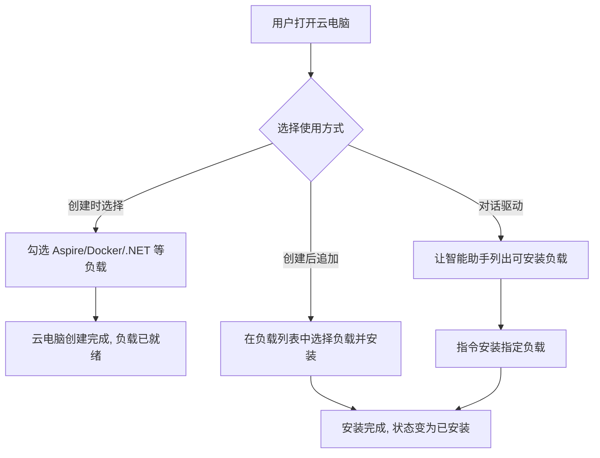
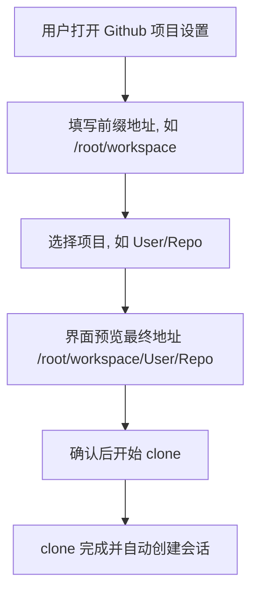

# 工作负载优化

**功能名称**: 工作负载优化
**PRD 版本**: v1.0
**创建日期**: 2026-10-22
**作者**: ZeroAsh Agent

## 背景与目标

### 1.1 背景

云电脑（云端工作容器）已经具备工作负载机制，并预制了 Docker、.NET、Aspire、Github 等工作负载。但目前存在两类体验缺口：

1. **云电脑负载的可见性与可用性不足**：用户在云电脑中想要使用 Aspire / Docker / .NET 环境时，缺少清晰的展示与使用入口——创建云电脑时无法选择这些负载，云电脑内的智能助手（MCP 通道）也未必能稳定地列出并安装它们。
2. **Github 工作负载的 clone 地址语义不直观**：用户在云电脑中设置 Github 项目时，需要自行计算并填写完整的最终 clone 目录，容易出错，也无法直观理解「项目会被放到哪个目录下」。

### 1.2 目标

- 用户在云电脑相关界面可以清晰地看到并可选择使用 Aspire / Docker / .NET 工作负载。
- 云电脑内的智能助手可以通过 MCP 通道列出可安装的负载（包含 Aspire / Docker / .NET），并按用户指令完成安装。
- 用户设置 Github 项目时，只需填写「前缀地址」并选择项目，最终 clone 地址自动由「前缀地址 + 项目名」拼接得出。

### 1.3 成功标准

- 用户能在云电脑负载列表中看到 Aspire、Docker、.NET 负载，且状态（可安装/已安装）展示正确。
- 在云电脑会话中通过智能助手要求「安装 Docker」时，助手能列出并安装对应负载，安装成功后负载状态变为「已安装」。
- 用户填写前缀地址 `/root/workspace` 并选择项目 `User/Repo` 后，项目被 clone 到 `/root/workspace/User/Repo`，且后续会话工作目录指向该地址。

## 用户分析

### 2.1 目标用户

- 使用云电脑进行日常开发的个人开发者。
- 需要在云电脑中运行 .NET / Aspire 技术栈项目的开发者。
- 通过云电脑处理 Github 仓库任务的开发者。

### 2.2 用户场景

| 场景 | 用户角色 | 目标 | 痛点 |
|--|--|--|--|
| 在云电脑中开发 Aspire 项目 | 开发者 | 快速获得可用的 Aspire 运行环境 | 不知道云电脑支持哪些负载，创建时无法选择，需要手动摸索 |
| 让智能助手帮忙准备环境 | 开发者 | 通过对话让助手列出并安装所需负载 | 助手无法感知可用负载列表，安装能力不稳定 |
| 在云电脑中拉取 Github 项目 | 开发者 | 指定一个工作根目录后自动按项目名归置 | 需要自行拼接完整 clone 路径，填写繁琐且易错 |

## 功能需求

### 3.1 功能概述

本需求包含两部分：一是让云电脑的负载能力（尤其是 Aspire / Docker / .NET）在展示、选择、MCP 通道三个层面完整可用；二是将 Github 项目设置的 clone 地址从「填写最终目录」改为「填写前缀地址 + 选择项目自动拼接」。

### 3.2 功能列表

#### 功能点 1: 云电脑负载展示支持 Aspire / Docker / .NET

- **描述**: 在云电脑的负载相关界面中，用户可以清晰地看到 Aspire、Docker、.NET 等负载，了解其用途、参数与安装状态；创建云电脑时可以选择需要预装的负载，创建后也可以在云电脑设置中追加安装。
- **用户价值**: 用户对环境能力一目了然，按需装配，避免「装了用不上」或「想用找不到」。
- **验收标准**:
  - [ ] 云电脑负载列表中能看到 Aspire、Docker、.NET 负载，且分类/用途展示清晰。
  - [ ] 负载的安装状态（未安装/安装中/已安装）展示正确。
  - [ ] 创建云电脑时可勾选 Aspire / Docker / .NET 负载，创建完成后负载已就绪。
  - [ ] 已创建的云电脑可在设置中追加安装上述负载。

#### 功能点 2: 云电脑 MCP 通道支持负载列出与安装

- **描述**: 云电脑会话中的智能助手可通过 MCP 通道获取当前云电脑可安装的负载列表（包含 Aspire / Docker / .NET），并能按用户指令安装指定负载、反馈安装结果。
- **用户价值**: 用户无需离开对话即可让助手准备好开发环境。
- **验收标准**:
  - [ ] 助手列出的负载清单与界面展示的可用负载一致（含 Aspire / Docker / .NET）。
  - [ ] 用户通过对话发出安装指令后，对应负载安装成功，界面状态同步更新。
  - [ ] 安装失败时助手能向用户反馈明确的原因。

#### 功能点 3: Github 项目 clone 地址前缀拼接

- **描述**: 用户在云电脑中设置 Github 项目时，填写「前缀地址」（即工作根目录）并选择要使用的项目（形如 `User/Repo`）；最终 clone 地址自动为「前缀地址/项目」。例如前缀地址 `/root/workspace`、项目 `User/Repo`，最终地址为 `/root/workspace/User/Repo`。
- **用户价值**: 目录归置规则统一、可预期，用户只需维护一个工作根目录。
- **验收标准**:
  - [ ] 设置界面以「前缀地址 + 项目选择」的形式呈现，并实时预览最终 clone 地址。
  - [ ] 前缀地址 `/root/workspace` + 项目 `User/Repo` 最终 clone 到 `/root/workspace/User/Repo`。
  - [ ] clone 完成后自动创建的会话工作目录指向最终地址。
  - [ ] 前缀地址为空或非法时给出明确提示，不允许提交。

### 3.3 用户操作流程

### 3.4 页面/界面描述

| 页面 | 描述 | 关键元素 |
|------|------|---------|
| 云电脑创建 | 创建云电脑时选择 harness 之外，可勾选需要预装的负载 | 负载勾选项、负载用途说明 |
| 云电脑负载列表/设置 | 展示全部可用负载及安装状态，支持追加安装 | 负载名称、分类（如环境类/工具类）、用途说明、安装状态、安装按钮 |
| Github 项目设置 | 设置 Github 项目 clone 与自动建会话 | 前缀地址输入框、项目选择、最终地址预览 |

### 3.5 异常与边界情况

| 情况 | 预期行为 |
|------|---------|
| 负载安装失败（如网络问题） | 界面展示失败状态与原因，允许重试 |
| 助手安装已安装的负载 | 提示已安装，不重复执行 |
| 前缀地址为空 | 提示必填，不允许提交 |
| 前缀地址为非法路径（非绝对路径） | 提示需以 `/` 开头，不允许提交 |
| 前缀地址末尾带 `/` | 自动规整，不产生双斜杠路径 |
| 项目已 clone 到同一最终地址 | 提示该地址已存在绑定/目录，由用户确认后继续或取消 |
| 用户此前已用旧的「完整目录」方式设置过项目 | 既有绑定保持可用，不受新拼接规则影响 |

## 四、非功能需求

### 4.1 性能要求

- 负载列表加载不超过 2 秒。
- 负载安装进度需要可感知（安装中状态），不要求实时百分比。

### 4.2 安全性要求

- Github 项目 clone 继续沿用最小化凭据机制，不因路径规则调整而扩大凭据权限。
- 前缀地址仅允许容器内绝对路径，需防止路径穿越类输入（如 `../`）。

### 4.3 兼容性要求

- 已创建的 Github 项目绑定（旧的完整目录语义）保持可用。
- 不破坏现有 harness 类型云电脑的创建流程。

## 五、依赖与约束

### 5.1 依赖

- 既有工作负载机制（负载定义、依赖展开、运行时安装）。
- 既有 Github 帐号绑定与凭据管理能力。

### 5.2 约束

- 云电脑环境位于内网，软件安装依赖内网代理通道，负载脚本须遵循既有代理约定。
- 产品文档不包含技术实现细节，实现方案以关联技术提案为准。

## 六、相关文档

- [[20261021-github-workload.md|Github 工作负载与云主机 Git 项目设置]]
- [[20261018-workload-phase1.md|工作负载一期（参数、依赖与预制工作负载）]]
- [[20261020-container-harness-support.md|容器启动任务支持 harness 类型]]
- 技术提案：`docs/engineering/proposals/20261022-feat-workload-optimization.md`
