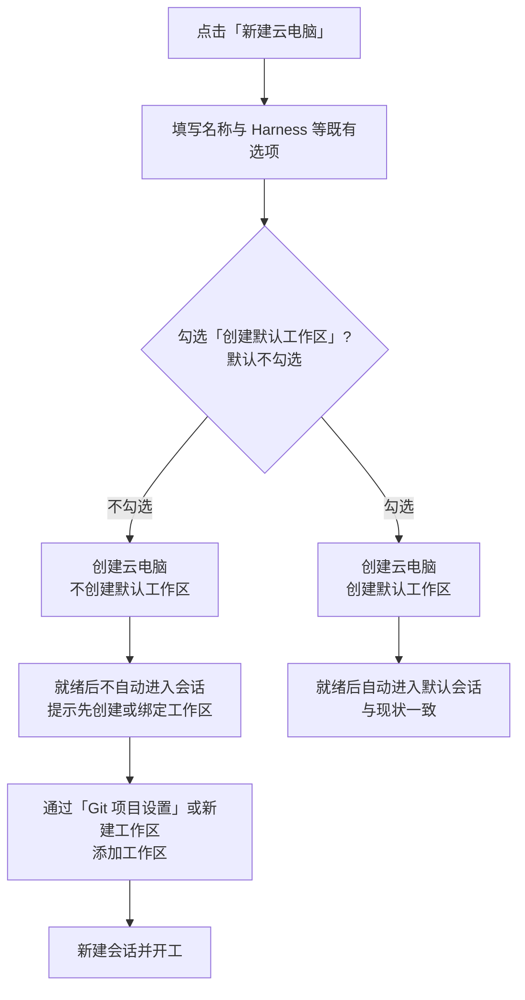
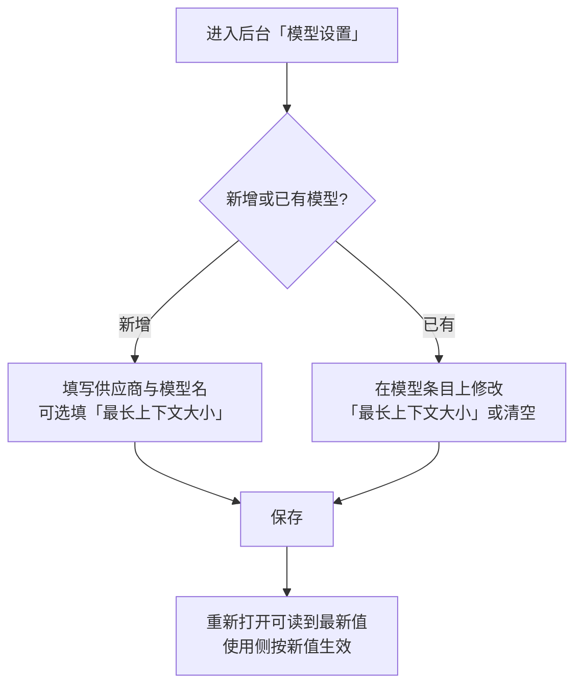

# 云容器优化二期

**功能名称**: 云容器优化二期
**PRD 版本**: v1.0
**创建日期**: 2026-10-23
**作者**: ZeroAsh Agent

## 背景与目标

### 1.1 背景

云容器优化一期正在如火如荼的进行中，本期并行推进三项二期优化。这三项都来自云电脑日常使用的实际反馈：

1. **默认工作区是「噪音」**：目前新建的云电脑总会自动创建一个 `/root/workspace` 默认工作区。但多数用户要么用「Git 项目设置」绑定 Github 项目目录、要么用自己的目录，这个凭空多出来的默认工作区既用不上，又出现在工作区列表里，用户还要额外去清理，容易误以为是自己创建的。
2. **模型上下文能力不透明**：后台的模型设置只有名称、启用/禁用、排序与定价，没有「模型最长上下文大小」。同一个供应商往往同时提供长上下文与短上下文的模型，管理员无法把各模型的上下文窗口固化在系统里，选择模型时缺少依据。
3. **云电脑磁盘没有上限**：云电脑模板没有限制临时存储（ephemeral-storage）大小，一台云电脑可以把所在节点的磁盘吃满，影响同一节点上的其它云电脑。

### 1.2 目标

- 新建云电脑默认**不再**创建 `/root/workspace` 默认工作区；仅当用户在创建时勾选「创建默认工作区」才创建，默认不勾选。
- 后台模型设置中每个模型可配置「最长上下文大小」，可在新增模型时填写，也可对已有模型随时修改或清空。
- 云电脑模板的临时存储（ephemeral-storage）上限固定为 10G，单台云电脑磁盘用量超限时被终止，不再拖垮同节点其它云电脑。

### 1.3 成功标准

- 新建云电脑（不勾选任何选项）后，该云电脑的工作区列表为空，不再出现 `/root/workspace`。
- 勾选「创建默认工作区」后创建的云电脑，行为与现状完全一致（有默认工作区，就绪后可直接进入默认会话）。
- 在后台为某模型设置最长上下文后，重新打开该模型的设置能读到同样的值；清空后恢复「未设置」状态。
- 新建的云电脑实例在集群侧的资源约束中能看到临时存储上限 10G；模拟磁盘写满时该云电脑按平台既有失败语义终止，且不影响同节点其它云电脑。

## 用户分析

### 2.1 目标用户

- 使用云电脑（云端工作容器）进行日常开发、习惯用「Git 项目设置」绑定项目的个人开发者。
- 管理多供应商、多模型的平台管理员（后台模型设置的使用者）。
- 同一节点上并行运行多台云电脑、关心资源隔离的团队用户。

### 2.2 用户场景

| 场景 | 用户角色 | 目标 | 痛点 |
|--|--|--|--|
| 新建一台云电脑专门做 Github 项目 | 云电脑开发者 | 工作区列表只有项目目录 | 平台凭空多一个 `/root/workspace`，要手动清理 |
| 新建一台云电脑临时跑个任务，不需要工作区 | 云电脑开发者 | 干净的初始状态 | 强制预置的工作区无处可用 |
| 少数场景仍希望开机就有一个可用工作区 | 云电脑开发者 | 一步拿到默认工作区 | 只能事后手动新建，多一步 |
| 在后台维护一批模型，长短上下文混杂 | 平台管理员 | 把每个模型的上下文窗口固化下来 | 模型设置里没有这个字段，只能记在别处 |
| 某台云电脑磁盘写满 | 团队用户 | 不影响其它云电脑 | 磁盘无上限，一台机器拖垮整节点 |

## 功能需求

### 3.1 功能概述

本期做三件事：让云电脑的初始工作区由用户决定（默认不建）、让模型的最长上下文大小可在后台配置、让每台云电脑的临时存储有 10G 硬上限。

### 3.2 功能列表

#### 功能点 1: 新建云电脑可选「创建默认工作区」，默认不勾选

- **描述**: 「新建云电脑」对话框新增「创建默认工作区」勾选项，**默认不勾选**。不勾选时，创建出的云电脑不带任何默认工作区（工作区列表为空）；勾选时才创建默认工作区（即现状行为）。未创建默认工作区的云电脑就绪后不自动进入会话，用户通过「Git 项目设置」或工作区管理添加工作区后再新建会话。
- **用户价值**: 初始状态由用户决定，不再有来路不明的 `/root/workspace`；绑定项目为主的用户少一步清理，临时用户拿到干净环境。
- **验收标准**:
  - [ ] 「新建云电脑」对话框中出现「创建默认工作区」勾选项，默认不勾选
  - [ ] 不勾选创建后，该云电脑的工作区列表为空，任何入口都不出现 `/root/workspace`
  - [ ] 勾选创建后，行为与现状一致：有默认工作区，就绪后自动进入默认会话
  - [ ] 不勾选时，就绪后不自动进入会话，界面明确提示「未创建默认工作区，请先创建或绑定工作区」，并给出「Git 项目设置」/新建工作区入口
  - [ ] 不勾选时，用户随后通过「Git 项目设置」或新建工作区，可正常创建会话并开工

#### 功能点 2: 后台模型设置支持「模型最长上下文大小」

- **描述**: 后台模型设置中，每个模型可配置「最长上下文大小」（单位：token，正整数，可留空表示未设置）。新增自定义模型时可直接填写；已有模型可随时修改或清空。该值随模型配置生效，供平台其它部分参考模型的上下文能力。
- **用户价值**: 长短上下文模型的差异被显式记录，管理员不必再靠人工记忆维护模型能力清单。
- **验收标准**:
  - [ ] 新增自定义模型时可选填「最长上下文大小」
  - [ ] 已有模型可修改该值，保存后重新打开能看到最新值
  - [ ] 可清空该值，清空后回到「未设置」状态
  - [ ] 填写 0、负数或非数字时不允许保存，并给出明确提示
  - [ ] 该值随模型配置一起下发到使用侧（如云电脑内的模型能力配置），未设置的模型不受影响

#### 功能点 3: 云电脑模板临时存储（ephemeral-storage）上限 10G

- **描述**: 更新云电脑模板，云电脑的临时存储（ephemeral-storage）最大 10G：单台云电脑可写磁盘上限为 10G，超过上限时该云电脑被终止并按平台既有失败语义展示。
- **用户价值**: 资源隔离，一台云电脑的磁盘滥用不再影响同节点其它云电脑；节点磁盘被吃满导致的整机故障大幅减少。
- **验收标准**:
  - [ ] 新建云电脑后，在集群侧查看该实例的资源约束，ephemeral-storage 上限为 10G
  - [ ] 云电脑磁盘用量达到 10G 时，该云电脑按平台既有失败语义终止并在界面可见（可重建）
  - [ ] 同节点其它云电脑不受影响
  - [ ] 存量云电脑不受影响（仅对新建生效）

### 3.3 用户操作流程

新建云电脑（默认不创建工作区）：

后台设置模型最长上下文大小：

### 3.4 页面/界面描述

| 页面 | 描述 | 关键元素 |
|------|------|---------|
| 新建云电脑对话框 | 创建云电脑，在既有选项基础上新增默认工作区开关 | 名称、Harness 等既有选项、「创建默认工作区」勾选项（默认不勾选）、就绪后提示文案与入口 |
| 后台模型设置 | 模型列表与新增/编辑模型 | 模型条目上的「最长上下文大小」展示与编辑、新增模型表单中的可选「最长上下文大小」输入、清空操作、非法值提示 |
| 云电脑详情/状态 | 展示云电脑生命周期状态 | 磁盘写满终止后的失败提示（沿用既有失败语义） |

### 3.5 异常与边界情况

| 情况 | 预期行为 |
|------|---------|
| 未勾选「创建默认工作区」时云电脑就绪 | 不自动进入会话，提示「未创建默认工作区」，给出「Git 项目设置」/新建工作区入口 |
| 未勾选「创建默认工作区」，但沿用其它开关（如 Github 项目、预装工作负载） | 各选项彼此独立，可自由组合；Github 项目准备照常创建项目目录作为工作区 |
| 勾选「创建默认工作区」 | 与现状完全一致（默认工作区 + 就绪后默认会话） |
| 最长上下文大小留空 | 表示「未设置」，使用侧视为未知，不做任何限制性处理 |
| 最长上下文大小填 0 / 负数 / 非数字 | 不允许保存，提示「请输入正整数」 |
| 清空已设置的最长上下文 | 回到「未设置」状态，使用侧不再按上下文能力处理该模型 |
| 云电脑磁盘用量达到 10G | 该云电脑被终止并按平台既有失败语义展示，可重建；同节点其它云电脑不受影响 |
| 存量云电脑 / 存量模型 | 均不受影响：存量云电脑保持原有资源口径，存量模型的最长上下文视为「未设置」，无需迁移 |
| 一期能力同时使用 | 本期选项与一期的「Github 项目初始化」「预装工作负载」「默认 MCP」等互不影响 |

## 四、非功能需求

### 4.1 性能要求

- 「创建默认工作区」开关不引入可感知的创建耗时差异（勾选/不勾选的创建时长体感一致）。
- 模型最长上下文的保存与读取为常规后台配置操作，保存后立即可读到最新值。

### 4.2 安全性要求

- 最长上下文大小仅是模型能力配置，不得改变既有的凭据下发与最小化授权口径。
- 临时存储上限属于资源隔离手段，不得被用来绕过既有的资源与配额约束（每用户 1 个活跃云电脑等）。

### 4.3 兼容性要求

- 默认行为变更（不再默认创建工作区）为**有意的体验变更**：存量云电脑不受影响，仅新建云电脑的默认行为改变；需要旧行为的用户勾选「创建默认工作区」即可完全等价。
- 存量模型数据无需迁移：未设置最长上下文的模型即「未设置」。
- 临时存储上限仅作用于新建云电脑，存量云电脑不追溯调整。

## 五、依赖与约束

### 5.1 依赖

- 云电脑（云端工作容器）与「Git 项目设置」能力已上线（一期继续在研，本期不依赖其未完成部分）。
- 后台模型设置（供应商与模型管理）已上线。

### 5.2 约束

- 云电脑「每用户同时最多 1 个实例」「停止即销毁」等既有生命周期约定不变。
- 「创建默认工作区」只决定是否创建默认工作区，不改变工作区管理、会话创建的既有规则（会话必须绑定工作区，工作区数量上限等不变）。
- 临时存储上限 10G 为固定口径，本期不做按套餐/按用户差异化配置。

## 六、相关文档

- [[20261022-cloud-container-optimization-phase1.md]] — 云容器优化一期（并行在研）
- [[20261022-workload-optimization.md]] — 工作负载优化
- [[20261020-container-harness-support.md]] — 容器启动任务支持 harness 类型（云电脑）
- [[20261020-api-channel-model-fixes.md]] — 内建 API 渠道一期上线后问题修复（供应商与模型管理）
- 技术提案：`docs/engineering/proposals/20261023-feat-cloud-container-optimization-phase2.md`
