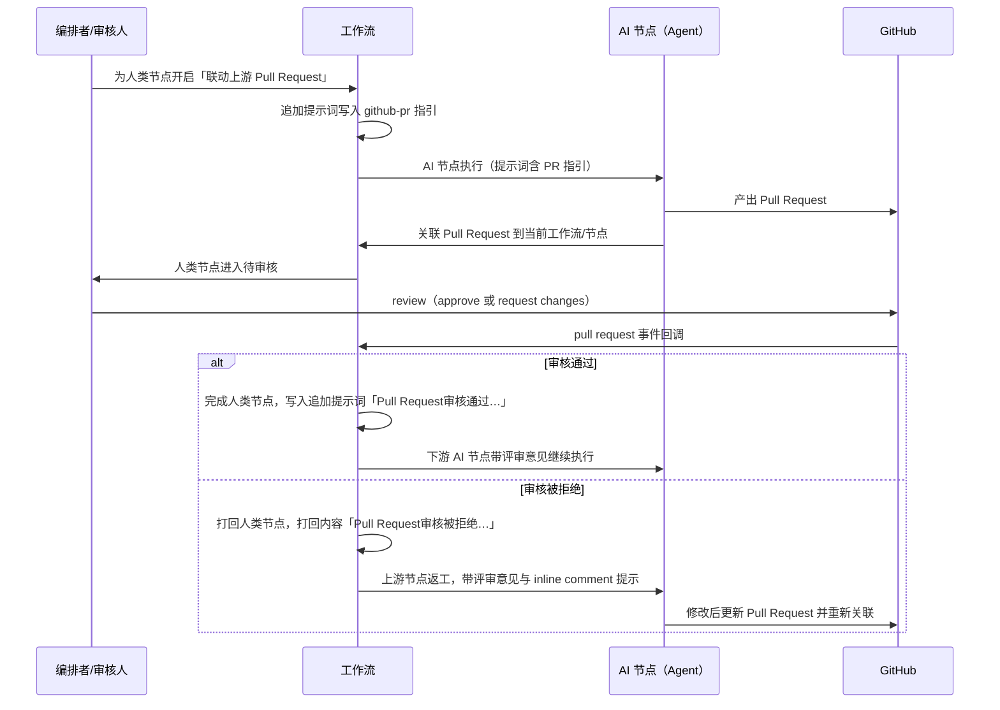
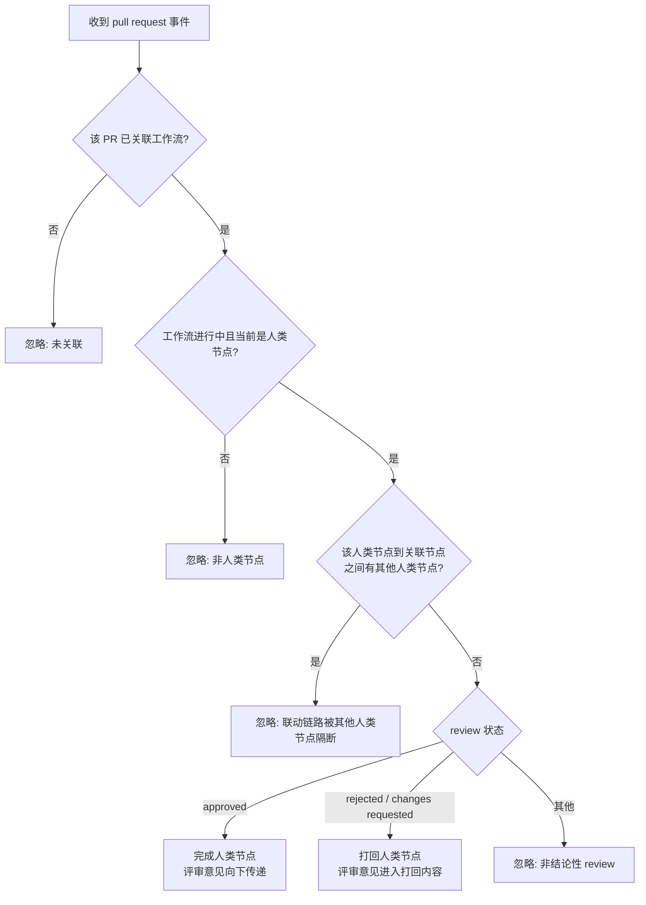

# 工作流 GitHub Pull Request 联动

**功能名称**: 工作流 GitHub Pull Request 联动
**PRD 版本**: v1.0
**创建日期**: 2026-10-23
**作者**: ZeroAsh Agent

## 背景与目标

### 1.1 背景

平台已具备本需求所需的两块基础能力：

1. **GitHub 接入**：前台用户可绑定 GitHub 帐号并授权仓库（见 [[20260709-github-account-binding]]），云主机工作区可一键设置 GitHub 项目并获得长期可用的 gh/git 能力（见 [[20261021-github-workload]]）。Agent 可以直接向 GitHub 提交 Pull Request。
2. **Agent 工作流**：工作流支持模板 → 已配置工作流 → 实例化的三级结构，人类节点与 AI 节点编排、产物黑板、打回与返工、归档等能力（见 [[20260808-agent-workflow]]、[[20260811-agent-workflow-phase2]]、[[20260821-workflow-optimization]]）。

但两个世界是割裂的：

1. **工作流不知道 Pull Request 的存在**。AI 节点把产物（产品文档、技术提案、实现代码）提交成 Pull Request 后，Pull Request 与工作流节点之间没有任何关联，只能靠产物里手写 PR 地址。
2. **审核结果无法回流**。审核人在 GitHub 上完成 review（通过 / 拒绝）后，仍需回到工作流界面手工点击「完成」或「打回」，审核意见还要人工搬运，容易漏、慢、且与 PR 上的 inline comment 脱节。
3. **AI 节点缺少 PR 协作语境**。AI 节点不知道本工作流正在和哪个 Pull Request 协作、收到审核意见后该做什么，产出与返工全靠提示词里的一句话描述。

在 GitHub 项目的工作区中实例化的工作流尤其需要打通这条链路：让 Pull Request 的评审直接驱动工作流流转。

### 1.2 目标

- 工作流实例可以与 GitHub Pull Request 建立关联；关联关系随工作流完成、归档自动解除。
- 人类节点可开启「联动上游 Pull Request」：该节点的审核结论可由其联动的 Pull Request 在 GitHub 上的 review 结果驱动——审核通过则自动完成该节点并把评审意见传递给下游；审核被拒绝则自动打回。
- 工作流新增「追加提示词」：工作流级别的 key-value 补充上下文，在 AI 节点执行前拼接进提示词，同一个 key 只插入一次。
- 勾选「联动上游 Pull Request」（即「监听 Pull Request」）的节点，会让工作流插入一段指导 AI 使用 GitHub PR 相关工具的提示词（key=`github-pr`），保证 AI 主动完成 PR 关联并在收到审核意见后正确处置。

### 1.3 成功标准

- 在 GitHub 项目工作区中实例化的工作流里，AI 节点产出 Pull Request 后能将其关联到当前工作流与节点；工作流实例详情可查看当前关联的 Pull Request。
- 人类节点开启「联动上游 Pull Request」后：
  - 审核人在 GitHub 上批准（approve）该 Pull Request，工作流中该人类节点自动完成，下游节点能收到包含评审意见与 PR 地址的提示词；
  - 审核人请求修改 / 拒绝（changes requested）该 Pull Request，该人类节点自动打回，打回内容包含评审意见、PR 地址并提醒检查 inline comment。
- 关联只在工作流进行中有效：工作流完成或归档后，Pull Request 事件不再影响工作流，关联自动解除。
- 无关事件安全忽略：未关联的 PR、当前不是人类节点、联动链路中存在其他人类节点、重复投递的事件，均不改变工作流状态，并有明确的忽略原因可追溯。
- 追加提示词同一 key 在一次提示词拼接中只出现一次；重复写入同 key 视为更新，不产生重复段落。
- 未开启联动的工作流行为与现状完全一致，无回归。

## 用户分析

### 2.1 目标用户

- **工作流编排者**：创建/编辑工作流模板与已配置工作流，决定哪些人类节点联动 Pull Request。
- **人类节点审核人**：在 GitHub 上 review Pull Request，期望自己的评审结论直接驱动工作流。
- **Agent（AI 节点执行体）**：产出 Pull Request、关联 Pull Request、按评审意见返工。
- **工作流观察者**：查看工作流实例进展、关联的 Pull Request 与追加提示词。

### 2.2 用户场景

| 场景 | 用户角色 | 目标 | 痛点 |
|--|--|--|--|
| AI 产出 PR 后关联工作流 | Agent | 把本次产出的 Pull Request 与当前工作流/节点绑定 | PR 与工作流脱节，只能手写地址 |
| 审核通过驱动流转 | 审核人 | 在 GitHub 上 approve 后工作流自动继续 | 需要回到工作流手工点「完成」，评审意见还要人工搬运 |
| 审核拒绝自动打回 | 审核人 | 在 GitHub 上 request changes 后工作流自动打回返工 | 打回原因与 PR 上的评论（含 inline comment）脱节，返工漏改 |
| 配置联动节点 | 工作流编排者 | 在模板/配置/实例化时为人类节点开启「联动上游 Pull Request」 | 无此能力，只能口头约定 |
| AI 感知 PR 协作规则 | Agent | 知道何时关联 PR、收到审核意见后如何处理 | 提示词缺失，AI 行为不稳定 |
| 工作流收尾 | 工作流观察者 | 工作流完成/归档后不再被 PR 事件打扰 | 历史 PR 事件误触发旧工作流 |

## 功能需求

### 3.1 功能概述

本期打通「工作流 ↔ GitHub Pull Request」双向链路：

1. **上行**：Agent 把 AI 节点产出的 Pull Request 关联到工作流实例与节点（工作流完成、归档时自动解除）。
2. **下行**：Pull Request 的 review 结果（通过 / 拒绝）驱动被联动的人类节点完成或打回，评审意见以统一文案向下传递。
3. **语境**：通过工作流「追加提示词」机制，把 PR 工具使用指引（key=`github-pr`）与 PR 审核结论（key=`github-pr-review`）拼接进 AI 节点的提示词。

### 3.2 功能列表

#### 功能点 1: Pull Request 关联（Agent 侧）

- **描述**: AI 节点在创建（或确认复用）GitHub Pull Request 后，可通过工作流内置的关联工具，把「当前工作流实例 + 当前节点」与该 Pull Request 登记为联动关系。关联关系属于工作流实例：
  - 同一节点重复关联视为更新（以最后一次为准）；
  - 一个工作流可以关联多个 Pull Request，各自独立生效；
  - 工作流**完成**或**归档**时，该工作流的全部关联自动解除，此后该 Pull Request 的事件不再影响此工作流。
- **用户价值**: Pull Request 与工作流节点建立可查询的绑定，为审核结果回流提供依据。
- **验收标准**:
  - [ ] AI 节点按提示词指引调用关联工具后，工作流实例详情中可见该 Pull Request（标识与地址）及其所属节点。
  - [ ] 关联不存在的工作流/节点、或关联到非当前工作流时被拒绝，并给出可理解的原因。
  - [ ] 工作流完成后，该 Pull Request 的后续事件不影响工作流；归档后同样不受影响。

#### 功能点 2: 人类节点「联动上游 Pull Request」设置

- **描述**: 在**工作流模板**、**已配置工作流**、**实例化工作流**三个环节，人类节点新增设置「联动上游 Pull Request」（勾选后该节点即「监听 Pull Request」节点），默认不勾选：
  - 设置随模板 → 已配置工作流 → 实例逐层传递，实例中尚未开始的人类节点可单独调整；
  - 含义：该人类节点的审核结论可由其上游 AI 节点（下称「PR 触发节点」，即与该人类节点之间没有其他人类节点的、关联了 Pull Request 的上游节点）所关联 Pull Request 的 review 结果驱动；
  - 仅人类节点可配置该设置；AI 节点、标志节点不提供。
- **用户价值**: 编排者可以把「GitHub 上的评审」直接声明为工作流中某个审批节点的通过/打回依据。
- **验收标准**:
  - [ ] 模板、已配置工作流、实例化三个环节的人类节点均可看到并切换该设置；未勾选时行为与现状一致。
  - [ ] 实例化后该设置随节点快照保存；实例中未开始的人类节点可修改，已开始/已完成节点不允许修改。
  - [ ] 勾选该设置后，工作流的追加提示词中出现 key=`github-pr` 的指引提示词（见功能点 4）。

#### 功能点 3: 工作流追加提示词

- **描述**: 工作流实例维护一份 key-value 的「追加提示词」字典：
  - 「AI」节点在执行前拼接提示词时，会把工作流的追加提示词追加到上下文中；
  - **同一个 key 只插入一次**：重复写入同一 key 视为更新（覆盖旧值），一次拼接中不会出现两段同 key 内容；
  - 实例详情可查看当前追加提示词（key 与内容）；
  - 本期写入方：功能点 4 的 PR 指引提示词、功能点 5 的审核结论提示词。
- **用户价值**: 工作流级别的补充上下文有了统一、可控、不重复的注入通道。
- **验收标准**:
  - [ ] AI 节点执行时的提示词末尾包含工作流追加提示词内容，且每个 key 只出现一次。
  - [ ] 同 key 再次写入后，AI 节点上下文中只保留最新内容。
  - [ ] 实例详情可查看追加提示词。

#### 功能点 4: 「监听 Pull Request」节点注入 PR 工具使用指引（key=github-pr）

- **描述**: 勾选「联动上游 Pull Request」（监听 Pull Request）的节点，会使工作流插入一段提示词：key=`github-pr`，value 为「指导 AI 使用 GitHub PR 相关工具」的提示词（何时关联、如何关联、关联后的效果、收到审核意见后如何处置）。文案定稿见「附录 A：提示词文案」。该条目受追加提示词「同 key 只插入一次」约束：多个节点勾选也只插入一段；全部取消勾选后移除。
- **用户价值**: AI 节点稳定地完成 PR 关联与审核意见处置，不依赖人工提醒。
- **验收标准**:
  - [ ] 勾选后 AI 节点提示词中包含 `github-pr` 指引；未勾选任何节点的工作流不包含该段。
  - [ ] 指引内容覆盖：关联时机、关联所需信息、关联效果、收到审核意见后的处理要求。

#### 功能点 5: Pull Request 审核事件驱动人类节点流转

- **描述**: 平台接收 pull request 类型的事件回调后，按下列条件处理：
  1. 事件对应的 Pull Request 已关联到某工作流实例与节点，否则忽略；
  2. 该工作流实例当前节点是人类节点，否则忽略；
  3. 该人类节点到关联节点之间没有其他人类节点（保证处理的是「正在等这个 PR 评审」的那个节点），否则忽略；
  4. 按 Pull Request 的 review 状态执行：
     - **审核通过（approved）**：完成该人类节点，并将评审意见作为追加提示词向下传递，提示词结构为「Pull Request审核通过\n{comment}\n详情请查看pull request:{pr地址}」（完整文案见附录 A.2）；
     - **审核被拒绝（rejected / changes requested）**：打回该人类节点，打回内容为「Pull Request审核被拒绝\n{comment}\n详情请查看pull request:{pr地址}\n注意检查pr的inline comment」（完整文案见附录 A.3），驱动上游节点返工。
  5. 其他 review 状态（如仅评论）忽略；同一事件重复投递只处理一次。
- **用户价值**: GitHub 上的评审结论零搬运地驱动工作流流转，评审意见（含 inline comment 提示）完整进入返工上下文。
- **验收标准**:
  - [ ] approved 事件：联动人类节点自动完成，下游节点收到含评审意见与 PR 地址的追加提示词。
  - [ ] rejected 事件：联动人类节点被打回，上游节点收到含评审意见、PR 地址与「注意检查 pr 的 inline comment」的打回内容并进入返工。
  - [ ] 不满足条件 1–3 的事件不改变任何节点状态，且记录可解释的忽略原因。
  - [ ] 同一事件重复投递，工作流状态只变化一次。

### 3.3 用户操作流程





### 3.4 页面/界面描述

| 页面 | 描述 | 关键元素 |
|------|------|---------|
| 工作流模板 / 已配置工作流的节点编辑 | 人类节点新增联动设置 | 「联动上游 Pull Request」开关（仅人类节点可见） |
| 实例化工作流（节点图编辑） | 实例化前可调整人类节点联动设置 | 同上，默认继承配置值 |
| 实例节点列表 / 节点详情 | 展示联动状态、关联的 Pull Request 与追加提示词 | 联动标记、关联 PR 标识与地址、追加提示词（key 与内容，只读） |
| GitHub Pull Request 页 | 审核人操作（外部系统） | review（approve / request changes）与评论、inline comment |

### 3.5 异常与边界情况

| 情况 | 预期行为 |
|------|---------|
| PR 事件对应的 Pull Request 未关联任何工作流 | 忽略，不报错，不改变任何状态 |
| 工作流已完成、归档或删除后收到 PR 事件 | 忽略，且自动解除该工作流的关联 |
| 工作流当前节点不是人类节点（AI/标志节点运行中） | 忽略，记录原因 |
| 当前人类节点与关联节点之间存在其他人类节点 | 忽略（该 PR 属于更早阶段的审批），记录原因 |
| 同一 review 事件重复投递 | 幂等：只处理一次，状态不重复变化（实例锁内重读登记行去重） |
| 并行分支下存在多个 READY/RUNNING 节点 | 忽略（无法判定唯一当前人类节点），记录 `CURRENT_NODE_AMBIGUOUS`；需人工推进到唯一人类节点 |
| 人类节点处于 REWORK（已被打回待重新提交） | 事件不驱动，保持 REWORK，等待人工重新提交；重新关联新 PR 后的评审结果继续生效 |
| 同一节点重复关联 / 更换新的 Pull Request | 以最后一次关联为准，旧关联被覆盖 |
| 一个工作流关联多个 Pull Request | 各自独立匹配事件，互不影响 |
| 同一 Pull Request 先到 rejected 后到 approved（或相反） | 以先到达并满足条件的事件为准；节点状态已变化后到达的事件忽略 |
| review 状态为仅评论等非结论状态 | 忽略，不驱动流转 |
| 打回后返工、重新提交 Pull Request | 重新关联后，新 Pull Request 的评审结果继续驱动该人类节点 |
| 追加提示词同 key 多次写入 | 覆盖更新，AI 节点上下文中只保留最新内容、只出现一次 |
| 事件回调缺少必要字段或格式非法 | 拒绝处理并提示原因，不影响既有状态 |
| 多个工作流关联同一 Pull Request | 各实例按各自联动链路独立判定，分别生效或忽略 |

## 四、非功能需求

### 4.1 性能要求

- 事件回调的接收与处理应在秒级完成并反映到工作流状态（正常情况下 5 秒内可见节点流转）。
- 追加提示词与关联登记不增加 AI 节点执行的可感延迟；关联/事件处理不得阻塞工作流其他节点的运行。

### 4.2 安全性要求

- 事件回调来源必须鉴权：仅接受携带合法凭据（平台签发的回调凭据或 GitHub 官方签名校验）的请求，未通过校验的请求直接拒绝。
- 关联与事件只影响 Pull Request 所属用户的工作流实例，不得跨用户生效；回调凭据不得在日志与界面中泄露。
- 追加提示词与评审意见按文本处理：进入提示词时保持纯文本，不解析其中的指令标记；在界面展示时按普通文本渲染。
- 审核结论只来自 review 状态，评论内容本身不具有驱动流转的能力。

### 4.3 兼容性要求

- 未开启「联动上游 Pull Request」的工作流行为与现状完全一致（无追加提示词注入、无事件驱动）。
- 存量工作流模板、已配置工作流、实例数据默认为「不联动」，无需数据迁移。
- 现有的人工「完成 / 打回 / 返工」操作不受影响：人工操作与事件驱动共用同一套节点流转规则。
- 事件回调为新增入口，不影响现有接口。

## 五、依赖与约束

### 5.1 依赖

- GitHub 帐号绑定与 GitHub 项目设置能力（Agent 可用 gh 创建 Pull Request）：[[20260709-github-account-binding]]、[[20261021-github-workload]]。
- Agent 工作流体系（模板 / 已配置工作流 / 实例化、人类节点与 AI 节点、产物黑板、打回与返工、归档）：[[20260808-agent-workflow]]、[[20260811-agent-workflow-phase2]]。

### 5.2 约束

- 本期仅支持 GitHub Pull Request，不覆盖其他代码托管平台。
- review 状态以 GitHub 语义为准：批准（approved）→ 通过；请求修改 / 拒绝（changes requested 等）→ 打回；其余状态不驱动流转。
- 三段提示词文案（附录 A）由平台统一维护，产品侧调整文案需走文档变更。
- 一个「PR 触发节点」的评审结论只驱动与其直接联动链路上的人类节点，不跨人类节点传递。

## 六、相关文档

- [[20260808-agent-workflow]] — Agent 工作流
- [[20260811-agent-workflow-phase2]] — Agent 工作流二期（工作流管理与实例化机制完善）
- [[20260821-workflow-optimization]] — 工作流优化
- [[20260709-github-account-binding]] — GitHub 帐号绑定
- [[20261021-github-workload]] — Github 工作负载与云主机 Git 项目设置
- 技术提案：`docs/engineering/proposals/20261023-feat-workflow-github-pr-callback.md`

## 附录 A：提示词文案

> 以下文案为产品定稿。`{comment}`、`{pr地址}`、`{reviewer}`、`{submittedAt}` 为运行时替换的占位符；实现层允许在不改变语义的前提下补充实现细节（如工具名），以实现层常量为准。

### A.1 追加提示词 key=`github-pr`（PR 工具使用指引）

```text
## GitHub Pull Request 联动

本工作流已启用 Pull Request 联动（监听 Pull Request）。当你在本节点产出或定位到 GitHub Pull Request 时，请使用工作流提供的 Pull Request 关联工具，把本次 Pull Request 关联到当前工作流与当前节点：

1. 关联时机：创建（或确认复用）Pull Request 后立即关联；关联前先确认当前节点信息（工作流实例 ID 与节点 ID）。
2. 关联信息：工作流实例 ID、当前节点 ID、Pull Request 标识（`owner/repo#编号` 或完整 Pull Request 地址）。
3. 关联效果：该 Pull Request 在 GitHub 上的审核结果会驱动工作流中联动的人类节点——审核通过则自动完成该人类节点，并把评审意见传递给下游；审核被拒绝则自动打回该人类节点，返工原因中附带评审意见并提醒检查 inline comment。
4. 同一节点重复关联视为更新（以最后一次为准）；若更换了新的 Pull Request，请用新的 Pull Request 重新关联。
5. 收到「Pull Request审核通过」或「Pull Request审核被拒绝」的追加提示词后：逐条落实评审意见（务必查看 pull request 的 inline comment），修改对应产物，并在 pull request 中逐条回复处理结果，便于审核人复审。
6. 只关联确实存在、且属于本次工作的 Pull Request；不要关联无关或不存在的 Pull Request。
```

### A.2 审核通过（key=`github-pr-review`，向下传递的追加提示词）

```text
Pull Request审核通过
{comment}
详情请查看pull request:{pr地址}
审核人：{reviewer}，审核时间：{submittedAt}
处理要求：
1. 请通读评审意见（含 pull request 的 inline comment）并逐条落实：如评审意见包含修改要求，在本节点及后续工作中完成修改，并在 pull request 中回复处理结果。
2. 若评审意见说明无需修改，按原计划继续推进后续工作。
```

### A.3 审核被拒绝（打回内容，驱动上游节点返工）

```text
Pull Request审核被拒绝
{comment}
详情请查看pull request:{pr地址}
注意检查pr的inline comment
审核人：{reviewer}，审核时间：{submittedAt}
返工要求：
1. 逐条处理评审意见与 pull request 的 inline comment，修改对应产物；
2. 修改完成后更新原 pull request（追加提交）；如需改用新的 pull request，请重新关联到当前工作流与节点；
3. 在 pull request 中逐条回复处理结果，便于审核人复审。
```
