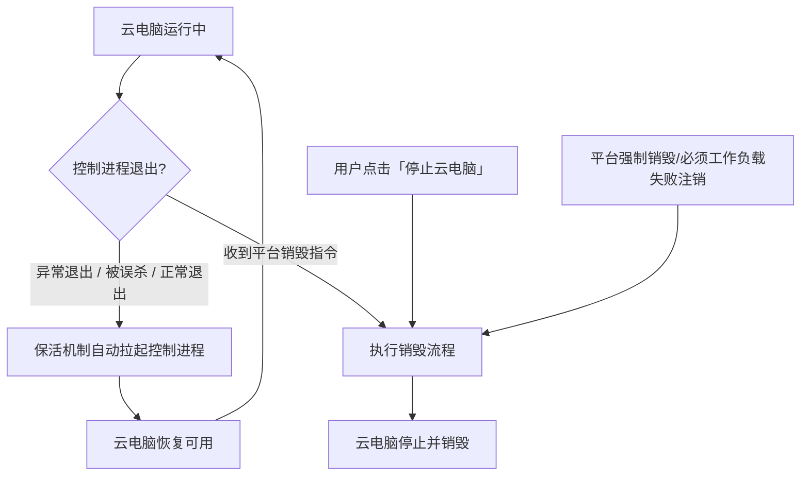

# 云电脑保活与 worker 用户

**功能名称**: 云电脑保活与 worker 用户
**PRD 版本**: v1.0
**创建日期**: 2026-10-25
**作者**: ZeroAsh

## 背景与目标

### 1.1 背景

云电脑节点的控制器（容器内负责回连与接受调度的进程）可能会意外退出。当前只要该进程退出，整个云电脑容器就会被判定结束并销毁：用户正在进行的会话、文件与运行中的任务随之全部丢失，且云电脑在列表中直接进入已停止状态，用户体验为「云电脑突然没了」。

同时，云电脑容器内目前默认以最高权限（root）身份运行。用户或 Agent 在云电脑内执行命令时，可以轻易终止包括控制器在内的任何进程，一次误操作（如 `pkill`、`kill` 错进程号）即可摧毁整台云电脑；权限缺乏最基本的隔离。

### 1.2 目标

- **保活**：在云电脑被平台明确销毁之前，容器内的控制进程无论以何种方式退出（正常退出、异常崩溃、被误杀），都被自动重新拉起，云电脑持续可用。
- **按需销毁**：只有用户主动发出「停止云电脑」动作（或平台侧的等价销毁指令，如必须工作负载初始化失败的强制注销）之后，云电脑才会被销毁。
- **权限隔离**：云电脑内默认改用普通用户（worker）身份操作，该用户无法终止系统级（root）保活进程，但其余操作能力尽量不受限，包括自由安装 apt 软件包。

### 1.3 成功标准

- 云电脑内控制进程被意外终止（崩溃或被误杀）后，云电脑不被销毁，短暂等待后自动恢复可用，用户可继续操作。
- 用户发出「停止云电脑」后，云电脑正常进入停止/销毁流程，不会被保活机制重新拉起。
- 新建云电脑内默认操作身份为普通用户 worker；在该身份下可直接安装 apt 软件包，且无法终止 root 拥有的系统进程。
- 既有能力不回归：云电脑的创建、初始化（工作负载安装）、会话拉起、停止与销毁流程行为与现状一致。

## 用户分析

### 2.1 目标用户

- **前台用户（云电脑使用者）**：在云电脑中运行 Agent 会话、执行命令、安装软件，期望云电脑稳定在线、不被意外销毁。
- **平台运营**：期望云电脑生命周期可控，销毁只由明确的停止/销毁动作触发，减少异常销毁带来的投诉与资损。

### 2.2 用户场景

| 场景 | 用户角色 | 目标 | 痛点 |
|--|--|--|--|
| 云电脑内控制进程意外退出 | 前台用户 | 云电脑自动恢复，继续使用 | 进程一退整台云电脑即被销毁，工作全部丢失 |
| Agent 在云电脑内执行命令 | 前台用户 | Agent 误杀进程后云电脑仍能恢复 | 误杀关键进程直接导致云电脑销毁 |
| 云电脑内安装软件 | 前台用户 | 用普通身份也能自由安装 apt 软件包 | 担心改成普通用户后装不了软件 |
| 主动停止使用云电脑 | 前台用户 | 「停止云电脑」后云电脑正常销毁 | 保活机制不应阻止正常的停止动作 |
| 平台强制回收异常云电脑 | 平台运营 | 初始化硬性失败等场景仍能强制注销 | 保活机制不应妨碍平台的强制销毁 |

## 功能需求

### 3.1 功能概述

为云电脑容器增加控制进程保活机制：在平台明确指令销毁之前，控制进程退出即自动重启；同时云电脑内默认操作身份从最高权限调整为普通用户 worker，worker 可安装 apt 软件包但无法终止系统级保活进程。

### 3.2 功能列表

#### 功能点 1: 控制进程持续保活

- **描述**: 云电脑容器内，控制进程无论以何种方式退出（正常退出、异常崩溃、被 worker 用户误杀），都被自动重新拉起；重启次数不设上限，反复退出时按退避节奏重启，避免高频空转。
- **用户价值**: 云电脑不再因为一次进程异常就被销毁，用户工作现场得以保留。
- **验收标准**:
  - [ ] 在云电脑内kill掉控制进程后，云电脑不进入已停止/已销毁状态，短暂等待后恢复可用。
  - [ ] 控制进程连续多次异常退出时，云电脑保持存活且重启间隔有退避，不出现高频重启风暴。
  - [ ] 保活恢复后，云电脑已完成的初始化（已安装的工作负载）不重复执行。

#### 功能点 2: 仅明确销毁指令可终止云电脑

- **描述**: 只有平台明确的销毁指令（用户「停止云电脑」、管理员强制销毁、必须工作负载初始化失败的强制注销等既有销毁链路）能终止保活并销毁云电脑；其余任何进程退出都不会销毁云电脑。
- **用户价值**: 销毁时机完全可控，用户对「停止云电脑」的行为结果有确定预期。
- **验收标准**:
  - [ ] 用户执行「停止云电脑」后，云电脑正常进入停止流程并最终销毁，不被保活重新拉起。
  - [ ] 管理员强制销毁、必须工作负载初始化失败触发的强制注销同样生效，不被保活阻止。
  - [ ] 除销毁指令外的任何进程退出（含退出码为 0 的正常退出）都触发保活重启而非销毁。

#### 功能点 3: 默认普通用户 worker

- **描述**: 新建云电脑内，用户与 Agent 的日常操作（终端、会话、工作负载脚本执行）默认以普通用户 worker 身份进行，不再默认是 root。
- **用户价值**: 降低误操作破坏云电脑的风险，权限边界清晰。
- **验收标准**:
  - [ ] 新建云电脑内执行 `whoami` 等身份查询显示为 worker。
  - [ ] 云电脑内用户的个人配置、工作区文件归属 worker 用户。
  - [ ] 既有的会话拉起、命令执行、文件读写能力在 worker 身份下可用。

#### 功能点 4: worker 可安装 apt 软件包

- **描述**: worker 用户可在云电脑内自由安装 apt 软件包（以及完成日常开发所需的等价操作），无需平台介入。
- **用户价值**: 改为普通用户后开发体验不回退，「无限大」的使用自由度保留。
- **验收标准**:
  - [ ] worker 身份下可直接完成 apt 软件包的安装。
  - [ ] 选择了 Docker 等需要系统能力的工作负载时，安装与使用在 worker 身份下依然可用。

#### 功能点 5: worker 无法终止系统级保活进程

- **描述**: 保活机制本身以系统级（root）身份运行；worker 用户在不显式提权的情况下无法终止这些进程，即使误杀控制进程也会由保活机制重新拉起。
- **用户价值**: 保活机制不会被日常操作破坏，云电脑在线有兜底保障。
- **验收标准**:
  - [ ] worker 身份下直接 kill 系统级保活进程被拒绝。
  - [ ] worker 身份下误杀控制进程后，保活机制将其重新拉起，云电脑不销毁。

### 3.3 用户操作流程

### 3.4 页面/界面描述

| 页面 | 描述 | 关键元素 |
|------|------|---------|
| 云电脑列表/详情 | 无界面变更；云电脑不再因内部进程异常而意外进入已停止状态 | 云电脑状态 |
| 云电脑内终端 | 命令行提示符等体现默认身份为 worker | 当前用户身份 |

### 3.5 异常与边界情况

| 情况 | 预期行为 |
|------|---------|
| 控制进程反复崩溃（如配置损坏） | 按退避节奏持续重启，云电脑不销毁；等待平台销毁指令或人工介入 |
| worker 用户误杀控制进程 | 保活机制重新拉起，云电脑不销毁 |
| worker 用户试图 kill 系统级进程 | 操作被拒绝（权限不足），保活进程不受影响 |
| 用户点击「停止云电脑」 | 保活停止，云电脑按既有流程正常销毁 |
| 必须工作负载初始化失败 | 平台强制注销链路照常生效，云电脑被销毁 |
| 云电脑创建后尚未就绪时进程退出 | 同样适用保活，等待恢复后继续就绪流程 |

## 四、非功能需求

### 4.1 性能要求

- 控制进程退出后的自动恢复应在秒级完成（含退避等待），不影响用户对云电脑在线状态的感知。

### 4.2 安全性要求

- 云电脑内默认身份为普通用户 worker，系统级保活进程以 root 身份运行并与 worker 隔离。
- worker 的提权能力以满足软件安装与日常开发为限，不以提供无差别的进程销毁能力为目标。

### 4.3 兼容性要求

- 存量云电脑在重建（停止后重新创建）后适用新行为；不涉及数据迁移。
- 云电脑创建、初始化、会话、停止等既有功能行为不回归。

## 五、依赖与约束

### 5.1 依赖

- 依赖既有的云电脑销毁链路（「停止云电脑」、强制销毁）作为保活的唯一终止出口。
- 依赖云电脑工作负载体系（Docker / .NET / Node.js 等预置工作负载）在 worker 身份下的适配。

### 5.2 约束

- 保活只在云电脑容器内部生效，不改变平台侧云电脑状态机的对外语义。
- 不引入新的用户界面；不改变「停止云电脑」的入口与交互。

## 六、相关文档

- 技术提案：[[../../engineering/proposals/20261025-feat-cloud-host-keepalive.md]]
- [[20261014-cloud-agent-phase2.md]] — 云Agent二期（K8s 云端工作容器）
- [[../shipping/20261025-cloud-container-unlimited-lifetime.md]] — 云电脑取消最长运行时间限制
