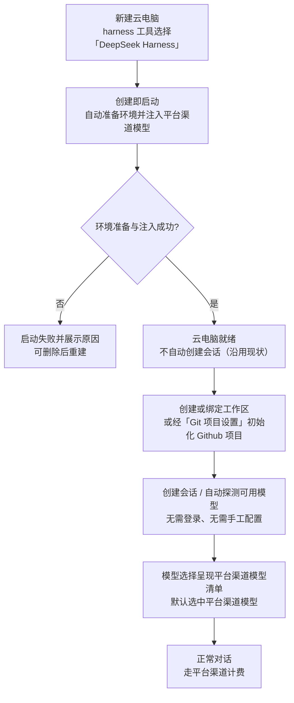
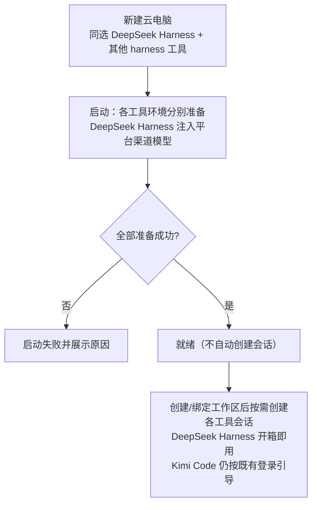

# 增加工作负载「DeepSeek Harness」（Harness）：DeepSeek Harness 接入与平台渠道模型注入

**功能名称**: 工作负载「DeepSeek Harness」（Harness）与平台渠道模型默认注入
**PRD 版本**: v1.1
**创建日期**: 2026-10-25
**作者**: ZeroAsh

> v1.1 修订（PR #284 评审）：移除「恰好选 1 个 harness 工具就绪后自动创建会话」的过时口径——自《云容器优化二期》（[[20261023-cloud-container-optimization-phase2.md]]）起，新建云电脑不预置工作区、就绪后不再自动创建会话（与选择几个 harness 工具无关），本文已按最新行为修订。

> 术语：「云电脑」「harness 工具」沿用《容器启动任务支持 harness 类型》（[[20261020-container-harness-support.md]]）的口径——云电脑是用户自助创建的云端机器，在左侧导航栏以「主机」形态呈现；创建时选择 harness 工具。
>
> 本期把 **DeepSeek Harness** 作为第三个 harness 工具接入（与 OpenCode、Kimi Code 同级、同为可选项）。DeepSeek Harness 是 DeepSeek 官方开源的 AI 编程工具（harness），支持平台标准的会话能力。
>
> 模型口径与 **OpenCode 一致**：云电脑启动初始化环境时，平台把**自己渠道的模型**（模型网关地址、运行专用模型凭证、可用模型清单）默认注入 DeepSeek Harness——用户创建完即可用，**无需登录、无需任何手工配置**；模型调用走平台渠道，计费口径与 OpenCode 云电脑相同（与 Kimi Code「登录后用用户自己账号、平台不计费」的口径不同）。
>
> 需求原文：
>
> - 工作负载初始化脚本：`npm install -g @deepseek-ai/dsh-acp-app`
> - 拉起 dsh 的 ACP 会话指令：`dsh --profile acp`
> - 和 OpenCode 类似，默认注入我们自己渠道的模型给 dsh（如何注入已调研，结论见技术提案附录）

## 背景与目标

### 1.1 背景

云电脑目前已内置两个 harness 工具：**OpenCode**（开箱即用，启动时注入平台渠道模型）与 **Kimi Code**（使用前需登录用户自己的 Kimi 账号）。创建云电脑时二者可多选，环境与模型由平台自动准备好，创建完即可用。

随着用户工具偏好多样化，DeepSeek Harness 用户希望在云电脑上使用自己的工具：

1. **DeepSeek Harness 用户希望在云电脑上使用该工具**。DeepSeek Harness 是 DeepSeek 官方开源的 AI 编程工具（harness），支持平台标准的会话能力，应作为 harness 工具的新选项出现在创建云电脑的选择中，体验与 OpenCode / Kimi Code 一致（可多选；可创建会话的工具范围为创建时所选工具；就绪后不自动创建会话、需先创建或绑定工作区的现状不变）。
2. **模型应默认注入平台渠道，开箱即用**。DeepSeek Harness 官方默认模型走 DeepSeek 官方渠道（需要用户自己的 DeepSeek 凭证）。平台云电脑的既有口径（OpenCode）是启动时把平台渠道模型注入工具配置，用户无需关心凭证与端点。DeepSeek Harness 应采用同一口径：启动初始化环境时默认注入平台渠道模型，未注入前工具不可用——注入失败则云电脑启动失败并展示原因。

### 1.2 目标

- 云电脑创建时，harness 工具可选「**DeepSeek Harness**」，与 OpenCode、Kimi Code **同级**（可多选；可创建会话的工具范围为创建时所选工具；就绪后不自动创建会话的现状不变）。
- 云电脑启动后 DeepSeek Harness **开箱可用**：环境自动准备好、校验可用；环境准备失败则云电脑启动失败并展示原因。
- **平台渠道模型默认注入**：云电脑启动初始化环境时，把平台渠道模型（网关地址、运行专用模型凭证、可用模型清单与模型最长上下文）写入 DeepSeek Harness 的工具配置；注入后新建会话默认使用平台渠道模型，模型选择中呈现平台渠道模型清单。
- 注入的平台渠道模型清单与后台模型设置保持一致（含模型最长上下文），与 OpenCode 云电脑同口径。
- **无需登录**：DeepSeek Harness 的使用动作（探测可用模型、创建会话）不要求任何登录/授权流程，不出现登录引导。
- 模型调用走平台渠道、按平台口径计费（与 OpenCode 云电脑一致）；DeepSeek Harness 的内建官方渠道不作为默认，也不出现在模型选择中。
- OpenCode、Kimi Code 与其他既有能力完全不受影响。

### 1.3 成功标准

- 新建云电脑的 harness 工具选项包含「DeepSeek Harness」「OpenCode」「Kimi Code」；可多选；仅选 DeepSeek Harness 创建后，就绪的云电脑**不**自动创建会话（沿用现状），创建/绑定工作区后可创建并进入 DeepSeek Harness 会话。
- 云电脑就绪后，主机界面的支持工具列表中 DeepSeek Harness 显示为可用；其会话可正常创建、对话。
- 就绪后的云电脑上，创建 DeepSeek Harness 会话**无需登录、无需手工配置模型**；会话的模型选择中呈现平台渠道模型清单（与 OpenCode 云电脑同一来源），默认选中平台渠道模型。
- 模型选择中**不**出现 DeepSeek Harness 内建的官方渠道模型。
- 模型清单/模型最长上下文随后台模型设置更新（与 OpenCode 云电脑同口径，新建云电脑生效）。
- 会话内对话正常：消息流、模型切换、历史回看与既有会话体验一致；会话支持「继续」（同工具内历史会话可继续）。
- 模型调用产生平台计费记录（与 OpenCode 云电脑同口径）。
- 环境准备/模型注入失败 → 云电脑启动失败并展示原因，可删除后重新创建；环境准备过程可重复执行（幂等）。
- OpenCode、Kimi Code 云电脑与普通主机既有功能完全不受影响；Kimi Code 的登录引导行为不变。

## 用户分析

### 2.1 目标用户

- **DeepSeek Harness 用户（本期主要用户）**：习惯使用 DeepSeek Harness 的前台用户，希望在云电脑上使用该工具，且直接使用平台渠道模型、不自己配置。
- **多工具用户**：创建云电脑时同时勾选多个 harness 工具（OpenCode / Kimi Code / DeepSeek Harness），按任务选用不同工具。
- **既有 OpenCode / Kimi Code 云电脑用户**：不受本期影响，继续原有体验。

### 2.2 用户场景

| 场景 | 用户角色 | 目标 | 痛点 |
|--|--|--|--|
| 创建自己的 DeepSeek Harness 云电脑 | DeepSeek Harness 用户 | 创建云电脑时选 DeepSeek Harness，开箱可用 | 云电脑没有该工具选项，工具偏好无法满足 |
| 零配置使用模型 | DeepSeek Harness 用户 | 创建完直接用平台渠道模型对话 | 官方默认渠道要自己找凭证、配端点，门槛高 |
| 切换平台渠道内的模型 | DeepSeek Harness 用户 | 在会话内切换平台渠道模型清单中的模型 | 不知道平台渠道有哪些模型可用 |
| 多任务并行 | 多工具用户 | 一台云电脑同时用多个 harness 工具 | 多个工具多套环境、多台机器 |
| 继续历史会话 | DeepSeek Harness 用户 | 同工具的历史会话可继续对话 | 每次都要从零开始 |
| 云电脑销毁重建 | DeepSeek Harness 用户 | 新云电脑自动重新注入平台渠道模型，开箱即用 | 重建后要手工重新配置 |
| 环境准备失败排查 | DeepSeek Harness 用户 | 启动失败能看到原因，删除后重建 | 失败无提示，不知如何恢复 |

## 功能需求

### 3.1 功能概述

云电脑的 harness 工具新增「**DeepSeek Harness**」（与 OpenCode、Kimi Code 同级、可多选）。云电脑启动初始化环境时自动完成 DeepSeek Harness 的环境准备，并把**平台渠道模型**（网关地址、运行专用模型凭证、可用模型清单与模型最长上下文）默认注入工具配置——与 OpenCode 的模型注入同口径。注入后用户开箱即用：创建会话无需登录、无需手工配置模型，模型选择中呈现平台渠道模型清单（默认选中平台渠道模型）；DeepSeek Harness 内建的官方渠道模型不作为默认、不出现在模型选择中。模型调用走平台渠道并按平台口径计费。OpenCode 与 Kimi Code 的体验与既有能力完全不变。

### 3.2 功能列表

#### 功能点 1: harness 工具新增「DeepSeek Harness」（与 OpenCode / Kimi Code 同级）

- **描述**: 新建云电脑的 harness 工具选择中新增「DeepSeek Harness」，与「OpenCode」「Kimi Code」同级并列、可多选（至少选一个）。既有规则保持不变：
  - 就绪后**不自动创建会话**（与选择几个工具无关）：新建云电脑不预置工作区，需先创建或绑定工作区（或经「Git 项目设置」初始化 Github 项目）后再创建会话；
  - 可创建会话的工具范围 = 创建时所选工具。
- **用户价值**: DeepSeek Harness 用户一步得到自己工具的云电脑；多工具用户一台电脑全都要。
- **验收标准**:
  - [ ] 新建云电脑的 harness 工具选项包含「DeepSeek Harness」「OpenCode」「Kimi Code」，可多选、至少选一个
  - [ ] 仅选 DeepSeek Harness 创建 → 就绪后不自动创建会话（沿用现状）；创建/绑定工作区后可创建并进入 DeepSeek Harness 会话
  - [ ] 同选 DeepSeek Harness 与其他工具 → 同样不自动创建会话；之后可分别创建各工具的会话
  - [ ] 未选/少选校验、实例上限等既有规则行为不变

#### 功能点 2: DeepSeek Harness 环境准备与模型注入（启动即就绪）

- **描述**: 云电脑启动时自动完成 DeepSeek Harness 的环境准备：安装并校验 DeepSeek Harness 运行环境（固定版本、可重复执行），并把平台渠道模型默认注入工具配置（网关地址、运行专用模型凭证、可用模型清单与模型最长上下文，与 OpenCode 注入同口径）。任一环节失败则云电脑启动失败并展示原因（与 OpenCode / Kimi Code 的环境准备同口径）。
- **用户价值**: 开箱即用，无需进入容器手工安装、无需手工配置模型。
- **验收标准**:
  - [ ] 云电脑就绪后，主机界面的支持工具列表中 DeepSeek Harness 显示为可用
  - [ ] 就绪后的云电脑上，工具配置中已注入平台渠道模型（模型清单与后台模型设置一致，含模型最长上下文）
  - [ ] 环境准备/模型注入失败 → 云电脑启动失败并展示原因，可删除后重新创建
  - [ ] 环境准备过程可重复执行（幂等），不产生重复安装或配置损坏问题
  - [ ] 注入的运行专用模型凭证不进入日志、不展示在任何界面；云电脑停止（销毁）后凭证随之失效

#### 功能点 3: 平台渠道模型默认生效（无需登录、无需手工配置）

- **描述**: 注入完成后：
  - 任何「使用 DeepSeek Harness」的动作（自动探测可用模型、创建会话）**直接可用**——不要求登录、不出现登录引导（与 Kimi Code 的登录引导形成对照）。
  - 新建会话的模型选择中呈现**平台渠道模型清单**（与 OpenCode 云电脑同一来源、按来源分组展示），默认选中平台渠道模型。
  - DeepSeek Harness 内建的官方渠道模型**不作为默认**，且**不出现在**模型选择中。
- **用户价值**: 零配置、零猜测——模型就在工具里，且只有平台渠道这一组，不会误选到不可用渠道。
- **验收标准**:
  - [ ] 创建 DeepSeek Harness 会话不出现任何登录/授权引导
  - [ ] 会话的模型选择中呈现平台渠道模型清单，默认选中平台渠道模型
  - [ ] 模型选择中不出现 DeepSeek Harness 内建官方渠道模型
  - [ ] 误选不可用渠道导致的失败形态不存在（选择项中无此类入口）

#### 功能点 4: 会话体验与既有会话一致

- **描述**: DeepSeek Harness 会话体验与既有会话一致：
  - 消息流、模型切换（平台渠道模型清单内）、历史回看与既有会话体验一致。
  - 同工具的历史会话支持「继续」（断线/重进后可继续对话）。
  - 会话内正常使用无需重复任何配置。
  - 模型调用走平台渠道，按平台口径计费（与 OpenCode 云电脑一致）。
- **用户价值**: 学习成本为零——用过既有会话就会用；费用归属清晰（平台渠道）。
- **验收标准**:
  - [ ] 会话内对话正常，消息流与既有会话一致
  - [ ] 会话内可在平台渠道模型清单内切换模型，切换后按新模型继续对话
  - [ ] 同工具历史会话可继续（会话列表可见、可继续对话）
  - [ ] DeepSeek Harness 会话产生平台计费记录，与 OpenCode 云电脑同口径

### 3.3 用户操作流程

#### 创建 DeepSeek Harness 云电脑并首次使用

#### 会话内切换模型

#### 多工具并行使用

### 3.4 页面/界面描述

| 页面 | 描述 | 关键元素 |
|------|------|---------|
| 新建云电脑对话框 | harness 工具选择扩展 | 名称输入、harness 工具多选（**OpenCode / Kimi Code / DeepSeek Harness**）、「就绪后不会自动创建会话，需先创建或绑定工作区」提示（沿用既有）、实例上限提示 |
| 主机界面（云电脑） | 与普通主机一致 | 支持的工具（ACP）列表（含 **DeepSeek Harness**）、工作区、会话入口 |
| 新建会话/会话界面 | 与既有会话一致 | 工具选择（DeepSeek Harness）、模型选择（平台渠道模型清单，按来源分组）、消息流 |
| 只读会话（已销毁云电脑） | 历史回看 | 与既有只读会话一致 |

### 3.5 异常与边界情况

| 情况 | 预期行为 |
|------|---------|
| 环境准备/模型注入失败（安装失败、校验失败、注入失败） | 云电脑启动失败并展示原因；可删除记录后重新新建 |
| 重复执行环境准备（重放/重试） | 幂等：不产生重复安装、配置不损坏 |
| 后台模型设置变更（新增/停用模型、修改最长上下文） | 与 OpenCode 云电脑同口径：新建云电脑按最新设置注入；既有云电脑的行为与 OpenCode 云电脑一致 |
| 平台渠道模型清单为空 | 与 OpenCode 云电脑同口径处理（不因此引入新的失败形态） |
| 选择多个 harness 工具 | 各自按各自规则准备；DeepSeek Harness 注入平台渠道模型，Kimi Code 仍维持使用前登录引导 |
| Kimi Code 的任何使用动作 | 登录引导行为完全不变 |
| OpenCode 的任何使用动作 | 行为完全不变 |
| 会话内切换模型 | 仅可在平台渠道模型清单内切换；切换后按新模型继续 |
| 云电脑停止（销毁）后再新建 | 新云电脑自动重新注入平台渠道模型，开箱即用 |
| 非属主访问该云电脑 | 拒绝并提示无权限（沿用既有口径） |
| 模型凭证泄漏风险面 | 凭证不进入日志、不展示在界面；随云电脑销毁失效 |

## 四、非功能需求

### 4.1 性能要求

- 环境准备与模型注入在云电脑启动耗时中的占比应与 OpenCode 的环境准备同量级，不明显拉长整体启动时长。
- 就绪后的使用动作（探测可用模型、创建会话）响应时长与既有 harness 工具会话一致，无额外前置步骤。

### 4.2 安全性要求

- 注入的运行专用模型凭证仅写入云电脑内部的工具配置（权限收紧、仅属主可读），不进入任何日志、错误信息与界面展示。
- 凭证随云电脑生命周期存在：停止即销毁、重建时重新下发；平台侧的凭证管理与撤销口径与 OpenCode 云电脑一致。
- 会话与对话记录的访问控制沿用既有标准会话口径（仅属主可见）。

### 4.3 兼容性要求

- OpenCode 云电脑（创建、环境准备、模型注入与计费）完全不受影响。
- Kimi Code 云电脑（创建、登录引导、账号口径）完全不受影响。
- 普通主机、既有会话、既有计费记录不受影响。
- 本期不新增任何后台（admin）入口与页面；后台模型设置沿用既有能力。

## 五、依赖与约束

### 5.1 依赖

- 云电脑 harness 工作负载能力（harness 工具多选、环境准备留档、启动失败语义）——DeepSeek Harness 以同类工作负载交付。
- 主机/会话能力（支持的工具（ACP）列表、标准会话、模型选择、会话继续）——DeepSeek Harness 会话完全复用。
- 平台渠道模型体系（后台模型设置、模型网关、运行专用模型凭证下发与撤销）——与 OpenCode 云电脑同一来源。
- DeepSeek Harness 官方工具能力（ACP 标准会话、模型配置注入机制）——调研结论见技术提案附录。

### 5.2 约束

- 模型注入发生在**云电脑启动初始化环境阶段**（与 OpenCode 同口径），**不做**使用前登录或任何用户交互前置。
- 一期仅注入**平台渠道模型**；不提供用户在界面手工录入 DeepSeek 官方凭证的入口。
- DeepSeek Harness 内建官方渠道模型不作为默认、不出现在模型选择中。
- 模型调用走平台渠道并按平台口径计费（与 OpenCode 云电脑一致；与 Kimi Code 的账号口径不同）。
- 环境准备（安装、校验与注入）必须幂等且有硬校验（安装成功但不可用、注入未生效均视为启动失败）。
- 注入的模型清单含模型最长上下文（与 OpenCode 云电脑同口径）。

## 六、相关文档

- [[20261020-container-harness-support.md]] — 容器启动任务支持 harness 类型（OpenCode 云电脑）
- [[20261025-kimi-code-harness.md]] — 增加工作负载「Kimi Code」（Harness）
- [[20261023-cloud-container-optimization-phase2.md]] — 云容器优化二期（创建期不预置默认工作区：就绪后不自动创建会话）
- [[20261025-opencode-model-context-length.md]] — 云电脑 OpenCode 模型上下文长度下发
- [[20261021-acp-protocol-enhancement.md]] — ACP 协议增强（能力透明化与模型来源分组）
- [[../../engineering/proposals/20261025-feat-deepseek-harness.md]] — 本期技术提案
