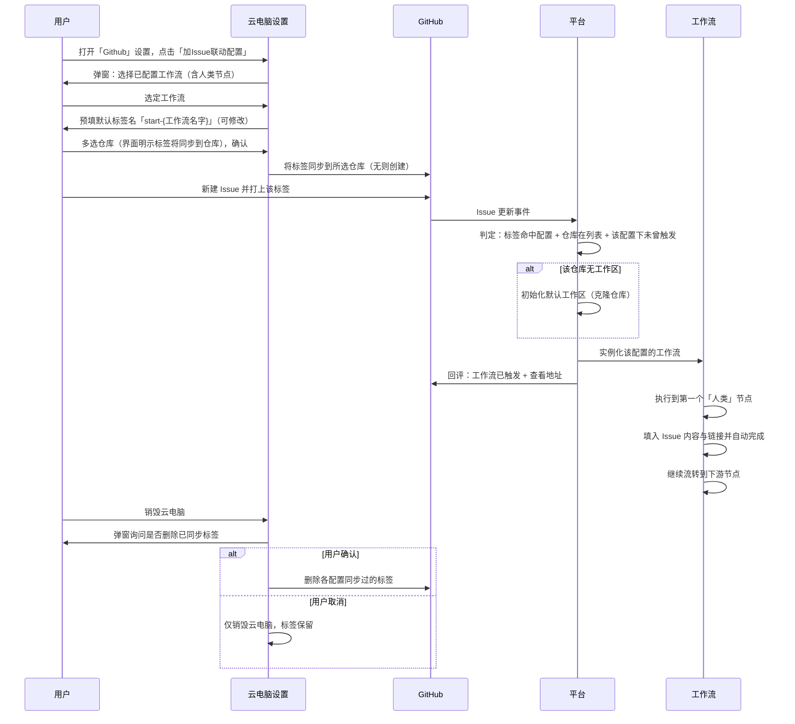
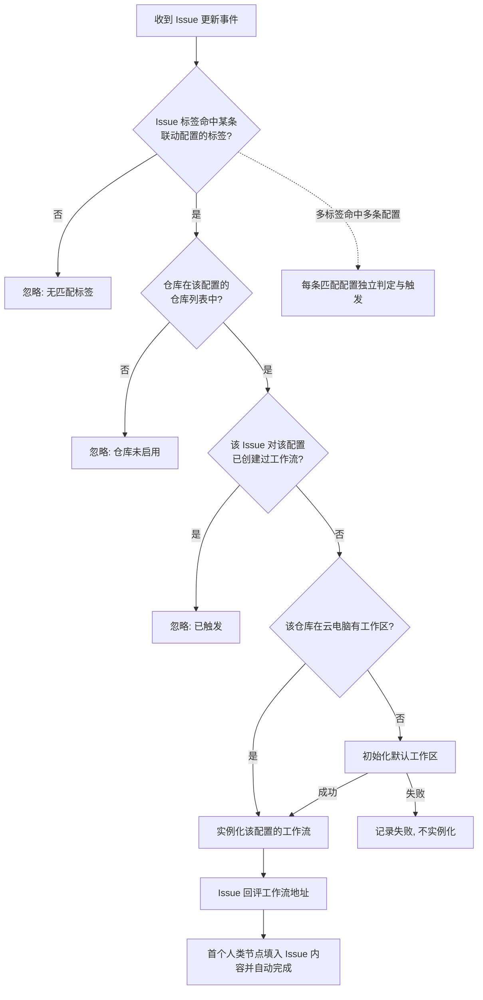

# 云电脑 GitHub Issues 联动工作流

**功能名称**: 云电脑 GitHub Issues 联动工作流
**PRD 版本**: v1.1
**创建日期**: 2026-10-25
**作者**: ZeroAsh Agent

> v1.1 变更：按评审意见将「启用Issues联动」单开关改为「Issue 联动配置列表」——每台云电脑可维护多条联动配置；每条配置先选工作流、标签名默认为「start-{工作流名字}」且可修改、再选仓库并显式同步标签；销毁云电脑时经用户确认清理已同步到仓库的标签。

## 背景与目标

### 1.1 背景

平台已经具备三块基础能力：

1. **GitHub 接入**：用户可绑定 GitHub 帐号并授权仓库（见 [[20260709-github-account-binding]]）；云电脑可一键完成 Github 项目设置，在云端工作容器中克隆仓库并自动创建工作区与会话（见 [[20261021-github-workload]]）。
2. **Agent 工作流**：工作流支持模板 → 已配置工作流 → 实例化的三级结构，已配置工作流归属于某台主机（控制器），支持人类节点与 AI 节点编排、产物黑板、打回返工（见 [[20260808-agent-workflow]]、[[20260811-agent-workflow-phase2]]）。
3. **GitHub 事件回流**：平台已可接收 GitHub 仓库事件并驱动工作流（Pull Request 审核联动，见 [[20261023-workflow-github-pr-callback]]）。

但目前工作流只能由用户在平台内手工发起：用户在 GitHub 上记录了一个 Issue（待办、需求、缺陷）后，仍需回到平台找到对应云电脑与工作区，手工实例化工作流，再把 Issue 内容手工转述给第一个处理人。Issue 与工作流之间没有通道，「在 GitHub 上提一个 Issue 就自动启动一条工作流」这一自然诉求无法达成。

### 1.2 目标

- 云电脑设置的「Github」区块以**列表**方式维护多条「Issue 联动配置」，每条配置 = 一个已配置工作流 + 一个触发标签 + 一组仓库：
  - 添加配置时先选定一个已配置工作流（需至少包含一个「人类」节点）；
  - 选定工作流后自动生成默认标签名「start-{工作流名字}」（例如工作流「开发工作流」→ 默认标签「start-开发工作流」），允许用户修改；
  - 然后多选仓库，界面显式告知「确认后将把该标签同步到所选仓库」；
  - 确认后，所选仓库中不存在该标签的会被自动创建。
- 启用后，仓库中带有某条联动配置标签的 Issue 会自动触发该配置对应的工作流：
  - 该仓库在云电脑中尚无工作区时，先自动完成仓库初始化（克隆并建好默认工作区）；
  - 工作区就绪后实例化工作流，并在 Issue 下回评告知工作流已触发、附工作流查看地址；
  - 工作流执行到第一个「人类」节点时，自动把 Issue 的内容与链接填入并自动完成该节点。
- 销毁云电脑时，若存在联动配置，弹窗询问用户是否删除对应仓库上的标签；用户确认后，将之前同步的标签全部删除。
- 同一个 Issue 对同一条联动配置不会重复触发工作流；未配置联动的仓库、未打标签的 Issue 不产生任何影响。

### 1.3 成功标准

- 云电脑设置中可见「Github」区块与 Issue 联动配置列表，列表含「加Issue联动配置」入口；配置弹窗依次完成工作流选择（仅列出该云电脑已配置且至少含一个「人类」节点的工作流；无可用工作流时展示「配置工作流」入口）→ 标签名（默认「start-{工作流名字}」，可修改）→ 仓库多选（显式展示标签将同步到所选仓库）。
- 确认添加后，所选仓库中不存在该标签的会被自动创建；已存在则不重复创建、不报错；列表中可见该配置的工作流、标签与仓库。
- 为配置列表中的仓库新建（或为已有 Issue 打上）对应标签后，在合理时间内（秒级到分钟级）自动完成：工作区准备（必要时）→ 工作流实例化 → Issue 评论回执（含工作流地址）→ 首个人类节点自动完成并携带 Issue 内容与链接。
- Issue 评论回执文案表达「工作流已经触发创建，Issue 的后续修改不会影响工作流的执行」，并给出可点击的工作流查看地址。
- 同一个 Issue 对同一条配置重复打标、重复投递事件只触发一次；一个 Issue 同时带有多条配置的标签时，每条匹配配置各触发一次对应工作流；不满足条件的 Issue 事件被安全忽略且原因可追溯。
- 销毁云电脑时出现标签清理询问；用户确认后，该平台同步过的标签从对应仓库全部删除；用户取消则标签保留。
- 未配置联动的云电脑行为与现状完全一致，无回归。

## 用户分析

### 2.1 目标用户

- **云电脑使用者**：在云电脑上通过 GitHub 项目管理工作，期望用 Issue 直接驱动工作流。
- **工作流编排者**：为云电脑配置工作流与联动配置，决定哪个工作流响应哪个标签的 Issue。
- **工作流观察者**：从 Issue 评论中的地址进入工作流，查看执行进展。

### 2.2 用户场景

| 场景 | 用户角色 | 目标 | 痛点 |
|--|--|--|--|
| 添加 Issue 联动配置 | 云电脑使用者 | 为云电脑选定工作流、标签与仓库，建立 Issue 触发通道 | 无此能力，Issue 与工作流割裂 |
| 多条配置并存 | 云电脑使用者 | 不同标签触发不同工作流（如「开发工作流」「调研工作流」） | 单一联动无法表达多场景 |
| 提 Issue 启动工作流 | 云电脑使用者 | 在 GitHub 上新建带对应标签的 Issue 即自动启动工作流 | 需回到平台手工实例化并手工转述 Issue 内容 |
| 老 Issue 补打标签触发 | 云电脑使用者 | 给存量 Issue 打上标签同样能触发 | 无通道，只能手工处理 |
| 查看工作流进展 | 工作流观察者 | 从 Issue 评论里的地址直达工作流 | 不知道工作流是否已触发、在哪里看 |
| 无可用工作流时引导配置 | 工作流编排者 | 添加联动配置时发现没有可用工作流，能直接去配置 | 无引导，卡住 |
| 销毁云电脑清理标签 | 云电脑使用者 | 销毁云电脑时可选择把同步到仓库的标签清理干净 | 标签残留仓库，造成误触发误解 |

## 功能需求

### 3.1 功能概述

打通「GitHub Issue → 云电脑工作流」的自动触发链路：云电脑设置中以列表维护多条联动配置（工作流 + 标签 + 仓库），确认时把标签同步到所选仓库；此后带对应标签的 Issue 会依次自动完成「工作区准备（必要时）→ 工作流实例化 → Issue 回评 → 首个人类节点自动完成」，使整条工作流无需人工干预即可流转到第一个 AI 节点；销毁云电脑时可经确认清理已同步的标签。

### 3.2 功能列表

#### 功能点 1: 云电脑设置「Github」区块与 Issue 联动配置列表

- **描述**: 「云电脑」的设置中新增「Github」部分，其中以**列表**展示当前全部 Issue 联动配置（每条展示：工作流名称、标签名、仓库列表），并提供「加Issue联动配置」按钮。点击后弹出配置弹窗，按以下顺序完成一条配置：
  1. **选择工作流**：先选一个已配置的工作流。仅列出为该台云电脑已配置完成、且至少包含一个「人类」节点的工作流；不满足条件的不出现在列表中。如果该云电脑没有任何可用工作流，界面显示「配置工作流」按钮，引导用户先去完成工作流配置；
  2. **设置标签名**：选定工作流后自动生成默认标签名「start-{工作流名字}」（例如选择「开发工作流」，默认标签名为「start-开发工作流」），该名字允许用户自行修改；同一台云电脑内标签名不允许重复；
  3. **选择仓库**：展示用户所有已绑定的仓库，支持多选；界面显式展示「确认后将把该标签同步到所选仓库」的提示；
  4. **确认生效**：确认后保存该条联动配置，并对每个所选仓库检查标签：若仓库中不存在该标签则自动创建（同步到仓库），已存在则跳过。
  - 列表中的每条配置支持修改（工作流/标签名/仓库）与删除；删除配置不影响已触发的工作流。
- **用户价值**: 一台云电脑可以表达多条「标签 → 工作流」的触发规则；标签命名自带工作流语义，在 GitHub 上一眼可辨；配置即声明，长期生效。
- **验收标准**:
  - [ ] 云电脑设置中可见「Github」部分、联动配置列表与「加Issue联动配置」按钮。
  - [ ] 弹窗中工作流列表只包含该云电脑已配置且至少含一个「人类」节点的工作流；无可用工作流时展示「配置工作流」按钮。
  - [ ] 选定工作流后标签名自动预填为「start-{工作流名字}」，可修改；同一云电脑内标签名重复时无法确认并提示。
  - [ ] 仓库列表展示全部已绑定仓库并支持多选；确认前显式展示标签将同步到所选仓库。
  - [ ] 确认后，所选仓库缺少该标签的会被自动创建成功；已存在的仓库不报错。
  - [ ] 列表可查看、修改、删除每条配置；修改后按新配置生效。

#### 功能点 2: 监听 Issue 更新并判定触发条件

- **描述**: 平台监听被联动仓库的 Issue 更新（新建、打标、编辑等），收到事件后按以下条件判定：
  1. Issue 所带标签命中某台云电脑某条联动配置的标签名；
  2. 该云电脑的这条联动配置存在（未删除）；
  3. 该 Issue 所属仓库在这条配置的仓库列表中；
  4. 这个 Issue 对这条配置未曾创建过工作流。
  - 全部满足则触发该配置对应的工作流；Issue 同时带有多条配置的标签时，每条匹配配置各自独立判定与触发（同一 Issue 可对不同配置各触发一个工作流实例）。
- **用户价值**: 只有真正「请求工作流」的 Issue 才会触发，避免噪音事件误启动工作流；多标签场景语义清晰。
- **验收标准**:
  - [ ] 无配置标签 Issue、未配置联动的仓库、对该配置已触发过的 Issue，均不触发且不影响任何状态。
  - [ ] 同一 Issue 对同一配置的重复事件（重复打标、重复投递）只触发一次。
  - [ ] 同一 Issue 带多条配置标签时，每条匹配配置各触发一次。
  - [ ] 每次忽略都有可追溯的原因记录。

#### 功能点 3: 工作区自动准备

- **描述**: 触发条件满足后，若该仓库在这台云电脑中没有工作区，则为该仓库初始化默认工作区（完成仓库克隆并建立工作区）；若已有工作区则直接使用。工作区准备完成后才进入下一步；准备失败则本次触发以失败收场并记录原因，不实例化工作流。
- **用户价值**: 首次对某仓库提 Issue 也能直接跑通，无需先手工做仓库初始化。
- **验收标准**:
  - [ ] 无工作区时自动完成仓库初始化并建立工作区；有工作区时不重复初始化。
  - [ ] 初始化失败时不实例化工作流，失败原因可查看。

#### 功能点 4: 实例化工作流并回评 Issue

- **描述**: 工作区就绪后，按命中的联动配置实例化对应的工作流，并记录「这个 Issue 对这条配置对应了哪个工作流实例」。随后在 Issue 下发布一条评论，大意为：「工作流已经触发创建，Issue 的后续修改将不会影响工作流的执行」，并附上工作流的外部查看地址（由平台外部访问地址配置决定），引导点击查看。
- **用户价值**: Issue 提交者立即获得明确回执与可点击的工作流入口；「Issue 修改不影响工作流」的预期被显式管理。
- **验收标准**:
  - [ ] 工作流实例化成功后，Issue 下出现回评，包含工作流查看地址且可点击跳转。
  - [ ] Issue 与工作流实例的对应关系可查询（用于「未曾创建过工作流」的判定）。
  - [ ] 评论发布失败不影响已创建的工作流，但需记录并可重试/补偿。

#### 功能点 5: 首个人类节点自动填入 Issue 内容并完成

- **描述**: 等待工作流执行到第一个「人类」节点时，把 Issue 的相关内容（标题、正文、链接等）与链接填入该节点，并自动完成这个「人类」节点，使工作流继续向下游流转。该自动完成只发生一次（即首个「人类」节点），后续人类节点仍按正常人工流程处理。
- **用户价值**: Issue 内容零搬运地进入工作流，第一个等待环节被自动消化，工作流不停顿地流到第一个 AI 节点。
- **验收标准**:
  - [ ] 工作流到达首个「人类」节点时，该节点自动完成，下游节点收到的上下文中包含 Issue 的标题、正文与链接。
  - [ ] 后续「人类」节点不被自动完成，行为与现状一致。
  - [ ] 自动完成的内容与工作流实例详情中可见，便于追溯。

#### 功能点 6: 销毁云电脑时的标签清理

- **描述**: 销毁（删除）云电脑时，若该云电脑存在联动配置，弹窗询问用户「是否删除已同步到对应仓库的标签」：
  - 用户确认后，将之前由平台同步到各仓库的标签全部删除（各配置的标签 × 各配置的仓库），仓库中本就不存在该标签的跳过；
  - 用户取消（或选择保留）时，仅销毁云电脑，仓库上的标签保留；
  - 无论用户如何选择，销毁完成后该云电脑的联动配置随之失效（不再触发）。
- **用户价值**: 云电脑销毁后不残留平台创建的标签，避免仓库里留存会误导团队成员的「触发入口」。
- **验收标准**:
  - [ ] 存在联动配置的云电脑销毁时出现标签清理询问；无配置时不出现。
  - [ ] 用户确认后，平台同步过的标签从对应仓库全部删除成功；个别仓库删除失败时提示失败项，其余不受影响。
  - [ ] 用户取消时标签保留；销毁后任何联动配置不再触发工作流。

### 3.3 用户操作流程

### 3.4 页面/界面描述

| 页面 | 描述 | 关键元素 |
|------|------|---------|
| 云电脑设置 -「Github」部分 | Issue 联动配置列表与入口 | 「加Issue联动配置」按钮；每条配置展示工作流名称、标签名、仓库列表；修改/删除入口 |
| 加 Issue 联动配置弹窗 | 依次完成一条配置 | 工作流选择（仅含人类节点的已配置工作流）、标签名输入（默认「start-{工作流名字}」可修改）、仓库多选、「标签将同步到所选仓库」明示、「配置工作流」按钮（无可用工作流时）、确认/取消 |
| 销毁云电脑确认弹窗 | 销毁前的标签清理询问 | 「是否删除已同步到对应仓库的标签」询问、确认/保留选项、失败项提示 |
| GitHub Issue 页 | 触发与回执（外部系统） | 联动配置标签、平台发布的工作流回评（含查看地址） |
| 工作流实例详情 | 查看触发来源与自动完成结果 | Issue 来源信息、首个人类节点的自动完成内容 |

### 3.5 异常与边界情况

| 情况 | 预期行为 |
|------|---------|
| Issue 无任何联动配置的标签 | 忽略，不触发 |
| 仓库不在命中配置的仓库列表中 | 忽略，不触发 |
| Issue 对该配置已触发过（重复打标/重复投递） | 忽略，对该配置只触发一次 |
| 同一 Issue 带有多条配置的标签 | 每条匹配配置各自触发一个工作流实例，互不影响 |
| 同一云电脑内新增/修改配置的标签名与既有配置重复 | 无法确认并提示标签名重复 |
| 标签名为空、超长或含非法字符 | 无法确认并提示修正 |
| 云电脑无可用工作流（未配置或均不含人类节点） | 弹窗展示「配置工作流」按钮，无法确认添加 |
| 确认时仓库已存在同名标签 | 跳过创建，不报错 |
| 标签同步失败（如权限不足） | 明确提示失败仓库与原因，其余仓库不受影响；可重试 |
| 触发时云电脑不在运行中 | 本次触发失败并记录原因，不实例化工作流 |
| 工作区初始化失败 | 本次触发失败并记录原因，不实例化工作流 |
| 实例化成功但 Issue 回评失败 | 工作流照常执行，回评失败记录原因并可补偿 |
| Issue 在触发后被编辑/追加内容/摘除标签 | 不影响已创建的工作流（回评中已声明）；摘除标签后不产生新触发 |
| 修改/删除联动配置 | 之后的事件按新配置判定；已触发的工作流不受影响；删除配置后其标签不再触发（仓库上已同步的标签保留，由用户在销毁时统一清理或自行处理） |
| 同一仓库被多台云电脑的配置覆盖（多实例场景） | 各自独立判定与触发，互不影响 |
| 销毁云电脑时用户选择保留标签 | 仅销毁云电脑；标签保留在仓库但不再触发任何工作流 |
| 销毁云电脑时部分仓库标签删除失败 | 提示失败仓库；其余标签正常删除；云电脑销毁流程不被阻断 |

## 四、非功能需求

### 4.1 性能要求

- 从 Issue 事件到平台受理在秒级完成；含工作区初始化的全链路在分钟级完成（主要耗时为仓库克隆）。
- 事件处理不阻塞云电脑与工作流的其他操作；销毁云电脑的标签清理在秒级完成。

### 4.2 安全性要求

- Issue 事件来源必须经平台鉴权校验，未通过校验的请求直接拒绝。
- 联动触发只影响配置所属用户的云电脑与工作流，不跨用户生效。
- Issue 标题、正文与标签名作为纯文本进入工作流上下文，不解析其中的指令标记；界面展示按普通文本渲染。
- 标签同步与删除使用最小必要权限的凭据，凭据不落地、不出现在日志与界面。

### 4.3 兼容性要求

- 未配置联动的云电脑行为与现状完全一致。
- 已有的手工实例化工作流、Pull Request 审核联动能力不受影响，可与本功能同时存在。
- 历史 Issue 在未打标签前不产生任何影响；仓库中用户自行创建的同名标签不会被平台删除（仅删除平台同步过的标签）。

## 五、依赖与约束

### 5.1 依赖

- GitHub 帐号绑定与仓库授权：[[20260709-github-account-binding]]。
- 云电脑 Github 项目设置（仓库克隆与工作区初始化）：[[20261021-github-workload]]。
- Agent 工作流体系（已配置工作流、实例化、人类节点）：[[20260808-agent-workflow]]、[[20260811-agent-workflow-phase2]]。
- GitHub 事件回流通道（Pull Request 审核联动已建立的事件接收与处理能力）：[[20261023-workflow-github-pr-callback]]。

### 5.2 约束

- 本期仅支持 GitHub，不覆盖其他代码托管平台。
- 每条联动配置一个触发标签；默认命名「start-{工作流名字}」，用户可修改；同一台云电脑内标签名唯一。
- 首个「人类」节点的自动完成只在工作流由 Issue 触发时发生；手工实例化的工作流不自动完成。
- 平台只删除由平台同步创建的标签；用户自行在仓库创建的同名标签不在清理范围内。
- 平台外部访问地址需正确配置，否则 Issue 回评中的工作流地址不可达。

## 六、相关文档

- [[20260709-github-account-binding]] — GitHub 帐号绑定
- [[20261021-github-workload]] — Github 工作负载与云主机 Git 项目设置
- [[20260808-agent-workflow]] — Agent 工作流
- [[20260811-agent-workflow-phase2]] — Agent 工作流二期
- [[20261023-workflow-github-pr-callback]] — 工作流 GitHub Pull Request 联动
- 技术提案：`docs/engineering/proposals/20261025-feat-github-issues-workflow.md`
