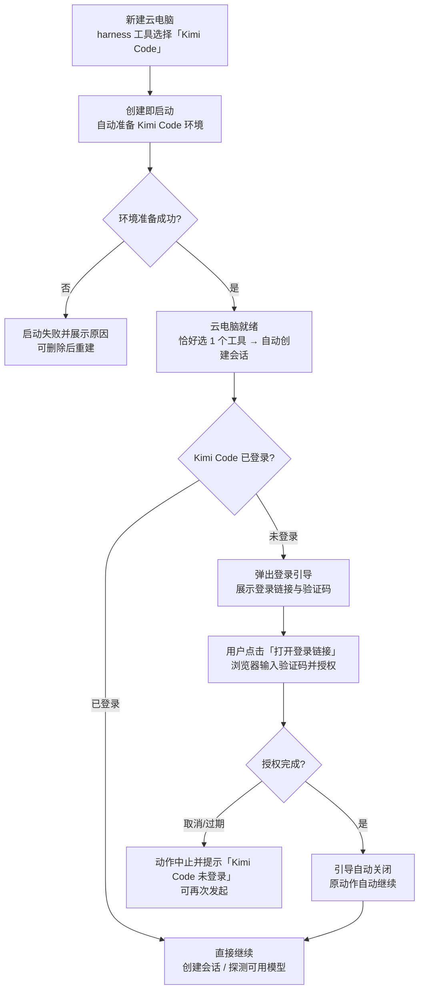
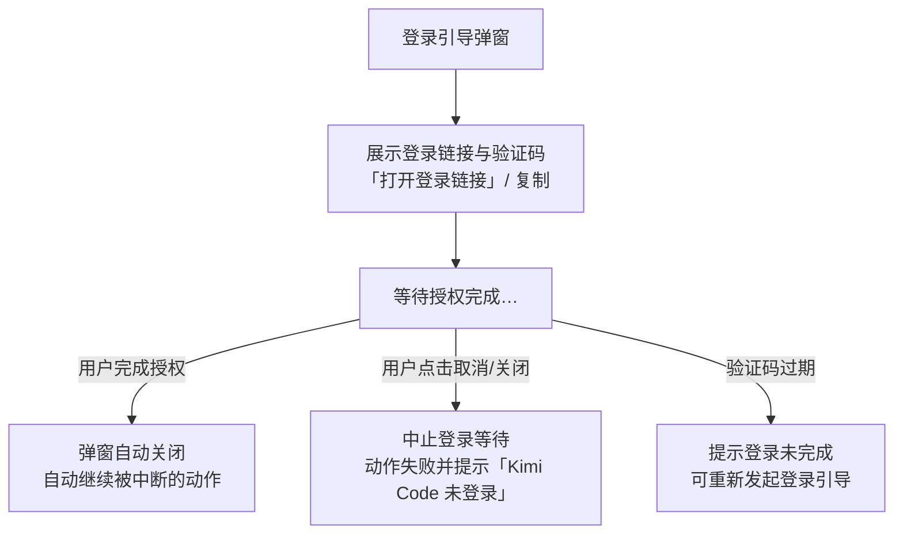
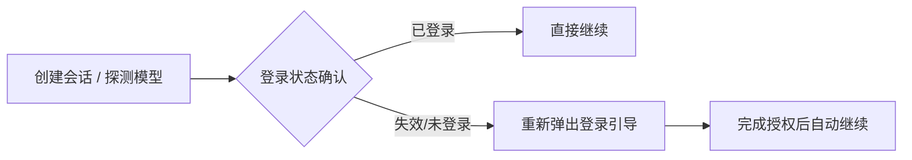

# 增加工作负载「Kimi Code」（Harness）：Kimi Code 接入与登录引导

**功能名称**: 工作负载「Kimi Code」（Harness）与使用前登录引导
**PRD 版本**: v1.0
**创建日期**: 2026-10-25
**作者**: ZeroAsh

> 术语：「云电脑」「harness 工具」沿用《容器启动任务支持 harness 类型》（[[20261020-container-harness-support.md]]）的口径——云电脑是用户自助创建的云端机器，在左侧导航栏以「主机」形态呈现；创建时选择 harness 工具（一期仅 OpenCode）。
>
> 本期把 **Kimi Code** 作为第二个 harness 工具接入（与 OpenCode 同级、同为可选项）。Kimi Code 使用前**必须登录**（Kimi Code OAuth 设备码授权，浏览器完成），与 OpenCode「开箱即用」不同；因此本期同时交付**使用前的登录确认与登录引导**：使用 Kimi Code 之前（如自动探测可用模型、创建会话）先确认登录状态，未登录时弹出引导框，用户按引导中的**登录链接**在浏览器完成授权后自动继续。
>
> 需求原文要求的登录判定口径（实现期核对，详见技术提案附录）：执行登录检查后，输出中出现「Logged in to {...}」即视为**已登录**；未登录时输出形如：
>
> ```
> Opening browser for Kimi device login: https://www.kimi.com/code/authorize_device?user_code={}
> If the browser did not open, paste the URL above and enter code: {}
> Code expires in 1800s.
> Waiting for authorization to complete…
> ```
>
> 引导弹窗展示的链接与验证码即取自这段输出。

## 背景与目标

### 1.1 背景

云电脑（harness 容器）一期交付时只内置了 **OpenCode** 一个 harness 工具：用户创建云电脑时只能选 OpenCode，环境与模型由平台自动准备好，创建完即可用。

随着用户工具偏好多样化，出现两类诉求：

1. **Kimi Code 用户希望在云电脑上使用自己的工具**。Kimi Code 是与 OpenCode 同级的 AI 编程工具（harness），支持平台标准的会话能力，应作为 harness 工具的新选项出现在创建云电脑的选择中，体验与 OpenCode 一致（可多选、恰好选 1 个时自动创建会话等规则不变）。
2. **Kimi Code 首次使用必须登录，缺了引导用户寸步难行**。Kimi Code 的能力来自用户的 Kimi 账号：必须先完成登录（浏览器设备码授权）才能使用。若用户在未登录时就触发使用动作（如系统自动探测可用模型、用户创建会话），只会得到失败或空白结果，用户不知道发生了什么、更不知道去哪里登录。因此在**使用 Kimi Code 之前**（注意：不是在云电脑启动初始化环境时，而是每次「使用」动作之前），系统必须先确认登录状态；未登录时弹出提示框进入登录流程，用户按照提示框中的**登录链接**（与工具输出一致）完成授权即可继续。

### 1.2 目标

- 云电脑创建时，harness 工具可选「**Kimi Code**」，与 OpenCode **同级**（可多选；恰好选 1 个时的默认会话规则不变）。
- 云电脑启动后 Kimi Code **开箱可用**：环境自动准备好、校验可用；环境准备失败则云电脑启动失败并展示原因。
- **使用前登录确认**：任何「使用 Kimi Code」动作（自动探测可用模型、创建会话等）之前，先确认登录状态——已登录则直接继续，用户无感知。
- **登录引导**：未登录时弹出提示框进入登录流程，展示**登录链接与验证码**（与工具输出一致），用户按链接在浏览器完成授权后，**自动继续**刚才被中断的动作，无需重复操作。
- 登录引导可取消、有明确的有效期与失败提示；并发的多个使用动作只出现**一个**登录引导、共享登录结果。
- 登录后模型可用范围随用户的 Kimi 账号（登录后自动探测）；OpenCode 与其他既有能力完全不受影响。

### 1.3 成功标准

- 新建云电脑的 harness 工具选项包含「Kimi Code」与「OpenCode」；可多选；仅选 Kimi Code 时就绪后自动创建并进入一个 Kimi Code 会话（沿用默认会话规则）。
- 云电脑就绪后，主机界面的支持工具列表中 Kimi Code 显示为可用；其会话可正常创建、对话。
- 未登录时创建 Kimi Code 会话（或触发可用模型探测）→ 弹出登录引导，展示登录链接与验证码；**不**出现失败/空白结果。
- 用户在浏览器按引导中的链接完成授权后，登录引导自动完成并关闭，刚才的使用动作**自动继续**（探测返回模型选项 / 会话创建成功）。
- 已登录状态下使用 Kimi Code **不**弹任何登录引导，与日常使用无差别。
- 登录引导中点击「取消」（或关闭弹窗）→ 本次使用动作中止并提示「Kimi Code 未登录」，可再次发起。
- 同时触发多个使用动作（如自动探测 + 创建会话）→ 只出现一个登录引导，登录完成后各自动作均继续。
- 授权超时/验证码过期 → 明确提示未完成登录，可重试。
- 云电脑停止（销毁）后登录状态不保留；新云电脑首次使用 Kimi Code 时重新引导登录。
- OpenCode 云电脑、普通主机既有功能完全不受影响；本期不出现任何平台代计费/模型凭证相关的新入口。

## 用户分析

### 2.1 目标用户

- **Kimi Code 用户（本期主要用户）**：习惯使用 Kimi Code 的前台用户，希望在云电脑上使用自己的工具与模型账号。
- **多工具用户**：创建云电脑时同时勾选 OpenCode 与 Kimi Code，按任务选用不同工具。
- **既有 OpenCode 云电脑用户**：不受本期影响，继续原有体验。

### 2.2 用户场景

| 场景 | 用户角色 | 目标 | 痛点 |
|--|--|--|--|
| 创建自己的 Kimi Code 云电脑 | Kimi Code 用户 | 创建云电脑时选 Kimi Code，开箱可用 | 云电脑只能选 OpenCode，工具偏好无法满足 |
| 首次使用时登录一次 | Kimi Code 用户 | 按引导在浏览器完成登录，之后畅用 | 未登录时使用只报失败，不知去哪登录 |
| 从弹窗直接打开登录页 | Kimi Code 用户 | 点击引导中的链接/按钮即达授权页 | 需要手动复制冗长链接与验证码 |
| 多任务并行 | 多工具用户 | 一台云电脑同时用 OpenCode 与 Kimi Code | 多个工具多套环境、多台机器 |
| 登录后看到可用模型 | Kimi Code 用户 | 登录后自动呈现账号可用的模型与模式 | 不知道登录后能用什么模型 |
| 授权中途反悔 | Kimi Code 用户 | 取消登录引导，动作中止且可重来 | 弹窗卡住、无法退出 |
| 授权过期后重试 | Kimi Code 用户 | 明确提示后重新发起登录 | 过期无感知，一直等待 |
| 云电脑销毁重建 | Kimi Code 用户 | 新云电脑上重新登录一次即可 | 误以为登录会永久保留 |

## 功能需求

### 3.1 功能概述

云电脑的 harness 工具新增「**Kimi Code**」（与 OpenCode 同级、可多选），云电脑启动时自动完成 Kimi Code 的环境准备。在**使用 Kimi Code 之前**（如自动探测可用模型、创建会话），系统先确认登录状态：已登录直接继续；未登录则弹出**登录引导**，展示来自工具输出的登录链接与验证码，用户按链接在浏览器完成授权后自动继续被中断的动作。登录状态在云电脑停止（销毁）后不保留，新云电脑重新引导登录。OpenCode 的体验与既有能力完全不变。

### 3.2 功能列表

#### 功能点 1: harness 工具新增「Kimi Code」（与 OpenCode 同级）

- **描述**: 新建云电脑的 harness 工具选择中新增「Kimi Code」，与「OpenCode」同级并列、可多选（至少选一个）。既有规则保持不变：
  - 恰好选择 **1 个** harness 工具 → 就绪后自动创建并进入一个使用该工具的会话；
  - 选择 **≥2 个** → 不默认创建会话；
  - 可创建会话的工具范围 = 创建时所选工具。
- **用户价值**: Kimi Code 用户一步得到自己工具的云电脑；多工具用户一台电脑全都要。
- **验收标准**:
  - [ ] 新建云电脑的 harness 工具选项包含「Kimi Code」与「OpenCode」，可多选、至少选一个
  - [ ] 仅选 Kimi Code 创建 → 就绪后自动创建并进入一个 Kimi Code 会话
  - [ ] 同选 OpenCode 与 Kimi Code → 不默认创建会话；之后可分别创建两种工具的会话
  - [ ] 未选/少选校验、实例上限等既有规则行为不变

#### 功能点 2: Kimi Code 环境准备（启动即就绪）

- **描述**: 云电脑启动时自动完成 Kimi Code 的环境准备：安装并校验 Kimi Code 运行环境（固定版本、可重复执行），失败则云电脑启动失败并展示原因（与 OpenCode 的环境准备同口径）。环境准备只负责「装好可用的 Kimi Code」，**不做登录**（登录属于使用前动作）。
- **用户价值**: 开箱即用，无需进入容器手工安装。
- **验收标准**:
  - [ ] 云电脑就绪后，主机界面的支持工具列表中 Kimi Code 显示为可用
  - [ ] 环境准备失败 → 云电脑启动失败并展示原因，可删除后重新创建
  - [ ] 环境准备过程可重复执行（幂等），不产生重复安装问题

#### 功能点 3: 使用前登录确认

- **描述**: 任何「使用 Kimi Code」的动作之前（包括：系统自动探测可用模型/模式、用户创建会话等），先确认 Kimi Code 登录状态：
  - **已登录**（登录检查输出含「Logged in to {...}」）→ 直接继续原动作，用户无感知，不弹任何提示。
  - **未登录** → 中断原动作、弹出**登录引导**（功能点 4），登录完成后自动继续原动作。
- **用户价值**: 杜绝「莫名其妙的失败」，把登录变成使用前的一步自然引导。
- **验收标准**:
  - [ ] 已登录时探测/创建会话等动作直接继续，无任何登录相关提示
  - [ ] 未登录时触发使用动作 → 弹出登录引导，动作暂缓而非失败
  - [ ] 登录确认对 Kimi Code 生效；OpenCode 的使用动作不出现登录确认
  - [ ] 登录状态确认在秒级完成（已登录场景），不产生可感知的等待

#### 功能点 4: 登录引导弹窗（按 stdio 链接登录）

- **描述**: 未登录时弹出提示框进入登录流程：
  - 展示**登录链接**与**验证码**（取自工具输出，与输出中的 URL/码逐字一致），并提供「打开登录链接」按钮（新标签页打开）与复制能力。
  - 引导文案说明：在浏览器打开链接、输入验证码、完成授权（Kimi 账号登录），完成后系统自动继续。
  - 弹窗期间持续等待授权结果：授权完成 → 弹窗自动关闭并**自动继续**被中断的动作；**不需要**用户手动「刷新/重试」。
  - 提供「取消」（关闭弹窗等同取消）：中止本次登录等待，被中断的动作随之失败并提示「Kimi Code 未登录」，可再次发起。
  - 授权有效期内未完成（验证码过期）→ 提示登录未完成，可重新发起登录引导。
  - 并发去重：同一台云电脑同时只出现**一个**登录引导；触发引导的多个使用动作共享本次登录结果。
- **用户价值**: 登录路径零猜测——链接就在弹窗里；登录一次、多个动作同时解锁。
- **验收标准**:
  - [ ] 弹窗展示的登录链接/验证码与工具输出一致，可一键打开/复制
  - [ ] 浏览器完成授权后弹窗自动关闭、被中断的动作自动继续
  - [ ] 取消（或关闭弹窗）→ 动作中止并提示「Kimi Code 未登录」，可再次发起
  - [ ] 授权过期/失败 → 明确提示并可重试，不无限等待
  - [ ] 多个使用动作并发触发 → 仅一个弹窗，登录后各动作均继续

#### 功能点 5: 登录后的模型与会话体验

- **描述**: 登录完成后：
  - 可用模型/模式来自用户的 Kimi 账号，系统自动探测并呈现在会话的模型/模式选择中（与既有会话的模型选择体验一致）。
  - 会话内正常使用无需重复登录；会话体验（消息流、模式/模型切换、历史回看）与普通主机/云电脑既有会话一致。
  - 本期 Kimi Code 的模型调用按用户 Kimi 账号口径执行，**平台不介入其计费**（与 OpenCode 云电脑使用平台模型凭证的口径不同）。
- **用户价值**: 登录即用自己账号的模型；费用归属清晰（Kimi 账号），不产生意料之外的平台扣费。
- **验收标准**:
  - [ ] 登录后创建会话，模型/模式选择中呈现账号可用选项
  - [ ] 会话内对话正常，无需再次登录
  - [ ] Kimi Code 会话不产生平台计费记录

#### 功能点 6: 登录失效后的再引导

- **描述**: 登录状态在以下情况后失效：云电脑停止（销毁）、登录凭证过期/被登出。失效后再次使用 Kimi Code（探测/创建会话）时，重新弹出登录引导（同功能点 3/4）。
- **用户价值**: 失效不静默失败，引导始终可重入。
- **验收标准**:
  - [ ] 云电脑销毁重建后，首次使用 Kimi Code 重新引导登录
  - [ ] 登录失效后使用动作 → 重新弹出登录引导（非失败报错）

### 3.3 用户操作流程

#### 创建 Kimi Code 云电脑并首次使用（登录引导）



#### 登录引导（弹窗内）



#### 使用中的再次登录（失效后）



### 3.4 页面/界面描述

| 页面 | 描述 | 关键元素 |
|------|------|---------|
| 新建云电脑对话框 | harness 工具选择扩展 | 名称输入、harness 工具多选（**OpenCode / Kimi Code**）、默认会话规则提示、实例上限提示 |
| 主机界面（云电脑） | 与普通主机一致 | 支持的工具（ACP）列表（含 **Kimi Code**）、工作区、会话入口 |
| 登录引导弹窗（新增） | 未登录时进入登录流程 | 说明文案、**登录链接**（可点击/复制）、「打开登录链接」按钮、**验证码**（可复制）、有效期提示、等待授权状态、「取消」按钮 |
| 新建会话/会话界面 | 与既有会话一致 | 工具选择（Kimi Code）、模式/模型选择（登录账号的可用选项）、消息流 |
| 只读会话（已销毁云电脑） | 历史回看 | 与既有只读会话一致 |

### 3.5 异常与边界情况

| 情况 | 预期行为 |
|------|---------|
| 未登录即触发使用动作（探测/创建会话） | 动作暂缓，弹出登录引导；不产生失败/空白结果 |
| 已登录 | 直接继续，不弹任何登录相关提示 |
| 弹窗中点击「打开登录链接」 | 新标签页打开授权页（链接与工具输出一致） |
| 用户在浏览器完成授权 | 弹窗自动关闭，被中断的动作自动继续 |
| 未在有效期内完成授权（验证码过期） | 提示登录未完成，可重新发起登录引导 |
| 点击「取消」或关闭弹窗 | 中止登录等待；动作失败并提示「Kimi Code 未登录」；可再次发起 |
| 登录检查本身失败（工具异常/超时） | 提示登录检查失败、可重试；不静默 |
| 多个使用动作并发触发 | 仅一个登录引导；登录后各动作均继续 |
| 登录引导期间云电脑停止/销毁 | 登录引导关闭并提示登录中断（云电脑已停止） |
| 云电脑停止（销毁）后再新建 | 新云电脑首次使用 Kimi Code 重新引导登录 |
| 登录凭证过期/被登出后再使用 | 重新弹出登录引导 |
| 选择多个 harness（OpenCode + Kimi Code） | 各自按各自规则；仅 Kimi Code 的使用动作涉及登录引导 |
| OpenCode 的任何使用动作 | 不出现登录引导，行为完全不变 |
| 启动/环境准备失败 | 状态「失败」并展示原因；可删除记录后重新新建 |
| 非属主访问该云电脑 | 拒绝并提示无权限（沿用既有口径） |

## 四、非功能需求

### 4.1 性能要求

- 已登录场景的登录确认应在秒级完成，用户无可感知等待。
- 登录引导弹窗应在触发使用动作后即时呈现（含链接与验证码），不出现长时间无反馈。
- 登录完成后原动作自动继续的衔接应无感（探测/会话创建按既有响应时长）。

### 4.2 安全性要求

- 登录链接与验证码仅用于本次设备授权，有效期内一次性使用；引导界面不展示、平台不存储任何登录凭证/令牌。
- 登录凭证仅存在于云电脑内部，随云电脑销毁而消失；平台不托管用户 Kimi 账号凭据。
- 会话与对话记录的访问控制沿用既有标准会话口径（仅属主可见）。

### 4.3 兼容性要求

- OpenCode 云电脑（创建、环境准备、模型凭证与计费）完全不受影响。
- 普通主机、既有会话、既有计费记录不受影响。
- 未具备登录引导能力的旧版本环境上使用 Kimi Code，行为不劣于现状（不因本期改造出现新的失败形态）。
- 本期不新增任何后台（admin）入口与页面。

## 五、依赖与约束

### 5.1 依赖

- 云电脑 harness 工作负载能力（harness 工具多选、环境准备留档、启动失败语义）——Kimi Code 以同类工作负载交付。
- 主机/会话能力（支持的工具（ACP）列表、标准会话、模式/模型选择）——Kimi Code 会话完全复用。
- Kimi Code 官方登录能力（设备码授权：浏览器打开链接 + 输入验证码完成登录）。

### 5.2 约束

- 登录确认发生在**使用 Kimi Code 之前**（探测可用模型、创建会话等），**不在**云电脑启动/环境准备阶段做登录。
- 一期登录方式仅支持 **Kimi Code OAuth 设备码登录**（弹窗链接引导），不提供平台 API Key 录入入口。
- 登录状态随云电脑生命周期存在：停止即销毁、重建需重新登录；平台不持久化、不托管登录凭证。
- Kimi Code 的模型可用范围与调用计费随用户 Kimi 账号，本期平台不代计费、不注入平台模型凭证（与 OpenCode 云电脑口径不同）。
- 登录引导仅对 Kimi Code 生效；OpenCode 及其他工具不涉及。
- 环境准备（安装与校验）必须幂等且有硬校验（安装成功但不可用视为启动失败）。

## 六、相关文档

- [[20261020-container-harness-support.md]] — 容器启动任务支持 harness 类型（OpenCode 云电脑）
- [[20260721-acp-server-mimo-kimi.md]] — ACP Server 支持 MiMo Code / Kimi Code CLI
- [[20261021-acp-protocol-enhancement.md]] — ACP 协议增强（能力透明化与模型来源分组）
- [[../../engineering/proposals/20261025-feat-kimi-code-harness.md]] — 本期技术提案
