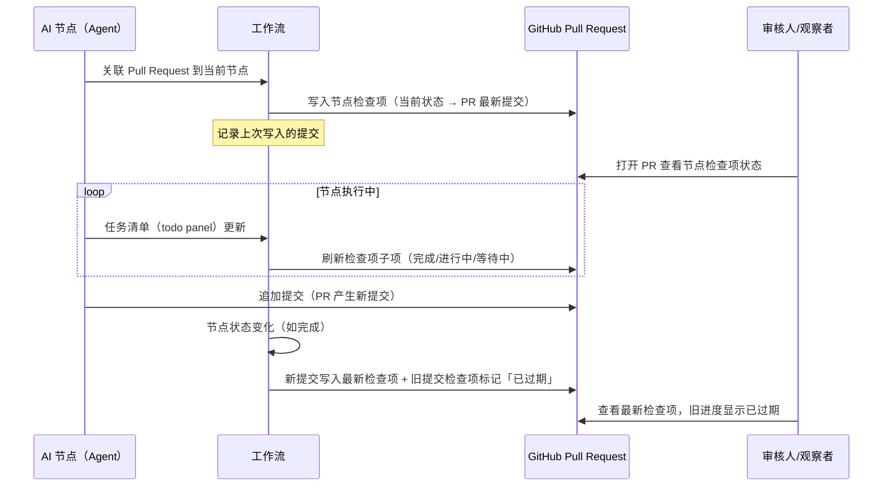
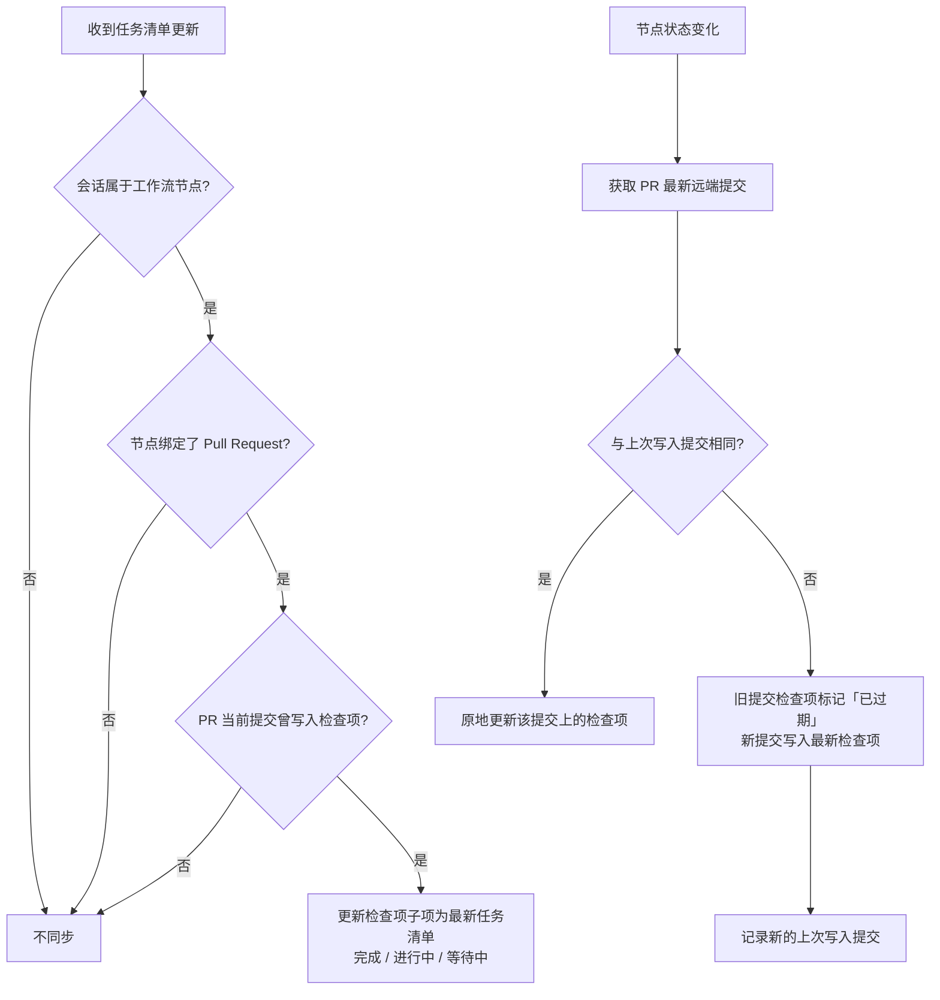

# 工作流节点状态通过 GitHub Check Runs 同步

**功能名称**: 工作流节点状态通过 GitHub Check Runs 同步
**PRD 版本**: v1.0
**创建日期**: 2026-10-25
**作者**: ZeroAsh Agent

## 背景与目标

### 1.1 背景

平台已打通「工作流 ↔ GitHub Pull Request」双向链路（见 [[20261023-workflow-github-pr-callback]]）：AI 节点可把产出的 Pull Request 关联到工作流实例与节点，PR 的审核结果（通过 / 拒绝）可自动驱动联动人类节点完成或打回。

但这条链路目前是「事件级」的——只有审核结论回流到工作流，**工作流内部的执行进展在 GitHub 上完全不可见**：

1. **审核人在 PR 页面看不到节点进度**。审核人打开 Pull Request 时，无法知道「产出这个 PR 的工作流节点现在处于什么状态」（排队中 / 执行中 / 被打回返工中 / 已完成），必须回到工作流界面查看。
2. **Agent 的执行过程不透明**。AI 节点执行时维护的任务清单（todo panel）只在工作流会话内可见，审核人与观察者无法从 PR 上感知「这个节点正在做哪几件事、做到哪一步」。

GitHub 提供了 Checks（检查运行）能力（官方文档：<https://docs.github.com/en/rest/checks/runs?apiVersion=2026-03-10>）：第三方可以在 Pull Request 的提交上写入带状态与结论文本的检查项，并随时更新。这正是把工作流节点进度「投影」到 PR 页面的理想载体。

### 1.2 目标

- **节点状态上 PR**：绑定了 Pull Request 的工作流节点，其状态实时同步为 PR 上的检查项；节点状态变化时，最新检查项写入 PR 最新的远端提交，系统记录上次写入的提交，旧提交上的检查项标记为「已过期（stale）」。
- **任务清单上 PR**：工作流会话的任务清单（todo panel）更新时，若该会话属于绑定了 PR 的节点、且当前提交已写入过检查项，则把检查项的子项内容更新为最新任务清单（完成 / 进行中 / 等待中三种状态）。
- **故障不回流**：GitHub 侧的同步失败（网络、权限、限流等）不影响工作流本身的流转。

### 1.3 成功标准

- 节点绑定 Pull Request 后，PR 页面立即出现对应该节点的检查项，且状态与节点当前状态一致。
- 节点每次状态变化（启动、完成、打回、返工、失败、复工等）后，PR 最新提交上的检查项在秒级内反映最新状态；若期间 PR 产生了新提交，新检查项写在新提交上，旧提交上的检查项变为「已过期」。
- AI 节点会话的任务清单更新后，对应检查项的子项内容同步刷新，三种状态（完成 / 进行中 / 等待中）展示正确；未写入过检查项的提交不产生子项更新。
- 未绑定 Pull Request 的节点、已完成 / 已归档的工作流，不产生任何检查项写入；GitHub 侧故障时工作流流转不受影响、无阻塞。

## 用户分析

### 2.1 目标用户

- **审核人**：在 GitHub 上 review Pull Request，期望不离开 PR 页面就能看到产出节点的实时状态与任务进展。
- **工作流观察者**：关注工作流进展，期望在 PR 时间线上直接跟进各绑定节点的进度。
- **Agent（AI 节点执行体）**：正常执行任务，任务清单与节点状态自动对外可见，无需额外汇报动作。
- **工作流编排者**：无需新增编排动作，沿用既有「绑定 Pull Request」能力即可获得进度可视化。

### 2.2 用户场景

| 场景 | 用户角色 | 目标 | 痛点 |
|--|--|--|--|
| 审核前看节点状态 | 审核人 | 打开 PR 即知产出节点是执行中还是已完成 | 必须回到工作流界面查节点状态 |
| 跟进 Agent 任务进展 | 审核人/观察者 | 在 PR 上看到节点任务清单的实时进度 | 任务清单只在会话内可见，过程不透明 |
| 识别过期进度 | 审核人 | PR 有新提交后，旧提交上的进度标记为已过期，不被误导 | 旧进度与新提交混在一起无法分辨 |
| 多节点同 PR | 观察者 | 同一 PR 被多个节点绑定时，各节点进度各自清晰 | 进度来源混杂 |

## 功能需求

### 3.1 功能概述

本期把「工作流节点进度」投影到 GitHub Pull Request 的 Checks 检查项上：

1. **节点状态同步**：绑定 PR 的节点，每次状态变化都更新 PR 检查项；检查项始终写在 PR 最新远端提交上，旧提交上的检查项标记「已过期」。
2. **任务清单同步**：节点会话的任务清单（todo panel）更新时，刷新当前提交检查项的子项内容（完成 / 进行中 / 等待中）。

### 3.2 功能列表

#### 功能点 1: 节点状态同步为 PR 检查项

- **描述**: 节点通过既有能力绑定 Pull Request 后：
  - **绑定即同步**：立即把节点当前状态写入 PR 最新远端提交的检查项；
  - **状态变化即更新**：节点状态每次变化时，获取 PR 最新远端提交并写入最新检查项；
  - **提交跟踪**：系统记录上次写入的提交；若最新提交与上次写入的提交不同，旧提交上的检查项标记为「已过期（stale）」，新检查项写在新提交上；若提交未变化，则原地更新同一检查项；
  - **一节点一检查项**：每个绑定节点对应一个独立、可识别的检查项（名称含节点名，见附录 A.1）；同一 PR 被多个节点绑定时各自独立展示；
  - **状态映射**：节点状态到检查项表现的映射见附录 A.2（排队中 / 进行中 / 返工中 / 已完成 / 被打回 / 失败）。
- **用户价值**: 审核人与观察者在 PR 页面即可实时掌握节点进度，新旧提交的进度关系清晰（旧的已过期、新的为最新）。
- **验收标准**:
  - [ ] 绑定 PR 后 PR 页面出现该节点的检查项，状态与节点当前状态一致。
  - [ ] 节点状态变化后秒级反映到 PR 检查项；PR 有新提交时检查项写在新提交，旧提交检查项显示「已过期」。
  - [ ] 同一 PR 绑定多个节点时，各节点检查项互不影响。

#### 功能点 2: 任务清单（todo panel）同步为检查项子项

- **描述**: 工作流运行对话中收到任务清单（todo panel）更新时，同时满足以下条件才同步：
  1. 该对话属于工作流节点会话；
  2. 该节点绑定了 Pull Request；
  3. 该 PR 当前提交曾写入过本节点的检查项；
  满足后把对应检查项的子项内容更新为最新任务清单，逐条展示任务及其状态（完成 / 进行中 / 等待中，见附录 A.3）。
- **用户价值**: 审核人可以看到「这个节点正在做的几件事、每件进展到哪一步」，执行过程透明可追溯。
- **验收标准**:
  - [ ] 任务清单更新后，检查项子项展示最新清单与三种状态，内容与面板一致。
  - [ ] 不满足条件（非工作流会话 / 未绑定 PR / 当前提交未写入检查项）时不产生任何写入。
  - [ ] 任务清单高频更新时同步有合并节流，不产生刷屏式写入。

#### 功能点 3: 同步状态可见性

- **描述**: 工作流实例详情中，已绑定 PR 的节点可查看检查项同步信息：检查项链接、最近同步时间、最近写入的提交；同步失败时可见失败提示。
- **用户价值**: 同步链路可观测，出问题能分辨「工作流没动」还是「同步没写上去」。
- **验收标准**:
  - [ ] 实例详情可见检查项链接与最近同步时间。
  - [ ] 同步失败有可理解的失败提示，且不影响工作流流转。

### 3.3 用户操作流程





### 3.4 页面/界面描述

| 页面 | 描述 | 关键元素 |
|------|------|---------|
| GitHub Pull Request 页（外部系统） | Checks 区展示节点检查项与子项进度 | 检查项名称（含节点名）、状态图标、子项任务清单（三态）、过期检查项的 stale 标记 |
| 工作流实例详情 / 节点详情 | 展示检查项同步信息 | 检查项链接、最近同步时间、最近写入的提交、失败提示 |

### 3.5 异常与边界情况

| 情况 | 预期行为 |
|------|---------|
| 节点未绑定 Pull Request | 不同步，行为与现状一致 |
| 工作流完成 / 归档 / 删除 | 关联解除后不再同步；已写入的检查项保持最终状态 |
| Pull Request 已关闭或合并 | 停止同步，不再写入新检查项 |
| GitHub 不可用 / 权限不足 / 被限流 | 不影响工作流流转；记录失败并在实例详情可见；下次状态变化或清单更新时再试 |
| 任务清单高频连续更新 | 合并节流后写入，避免对 GitHub 的写入风暴；内容未变化时不重复写入 |
| 同一 PR 被多个节点绑定 | 各节点独立检查项，互不影响 |
| 同一节点换绑新 PR | 以最后一次绑定为准，后续同步到新 PR；旧 PR 上的检查项不再更新 |
| 状态变化时 PR 无新提交 | 原地更新已有检查项，不产生重复检查项 |
| 任务清单为空 | 子项显示为空清单（或清空子项），不报错 |
| 绑定 PR 时仓库未授权检查项能力 | 同步失败并提示授权缺失，工作流流转不受影响 |

## 四、非功能需求

### 4.1 性能要求

- 节点状态变化到 PR 检查项更新的端到端延迟在秒级（正常情况 5 秒内可见）。
- 任务清单同步必须有节流合并，单检查项的写入频率有上限；同步过程不阻塞工作流节点流转与会话消息处理。

### 4.2 安全性要求

- 访问 GitHub 使用平台既有授权体系，按最小权限申请检查项写入能力；凭据不落日志、不出现在错误信息与界面中。
- 同步只写入 PR 所属用户授权范围内的仓库；不得向未授权仓库写入检查项。
- 任务清单与状态文案按纯文本写入检查项，不包含凭据、内部地址等敏感信息。

### 4.3 兼容性要求

- 未绑定 Pull Request 的工作流行为与现状完全一致；既有 PR 联动（审核驱动完成/打回）不受影响。
- 存量已绑定 PR 的节点在功能上线后，于下一次状态变化或清单更新时自然开始同步，无需人工操作。

## 五、依赖与约束

### 5.1 依赖

- 工作流 GitHub Pull Request 联动（节点绑定 PR、关联生命周期）：[[20261023-workflow-github-pr-callback]]。
- GitHub 帐号绑定与仓库授权：[[20260709-github-account-binding]]。
- GitHub Checks 检查项能力（官方文档）：<https://docs.github.com/en/rest/checks/runs?apiVersion=2026-03-10>。

### 5.2 约束

- 本期仅支持 GitHub Pull Request 的 Checks 检查项，不覆盖其他代码托管平台。
- 检查项写入依赖 GitHub 应用被授予 Checks 写入权限；未授权时同步降级为失败提示，不阻断工作流。
- 检查项名称、状态文案、子项格式由平台统一维护（附录 A），产品侧调整需走文档变更。
- 节点状态以工作流状态机为准，检查项是其只读投影；不提供从 GitHub 侧反向驱动工作流的能力。

## 六、相关文档

- [[20261023-workflow-github-pr-callback]] — 工作流 GitHub Pull Request 联动
- [[20260808-agent-workflow]] — Agent 工作流
- [[20260709-github-account-binding]] — GitHub 帐号绑定
- 技术提案：`docs/engineering/proposals/20261025-feat-workflow-check-runs-sync.md`

## 附录 A：文案与展示定稿

> 以下文案为产品定稿。`{节点名称}`、`{工作流名称}` 为运行时替换的占位符；实现层允许在不改变语义的前提下补充细节。

### A.1 检查项命名

```text
ZAG 工作流 · {节点名称}
```

同一 PR 被多个节点绑定时，各检查项按节点名区分；检查项详情中标注所属工作流名称。

### A.2 节点状态 → 检查项表现映射

| 节点状态 | 检查项表现 | 说明 |
|------|------|------|
| 排队中（待启动） | 排队中 | 节点已就绪等待执行 |
| 执行中 | 进行中 | 节点正在执行 |
| 返工中 | 进行中（标注「返工中」） | 节点被打回后重新执行 |
| 已完成 | 通过 | 节点已完成 |
| 被打回 | 需要处理 | 节点被下游打回，等待返工或重新提交 |
| 执行失败 | 失败 | 节点标记失败，需要人工介入 |
| —（旧提交上的检查项） | 已过期（stale） | PR 已有新提交，该检查项不再是最新进度 |

### A.3 任务清单子项格式

检查项子项为任务清单的逐条展示，每条任务一行，三态标记：

- **完成**：任务已完成；
- **进行中**：任务正在执行；
- **等待中**：任务尚未开始。

子项顶部给出汇总（如「3/5 完成」），清单顺序与任务面板一致。
