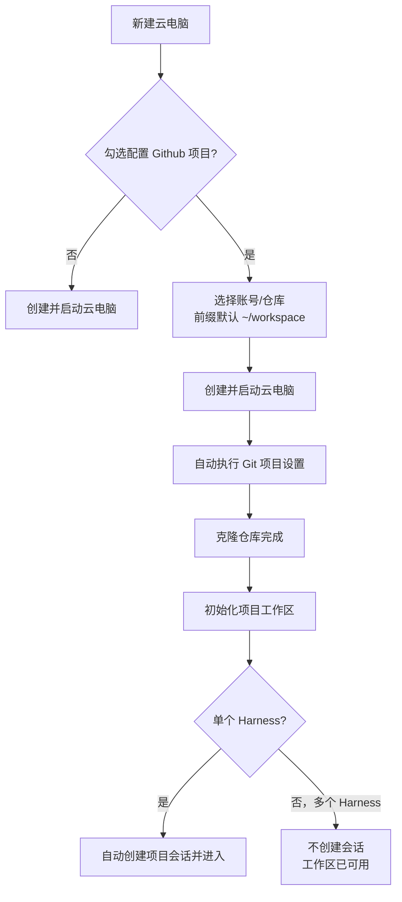
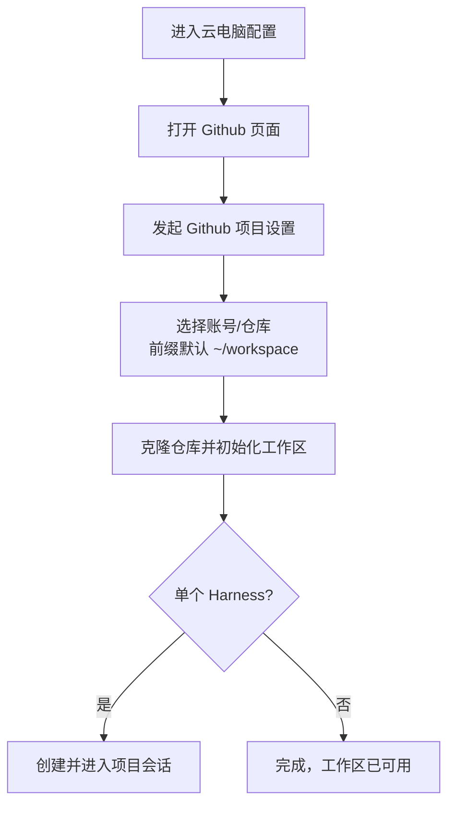

# 默认工作区优化

**功能名称**: 默认工作区优化
**PRD 版本**: v1.0
**创建日期**: 2026-10-26
**作者**: z-agent-bot

## 背景与目标

### 1.1 背景

云电脑此前调整为「创建期不再预置默认工作区」：默认工作区只在用户通过「Git 项目设置」初始化 Github 项目时才创建。该调整上线后发现以下不完善之处与 BUG（来源：GitHub Issue [Deliay/z-agent-gear#304](https://github.com/Deliay/z-agent-gear/issues/304)）：

1. 创建云电脑时同步勾选「配置 Github 项目」且不自动创建会话的场景下，仓库已被克隆到云电脑内，但对应的工作区没有出现在工作区列表中——用户无法基于已克隆的项目开展工作。
2. 云电脑配置中的「Github 项目设置」入口当前位于「工作负载」页签，与 Github 相关的其他配置分散在不同位置，查找路径不直观。
3. 「Git 项目设置」对话框中的「前缀地址（工作根目录）」需要用户手工填写绝对路径，默认值不友好，新用户不清楚应该填什么。

### 1.2 目标

1. 只要用户完成「Git 项目设置」（仓库克隆成功），无论是否同时创建会话，被克隆的项目目录都必须作为工作区出现在该云电脑的工作区列表中。
2. 云电脑配置中所有 Github 相关设置集中到同一处，降低查找成本。
3. 「前缀地址（工作根目录）」提供合理的默认值 `~/workspace`，用户不修改即可直接提交。

### 1.3 成功标准

1. 创建云电脑并勾选「配置 Github 项目」、选择多个 Harness 工具（不自动创建会话）时，设置完成后工作区列表中出现项目工作区，且该云电脑被标记为「已创建默认工作区」。
2. 云电脑配置的 Github 页面内可以完成「Github 项目设置」的发起；原「工作负载」页签不再出现该入口。
3. 打开「Git 项目设置」对话框（含新建云电脑流程中的 Github 项目区块）时，前缀地址默认值为 `~/workspace`，直接提交可成功完成设置。

## 用户分析

### 2.1 目标用户

使用云电脑（云端工作容器）并希望通过 Github 项目快速搭建工作环境的平台用户。

### 2.2 用户场景

| 场景 | 用户角色 | 目标 | 痛点 |
|--|--|--|--|
| 新建云电脑时勾选配置 Github 项目，并选择多个 Harness 工具 | 云电脑用户 | 项目克隆完成后能在工作区列表中看到并使用该项目 | 项目已克隆但工作区列表为空，无从下手 |
| 对运行中的云电脑补充配置 Github 项目 | 云电脑用户 | 快速找到 Github 项目设置入口 | 入口藏在「工作负载」页签，与 Github 其他设置分离 |
| 填写 Git 项目设置表单 | 云电脑用户 | 不理解「前缀地址」含义时也能使用合理默认完成设置 | 无前缀默认值或默认值不直观，需手工输入绝对路径 |

## 功能需求

### 3.1 功能概述

修复云电脑 Git 项目设置在「不创建会话」场景下不初始化工作区的问题，将云电脑配置中的「Github 项目设置」入口集中到 Github 页面，并把「前缀地址（工作根目录）」的默认值调整为 `~/workspace`。

### 3.2 功能列表

#### 功能点 1: 不创建会话时也初始化项目工作区

- **描述**: 通过「Git 项目设置」（含新建云电脑流程中勾选「配置 Github 项目」）完成仓库克隆后，无论是否同时创建会话，都要把克隆目标目录初始化为该云电脑的工作区，并标记该云电脑已创建默认工作区。选择多个 Harness 工具时不创建会话的产品行为保持不变。
- **用户价值**: 项目克隆完成后立即可在工作区列表中看到并进入项目，不会出现「代码已在云电脑里但前台看不到」的脱节状态。
- **验收标准**:
  - [ ] 新建云电脑勾选「配置 Github 项目」且选择多个 Harness 工具时，设置流程完成后工作区列表出现项目工作区
  - [ ] 上述场景下不自动创建会话（行为与现状一致），云电脑被标记为已创建默认工作区，不再出现「未创建默认工作区，请先创建或绑定工作区」提示
  - [ ] 对运行中的云电脑发起「Git 项目设置」成功后，同样保证工作区已初始化
  - [ ] 工作区初始化失败时设置流程给出明确失败提示，重试后幂等不重复创建

#### 功能点 2: 「Github 项目设置」入口迁移至 Github 页面

- **描述**: 云电脑配置中「工作负载」页签内的「Github 项目设置」入口迁移到云电脑配置的「Github」页面，与 Github 相关的其他配置集中展示。入口的可用条件不变（云电脑运行中才可用）。新建云电脑流程中的「配置 Github 项目」区块与侧边栏工作区入口不受本调整影响。
- **用户价值**: Github 相关配置集中在一个页面，查找路径符合直觉。
- **验收标准**:
  - [ ] 云电脑配置的「Github」页面内可以发起「Github 项目设置」，对话框与设置流程与现状一致
  - [ ] 「工作负载」页签不再展示「Github 项目设置」入口
  - [ ] 云电脑非运行中或已删除时，Github 页面内入口不可用并给出与现状一致的提示

#### 功能点 3: 前缀地址默认值 `~/workspace`

- **描述**: 「Git 项目设置」对话框与新建云电脑流程的 Github 项目区块中，「前缀地址（工作根目录）」默认值调整为 `~/workspace`。当云电脑已存在默认工作区时，仍预填该默认工作区路径（便于把新项目放到既有根目录下）。`~` 表示云电脑内的用户主目录，最终克隆地址预览保持实时展示。
- **用户价值**: 绝大多数用户无需理解并手工输入绝对路径即可直接完成设置。
- **验收标准**:
  - [ ] 无默认工作区时打开「Git 项目设置」对话框，前缀地址预填 `~/workspace`
  - [ ] 新建云电脑流程勾选「配置 Github 项目」时，前缀地址预填 `~/workspace`
  - [ ] 已有默认工作区时打开对话框，仍预填该默认工作区路径
  - [ ] 以默认值直接提交可以成功完成设置，最终克隆地址预览正确展示展开后的路径

### 3.3 用户操作流程

### 3.4 页面/界面描述

| 页面 | 描述 | 关键元素 |
|------|------|---------|
| 云电脑配置 - Github 页面 | 集中展示 Github 相关配置 | 「Github 项目设置」入口（运行中可用）、Github 相关配置区块 |
| 云电脑配置 - 工作负载页签 | 仅展示工作负载列表与安装 | 不再包含「Github 项目设置」入口 |
| Git 项目设置对话框 | 选择账号/仓库/前缀并执行设置 | 前缀地址默认 `~/workspace`、最终克隆地址实时预览 |
| 新建云电脑对话框 | 创建云电脑并可勾选配置 Github 项目 | Github 项目区块前缀地址默认 `~/workspace` |

### 3.5 异常与边界情况

| 情况 | 预期行为 |
|------|---------|
| 多 Harness 不创建会话时仓库克隆成功 | 工作区正常初始化，云电脑标记为已创建默认工作区 |
| 工作区初始化失败 | 设置流程提示失败，可重试；重试幂等，不产生重复工作区 |
| 会话创建失败（工作区已就绪） | 与现状一致：提示「仓库已就绪，请手动创建会话」，工作区保留 |
| 云电脑非运行中 | Github 页面内「Github 项目设置」入口不可用 |
| 前缀地址留空或填写非法内容 | 与现状一致的校验提示，无法提交 |
| 前缀地址使用 `~` 开头 | 正确解析为云电脑内用户主目录下的路径，预览展示展开结果 |

## 四、非功能需求

### 4.1 性能要求

无新增性能要求；设置流程耗时不因本次调整明显增加。

### 4.2 安全性要求

`~` 路径解析必须限定在云电脑用户主目录内，不允许通过构造输入逃逸到其他目录。

### 4.3 兼容性要求

存量已设置过 Github 项目的云电脑不受影响；已创建的工作区与默认工作区标记保持不变。

## 五、依赖与约束

### 5.1 依赖

- 依赖现有「Git 项目设置」设置流程与工作区管理能力。
- 依赖云电脑内用户主目录约定（与云电脑默认工作区目录约定一致）。

### 5.2 约束

- 不改变「创建云电脑不再预置默认工作区」的整体策略：默认工作区仍只在 Git 项目设置时创建。
- 不改变多 Harness 场景「不自动创建会话」的既有产品行为。

## 六、相关文档

- GitHub Issue：[Deliay/z-agent-gear#304 默认工作区优化](https://github.com/Deliay/z-agent-gear/issues/304)
- 技术提案：[[../../engineering/proposals/20261026-fix-default-workspace-optimization.md]]
- 关联契约：`contracts/cloud-host.graphql`
