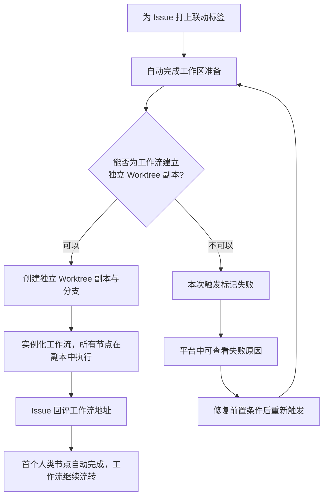

# GitHub Issues 联动工作流强制 Worktree 隔离

**功能名称**: GitHub Issues 联动工作流强制 Worktree 隔离
**PRD 版本**: v1.0
**创建日期**: 2026-10-26
**作者**: ZeroAsh Agent

## 背景与目标

### 1.1 背景

云电脑 GitHub Issues 联动能力（见 [[20261025-github-issues-workflow]]）上线后，用户在仓库中为 Issue 打上联动标签，即可自动完成「工作区准备 → 实例化工作流 → Issue 回评 → 首个人类节点自动完成」的全链路。

但该链路存在一个严重缺陷：**通过 Issues 联动触发的工作流没有启用 Worktree 隔离**。平台内手工实例化工作流时，用户可以勾选「为工作流创建独立 Worktree」；而 Issues 联动通道全程无人工干预，没有任何环节开启隔离，导致：

1. 工作流的所有节点会话直接在**工作区主分支**上执行，AI 的改动直接落在主分支上，污染仓库的基线代码；
2. 同一仓库多个 Issue 并发触发多条工作流时，所有工作流共享同一个主分支工作区，产物相互覆盖、相互串扰；
3. 与手工实例化可选隔离的行为不一致，用户对「联动触发的工作流在哪里跑」没有预期。

### 1.2 目标

- Issues 联动触发的工作流**一律在独立 Worktree 中执行**，每个工作流实例拥有自己独立的工作副本与分支，工作区主分支在整个执行期间零改动。
- 对用户**零配置成本**：联动配置的维护方式不变，无需新增任何选项，触发即隔离。
- 当隔离环境无法建立时（例如工作区尚未就绪为 Git 仓库），触发**明确失败并给出可读原因**，绝不静默降级为在主分支上执行。

### 1.3 成功标准

- 为联动仓库的 Issue 打上触发标签后，自动创建的工作流实例拥有独立的 Worktree 工作副本与独立分支，实例内所有节点会话均在该副本中工作。
- 工作流从触发到执行完毕，工作区主分支不产生任何新提交与未提交改动。
- 同一仓库多个 Issue 并发触发时，各工作流实例互不影响，产物不串扰。
- 隔离环境建立失败时，该次触发以失败终态结束，失败原因在平台中可查看、可追溯；不会出现在主分支上「跑了一半」的情况。
- 手工实例化工作流的「为工作流创建独立 Worktree」选项行为保持不变，无回归。

## 用户分析

### 2.1 目标用户

- **云电脑使用者（联动配置者）**：为云电脑配置 Issues 联动，期望 Issue 触发的工作流安全、隔离地执行，不破坏仓库主分支。
- **工作流观察者**：从 Issue 评论进入工作流查看进展，期望看到的是一条干净、独立的执行线。
- **仓库维护者**：仓库主分支需要保持干净可信，不接受自动化流程直接向主分支写入。

### 2.2 用户场景

| 场景 | 用户角色 | 目标 | 痛点 |
|--|--|--|--|
| Issue 触发工作流安全执行 | 云电脑使用者 | 打标签触发工作流，AI 在隔离副本中工作 | 联动工作流直接改主分支，基线被污染 |
| 多 Issue 并发触发 | 云电脑使用者 | 多个 Issue 各自触发的工作流互不干扰 | 共享主分支工作区，产物相互覆盖 |
| 查看工作流执行位置 | 工作流观察者 | 明确知道该工作流实例在哪个副本/分支上执行 | 无隔离时无法区分，改动去向不明 |
| 隔离建立失败时感知 | 云电脑使用者 | 触发失败能看到明确原因，便于修复重试 | 静默跑在主分支上，事后才发现 |
| 手工实例化行为不变 | 云电脑使用者 | 平台内手工实例化的隔离选项语义保持现状 | 修复不影响既有手工入口 |

## 功能需求

### 3.1 功能概述

修复 Issues 联动触发链路：为联动触发的工作流实例**强制启用 Worktree 隔离**——实例化时自动为工作流创建独立 Worktree 工作副本，实例内所有节点会话默认在该副本中执行；隔离副本建立失败时，本次触发以明确原因失败，不降级到主分支执行。

### 3.2 功能列表

#### 功能点 1: 联动触发的工作流强制 Worktree 隔离

- **描述**: 通过 Issues 联动触发而创建的工作流实例，无需任何人工勾选，自动获得独立的 Worktree 工作副本与分支；实例内所有节点会话（包括未单独配置隔离的节点）都在该副本中工作，工作区主分支全程不被触碰。
- **用户价值**: 主分支始终干净可信；多条联动工作流并发执行互不干扰；与「Issue 驱动开发」的心智模型一致——每个 Issue 对应一条独立的改动线。
- **验收标准**:
  - [ ] 为联动仓库 Issue 打上触发标签后，自动创建的工作流实例持有独立 Worktree 副本与分支，且实例详情中可看到该分支信息
  - [ ] 工作流全部节点执行过程中产生的文件改动只出现在该实例的 Worktree 副本中，工作区主分支无任何新提交与未提交改动
  - [ ] 同一仓库两个 Issue 并发触发两条工作流时，两条工作流各自持有独立副本，产物互不覆盖

#### 功能点 2: 隔离建立失败时明确失败

- **描述**: 当联动触发的工作流无法建立隔离副本时（例如工作区尚未识别为 Git 仓库），本次触发直接以失败终态结束，并记录人类可读的失败原因；**不允许**静默降级为在主分支上执行。
- **用户价值**: 失败可感知、可定位、可重试，避免「以为在隔离环境、实际改了主分支」的最差结果。
- **验收标准**:
  - [ ] 隔离副本无法建立时，该次触发记录为失败状态，原因清晰可读（指明与 Git 工作区相关）
  - [ ] 失败后工作区主分支无任何由本次触发产生的改动
  - [ ] 修复前置条件（如完成仓库初始化）后重新触发同一 Issue，可正常建立隔离并执行

#### 功能点 3: 既有入口行为保持

- **描述**: 本次修复只改变 Issues 联动触发通道的行为；平台内手工实例化工作流的隔离选项（勾选与否）及其语义完全不变；已按节点单独配置隔离的工作流，其节点级隔离行为不变。
- **用户价值**: 修复范围可控，老用户既有习惯与配置不受任何影响。
- **验收标准**:
  - [ ] 手工实例化时勾选/不勾选「为工作流创建独立 Worktree」的行为与修复前完全一致
  - [ ] 节点级已配置隔离的工作流，经联动触发时节点级隔离仍然生效

### 3.3 用户操作流程

### 3.4 页面/界面描述

本需求不新增配置入口与页面。既有界面中的表现要求：

| 页面 | 描述 | 关键元素 |
|------|------|---------|
| 工作流实例详情 | 联动触发的实例与手工勾选隔离的实例一样，可看到独立副本/分支信息 | 实例的 Worktree 分支信息 |
| 云电脑设置「Github」区块 | 联动配置列表维护方式不变，无新增选项 | 维持现状 |
| Issue 评论区 | 回评行为不变：告知工作流已触发并附查看地址 | 工作流查看地址 |

### 3.5 异常与边界情况

| 情况 | 预期行为 |
|------|---------|
| 工作区尚未就绪为 Git 仓库（无默认分支信息） | 本次触发明确失败，原因可读，主分支零改动 |
| 同一 Issue 重复打标/事件重复投递 | 仍只触发一次（维持既有幂等行为），不会重复建副本 |
| 多条联动配置命中同一 Issue | 每条配置各触发一条工作流，各自持有独立副本 |
| 隔离副本已建立但实例创建中途失败 | 已建立的副本被清理，不留垃圾 |
| 工作流实例被删除 | 其独立副本随之清理（维持既有清理行为） |
| 手工实例化（非联动） | 行为与修复前完全一致，不强制隔离 |

## 四、非功能需求

### 4.1 性能要求

- 建立隔离副本不应显著拉长「打标签 → 工作流启动」的端到端耗时，整体仍维持在秒级到分钟级的既有水平。

### 4.2 安全性要求

- 联动触发的工作流任何情况下不得直接在工作区主分支上执行；这是本需求的硬约束。

### 4.3 兼容性要求

- 已存在的联动配置无需修改即自动获得隔离行为；
- 修复前已在执行中的存量工作流实例不受影响，按原方式执行完毕。

## 五、依赖与约束

### 5.1 依赖

- 云电脑 GitHub Issues 联动能力（见 [[20261025-github-issues-workflow]]）；
- 工作流实例的独立 Worktree 能力（见 [[20260817-session-lifecycle-and-worktree-management]]、[[20260829-workflow-worktree-session-start]]）。

### 5.2 约束

- 不改变联动配置的数据结构与维护方式；
- 不改变手工实例化入口的隔离选项语义；
- 触发链路保持「事件不等待全链路」的异步推进方式。

## 六、相关文档

- [[20261025-github-issues-workflow]] — 云电脑 GitHub Issues 联动工作流（本修复的基础能力）
- [[20260817-session-lifecycle-and-worktree-management]] — 会话生命周期与 Worktree 管理
- [[20260829-workflow-worktree-session-start]] — 工作流 Worktree 节点会话启动失败修复
- [[20261023-workflow-github-pr-callback]] — 工作流 GitHub Pull Request 联动
