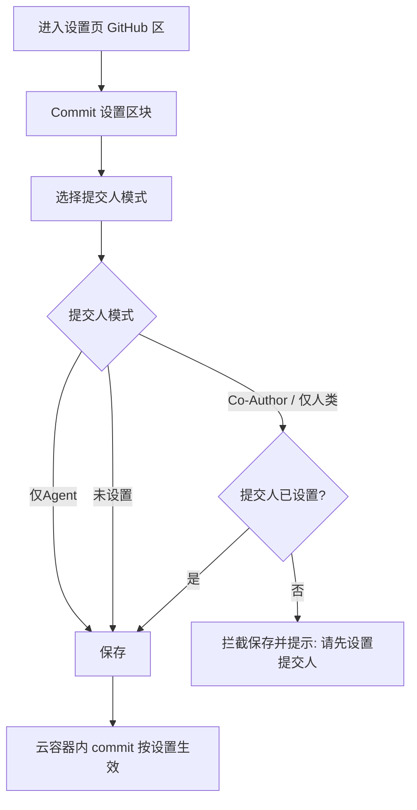
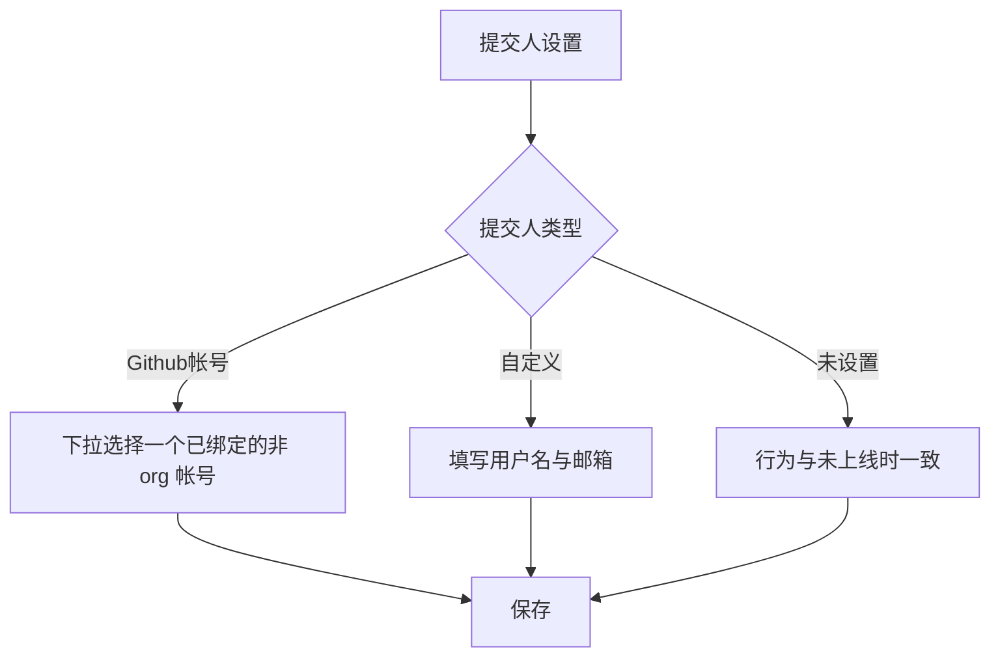

# 云容器 Commit 提交人设置

**功能名称**: Commit 设置（云容器提交人模式与提交人）
**PRD 版本**: v1.0
**创建日期**: 2026-10-27
**作者**: ZeroAsh Agent

## 背景与目标

### 1.1 背景

云容器（云电脑）内会产生大量代码提交（commit），但平台从未规定这些 commit 由谁提交：

- 容器内 git 提交身份未配置时，提交直接失败或使用容器默认身份（如主机名），提交历史无法追溯真实操作者；
- 无法区分「Agent 代提交」与「用户本人提交」，团队协作与审计场景缺乏归属依据；
- GitHub 帐号绑定、Github 工作负载与云主机 Git 项目设置已上线，仓库克隆与凭据链路已通，但提交身份链路缺失。

### 1.2 目标

- 设置页「GitHub 绑定」下方新增「Commit 设置」区块，用户可声明云容器内 commit 的提交人模式与提交人身份；
- 云容器内产生的 commit 按用户设置正确落提交人（平台 bot / 用户本人 / 用户 + bot 共同署名）；
- 「未设置」时行为与本需求上线前完全一致（零回归）。

### 1.3 成功标准

- 用户可在设置页完成 Commit 设置的查看与保存，非法组合（选择 Co-Author / 仅人类但未设置提交人）被拦截并给出明确提示；
- 云容器内提交的 commit 作者身份与设置一致：仅Agent → 平台 bot；仅人类 → 用户；Co-Author → 用户为主提交人并附带 bot 共同署名；
- 未设置过的用户与存量云容器行为与功能上线前一致。

## 用户分析

### 2.1 目标用户

使用云容器（云电脑）进行仓库开发、关注 commit 归属与审计的注册用户。

### 2.2 用户场景

| 场景 | 用户角色 | 目标 | 痛点 |
|--|--|--|--|
| Agent 全自动开发并提交 | 个人开发者 | commit 标记为平台 bot，便于区分机器提交 | 容器内提交身份缺失或与用户混淆 |
| 团队仓库协作与审计 | 项目维护者 | commit 必须追溯到真实用户 | Agent 代提交无法追溯到人 |
| Agent 辅助开发 | 使用 AI 辅助的开发者 | 主提交人为用户，同时保留 bot 共同署名体现 AI 参与 | 无法表达「人为主、AI 协同」的署名关系 |

## 功能需求

### 3.1 功能概述

在设置页「GitHub 绑定」下方新增「Commit 设置」区块，通过「提交人模式」与「提交人」两个设置项声明云容器内 commit 的提交身份；区块头部常驻提示「设置只对云容器环境生效」。

### 3.2 功能列表

#### 功能点 1: Commit 设置区块

- **描述**: 设置页「GitHub 绑定」下方新增独立区块「Commit 设置」；区块头部显示常驻提示「设置只对云容器环境生效」。该设置对本地控制器环境不产生任何影响。
- **用户价值**: 明确设置生效边界，避免用户误以为会影响本地 git 配置。
- **验收标准**:
  - [ ] 设置页「GitHub 绑定」下方出现「Commit 设置」区块
  - [ ] 区块头部展示提示「设置只对云容器环境生效」
  - [ ] 本地控制器环境内的 commit 行为不受该设置影响

#### 功能点 2: 提交人模式

- **描述**: 「提交人模式」在「仅Agent」「Co-Author」「仅人类」「未设置」中四选一，默认为「未设置」。
  - **仅Agent**：勾选了 Github 负载的云容器内，git 提交配置的用户名和邮箱为平台 bot 的名字和邮箱；
  - **Co-Author**：主要提交人是用户，commit 同时附带 bot 的 Co-Author 共同署名；
  - **仅人类**：提交人是用户；
  - **未设置**：行为与本需求未上线时一致。
  - 选择「Co-Author」或「仅人类」时要求「提交人」设置不是「未设置」，否则禁止保存并提示原因。
- **用户价值**: 用户可按协作与审计需求声明容器内提交的归属方式。
- **验收标准**:
  - [ ] 默认值为「未设置」
  - [ ] 四种模式可切换并保存
  - [ ] 选择「Co-Author」或「仅人类」且「提交人」为「未设置」时保存被拦截，并提示需先设置提交人
  - [ ] 「仅Agent」模式下，勾选 Github 负载的云容器内提交的 commit 作者为平台 bot
  - [ ] 「Co-Author」模式下，commit 作者为用户且附带 bot 共同署名
  - [ ] 「仅人类」模式下，commit 作者为用户且无 bot 署名
  - [ ] 「未设置」时容器内 git 提交身份与功能上线前一致

#### 功能点 3: 提交人

- **描述**: 「提交人」在「Github帐号」「自定义」「未设置」中三选一。
  - **Github帐号**：显示一个下拉框，可选择一个已绑定的非 org 帐号；以该帐号的用户名与 GitHub noreply 邮箱作为提交身份；
  - **自定义**：显示用户名和邮箱两个输入框，对应 git 的 user 和 email；
  - **未设置**：行为与本需求未上线时一致。
- **用户价值**: 提交人身份既可复用已绑定的 GitHub 身份（免填写、commit 可关联帐号），也可完全自定义。
- **验收标准**:
  - [ ] 选择「Github帐号」时显示已绑定帐号下拉框，org 帐号不出现在选项中
  - [ ] 未绑定任何 Github 帐号时下拉框为空，并引导用户先绑定 Github 帐号
  - [ ] 选择「自定义」时展示用户名、邮箱输入框；用户名为空或邮箱格式非法时保存被拦截并提示
  - [ ] 「未设置」时行为与功能上线前一致

#### 功能点 4: 生效范围与时机

- **描述**: 设置保存后对云容器环境生效：新建云容器立即按设置生效；已运行的云容器稍后自动生效，无需重建；切换回「未设置」后，云容器恢复为功能上线前的行为，不残留本功能写入的提交身份配置。
- **用户价值**: 设置随时可改、可退，无需重建环境，无配置残留。
- **验收标准**:
  - [ ] 保存设置后新建的云容器内 commit 身份符合设置
  - [ ] 已运行的云容器无需重建即可在稍后自动生效
  - [ ] 切回「未设置」后，容器内不再保留本功能写入的提交身份配置

### 3.3 用户操作流程

### 3.4 页面/界面描述

| 页面 | 描述 | 关键元素 |
|------|------|---------|
| 设置页 - Commit 设置区块 | 「GitHub 绑定」下方的独立区块 | 头部提示「设置只对云容器环境生效」、「提交人模式」选择器、「提交人」选择器、保存按钮 |
| 提交人 - Github帐号 | 提交人选择「Github帐号」时显示 | 已绑定非 org 帐号下拉框（头像 + 用户名） |
| 提交人 - 自定义 | 提交人选择「自定义」时显示 | 用户名输入框、邮箱输入框 |

### 3.5 异常与边界情况

| 情况 | 预期行为 |
|------|---------|
| 选择「Co-Author」或「仅人类」但「提交人」为「未设置」 | 拦截保存并提示「请先设置提交人」 |
| 提交人选择「Github帐号」但未绑定任何帐号 | 下拉框为空，引导用户先绑定 Github 帐号，且无法保存该组合 |
| 已选 Github 帐号之后被解绑 | 设置保留但该容器按「未设置」行为处理；用户重新打开设置页时提示重新选择提交人 |
| 「仅Agent」但云容器未勾选/未安装 Github 负载 | 该容器不做任何提交身份配置（行为同「未设置」） |
| 自定义邮箱格式非法或用户名为空 | 拦截保存并提示 |
| 已运行的云容器 | 稍后自动生效，无需重建 |
| 切换回「未设置」 | 移除本功能写入的提交身份配置，恢复上线前行为 |

## 四、非功能需求

### 4.1 性能要求

- 设置的读取与保存在 2 秒内完成；
- 已运行云容器的生效延迟可接受分钟级。

### 4.2 安全性要求

- 提交身份仅包含用户名与邮箱，不引入任何新凭据；
- 自定义输入需校验，不允许换行等非法字符；
- 「Github帐号」提交人与 bot 署名均使用 GitHub noreply 邮箱形式，不暴露用户真实邮箱（用户主动自定义填写除外）。

### 4.3 兼容性要求

- 未设置用户与存量云容器行为零变化；
- 旧版本云容器不支持该能力时优雅降级为「未设置」行为，不产生错误。

## 五、依赖与约束

### 5.1 依赖

- GitHub 帐号绑定（已上线）；
- Github 工作负载与云主机 Git 项目设置（已上线）。

### 5.2 约束

- 仅对云容器（云电脑）环境生效，本地控制器环境不适用；
- 仅支持 github.com；
- 每个设置项单选，默认均为「未设置」。

## 六、相关文档

- [[../released/20260709-github-account-binding.md]] — GitHub 帐号绑定
- [[20261021-github-workload.md]] — Github 工作负载与云主机 Git 项目设置
- [[20261026-default-workspace-optimization.md]] — 默认工作区优化（Github 项目设置入口迁移）
- 技术提案：[[../../engineering/proposals/20261027-feat-commit-author-settings.md]]
