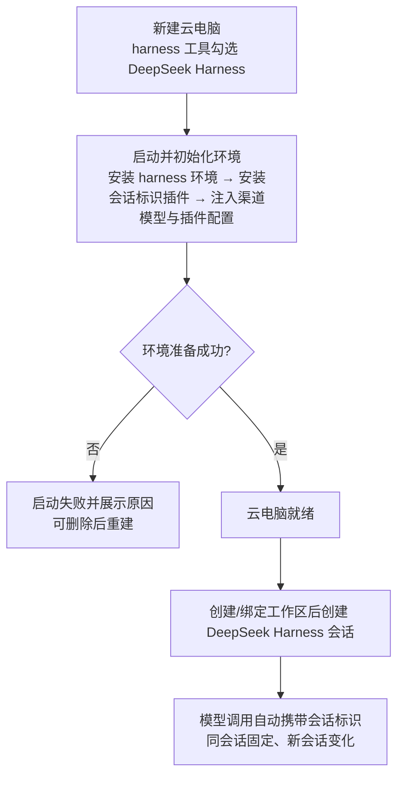
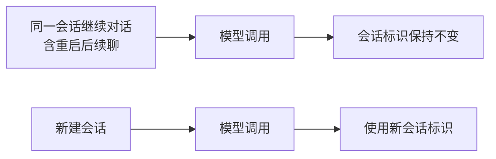

# DeepSeek Harness 会话标识请求头注入（dsh-header-masq 插件预置）

**功能名称**: DeepSeek Harness 云电脑会话标识请求头注入（dsh-header-masq 插件）
**PRD 版本**: v1.0
**创建日期**: 2026-10-27
**作者**: ZeroAsh

> 术语沿用《增加工作负载「DeepSeek Harness」（Harness）》（[[20261025-deepseek-harness.md]]）的口径：云电脑是用户自助创建的云端机器，创建时选择 harness 工具；DeepSeek Harness 是第三个 harness 工具（与 OpenCode、Kimi Code 同级），启动初始化环境时平台默认注入渠道模型，开箱即用、无需登录。
>
> 需求原文：
>
> - dsh 增加插件：`Deliay/dsh-header-masq`
> - 工作负载中增加命令：`dsh plugin --profile acp add Deliay/dsh-header-masq`
> - 增加如下配置：
>
> ```
> - insert:
>     - id: header-masq
>       name: dsh-header-masq
>       config:
>         source: x-deepseek-harness-session-id
>         targets:
>           - x-opencode-session
>         fallbackToSessionId: true
>         debug: false
> ```

## 背景与目标

### 1.1 背景

云电脑已支持三个 harness 工具：OpenCode、Kimi Code、DeepSeek Harness。其中 OpenCode 与 DeepSeek Harness 均为「平台渠道模型默认注入、开箱即用」的口径：模型调用经平台模型网关到上游供应商，按平台口径计费。

平台模型网关链路上存在一个**会话标识请求头**约定（`x-opencode-session`）：OpenCode 在每次模型调用时原生携带该头，平台网关将其透传给上游供应商，作为会话路由/亲和标识。DeepSeek Harness 原生**不发送**该请求头——其模型调用在平台链路上缺少会话标识，与 OpenCode 的行为不一致。

`dsh-header-masq` 是 DeepSeek Harness 的会话标识桥接插件：在模型调用时把当前会话的**持久化会话 ID** 写入 `x-opencode-session` 请求头，使 DeepSeek Harness 会话的模型调用携带与 OpenCode 相同语义的会话标识。该插件行为稳定（同一会话全程同一值、新会话新值、进程重启后续聊同一会话值不变），且支持配置来源头、目标头清单等。

### 1.2 目标

- DeepSeek Harness 云电脑在启动初始化环境时**自动安装并启用** `dsh-header-masq` 插件，用户无需任何手工操作。
- 插件按平台统一口径配置生效：来源头 `x-deepseek-harness-session-id`、目标头 `x-opencode-session`、回退使用持久化会话 ID、关闭调试输出。
- 生效后，DeepSeek Harness 会话的每次模型调用自动携带会话标识请求头，且满足**固定性保证**：同一会话的各轮对话（含标题生成、压缩、重试）标识完全一致；新建会话使用新标识；云电脑重启后继续同一会话标识不变。
- 环境准备（含插件安装与配置注入）可重复执行（幂等）；失败则云电脑启动失败并展示原因（与既有 harness 环境准备同口径）。
- OpenCode、Kimi Code 与普通主机完全不受影响；DeepSeek Harness 既有会话体验（消息流、模型切换、会话继续）不受影响。

### 1.3 成功标准

- 新建含 DeepSeek Harness 的云电脑，就绪后其会话的模型调用均携带会话标识请求头，且同一会话内各轮调用的标识完全一致。
- 同一会话经「继续」（含云电脑重启后续聊）后，模型调用仍携带相同标识；新建会话后标识更新为新值。
- 插件安装/配置注入失败 → 云电脑启动失败并展示原因；初始化过程重复执行不产生重复安装或配置损坏。
- 注入的配置与平台统一口径一致（来源头、目标头、回退策略、调试开关），用户侧无新增配置入口、无新增界面。
- OpenCode、Kimi Code 云电脑与普通主机既有功能零回归。

## 用户分析

### 2.1 目标用户

- **DeepSeek Harness 云电脑用户（直接受益者）**：使用 DeepSeek Harness 会话时，模型调用在平台链路上的行为与 OpenCode 一致，无需感知任何差异。
- **平台运营/计费方（间接受益者）**：DeepSeek Harness 流量与 OpenCode 流量具备同口径的会话标识，链路网关的会话路由与归因行为统一。

### 2.2 用户场景

| 场景 | 用户角色 | 目标 | 痛点 |
|--|--|--|--|
| DeepSeek Harness 会话正常对话 | DeepSeek Harness 用户 | 模型调用与 OpenCode 一样携带会话标识 | DeepSeek Harness 原生不发送会话标识头，链路行为不一致 |
| 长会话多轮对话 | DeepSeek Harness 用户 | 同一会话各轮调用标识固定 | 标识若逐轮变化会破坏上游会话亲和 |
| 重启后续聊历史会话 | DeepSeek Harness 用户 | 继续会话后标识保持不变 | 标识若重置，同一会话被上游视为多个会话 |
| 环境准备失败排查 | DeepSeek Harness 用户 | 启动失败可见原因，可删除重建 | 失败无提示则不知如何恢复 |

## 功能需求

### 3.1 功能概述

DeepSeek Harness 预置工作负载的环境准备流程新增「会话标识插件」环节：安装并启用 `dsh-header-masq` 插件，并按平台统一口径写入插件配置（来源头 `x-deepseek-harness-session-id`、目标头 `x-opencode-session`、回退到持久化会话 ID、关闭调试）。生效后 DeepSeek Harness 会话的模型调用自动携带会话标识请求头，同一会话全程固定。全过程在创建云电脑时自动完成，无新增用户操作与界面。

### 3.2 功能列表

#### 功能点 1: DeepSeek Harness 环境准备自动安装会话标识插件

- **描述**: 含 DeepSeek Harness 的云电脑在启动初始化环境时，自动安装并启用 `dsh-header-masq` 插件（与 harness 运行环境安装、渠道模型注入同一阶段完成）。插件安装来源固定，安装结果经校验；安装失败视为环境准备失败。
- **用户价值**: 开箱即用——创建完云电脑即具备会话标识能力，无需进入机器手工安装。
- **验收标准**:
  - [ ] 新建含 DeepSeek Harness 的云电脑就绪后，插件已安装并启用
  - [ ] 插件安装失败 → 云电脑启动失败并展示原因，可删除后重建
  - [ ] 环境准备重复执行（重放/重试）幂等：不产生重复安装、不损坏既有配置

#### 功能点 2: 插件配置按平台统一口径注入

- **描述**: 插件配置随渠道模型注入一并写入并生效，口径为需求原文给定值：
  - 来源头：`x-deepseek-harness-session-id`
  - 目标头：`x-opencode-session`
  - 回退策略：拿不到来源头时回退使用当前会话的持久化会话 ID（`fallbackToSessionId: true`）
  - 调试输出：关闭（`debug: false`）
- **用户价值**: 全平台 DeepSeek Harness 云电脑行为一致、可预期；无调试噪音。
- **验收标准**:
  - [ ] 就绪云电脑内插件配置与上述口径逐项一致
  - [ ] 配置注入可重复执行（幂等），重复注入后配置内容保持不变
  - [ ] 配置不含任何凭证信息；注入过程不进入日志敏感信息

#### 功能点 3: 会话标识固定性与一致性

- **描述**: 插件生效后的会话标识满足固定性保证：
  - 同一会话的第 1、2、N 轮对话（含标题生成、压缩、重试）标识完全相同；
  - 新建另一个会话 → 使用新的、不同的标识；
  - 云电脑进程重启后继续同一会话 → 标识仍然相同（基于持久化会话 ID，而非随机数）；
  - 目标头已存在时被覆盖为当前会话标识，不残留旧会话的值。
- **用户价值**: 上游链路看到的会话边界与用户感知一致；续聊、重试不产生会话漂移。
- **验收标准**:
  - [ ] 同一会话多轮对话的模型调用标识一致
  - [ ] 会话「继续」（含重启后续聊）后标识保持
  - [ ] 新建会话后标识更新且与历史会话不同

### 3.3 用户操作流程

#### 创建 DeepSeek Harness 云电脑（会话标识自动就绪）



#### 会话延续与标识固定



### 3.4 页面/界面描述

本期**无新增页面与界面元素**：插件安装与配置注入全部发生在云电脑创建时的环境准备阶段；环境准备失败沿用既有「启动失败并展示原因」的呈现方式。

| 页面 | 描述 | 关键元素 |
|------|------|---------|
| 新建云电脑对话框 | 无变化 | harness 工具多选（沿用既有） |
| 主机界面（云电脑） | 无变化 | 支持的工具列表、工作区、会话入口（沿用既有） |
| 会话界面 | 无变化 | 消息流、模型选择（沿用既有） |

### 3.5 异常与边界情况

| 情况 | 预期行为 |
|------|---------|
| 插件安装失败（网络不可达、插件来源不可用、版本不兼容） | 云电脑启动失败并展示原因；可删除后重新创建 |
| 插件配置注入失败 | 同上：启动失败并展示原因 |
| 环境准备重复执行（重连重放、重试） | 幂等：插件不重复安装、配置不损坏 |
| 拿不到当前会话标识的模型调用 | 按配置回退读取来源头；均无时不注入目标头（不写入空值） |
| 同选多个 harness 工具 | 各工具环境分别准备；插件仅作用于 DeepSeek Harness，OpenCode / Kimi Code 不受影响 |
| 管理员已在后台定制过该预置工作负载的环境准备脚本 | 平台不擅自覆盖其定制内容（沿用预置工作负载既有口径） |
| 既有（旧版创建的）DeepSeek Harness 云电脑 | 环境准备只在创建时执行，存量云电脑不自动变更；重建后自动获得本能力 |

## 四、非功能需求

### 4.1 性能要求

- 插件安装与配置注入在云电脑启动耗时中的占比应与既有 harness 环境准备同量级，不明显拉长整体启动时长。
- 插件生效后对每次模型调用的额外开销可忽略（仅在请求上写入请求头），不影响会话内对话延迟。

### 4.2 安全性要求

- 插件配置不含任何凭证信息；注入的模型凭证管理口径不变（不进入日志、不展示在界面、随云电脑销毁失效）。
- 插件仅向模型调用请求写入会话标识请求头，不读取、不上传会话内容。
- 插件安装来源固定且公开可审计；平台不引入第三方私有来源。

### 4.3 兼容性要求

- OpenCode、Kimi Code 云电脑与普通主机完全不受影响。
- DeepSeek Harness 既有会话能力（消息流、模型切换、会话继续、平台计费）不受影响。
- 本期不新增任何前台/后台页面与配置入口；后台模型设置沿用既有能力。

## 五、依赖与约束

### 5.1 依赖

- 云电脑 harness 工作负载能力（DeepSeek Harness 预置工作负载与启动失败语义）——本期在其环境准备流程中扩展。
- 平台渠道模型注入能力（渠道模型写入工具配置）——插件配置随同一注入环节生效。
- `dsh-header-masq` 插件的公开可用性与稳定性（插件行为与固定性保证以其公开文档为准）。
- DeepSeek Harness 运行环境版本需满足插件声明的兼容范围。

### 5.2 约束

- 插件安装与配置注入发生在**云电脑启动初始化环境阶段**，不做任何使用前用户交互前置。
- 插件配置口径以需求原文给定值为准，平台统一写入；一期不提供用户侧自定义入口。
- 环境准备（含插件环节）必须幂等且有硬校验：安装成功但未生效视为启动失败。
- 不改动 OpenCode / Kimi Code 的任何行为；不改动计费口径本身（仅补齐会话标识）。

## 六、相关文档

- [[20261025-deepseek-harness.md]] — 增加工作负载「DeepSeek Harness」（Harness）（本期的前置需求）
- [[20261020-container-harness-support.md]] — 容器启动任务支持 harness 类型（OpenCode 云电脑）
- [[20261025-opencode-model-context-length.md]] — 云电脑 OpenCode 模型上下文长度下发
- [[../../engineering/proposals/20261027-feat-dsh-header-masq.md]] — 本期技术提案
