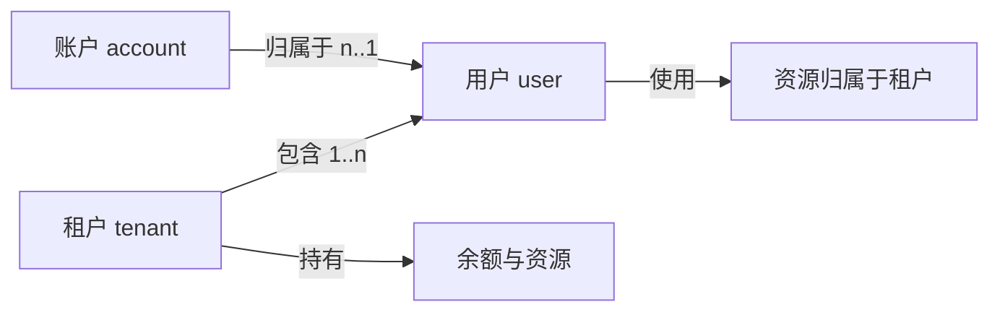
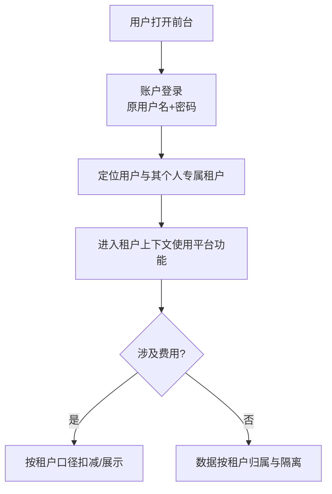
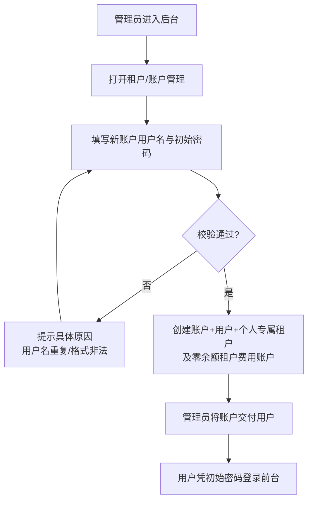
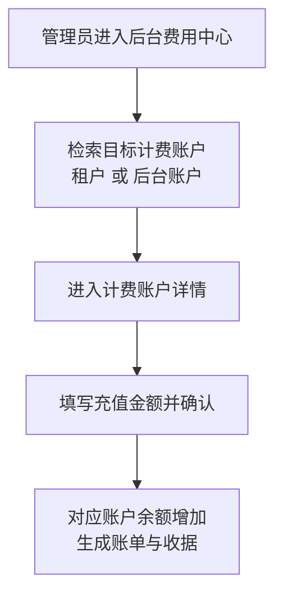

# 多租户一期

**功能名称**: 多租户一期（三层帐号体系与数据按租户隔离）
**PRD 版本**: v1.3
**创建日期**: 2026-10-27
**作者**: z-agent-bot
**需求来源**: [GitHub Issue Deliay/z-agent-gear#329](https://github.com/Deliay/z-agent-gear/issues/329)
**版本说明**:
- v1.0（2026-10-27）初版。
- v1.1（2026-10-27，评审返工）按评审意见重构帐号模型为「租户（tenant)→用户（user)、账户（account)→用户（user）」三层关联：新增「账户」概念承载登录能力（原帐号的登录部分整合进账户），用户成为独立的身份主体；租户与用户的关系明确为一对多（租户可以有多个成员），一期落地的个人专属租户仍保持单成员、不可删除、不可添加成员。同步修订 §1.1/§1.2/§1.3/§3.1/§3.2/§3.3/§3.5/§4.2。
- v1.2（2026-10-27，评审返工）按评审意见明确两点：① 后台（管理面）不做多租户设计——后台管理员帐号不建租户、管理面不做租户隔离，后台对前台租户与账户仅提供只读查看能力；② 计费系统同时兼容「后台账户计费」与「租户计费」两类支出——既有的后台账户计费保持原样，租户计费账户作为新增的账户归属类型与之并存，后台费用中心可对两类计费账户分别检索与充值。同步修订 §1.2/§1.3/§2.2/§3.2/§3.3/§3.4/§5.2。
- v1.3（2026-10-27，评审返工）按评审意见明确：租户内的数据（会话、工作流、云电脑、待办通知等）本期仍归属创建它的用户本人，可见与操作口径与上线前保持一致——租户维度只作为新增的隔离边界叠加，不改变用户侧既有体感；后续期次再按场景评估租户内共享。同步修订 §3.2 功能点 3。

## 背景与目标

### 1.1 背景

平台当前是「单个帐号直接使用资源」的模式：帐号既是登录凭据又是身份主体，云电脑、会话、工作区、模型配置等全部资源直接挂在帐号名下，费用也从帐号余额中直接扣减。这种「登录、身份、资源归属三位一体」的模型无法支撑多租户形态。

本期引入三层关联模型，把登录、身份、组织归属拆开：

- **租户（tenant）**：资源与费用的归属主体，包含若干用户成员（租户→用户，一对多）。
- **用户（user）**：平台使用者的身份主体；用户归属于租户，经租户使用资源。
- **账户（account）**：用户的登录凭据，归属于用户（账户→用户）；登录动作发生在账户上。

一期只做最小落地：为每个存量用户创建同名的**个人专属租户**（单成员、不可删除、不可添加成员），把登录部分整合进账户模型，资源与余额归属切换到租户。多人租户、多账户登录方式等能力由后续期次扩展，但模型从一期起就按「租户可多成员、账户可归用户」的关联形态建设。

### 1.2 目标

- **三层帐号体系建立**：账户（登录）→用户（身份）→租户（组织归属）的关联模型落地；存量帐号平滑迁移为「账户 + 用户 + 个人专属租户」。
- **租户支持多成员**：租户与用户为一对多关联；一期仅落地个人专属租户（单成员、不可删除、不可添加成员），为后续多人租户预留。
- **计费口径切换到租户（前台侧）**：存量前台帐号的余额迁移到租户，此后前台用户的消费、账单、收据均以租户为口径；后台充值新增「租户」为充值对象。
- **计费系统兼容两类支出**：计费系统同时承载「后台账户计费」（既有的后台账户开支，保持原样）与「租户计费」（前台租户开支）两类计费账户，两类账户并存、互不干扰；后台可对任一类型的计费账户检索与充值。
- **数据按租户归属与隔离**：所有原先按帐号归属的数据改为按租户归属；用户只能看到并使用自己租户内的数据。
- **后台不做多租户设计**：后台管理面保持全局视角、不纳入租户隔离；后台管理员帐号不建租户、不按租户划分；后台仅新增对前台租户与账户的只读查看能力。
- **前台关闭注册**：前台只保留登录，不再开放注册；新账户的开户入口收敛到后台。
- **后台具备租户与账户的查看能力**：后台可列出全部租户、查看租户下的用户，本期不提供对用户/租户的编辑、停用、删除等操作能力。

### 1.3 成功标准

- 存量每个帐号在升级后都能用原用户名密码正常登录；登录后可看到一个与自己同名的租户，自己位于该租户中；该租户没有删除入口、没有添加成员入口。
- 升级后每个用户的数据形态完整：恰好一个登录账户（原用户名密码可用）、恰好一个个人专属租户、且用户是该租户唯一成员。
- 升级前任一前台帐号的余额，升级后分文不差地体现在其租户余额上；升级后前台产生的每一笔消费、充值、账单、收据的归属方都是租户。
- 后台为某租户充值后，该租户余额与账单立即可见、金额正确。
- 后台账户的计费在升级前后行为完全一致：后台账户计费账户的查询、充值、扣费不受多租户改造影响，与租户计费账户并存且互不影响。
- 任一用户使用平台功能（云电脑、会话、工作区、模型配置、工作流等）时，只能看到并操作自己租户名下的数据；以另一租户身份无法查到此数据。
- 前台不存在注册入口，以任何方式都无法自助注册；管理员可在后台成功创建新账户，新账户创建后即可登录，并自动拥有同名个人专属租户与零余额租户费用账户。
- 后台可以列出全部租户列表，并查看任一租户下的用户列表；后台界面上不提供对用户、租户的操作入口。

## 用户分析

### 2.1 目标用户

- **前台用户（开发者）**：平台的终端使用者。本期对他们而言登录方式不变（用户名+密码），但身份主体从「帐号」变为「用户」，登录凭据由「账户」承载，资源与费用的归属主体变为「租户」。
- **后台管理员（平台运营）**：负责开户、充值与日常查看。本期获得租户列表、租户成员查看、后台开户、为租户充值的能力。

### 2.2 用户场景

| 场景 | 用户角色 | 目标 | 痛点 |
|--|--|--|--|
| 老用户升级后登录使用 | 前台用户 | 原用户名密码照常登录，数据、余额原样保留 | 担心升级后无法登录或数据/余额丢失 |
| 查看自己的费用 | 前台用户 | 看到以租户为口径的余额与账单 | 计费口径切换后期望账目连续可核对 |
| 新用户开通帐号 | 后台管理员 | 在后台为其创建账户并交付 | 前台注册开放时无法管控开户节奏 |
| 给客户的租户充值 | 后台管理员 | 以租户为单位充值 credits | 原先按帐号充值，与租户口径不一致 |
| 后台账户计费与充值 | 后台管理员 | 后台账户的开支计费与充值保持原样可用 | 多租户改造不能影响后台账户的既有计费链路 |
| 盘点平台租户 | 后台管理员 | 一览全部租户及其下用户 | 无租户视角，只能逐个帐号查看 |
| 防止自助注册 | 平台运营 | 注册入口关闭，开户渠道唯一 | 前台注册不可控 |
| 未来组建团队 | 前台用户 | 多人共用租户资源与费用 | 现有模型租户与帐号一对一，无法扩展 |

## 功能需求

### 3.1 功能概述

把平台帐号体系升级为「账户→用户→租户」三层模型：账户承载登录（原帐号的用户名+密码整合为账户），用户为身份主体，租户为资源与费用的归属主体且支持多成员。为每个存量用户建立同名个人专属租户（一期单成员、不可删除、不可添加成员），余额迁移为租户余额，全部用户数据改为按租户归属并仅在租户内可见；前台关闭注册，新账户由后台开户；后台新增租户列表与租户成员查看能力。

### 3.2 功能列表

#### 功能点 1: 三层帐号体系（账户→用户→租户）

- **描述**: 建立三层关联模型：
  - **账户（account）**：登录凭据，承载用户名与密码；账户归属于用户（账户→用户）。登录、密码修改等认证行为都发生在账户上。
  - **用户（user）**：身份主体，承载使用偏好等个人属性；用户的资源使用都以其所属租户的名义进行。
  - **租户（tenant）**：组织归属主体，包含若干用户成员（租户→用户，一对多）；资源与余额归属租户。
- 存量帐号迁移：每个存量帐号拆分为「一个用户 + 一个登录账户（沿用原用户名密码）」，并创建同名的个人专属租户，用户放入其中。个人专属租户是特殊租户：**无法删除、无法添加成员**（一期单成员）。后台新开户同样生成「账户 + 用户 + 个人专属租户」三件套。
- **用户价值**: 用户无感知完成体系升级；平台获得可扩展的多租户底座。
- **验收标准**:
  - [ ] 每个存量帐号升级后可用原用户名密码登录
  - [ ] 每个存量用户 exactly 拥有：一个登录账户、一个同名个人专属租户、且为该租户唯一成员
  - [ ] 个人专属租户不存在删除入口，也不存在添加成员入口
  - [ ] 用户登录后直接进入自己租户的使用上下文，无需选择租户
  - [ ] 后台新创建的账户同样自动获得同名个人专属租户

#### 功能点 2: 余额迁移与租户口径计费（兼容后台账户计费）

- **描述**: 存量前台帐号的余额（含现金、赠送等各资金构成）迁移到其租户上，迁移后前台用户不再直接持有余额。此后前台所有计费口径一律使用租户口径：前台消费从租户余额扣减、账单与收据归属租户、额度检查以租户为单位。后台充值新增以租户为对象——管理员在后台可为指定租户充值。**计费系统同时兼容后台账户计费**：既有的后台账户计费账户及其查询、充值、扣费链路保持原样，与租户计费账户并存；后台费用中心保持按计费账户管理，两类计费账户（后台账户 / 租户）都可检索、查看与充值，互不影响。
- **用户价值**: 用户账目连续、金额无损；平台费用归属与资源归属统一，为团队共享费用打底；后台既有计费习惯不受冲击。
- **验收标准**:
  - [ ] 升级前后逐帐号核对：前台帐号原余额 == 其租户升级后余额，分文不差
  - [ ] 升级后前台产生的消费、充值、账单、收据均以租户为归属方
  - [ ] 后台可为租户计费账户充值，充值后租户余额、账单、收据立即可见
  - [ ] 后台账户计费账户的查询、充值、扣费与升级前行为完全一致；两类计费账户并存，互不影响
  - [ ] 前台「我的费用」展示的余额、账单、收据为当前用户所在租户的口径，数值与升级前连续
  - [ ] 余额不足拦截、冻结、欠费止损等既有资金规则在租户口径下行为不变

#### 功能点 3: 数据按租户归属与隔离

- **描述**: 所有原先归属于帐号的数据（云电脑、会话、工作区、控制器、模型配置、MCP 配置、GitHub 绑定、工作流等）改为归属于用户所在的租户；存量数据全部完成归属清洗。用户使用过程中的一切数据查询与操作都限定在其租户范围内：列表只出本租户数据，详情、修改、删除只能作用于本租户数据，跨租户访问一律不可达。后台管理面本期除外，保持全局视角。**数据在租户内仍归属创建它的用户本人**：会话、工作流、云电脑、待办通知等场景本期维持按创建者本人的可见与操作口径（与上线前一致），租户维度只作为新增的隔离边界叠加，不改变用户侧既有体感；后续期次再按场景评估租户内共享。
- **用户价值**: 用户数据边界清晰、互不串扰；平台具备多租户的数据安全底座；用户既有使用习惯零变化。
- **验收标准**:
  - [ ] 存量带帐号归属的数据 100% 完成租户归属清洗，无遗漏、无错挂
  - [ ] 任一前台列表/详情/操作都只能触达当前用户租户内的数据
  - [ ] 直接以其他租户数据的标识发起访问（详情、修改、删除）被拒绝，且不泄露该数据是否存在
  - [ ] 两个租户各建同类资源后互不可见、互不可操作
  - [ ] 会话、工作流、云电脑、待办通知等场景的可见与操作范围与上线前一致（仍跟随创建者本人），未因租户化改造发生变化
  - [ ] 后台管理面的既有全局查看能力不受租户隔离影响

#### 功能点 4: 前台注册关闭与后台开户

- **描述**: 前台只保留登录能力，移除一切注册入口与注册通道，任何方式都无法在前台自助创建账户。新账户的开户收敛到后台：由管理员在后台填写用户名与初始密码完成创建，创建成功即交付使用。开户成功同时生成登录账户、用户与同名个人专属租户，以及零余额的租户费用账户。
- **用户价值**: 平台对开户节奏完全可控；新用户从创建第一天起就是三层体系的一员。
- **验收标准**:
  - [ ] 前台页面不存在注册入口，直接访问注册相关地址也无法完成注册
  - [ ] 管理员可在后台成功创建账户（用户名 + 初始密码），用户名重复、格式非法时有明确提示
  - [ ] 新账户凭初始密码可正常登录前台，登录后可见同名个人专属租户
  - [ ] 新账户的租户费用账户余额为 0，可正常被充值、可正常消费

#### 功能点 5: 后台租户与账户查看

- **描述**: 后台新增租户管理视图：可列出全部租户（名称、类型、成员数、余额、创建时间等概要信息），可进入任一租户查看其下用户列表（用户名、创建时间等）。本期为**只读**能力：不提供对租户的删除、对用户的编辑/停用/删除等操作入口（后台开户除外）。该视图只是面向前台数据的只读盘点能力——后台自身不做多租户设计：后台管理员帐号不建租户、管理面不做租户隔离。
- **用户价值**: 平台运营第一次拥有租户视角的全局盘点能力。
- **验收标准**:
  - [ ] 后台可列出全部租户，支持按名称检索，分页可用
  - [ ] 可查看任一租户下的用户列表，信息准确
  - [ ] 租户与用户均展示为只读，界面上不出现编辑、删除、停用等操作入口（后台开户除外）
  - [ ] 租户列表中的余额与费用中心该租户账户余额一致

### 3.3 用户操作流程

老用户升级后的使用流程（无感知迁移）：

新账户开户流程：

后台充值流程（兼容租户与后台账户两类计费账户）：

### 3.4 页面/界面描述

| 页面 | 描述 | 关键元素 |
|------|------|---------|
| 前台登录页 | 仅保留登录表单 | 用户名、密码、登录按钮；**无注册入口** |
| 前台「我的费用」 | 数值口径切换为租户 | 租户余额、账单、收据（展示口径变化，布局不变） |
| 后台租户列表页 | 全部租户一览 | 租户名称、类型（个人专属）、成员数、余额、创建时间；名称检索；分页 |
| 后台租户详情页 | 单个租户只读详情 | 租户概要、成员用户列表（用户名、创建时间）；充值入口 |
| 后台开户入口 | 创建新前台账户 | 用户名、初始密码、确认创建、结果提示 |
| 后台费用中心充值 | 兼容两类计费账户 | 计费账户按归属类型检索与充值：租户计费账户与后台账户计费账户并存 |

### 3.5 异常与边界情况

| 情况 | 预期行为 |
|------|---------|
| 升级迁移期间用户正在使用平台 | 迁移完成后用户使用不受影响；迁移失败的用户可重跑迁移直至成功，不得出现半迁移状态（如只有账户没有租户、有租户无余额） |
| 用户尝试访问其他租户的数据 | 一律按「不存在」拒绝，不泄露数据是否存在 |
| 用户以前台的旧注册地址/入口尝试注册 | 明确提示注册已关闭，无法创建账户 |
| 后台开户时用户名与存量账户重复 | 创建失败并明确提示用户名已存在 |
| 后台开户时用户名/密码不符合规则 | 创建失败并提示具体规则 |
| 个人专属租户被尝试删除或添加成员 | 无操作入口；任何非常规方式的尝试都被拒绝 |
| 租户余额不足时的既有拦截与止损 | 与升级前行为一致，只是口径为租户 |
| 后台查看个人专属租户成员 | 恒定有且仅有一名成员（其用户本身） |

## 四、非功能需求

### 4.1 性能要求

- 租户归属判定不得引入用户可感知的额外延迟：常用列表查询响应时间与升级前相比无显著劣化。
- 存量数据迁移在可接受窗口内完成，迁移过程不阻塞平台正常服务。

### 4.2 安全性要求

- 租户隔离是安全红线：任何前台数据访问都必须限定在当前用户租户范围内，禁止以任何形式绕过。
- 跨租户访问统一按「不存在」处理，避免泄露其他租户数据的存在性。
- 登录认证只认账户：账户与用户的关联不可被用户侧修改；密码以不可逆方式存储。
- 后台开户、充值等操作保留操作记录，可追溯操作人与时间。
- 新账户初始密码由管理员线下交付；用户首次登录后可自行修改密码（沿用既有修改密码能力，作用于账户）。

### 4.3 兼容性要求

- 存量用户的登录方式（原用户名+密码）、数据、余额在升级后完整保留。
- 已签发的各类凭据（如模型调用 API Key）在升级后按租户口径继续有效可用。
- 本地控制器等既有接入方式的鉴权与使用不受三层化影响。

## 五、依赖与约束

### 5.1 依赖

- 依赖已上线的费用中心能力（账户、账单、收据、充值、额度检查），本期仅将其归属口径从帐号切换为租户。
- 依赖后台管理面既有的管理员登录与鉴权能力。

### 5.2 约束

- 模型按「租户可多成员、账户归属于用户」建设，但**本期不做**多人租户的成员管理（邀请/移除/角色）、多账户登录方式（如第三方登录）与租户切换。
- 个人专属租户不可删除、不可添加成员的约束在后续期次中依然保持。
- 后台不做多租户设计：后台管理面保持全局视角、不纳入租户隔离，后台管理员帐号不建租户；后台对租户与账户仅提供只读查看与开户。
- 计费系统必须同时兼容「后台账户计费」与「租户计费」：后台账户的既有计费链路（查询、充值、扣费、对账）不得因多租户改造发生改变。
- 迁移必须保证资金零差错：任何帐号余额迁移失败都视为整体迁移失败，需修复后重跑。
- 前台的屏蔽注册是硬关闭，而非仅隐藏入口。

## 六、相关文档

- 需求来源：[GitHub Issue Deliay/z-agent-gear#329 — 多租户一期](https://github.com/Deliay/z-agent-gear/issues/329)
- 技术提案：[[../../engineering/proposals/20261027-feat-multi-tenant-phase1.md]]
- 关联文档：[[20261018-credits-billing.md]]（费用中心，计费口径切换的基础）
