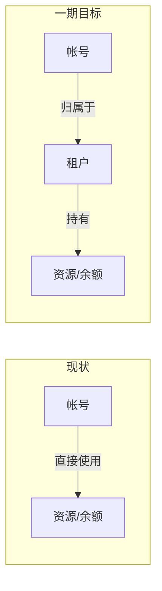
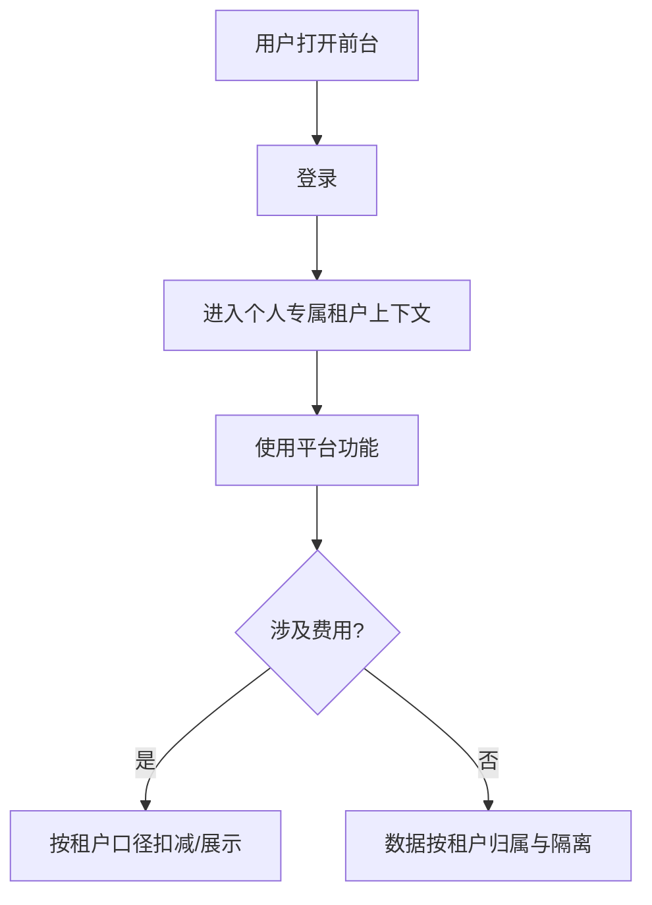
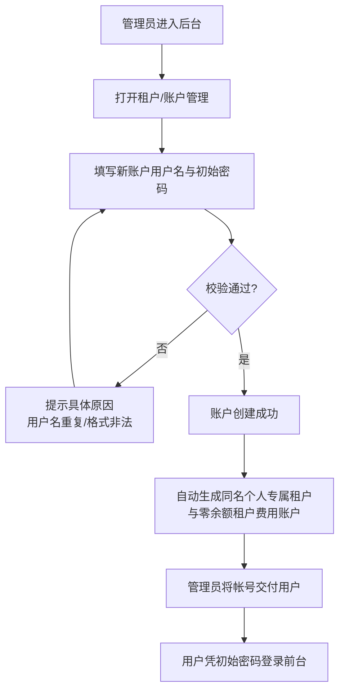
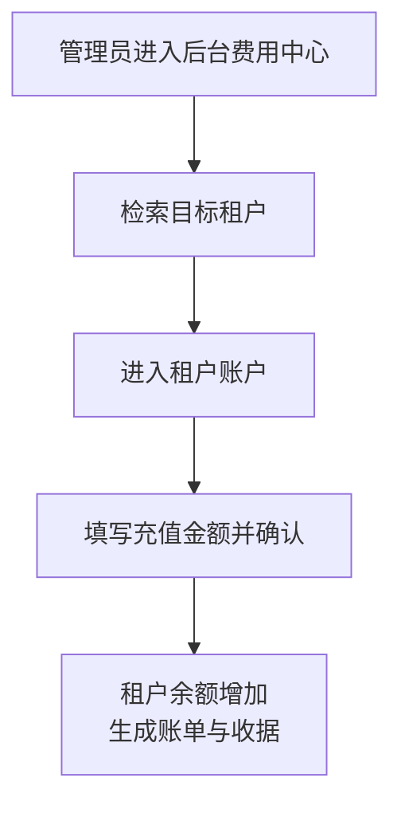

# 多租户一期

**功能名称**: 多租户一期（帐号体系转换与数据按租户隔离）
**PRD 版本**: v1.0
**创建日期**: 2026-10-27
**作者**: z-agent-bot
**需求来源**: [GitHub Issue Deliay/z-agent-gear#329](https://github.com/Deliay/z-agent-gear/issues/329)

## 背景与目标

### 1.1 背景

平台当前是「单个帐号直接使用资源」的模式：用户注册、登录后，云电脑、会话、工作区、模型配置等全部资源直接挂在帐号名下，费用也从帐号余额中直接扣减。

随着平台发展，需要支持「多个用户以团队形式共享资源与费用」的多租户形态。这是一项复杂且长期的改造，无法一步到位，因此分期推进。本期的目标是把「帐号直接用资源」的底盘先转换为「帐号归属于租户、资源归属于租户」的租户底盘，为后续的团队租户（多成员、邀请、角色权限等）打地基：

一期只做「单成员的个人专属租户」转换：每个已有帐号获得一个与帐号同名的租户，帐号被放置其中，资源与余额随之归属到租户；暂不提供多人租户、成员管理、租户间切换等能力（后续期次再做）。

### 1.2 目标

- **帐号体系完成租户化转换**：每一个已有帐号都拥有一个与帐号同名的租户，帐号归属于该租户；这类「帐号自带租户」是特殊租户——**无法删除、无法添加成员**。
- **计费口径切换到租户**：帐号上的余额迁移到其租户，此后所有消费、充值、账单、收据均以租户为口径；后台充值的对象由帐号变为租户。
- **数据按租户归属与隔离**：所有原先按帐号归属的数据，改为按租户归属；用户使用数据时只能看到并使用自己租户内的数据，天然无法触达其他租户的数据。后台管理面本期暂不纳入租户隔离（保持全局视角）。
- **前台关闭注册**：前台只保留登录，不再开放注册；新账户的开户入口收敛到后台，由管理员创建。
- **后台具备租户与账户的查看能力**：后台可列出全部租户、查看租户下的用户，但本期不提供对用户/租户的编辑、停用、删除等操作能力。

### 1.3 成功标准

- 存量每个帐号在升级后都能正常登录，且都能看到一个与自己同名的租户，自己位于该租户中；该租户没有删除入口、没有添加成员入口。
- 升级前任一帐号的余额，升级后分文不差地体现在其租户余额上；升级后产生的每一笔消费、充值、账单、收据的归属方都是租户。
- 后台为某租户充值后，该租户余额与账单立即可见、金额正确。
- 任一用户使用平台功能（云电脑、会话、工作区、模型配置、工作流等）时，只能看到并操作自己租户名下的数据；以另一租户身份无法查到此数据。
- 前台不存在注册入口，以任何方式都无法自助注册新帐号；管理员可在后台成功创建新账户，新账户创建后即可登录，并自动拥有同名个人专属租户与零余额租户账户。
- 后台可以列出全部租户列表，并查看任一租户下的用户列表；后台界面上不提供对用户、租户的操作入口。

## 用户分析

### 2.1 目标用户

- **前台用户（开发者）**：平台的终端使用者。本期对他们而言，使用体验基本不变，但资源与费用的归属主体从「我的帐号」变为「我所在的租户」。
- **后台管理员（平台运营）**：负责开户、充值与日常查看。本期获得租户列表、租户成员查看、后台开户、为租户充值的能力。

### 2.2 用户场景

| 场景 | 用户角色 | 目标 | 痛点 |
|--|--|--|--|
| 老用户升级后登录使用 | 前台用户 | 数据、余额原样保留，无感知完成转换 | 担心升级后数据或余额丢失 |
| 查看自己的费用 | 前台用户 | 看到以租户为口径的余额与账单 | 计费口径切换后期望账目连续可核对 |
| 新用户开通帐号 | 后台管理员 | 在后台为其创建账户并交付 | 前台注册开放时无法管控开户节奏 |
| 给客户的租户充值 | 后台管理员 | 以租户为单位充值 credits | 原先按帐号充值，与租户口径不一致 |
| 盘点平台租户 | 后台管理员 | 一览全部租户及其下用户 | 无租户视角，只能逐个帐号查看 |
| 防止自助注册 | 平台运营 | 注册入口关闭，开户渠道唯一 | 前台注册不可控 |

## 功能需求

### 3.1 功能概述

把平台的归属主体从「帐号」升级为「租户」：为每个存量帐号建立同名个人专属租户（不可删除、不可添加成员），帐号余额迁移为租户余额，全部用户数据改为按租户归属并仅在租户内可见；前台关闭注册，新账户由后台开户；后台新增租户列表与租户成员查看能力。

### 3.2 功能列表

#### 功能点 1: 个人专属租户（帐号体系转换）

- **描述**: 为平台每一个存量帐号创建一个与帐号同名的租户，并将该帐号放置其中。这类由帐号自带的租户属于特殊租户（个人专属租户）：**无法删除、无法添加成员**。新开户的帐号同样自动获得同名个人专属租户。用户登录后，其使用身份即「该帐号 + 其个人专属租户」，无需手动选择或切换。
- **用户价值**: 用户无感知地完成了从帐号模式到租户模式的迁移，为将来以团队形式协作打好归属基础。
- **验收标准**:
  - [ ] 每个存量帐号升级后都 exactly 拥有一个同名租户，且帐号位于其中
  - [ ] 个人专属租户不存在删除入口，也不存在添加成员入口
  - [ ] 用户登录后直接进入自己租户的使用上下文，无需选择租户
  - [ ] 后台新创建的账户同样自动获得同名个人专属租户

#### 功能点 2: 余额迁移与租户口径计费

- **描述**: 存量帐号的余额（含现金、赠送等各资金构成）迁移到其租户上，迁移后帐号不再持有余额。此后平台所有计费口径一律使用租户口径：消费从租户余额扣减、账单与收据归属租户、额度检查以租户为单位。后台充值的对象由帐号变为租户——管理员在后台为指定租户充值。
- **用户价值**: 用户账目连续、金额无损；平台费用归属与资源归属统一，为团队共享费用打底。
- **验收标准**:
  - [ ] 升级前后逐帐号核对：帐号原余额 == 其租户升级后余额，分文不差
  - [ ] 升级后产生的消费、充值、账单、收据均以租户为归属方
  - [ ] 后台充值页以租户为充值对象，充值后租户余额、账单、收据立即可见
  - [ ] 前台「我的费用」展示的余额、账单、收据为当前用户所在租户的口径，数值与升级前连续
  - [ ] 余额不足拦截、冻结、欠费止损等既有资金规则在租户口径下行为不变

#### 功能点 3: 数据按租户归属与隔离

- **描述**: 所有原先归属于帐号的数据（云电脑、会话、工作区、控制器、模型配置、MCP 配置、GitHub 绑定、工作流等）改为归属于帐号所在的租户；存量数据全部完成归属清洗。用户使用过程中的一切数据查询与操作都限定在其租户范围内：列表只出本租户数据，详情、修改、删除只能作用于本租户数据，跨租户访问一律不可达。后台管理面本期除外，保持全局视角。
- **用户价值**: 用户数据边界清晰、互不串扰；平台具备多租户的数据安全底座。
- **验收标准**:
  - [ ] 存量带帐号归属的数据 100% 完成租户归属清洗，无遗漏、无错挂
  - [ ] 任一前台列表/详情/操作都只能触达当前用户租户内的数据
  - [ ] 直接以其他租户数据的标识发起访问（详情、修改、删除）被拒绝，且不泄露该数据是否存在
  - [ ] 两个租户各建同类资源后互不可见、互不可操作
  - [ ] 后台管理面的既有全局查看能力不受租户隔离影响

#### 功能点 4: 前台注册关闭与后台开户

- **描述**: 前台只保留登录能力，移除一切注册入口与注册通道，任何方式都无法在前台自助创建帐号。新账户的开户收敛到后台：由管理员在后台填写用户名与初始密码完成创建，创建成功即交付使用。新账户创建后自动获得同名个人专属租户（功能点 1）与零余额的租户费用账户。
- **用户价值**: 平台对开户节奏完全可控；新用户从创建第一天起就是租户体系的一员。
- **验收标准**:
  - [ ] 前台页面不存在注册入口，直接访问注册相关地址也无法完成注册
  - [ ] 管理员可在后台成功创建账户（用户名 + 初始密码），用户名重复、格式非法时有明确提示
  - [ ] 新账户凭初始密码可正常登录前台，登录后可见同名个人专属租户
  - [ ] 新账户的租户费用账户余额为 0，可正常被充值、可正常消费

#### 功能点 5: 后台租户与账户查看

- **描述**: 后台新增租户管理视图：可列出全部租户（名称、类型、成员数、余额、创建时间等概要信息），可进入任一租户查看其下用户列表（用户名、创建时间等）。本期为**只读**能力：不提供对租户的删除、对用户的新增之外的编辑/停用/删除等操作入口。
- **用户价值**: 平台运营第一次拥有租户视角的全局盘点能力。
- **验收标准**:
  - [ ] 后台可列出全部租户，支持按名称检索，分页可用
  - [ ] 可查看任一租户下的用户列表，信息准确
  - [ ] 租户与用户均展示为只读，界面上不出现编辑、删除、停用等操作入口（后台开户除外）
  - [ ] 租户列表中的余额与费用中心该租户账户余额一致

### 3.3 用户操作流程

老用户升级后的使用流程（无感知迁移）：

新账户开户流程：

后台充值流程（对象由帐号变为租户）：

### 3.4 页面/界面描述

| 页面 | 描述 | 关键元素 |
|------|------|---------|
| 前台登录页 | 仅保留登录表单 | 用户名、密码、登录按钮；**无注册入口** |
| 前台「我的费用」 | 数值口径切换为租户 | 租户余额、账单、收据（展示口径变化，布局不变） |
| 后台租户列表页 | 全部租户一览 | 租户名称、类型（个人专属）、成员数、余额、创建时间；名称检索；分页 |
| 后台租户详情页 | 单个租户只读详情 | 租户概要、成员用户列表（用户名、创建时间）；充值入口 |
| 后台开户入口 | 创建新前台账户 | 用户名、初始密码、确认创建、结果提示 |
| 后台费用中心充值 | 充值对象调整为租户 | 以租户为检索与充值对象 |

### 3.5 异常与边界情况

| 情况 | 预期行为 |
|------|---------|
| 升级迁移期间用户正在使用平台 | 迁移完成后用户使用不受影响；迁移失败的帐号可重跑迁移直至成功，不得出现半迁移状态（有租户无余额或有余额无租户） |
| 用户尝试访问其他租户的数据 | 一律按「不存在」拒绝，不泄露数据是否存在 |
| 用户以前台的旧注册地址/入口尝试注册 | 明确提示注册已关闭，无法创建帐号 |
| 后台开户时用户名与存量帐号重复 | 创建失败并明确提示用户名已存在 |
| 后台开户时用户名/密码不符合规则 | 创建失败并提示具体规则 |
| 个人专属租户被尝试删除或添加成员 | 无操作入口；任何非常规方式的尝试都被拒绝 |
| 租户余额不足时的既有拦截与止损 | 与升级前行为一致，只是口径为租户 |
| 后台查看租户成员列表为空或异常 | 个人专属租户恒定有且仅有一名成员（其帐号本身） |

## 四、非功能需求

### 4.1 性能要求

- 租户归属判定不得引入用户可感知的额外延迟：常用列表查询响应时间与升级前相比无显著劣化。
- 存量数据迁移在可接受窗口内完成，迁移过程不阻塞平台正常服务。

### 4.2 安全性要求

- 租户隔离是安全红线：任何前台数据访问都必须限定在当前用户租户范围内，禁止以任何形式绕过。
- 跨租户访问统一按「不存在」处理，避免泄露其他租户数据的存在性。
- 后台开户、充值等操作保留操作记录，可追溯操作人与时间。
- 新账户初始密码由管理员线下交付；用户首次登录后可自行修改密码（沿用既有修改密码能力）。

### 4.3 兼容性要求

- 存量用户的登录态、数据、余额在升级后完整保留。
- 已签发的各类凭据（如模型调用 API Key）在升级后按租户口径继续有效可用。
- 本地控制器等既有接入方式的鉴权与使用不受租户化影响。

## 五、依赖与约束

### 5.1 依赖

- 依赖已上线的费用中心能力（账户、账单、收据、充值、额度检查），本期仅将其归属口径从帐号切换为租户。
- 依赖后台管理面既有的管理员登录与鉴权能力。

### 5.2 约束

- 本期只做「单成员个人专属租户」，**不做**多人租户、租户间切换、成员邀请与角色权限。
- 个人专属租户不可删除、不可添加成员的约束在后续期次中依然保持。
- 后台管理面（全局视角）本期不纳入租户隔离范围。
- 迁移必须保证资金零差错：任何帐号余额迁移失败都视为整体迁移失败，需修复后重跑。
- 前台的屏蔽注册是硬关闭，而非仅隐藏入口。

## 六、相关文档

- 需求来源：[GitHub Issue Deliay/z-agent-gear#329 — 多租户一期](https://github.com/Deliay/z-agent-gear/issues/329)
- 技术提案：[[../../engineering/proposals/20261027-feat-multi-tenant-phase1.md]]
- 关联文档：[[20261018-credits-billing.md]]（费用中心，计费口径切换的基础）
