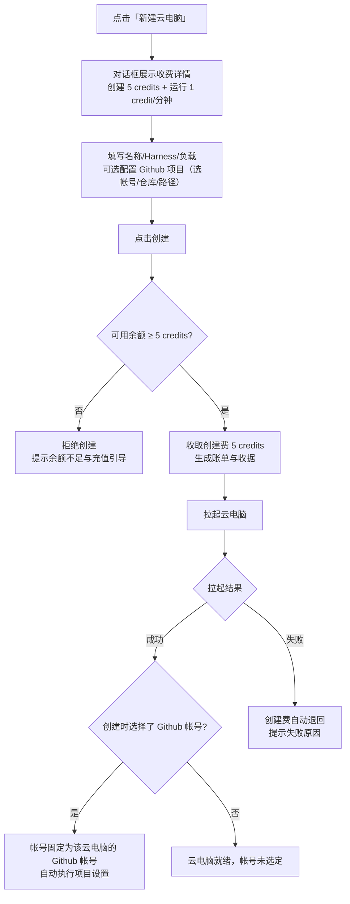
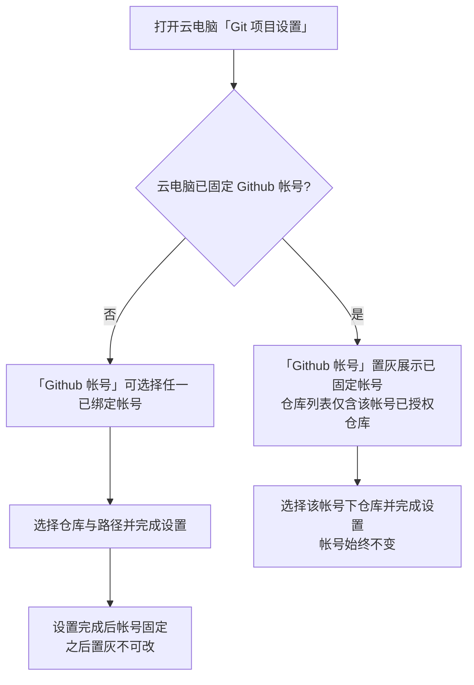

# 用户开放无限制云电脑支持

**功能名称**: 用户开放无限制云电脑支持
**PRD 版本**: v1.0
**创建日期**: 2026-10-27
**作者**: z-agent-bot

## 背景与目标

### 1.1 背景

云电脑（云端工作容器）目前处于灰度形态：每用户同时最多只能拉起 1 台，且创建完全免费。随着费用中心（Credits 计费）上线（见 [[20261018-credits-billing]]），平台具备了按分钟计费与账户余额体系，向全部用户开放云电脑的时机已经成熟，但直接开放存在三个缺口：

1. **创建零成本导致资源滥用风险**：云电脑创建即占用平台调度与初始化资源，完全没有门槛时，用户可以无成本反复创建/销毁，既浪费平台资源也放大滥用面。运行期已有「1 credit/分钟」的持续计费，但创建动作本身没有任何收费。
2. **每用户 1 台的限制挡住正常使用**：多项目并行的用户需要多台云电脑同时工作，「同时最多 1 个实例」的灰度限制必须解除。
3. **Github 多帐号与云电脑凭据的错配**：一台云电脑内的凭据管理器同一时刻只能持有一个 Github 帐号的凭据。目前「Git 项目设置」每次都可以任选帐号，用户切换帐号后容器内凭据语义混乱（凭据对应的是哪台机器、哪个帐号不可预期），需要把「云电脑 ↔ Github 帐号」的关系固定下来。

### 1.2 目标

- **创建收费**：点击创建云电脑触发拉起时收取 5 credits；余额不足时拒绝创建并给出明确提示。
- **收费透明**：创建对话框中展示收费详情——创建花费（5 credits）与运行消费（1 credit/分钟），用户在确认前清楚知道费用口径。
- **放开数量限制**：用户可以拉起任意多台云电脑，每台独立计费、独立生命周期。
- **Github 帐号跟随云电脑**：每台云电脑固定使用一个 Github 帐号的凭据；帐号在创建云电脑时可以选择，创建时未选择的可在创建后选定一次；一经选定不可修改；「Git 项目设置」中的「Github 帐号」选项跟随云电脑已选帐号、置灰不可更改。

### 1.3 成功标准

- 余额充足的用户点击创建云电脑后，账户账单中出现一笔 5 credits 的「创建云电脑」消费及对应收据；云电脑正常拉起。
- 可用余额不足 5 credits 的用户点击创建时被拒绝，看到明确的「余额不足」提示与当前余额，不产生任何云电脑记录与账单。
- 创建对话框内可见「创建花费 5 credits」「运行消费 1 credit/分钟」的收费说明，且展示数值与账单实际扣费一致。
- 同一用户可同时保持 2 台及以上云电脑运行，各自的分钟计费账单互不混淆；不再出现「每用户同时最多 1 个云电脑实例」的拦截提示。
- 创建云电脑时选择了 Github 帐号与项目的，后续对该云电脑发起「Git 项目设置」时「Github 帐号」已固定为创建时选择的帐号且不可更改；创建时未选择的，首次「Git 项目设置」可任选帐号，完成后该帐号被锁定、之后不可修改。

## 用户分析

### 2.1 目标用户

- **前台注册用户（开发者）**：需要一台或多台云电脑并行开展项目开发，按量付费。
- **平台运营/管理员**：通过创建收费控制资源滥用，通过账单核对每台云电脑的消费。

### 2.2 用户场景

| 场景 | 用户角色 | 目标 | 痛点 |
|--|--|--|--|
| 同时开发多个项目 | 前台用户 | 为每个项目各拉起一台云电脑并行工作 | 每用户限 1 台，只能反复销毁重建 |
| 创建前了解费用 | 前台用户 | 创建前知道创建要花多少、运行每分钟花多少 | 创建对话框没有任何费用说明，扣费不可预期 |
| 余额不足时创建 | 前台用户 | 明确知道为什么不能创建、差多少钱 | 无收费前置校验时表现为创建失败，原因不明 |
| 一台机器固定一个 Github 身份 | 前台用户 | 云电脑内的 gh/git 操作始终使用同一个帐号凭据 | 每次设置可换帐号，凭据归属混乱、误用风险高 |
| 多帐号用户分机器使用 | 拥有多个 Github 帐号的用户 | A 机器用个人帐号、B 机器用公司帐号 | 缺少「机器 ↔ 帐号」的固定关系 |

## 功能需求

### 3.1 功能概述

向全部用户开放无限制数量的云电脑：创建云电脑收取 5 credits（运行期维持既有 1 credit/分钟计费不变），创建对话框展示完整收费详情，余额不足拒绝创建；同时把 Github 帐号收敛为云电脑级属性——创建时可选、未选则创建后首次「Git 项目设置」时选定、选定后不可修改，「Git 项目设置」中的帐号选项跟随云电脑已选帐号置灰展示。

### 3.2 功能列表

#### 功能点 1: 创建云电脑收费（5 credits）

- **描述**: 用户在创建对话框点击「创建」触发拉起云电脑时，收取一次性创建费用 5 credits，从该用户的费用账户扣除并生成账单与收据（消费来源标注为云电脑创建）。可用余额不足 5 credits 时拒绝创建，不产生云电脑、不产生账单，提示余额不足与当前可用余额。扣费成功后若云电脑拉起失败（未进入运行状态即终止），创建费用自动退回账户并留痕。
- **用户价值**: 创建有明确价格门槛，遏制零成本滥用；费用立即可查、失败有退款保障。
- **验收标准**:
  - [ ] 余额充足时创建成功，账单出现 5 credits 创建消费与收据，描述可辨识为「创建云电脑」
  - [ ] 可用余额（含冻结额扣减后）不足 5 credits 时创建被拒绝，提示余额不足，无云电脑记录、无账单
  - [ ] 同一台云电脑只收取一次创建费（重复提交、网络重试不产生重复扣费）
  - [ ] 扣费后拉起失败（启动即失败/超时终止）时创建费自动退回，账户可见退回记录
  - [ ] 云电脑正常运行后再销毁，创建费不退（仅覆盖「拉起失败」场景）

#### 功能点 2: 创建对话框收费详情

- **描述**: 「新建云电脑」对话框增加收费详情区块，在确认创建前展示：
  - 创建花费：5 credits（一次性，确认创建即扣费）；
  - 运行消费：1 credit/分钟（自云电脑就绪起按分钟计费，不足 1 分钟按 1 分钟计）；
  - 欠费后果提示：余额不足持续 10 分钟云电脑将被强制销毁（与费用中心既有口径一致）。
  - 展示的价格与实际扣费口径保持一致（价格调整时对话框同步更新）；收费数据加载失败时不阻断创建流程，区块降级为通用提示「创建与运行将产生费用，详见账单」。
- **用户价值**: 费用在确认前完全透明，不存在「点完才知道要钱」的惊吓。
- **验收标准**:
  - [ ] 打开创建对话框即可见创建花费与每分钟消费两项说明
  - [ ] 展示数值与实际账单扣费一致
  - [ ] 余额不足时对话框内可见当前可用余额与充值引导（联系管理员充值）
  - [ ] 收费数据加载失败时可继续创建，降级提示不误导

#### 功能点 3: 放开云电脑数量限制

- **描述**: 取消「每用户同时最多 1 个云电脑实例」的限制，用户可以创建并保持任意多台云电脑同时运行。每台云电脑维持既有语义不变：创建即启动、停止即销毁、各自独立的会话/工作区/Github 设置与计费（各自的 5 credits 创建费与各自的分钟计费）。既有「新建云电脑」入口不再因已存在运行中的云电脑而禁用。
- **用户价值**: 多项目并行不再受限，云电脑成为可按需取用的弹性资源。
- **验收标准**:
  - [ ] 已有一台运行中云电脑的用户仍可再次创建并成功拉起第二台
  - [ ] 不再出现「每用户同时最多 1 个云电脑实例」的拦截提示
  - [ ] 多台云电脑在列表中各自展示状态，停止/删除互不影响
  - [ ] 多台云电脑的分钟计费分别出账，账单可按来源区分到具体云电脑

#### 功能点 4: Github 帐号跟随云电脑（选定后不可修改）

- **描述**: 每台云电脑固定关联一个 Github 帐号，该帐号决定云电脑内可获得的 Git 凭据：
  - **创建时选择**：「新建云电脑」对话框勾选「配置 Github 项目」时，所选 Github 帐号即固定为该云电脑的帐号；
  - **创建后补选**：创建时未选择帐号的云电脑，可在之后首次「Git 项目设置」时选择一个帐号，完成设置后帐号固定；
  - **不可修改**：帐号一经固定（无论创建时还是创建后选定），之后不可更换；「Git 项目设置」中「Github 帐号」选项置灰不可选择，展示并跟随该云电脑已固定的帐号；
  - **仓库仍可换**：同一帐号下，后续「Git 项目设置」可以选择该帐号已授权的其他仓库（换仓库不受限），但不得选择其他帐号；
  - **多帐号用户的用法**：需要使用另一个 Github 帐号时，另建一台云电脑并选择该帐号。
- **用户价值**: 云电脑内凭据归属确定、可预期，杜绝一台机器内混用多个身份的凭据风险；多帐号用户有明确的绕行方式（一台机器一个身份）。
- **验收标准**:
  - [ ] 创建时勾选 Github 项目并选择帐号后，该云电脑的「Git 项目设置」中帐号固定为该帐号且置灰不可改
  - [ ] 创建时未选帐号的云电脑，首次「Git 项目设置」可任选已绑定帐号；设置完成后帐号锁定
  - [ ] 已锁定帐号的云电脑发起「Git 项目设置」时，仓库列表仅展示该锁定帐号已授权的仓库
  - [ ] 尝试为已锁定帐号的云电脑更换帐号被拒绝并提示（界面上选项置灰，不可提交其他帐号）
  - [ ] 同一用户的不同云电脑可以分别锁定不同的 Github 帐号，互不影响

### 3.3 用户操作流程

#### 创建云电脑（收费 + 收费详情 + 可选 Github 项目）

#### 创建后「Git 项目设置」（帐号跟随云电脑）

### 3.4 页面/界面描述

| 页面 | 描述 | 关键元素 |
|------|------|---------|
| 新建云电脑对话框 | 创建云电脑，收费透明 | 收费详情区块（创建花费 5 credits、运行消费 1 credit/分钟、欠费销毁提示）、可用余额与充值引导（余额不足时）、Github 项目区块（帐号/仓库/前缀） |
| 侧边栏主机列表 | 云电脑列表与新建入口 | 新建入口不再因已有运行中云电脑而禁用；多台云电脑各自展示状态 |
| Git 项目设置对话框 | 为云电脑设置 Github 项目 | 「Github 帐号」在已固定时置灰展示固定帐号（附说明「帐号跟随云电脑，选定后不可修改」）、未固定时可选择；仓库列表、前缀地址、最终地址预览 |
| 我的费用 | 查看创建费与运行费 | 账单中「创建云电脑」消费与退回记录、按云电脑区分的分钟消费 |

### 3.5 异常与边界情况

| 情况 | 预期行为 |
|------|---------|
| 可用余额不足 5 credits 点击创建 | 拒绝创建，提示余额不足与当前可用余额、充值引导；不产生云电脑与账单 |
| 创建扣费成功但拉起失败 | 创建费自动退回账户并留痕；用户可重新创建 |
| 创建请求重复提交/网络重试 | 同一创建只扣一次 5 credits，不产生重复云电脑 |
| 创建时勾选 Github 项目但项目设置失败 | 云电脑保留可用；创建时已选帐号仍固定，可就地重试或之后手动「Git 项目设置」（帐号置灰为该帐号） |
| 已固定帐号的云电脑再选其他帐号 | 界面置灰不可选；任何绕过提交被拒绝并提示帐号已固定 |
| 锁定帐号在设置页被解绑 | 云电脑内凭据随解绑失效；「Git 项目设置」提示该帐号授权已失效、仓库不可用；帐号锁定关系不因此解除（不允许借此换绑），用户可重新绑定同一 Github 帐号恢复 |
| 同一帐号授权仓库变更（新增/移除授权） | 仓库列表随授权实时变化；已克隆的项目不受影响 |
| 多台云电脑同时运行至欠费 | 每台独立按分钟计费；连续 10 分钟余额不足时按费用中心既有口径强制销毁，创建费不退 |
| 云电脑停止/销毁后再创建新机器 | 新机器重新收取 5 credits 创建费，Github 帐号重新选择（帐号跟随单台机器，不跨机器继承） |

## 四、非功能需求

### 4.1 性能要求

- 创建对话框收费详情与余额展示即时加载，不阻塞表单填写；余额校验引入的额外等待体感无感。
- 多台云电脑并存时，列表与状态刷新性能与现状一致。

### 4.2 安全性要求

- 创建扣费必须服务端权威判定，前端展示的余额与收费详情仅作提示，不能作为放行依据。
- 云电脑的 Github 凭据仍保持最小化（仅限该用户授权、限定到目标仓库、短时效自动续期）；帐号锁定关系存储于平台侧，容器内不可见、不可改。
- 创建费扣费、退回均有账单留痕，可审计。

### 4.3 兼容性要求

- 存量云电脑（本功能上线前创建）视为「未选定 Github 帐号」：首次「Git 项目设置」可选定一次，之后锁定；其创建不补收创建费。
- 运行期分钟计费口径（1 credit/分钟、保证金与周期实扣、欠费 10 分钟强拆）不变。
- 本地/自定义主机不出现创建收费与数量限制相关变化。

## 五、依赖与约束

### 5.1 依赖

- 费用中心（Credits 计费）已上线：账户、统一预扣费检查、账单与收据、容器按分钟计费与欠费强拆（[[20261018-credits-billing]]）。
- Github 帐号绑定与「Git 项目设置」能力（[[20260709-github-account-binding]]、[[20261021-github-workload]]）。
- 云电脑创建与项目准备编排（[[20261022-cloud-container-optimization-phase1]]、[[20261026-default-workspace-optimization]]）。

### 5.2 约束

- 创建费固定为一次性 5 credits、运行费维持 1 credit/分钟；价格数值以后台价目为准，界面展示与实际扣费一致。
- Github 帐号与云电脑的关联一经建立不可修改、不可跨云电脑迁移。
- 放开数量限制后，欠费强拆、会话只读、停止即销毁等既有生命周期语义全部保持不变。

## 六、相关文档

- [[20261018-credits-billing]] — 费用中心（Credits 计费）PRD
- [[20260709-github-account-binding]] — Github 帐号绑定 PRD
- [[20261021-github-workload]] — Github 工作负载与云主机 Git 项目设置 PRD
- [[20261022-cloud-container-optimization-phase1]] — 云容器优化一期（新建云电脑初始化 Github 项目）
- [[20261026-default-workspace-optimization]] — 默认工作区优化
- [[../shipping/20261025-cloud-container-unlimited-lifetime]] — 云电脑取消最长运行时间限制
- 技术提案：[[../../engineering/proposals/20261027-feat-unlimited-cloud-hosts.md]]
- [[../AGENTS.md]] — 产品文档管理规范
