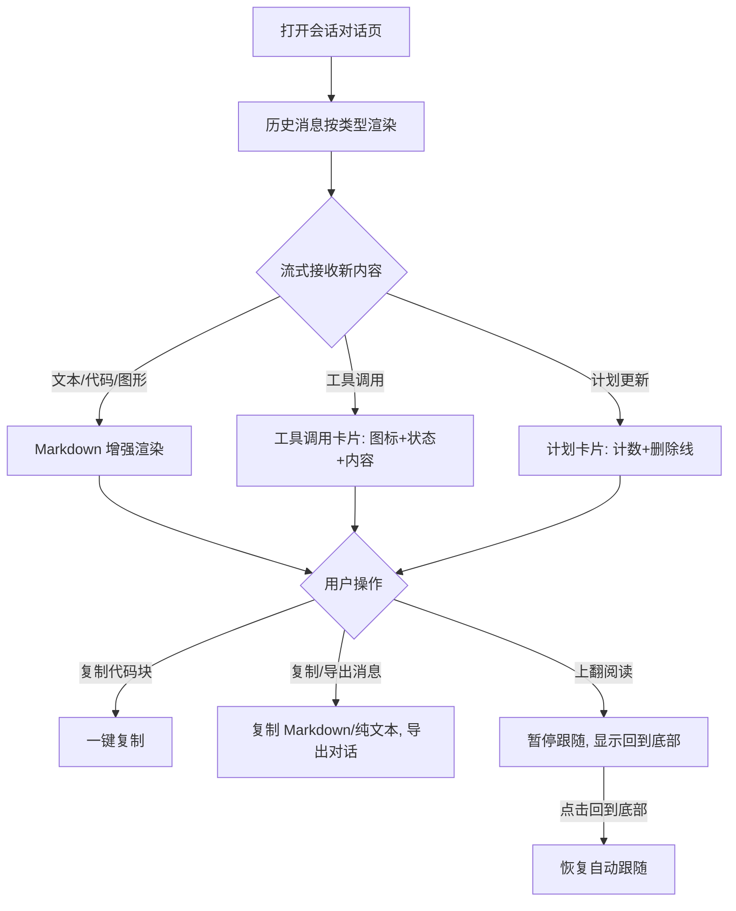

# 重构对话渲染

**功能名称**: 对话渲染能力重构
**PRD 版本**: v1.0
**创建日期**: 2026-10-28
**作者**: z-agent-gear 工作流（需求来源：Deliay）

## 背景与目标

### 1.1 背景

需求来源：GitHub Issue [Deliay/z-agent-gear#332](https://github.com/Deliay/z-agent-gear/issues/332)「重构对话渲染」，要求参考项目 [zed](https://github.com/zed-industries/zed)，补齐现在的对话渲染能力的缺失。

当前产品的会话对话页已具备基础的对话展示能力：Markdown 文本渲染、代码语法高亮、工具调用折叠卡片、思考块、计划卡片、终端输出与简易差异对比。与 zed 对 ACP 协议数据的处理与渲染方式对比，存在以下能力缺失：

- **代码块无操作能力**：zed 的代码块带语言标识、悬停复制按钮与换行切换；当前只能手动拖选复制长代码，容易漏行。
- **Mermaid 图形不渲染**：zed 将 Mermaid 代码块渲染为可缩放图形；当前以纯源码展示，用户需自行脑补图形结构。
- **差异对比不可信**：zed 使用真实差异算法并按文件、差异块分组展示；当前使用逐行对比，遇到插入/删除行即错位，可能误导用户对修改范围的判断。
- **终端输出丢失颜色**：zed 保留终端输出的颜色与样式；当前剥离全部终端控制序列后统一显示为绿色文字，错误/警告/成功无法通过颜色区分。
- **工具调用信息不完整**：zed 为每种工具类型提供图标、完整状态体系与可折叠的原始输入查看；当前未覆盖的工具类型只显示一行摘要，无法查看工具的实际入参与产出。
- **消息内容不可复用**：zed 支持复制单条回复、复制为 Markdown、导出整段对话；当前均不支持。
- **长对话导航缺失**：zed 上翻阅读时不打断，并提供回到底部入口；当前新消息到达时强制滚动到底部，打断阅读。

### 1.2 目标

以 zed 对 ACP 数据的处理与渲染为参照，系统性补齐对话渲染能力，使用户在**阅读、审查、复用、导出** Agent 产出内容时达到与 zed 相当的体验：

1. 对话中所有内容类型（文本、代码、图形、差异、终端、图片、资源）都有完整、准确的展示形式。
2. 工具调用过程透明可查：任何工具调用都能看清「做了什么、状态如何、输入输出是什么」。
3. Agent 产出内容可一键复用：代码可复制、消息可复制、整段对话可导出。

### 1.3 成功标准

| 指标 | 目标值 |
|------|--------|
| 代码块一键复制覆盖率 | 100% 代码块提供复制按钮 |
| Mermaid 代码块图形化率 | 100% 合法 Mermaid 块渲染为图形 |
| 差异展示准确性 | 插入/删除/修改行对齐正确，与主流差异工具口径一致 |
| 终端输出颜色保留 | ANSI 颜色与粗体样式完整渲染 |
| 工具调用可检视率 | 100% 工具调用可查看原始输入与产出 |
| 阅读不中断 | 用户上翻阅读历史时不被新消息强制拉回底部 |
| 内容复用 | 任意 Agent 回复可复制为 Markdown，整段对话可导出为 Markdown 文件 |

## 用户分析

### 2.1 目标用户

使用本产品创建 Agent 会话进行软件开发、技术写作、资料研究等工作的用户，以开发者为主。

### 2.2 用户场景

| 场景 | 用户角色 | 目标 | 痛点 |
|------|----------|------|------|
| 审查 Agent 的代码修改 | 开发者 | 快速看懂改了哪个文件、改了哪些行 | 差异逐行错位，插入多行后新旧内容对不上，无法信任对比结果 |
| 复用 Agent 生成的代码 | 开发者 | 一键复制完整代码块 | 手动拖选长代码易漏行，复制后还要补全 |
| 阅读 Agent 生成的架构图/流程图 | 所有用户 | 直接看到图形 | Mermaid 源码以纯文本展示 |
| 查看命令执行结果 | 开发者 | 通过颜色区分错误、警告与成功输出 | 终端颜色被剥离，所有输出一律绿色 |
| 追溯长对话上下文 | 所有用户 | 上翻阅读时不被打断，读完一键回到底部 | 新消息到达即被强制拉回底部 |
| 保存或分享对话成果 | 所有用户 | 导出整段对话为文档 | 无导出能力，只能逐段手选复制 |
| 确认 Agent 工具行为 | 开发者 | 查看工具实际入参与产出 | 非常见工具类型只有一行摘要，无从核对 |

## 功能需求

### 3.1 功能概述

重构会话对话的渲染层，按六组能力补齐与 zed 的差距：Markdown 渲染增强、工具调用卡片增强、差异渲染升级、终端渲染升级、消息操作、滚动导航与计划展示增强。

### 3.2 功能列表

#### 功能点 1: 代码块工具栏

- **描述**: 对话中的每个代码块展示语言标签，悬停时显示「复制」与「自动换行」两个操作按钮；复制成功与失败均有明确反馈；长行代码默认横向滚动，切换换行后按容器宽度折行。
- **用户价值**: 快速识别代码语言，一键完整复制，按需查看长行代码。
- **验收标准**:
  - [ ] 所有带语言标记与不带语言标记的代码块均有工具栏
  - [ ] 点击复制按钮后剪贴板内容与代码块内容完全一致，成功/失败均有提示
  - [ ] 换行切换在横向滚动与自动折行之间切换，状态在单次展示内保持
  - [ ] 窄面板（移动端）下工具栏不撑破布局

#### 功能点 2: Mermaid 图形渲染

- **描述**: `mermaid` 语言的代码块渲染为图形而非源码；图形支持放大缩小与「查看源码」切换；图形加载失败或语法错误时回退为普通代码块展示源码；图形风格跟随当前深色/浅色主题。
- **用户价值**: 架构图、流程图、时序图直接可视，无需自行解析源码。
- **验收标准**:
  - [ ] 合法 Mermaid 块渲染为图形
  - [ ] 语法错误块回退为代码块且不阻断整页渲染
  - [ ] 图形可缩放，可切回源码视图
  - [ ] 深色/浅色主题切换后图形风格一致

#### 功能点 3: 差异渲染升级

- **描述**: 文件修改类内容使用真实差异算法展示：新增行、删除行、未变行正确对齐；展示行号；新增/删除行以语义颜色区分；差异内容附带语法高亮；文件头展示文件路径与「新建文件」等状态徽标。
- **用户价值**: 准确判断 Agent 的修改范围，不再被错位差异误导。
- **验收标准**:
  - [ ] 插入多行、删除多行、连续修改场景下差异对齐正确
  - [ ] 每行展示行号
  - [ ] 新增/删除行颜色语义化且适配深色/浅色主题
  - [ ] 大文件差异限定展示高度并可内部滚动
  - [ ] 新建文件展示「新建文件」徽标（保持现有行为）

#### 功能点 4: 终端输出颜色渲染

- **描述**: 命令执行的输出保留终端颜色与粗体等样式渲染，不再统一显示为绿色；继续过滤终端控制序列中的光标移动等非展示指令；输出超出最大高度时内部滚动。
- **用户价值**: 编译错误红、警告黄、成功绿等颜色语义一目了然。
- **验收标准**:
  - [ ] ANSI 颜色码渲染为对应前景色/背景色
  - [ ] 粗体样式保留
  - [ ] 光标控制等非展示序列不产生乱码
  - [ ] 无颜色的输出保持现有可读性

#### 功能点 5: 工具调用卡片增强

- **描述**: 工具调用卡片按工具类型展示图标（读取、编辑、删除、移动、搜索、执行、思考、网络抓取等各有专属图标）；状态视觉覆盖进行中、已完成、失败、等待确认等状态；所有工具调用可折叠查看「原始输入」与「原始输出」；工具产出内容支持文本、图片、资源链接、嵌入资源等全部类型；卡片标题中的文件路径完整可读。
- **用户价值**: 工具调用过程透明可查，一眼识别工具类型与状态，任何工具行为都能核对入参与产出。
- **验收标准**:
  - [ ] 每种工具类型展示对应图标
  - [ ] 进行中/完成/失败状态视觉区分明显，等待确认状态有独立样式
  - [ ] 任意工具调用可展开查看原始输入与原始输出
  - [ ] 图片产出正常渲染，资源链接可点击打开
  - [ ] 未识别的新工具类型降级为标题 + 状态 + 原始数据展示，不渲染空白

#### 功能点 6: 消息操作与对话导出

- **描述**: 每条 Agent 回复悬停显示操作入口，支持「复制 Markdown」「复制纯文本」；对话页提供「导出对话为 Markdown」入口，导出文件按消息顺序包含用户消息、Agent 回复、思考内容、工具调用与结果摘要。
- **用户价值**: Agent 产出内容可快速复用到文档、Issue、分享场景。
- **验收标准**:
  - [ ] 复制 Markdown 得到原始 Markdown 文本
  - [ ] 复制纯文本得到去除标记符号后的可读文本
  - [ ] 导出的 Markdown 文件结构完整、时间有序、可被标准 Markdown 阅读器正常打开
  - [ ] 剪贴板不可用时给出失败提示

#### 功能点 7: 滚动导航

- **描述**: 用户向上滚动阅读历史时暂停自动跟随，新消息到达不再强制拉回底部；右下角显示「回到底部」浮动按钮，有新消息时按钮带提示；回到底部后恢复自动跟随。
- **用户价值**: 长对话中可安心阅读历史内容，不被流式输出打断。
- **验收标准**:
  - [ ] 上翻后新消息到达视图保持原位
  - [ ] 「回到底部」按钮仅在不在底部时出现
  - [ ] 点击按钮平滑滚动到底并恢复自动跟随
  - [ ] 初始加载与加载更早历史的现有行为不回归

#### 功能点 8: 计划（Plan）展示增强

- **描述**: 计划条目按状态展示：已完成条目内容加删除线、进行中有动态指示、待办为空心样式；卡片摘要展示完成计数（如「3/5」）。
- **用户价值**: 任务进度一目了然。
- **验收标准**:
  - [ ] 已完成条目展示删除线
  - [ ] 摘要计数与实际条目状态一致
  - [ ] 全部完成时摘要展示完成态文案

### 3.3 用户操作流程

### 3.4 页面/界面描述

| 页面 | 描述 | 关键元素 |
|------|------|----------|
| 会话对话页 | 全部增强能力的承载页面 | 消息列表、代码块工具栏、Mermaid 图形、差异视图、终端输出、工具调用卡片、消息悬停操作、「回到底部」浮动按钮、导出入口 |

### 3.5 异常与边界情况

| 情况 | 预期行为 |
|------|----------|
| Mermaid 语法错误 | 回退为普通代码块展示源码，不影响其他内容渲染 |
| 未识别的工具调用类型 | 展示标题与状态，可折叠查看原始输入/输出，不渲染空白卡片 |
| 超长代码块/终端输出/差异 | 限定最大高度，区域内部滚动 |
| 剪贴板权限被拒绝 | 提示复制失败，不静默 |
| 图片内容（base64/URL） | 正常渲染并限定最大高度，加载失败显示占位提示 |
| 会话历史为空或加载失败 | 保持现有空态与错误态行为 |
| 移动端窄屏 | 工具栏、卡片、差异视图不产生横向溢出 |

## 四、非功能需求

### 4.1 性能要求

- 千级消息的会话滚动流畅，无明显卡顿。
- 图形渲染库按需加载，不拖慢首屏。
- 流式接收期间输入框输入不卡顿、不丢字。

### 4.2 安全性要求

- Markdown 渲染不执行原始 HTML 与脚本，防 XSS。
- 外部链接一律新窗口打开并带 `noreferrer`。
- 导出的对话文件内容与会话内容一致，不夹带额外信息。

### 4.3 兼容性要求

- 桌面端与移动端布局均可用。
- 深色与浅色主题下所有新增视觉元素颜色可读。

## 五、依赖与约束

### 5.1 依赖

- 现有会话消息数据（ACP 协议会话更新）不变，本需求不改变数据获取方式。

### 5.2 约束

- 本需求仅涉及渲染层重构，不改变会话的协议交互、存储结构与后端接口。
- 不引入需要后端配合的能力（如检查点恢复、消息编辑重发、回复评分），此类能力不在本期范围。
- 遵循项目文档规范与前端开发规范。

## 六、相关文档

- 技术提案：[[../../engineering/proposals/20261028-refactor-conversation-rendering.md]]
- 需求来源：[GitHub Issue #332 重构对话渲染](https://github.com/Deliay/z-agent-gear/issues/332)
- 参考项目：[zed](https://github.com/zed-industries/zed)（ACP 数据处理与对话渲染）
