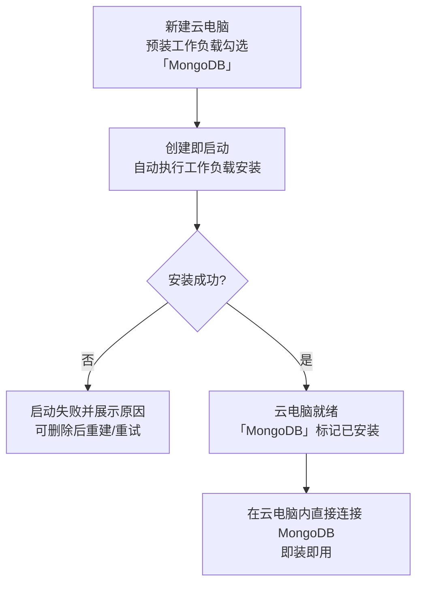
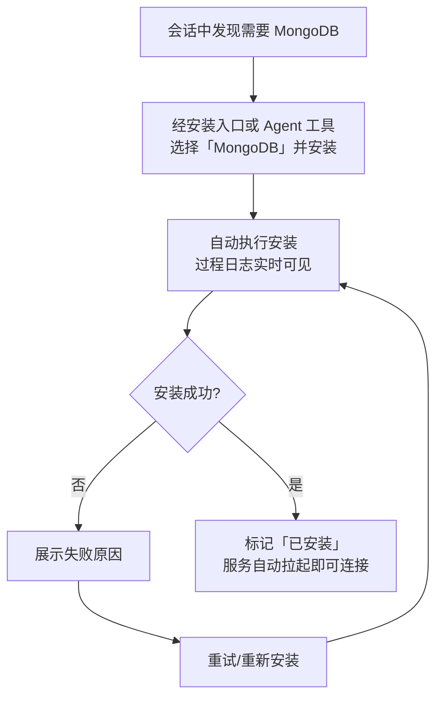

# 增加工作负载「MongoDB」：原生 apt 安装 MongoDB 数据库服务

**功能名称**: 工作负载「MongoDB」（原生 apt 安装）
**PRD 版本**: v1.0
**创建日期**: 2026-10-28
**作者**: ZeroAsh

> 术语：「工作负载」沿用《工作负载一期》（[[20261018-workload-phase1.md]]）的口径——工作负载是可安装到云电脑/云端工作容器的能力包（如 Docker、Node.js、.NET、Aspire、Github），可在创建云电脑时预装、也可在运行期安装，安装过程与结果在界面上可见。
>
> 需求原文（Issue #341）：
>
> - 增加工作负载 mongodb，最好使用原生使用 apt
> - apt 源：
>   - gpg: `https://nexus.internal.fffdan.com/repository/misc-cache/mongodb/server-8.0.asc`
>   - apt: `https://nexus.internal.fffdan.com/repository/mongodb-apt-proxy`
> - `sudo apt-get update`
> - `sudo apt-get install -y mongodb-org`

## 背景与目标

### 1.1 背景

云电脑/云端工作容器的工作负载体系已上线多个预制工作负载（Docker、Node.js、.NET、Aspire、Github 等），用户可在创建云电脑时预装、或在运行期按需安装，安装过程自动执行、结果自动留档。

用户的云端开发任务经常需要**数据库**。MongoDB 是最常用的文档数据库之一，而当前工作负载目录中没有任何数据库类工作负载，用户需要数据库时只能进容器手工安装，步骤繁琐、无留档、失败无提示，且不同用户安装方式各异、难以复用。

本期新增「**MongoDB**」标准工作负载：按需求指定，**优先使用原生 apt 方式**安装（使用内网 apt 源安装官方 `mongodb-org` 包，而非 Docker 嵌套或二进制分发），安装完成后 MongoDB 服务自动拉起、即装即用。

### 1.2 目标

- 工作负载目录新增「**MongoDB**」，与 Docker、Node.js、.NET、Aspire、Github 等同级：后台工作负载列表可见（带「预制」标记）、创建云电脑可预装、运行期可安装、Agent 工具可列出与安装。
- **原生 apt 安装**：使用需求指定的内网 apt 源（GPG 校验）安装官方 `mongodb-org` 软件包（8.0 系），全程仅依赖内网源，不回退公网。
- **安装即用**：安装完成后 MongoDB 服务自动启动并可直接连接使用，无需用户进入容器手工拉起。
- **幂等可重复**：安装过程可重复执行（创建时预装 + 运行期再装、重试、重放）不产生重复安装、重复实例或数据损坏。
- **失败可恢复**：安装失败明确展示原因，可重试；作为必须工作负载安装失败时沿用既有失败语义（云电脑启动失败并展示原因）。
- 既有工作负载与其他能力完全不受影响。

### 1.3 成功标准

- 后台工作负载列表出现「MongoDB」（带「预制」标记），与既有预制工作负载展示口径一致。
- 新建云电脑的「预装工作负载」可选「MongoDB」；云电脑就绪后该负载显示为已安装。
- 运行期安装（界面入口与 Agent 工具 `workload_list` / `workload_install`）可完成 MongoDB 安装，安装结果与「已安装」标记正确呈现。
- 安装完成后，云电脑内 MongoDB 服务处于运行状态、可直接连接（默认端口）并读写数据。
- 重复执行安装（含已安装状态下的再次安装）幂等成功，不重复安装、不产生第二个实例、既有数据不损坏。
- 安装过程日志在界面上可见；失败时原因可见、可重试恢复。
- 既有预制工作负载（Docker / Node.js / .NET / Aspire / Github 等）安装与使用零回归；既有云电脑、会话、主机功能零影响。

## 用户分析

### 2.1 目标用户

- **云端开发者（主要用户）**：在云电脑上开发需要 MongoDB 的应用（本地联调、原型验证、数据导入导出），希望开箱即得一个可用的 MongoDB。
- **多服务联调用户**：在云电脑上同时运行应用与数据库，依赖工作负载组合（如 Node.js/.NET + MongoDB）。
- **管理员**：在后台管理工作负载目录，期望预制负载口径统一（安装方式、幂等、留档）。

### 2.2 用户场景

| 场景 | 用户角色 | 目标 | 痛点 |
|--|--|--|--|
| 创建云电脑时预装数据库 | 云端开发者 | 创建时勾选 MongoDB，就绪即用 | 没有数据库类工作负载，进容器手工装步骤多 |
| 运行期按需安装 | 云端开发者 | 会话中途发现需要 MongoDB，随手安装 | 手工安装无留档、失败无提示 |
| 组合工作负载开发 | 多服务联调用户 | Node.js/.NET + MongoDB 一台云电脑全配好 | 多环境多步骤，重复劳动 |
| 重复安装/重试 | 云端开发者 | 已装过再执行安装不出错 | 担心重复安装弄坏环境、数据丢失 |
| 安装失败排查 | 云端开发者 | 看到失败原因，重试即可恢复 | 失败无提示不知如何恢复 |
| 目录管理 | 管理员 | 后台统一查看预制工作负载 | 新负载口径不一致会增加支持成本 |

## 功能需求

### 3.1 功能概述

工作负载目录新增「**MongoDB**」标准工作负载（预制）：使用需求指定的内网 apt 源、以**原生 apt** 方式安装官方 `mongodb-org` 软件包（8.0 系），安装完成后 MongoDB 服务自动启动并确认可用——即装即用。该负载与既有工作负载同口径呈现与管理：创建云电脑可预装、运行期可安装（界面与 Agent 工具均可）、安装过程留档、结果标记「已安装」、幂等可重复、失败可恢复。

### 3.2 功能列表

#### 功能点 1: 工作负载目录新增「MongoDB」（预制标准工作负载）

- **描述**: 工作负载目录新增「MongoDB」，与 Docker、Node.js、.NET、Aspire、Github 等既有预制工作负载同级、同口径呈现：后台工作负载列表可见并带「预制」标记；创建云电脑的「预装工作负载」可勾选；运行期可通过安装入口与 Agent 工具列出并安装；安装后显示「已安装」与安装时间。本期该负载**无参数、无依赖**（直接安装，不依赖其他工作负载）。
- **用户价值**: 所有既有工作负载的入口处都能找到 MongoDB，学习成本为零。
- **验收标准**:
  - [ ] 后台工作负载列表出现「MongoDB」（带「预制」标记），展示口径与既有预制负载一致
  - [ ] 新建云电脑的「预装工作负载」可选「MongoDB」，可与其他工作负载同时勾选
  - [ ] 运行期安装入口与 Agent 工具（列出 / 安装工作负载）均可见「MongoDB」
  - [ ] 安装完成后界面显示「已安装」与安装时间，与其他负载口径一致

#### 功能点 2: 原生 apt 安装 MongoDB 8.0（内网源）

- **描述**: 安装时使用需求指定的**内网 apt 源**（GPG 密钥 + apt 源均为内网地址）以原生 apt 方式安装官方 `mongodb-org` 软件包（8.0 系）。全程仅依赖内网源，不回退公网；软件来源与完整性经 GPG 校验。
- **用户价值**: 安装方式正规、可审计、速度快（内网），与「原生 apt」诉求一致。
- **验收标准**:
  - [ ] 安装使用需求指定的内网 GPG 密钥与 apt 源，全程不访问公网源
  - [ ] 安装的是官方 `mongodb-org` 软件包（8.0 系）
  - [ ] 软件来源经 GPG 校验（apt 源带签名校验）
  - [ ] 安装过程日志在界面上可见

#### 功能点 3: 安装即用（服务自动拉起与可用性确认）

- **描述**: 安装完成后 MongoDB 服务自动启动并监听默认端口，安装流程内完成可用性确认（能连上并响应）；确认失败视为安装失败。用户安装完成后**无需进入容器做任何手工操作**即可连接使用。数据默认落盘保留（容器生命周期内）。
- **用户价值**: 即装即用，真正「一键」。
- **验收标准**:
  - [ ] 安装完成后 MongoDB 服务处于运行状态，默认端口可直接连接并读写
  - [ ] 服务未就绪/不可连接时按安装失败处理并展示原因
  - [ ] 安装完成后用户无需任何手工拉起/配置动作
  - [ ] 容器生命周期内已写入的数据在重启进程后仍可用（数据不因重复安装丢失）

#### 功能点 4: 幂等可重复执行与失败可恢复

- **描述**: 安装过程幂等：已安装状态下再次执行（创建时预装与运行期安装重复命中、重试、重放）直接成功，不重复安装、不产生第二个服务实例、既有数据不损坏。安装失败（源不可达、包损坏、启动失败等）时明确展示原因，可重试或重新安装恢复。作为必须工作负载安装失败时，沿用既有失败语义（云电脑启动失败并展示原因）。
- **用户价值**: 放心重试、放心重复安装，失败可自助恢复。
- **验收标准**:
  - [ ] 已安装状态下再次执行安装直接成功，不重复安装、不产生第二个实例
  - [ ] 重复安装后既有数据不损坏、服务不中断
  - [ ] 安装失败时界面上可见失败原因，可重试/重新安装
  - [ ] 作为必须工作负载安装失败时，沿用既有「启动失败并展示原因」语义

### 3.3 用户操作流程

#### 创建云电脑时预装 MongoDB

#### 运行期按需安装 MongoDB

#### 已安装状态下的重复安装（幂等）

### 3.4 页面/界面描述

| 页面 | 描述 | 关键元素 |
|------|------|---------|
| 后台·工作负载管理 | 预制工作负载目录扩展 | 「MongoDB」条目（「预制」标记）、名称、参数（本期无）、依赖（本期无）、脚本与日志查看 |
| 新建云电脑对话框 | 预装工作负载选择扩展 | 「预装工作负载（可选）」列表含「MongoDB」，可多选、可设必须项 |
| 云电脑/主机·工作负载区域 | 已安装与可安装工作负载 | 「MongoDB」已安装标记与安装时间；运行期安装入口；安装日志与失败原因 |
| Agent 工具（会话内） | 工作负载的列出与安装 | 列出含「MongoDB」（含已安装标记）；安装动作与结果反馈 |

### 3.5 异常与边界情况

| 情况 | 预期行为 |
|------|---------|
| 重复安装（已安装再执行） | 幂等直接成功；不重复安装、不产生第二个实例、既有数据不损坏 |
| 安装源不可达/超时 | 安装失败并展示原因；可重试 |
| 软件包安装失败/损坏 | 安装失败并展示原因；可重试/重新安装 |
| 服务启动/可用性确认失败 | 按安装失败处理并展示原因 |
| 必须工作负载安装失败 | 沿用既有语义：云电脑启动失败并展示原因，可删除后重建 |
| 可选工作负载安装失败 | 沿用既有语义：不阻断其他负载，失败原因可见可重试 |
| 与其他工作负载组合安装 | 各负载互不影响，按既有编排顺序执行 |
| 云电脑销毁 | 数据随容器回收（与既有工作负载数据同口径），重建后按需重新安装 |
| 环境已存在手工安装的 MongoDB | 幂等口径覆盖：检测到已安装即成功返回，不破坏既有实例与数据 |

## 四、非功能需求

### 4.1 性能要求

- 安装耗时以「内网 apt 源安装」为基准，不引入公网下载环节；整体安装应在工作负载既有超时预算内完成（与 Docker 等安装型负载同量级）。
- 安装即用：安装完成后连接数据库不需要额外的等待或手工启动动作。

### 4.2 安全性要求

- 软件来源仅限需求指定的内网 apt 源，且经 GPG 签名校验；不回退任何公网源。
- 安装过程与既有工作负载同口径留档（过程日志可见），不引入新的凭证或密钥面。
- MongoDB 服务的访问控制遵循软件默认口径，本期不额外开放鉴权配置（见约束）。

### 4.3 兼容性要求

- 既有预制工作负载（Docker / Node.js / .NET / Aspire / Github 等）的列表、安装、依赖、参数、日志、失败语义完全不受影响。
- 既有云电脑、普通主机、会话功能不受影响。
- 后台、前台界面不新增页面，仅在既有工作负载列表/选择处多出一个可选项（数据驱动，无界面改造）。

## 五、依赖与约束

### 5.1 依赖

- 工作负载能力（预制工作负载目录、创建预装与运行期安装、安装留档与「已安装」标记、依赖展开与失败语义）——MongoDB 以标准工作负载交付，完全复用既有能力。
- 内网软件源服务（需求指定的 GPG 密钥地址与 apt 源地址）——安装期可用。

### 5.2 约束

- **安装方式**：原生 apt 安装官方 `mongodb-org`（8.0 系），不采用 Docker 嵌套、不采用二进制分发（需求明确「最好使用原生使用 apt」）。
- 安装源必须为需求指定的内网地址，不回退公网。
- 安装与服务拉起必须**幂等且有硬校验**（安装成功但服务不可用视为安装失败）。
- 本期不提供安装参数（版本、端口、存储路径、鉴权等均使用软件默认口径），保持最小可用；参数化留待后续按需求扩展。
- 本期不做 MongoDB 高可用/副本集、数据持久化到容器外、备份恢复等能力。

## 六、相关文档

- [[20261018-workload-phase1.md]] — 工作负载一期（参数、依赖与预制工作负载）
- [[20261022-workload-optimization.md]] — 工作负载优化（工作负载展示与安装、MCP 列出安装）
- [[20261021-github-workload.md]] — Github 工作负载与云主机 Git 项目设置（预制标准工作负载先例）
- [[20261025-cloud-host-keepalive.md]] — 云电脑保活与 worker 用户（容器内普通用户可安装 apt 包）
- [[../../engineering/proposals/20261028-feat-mongodb-workload.md]] — 本期技术提案
