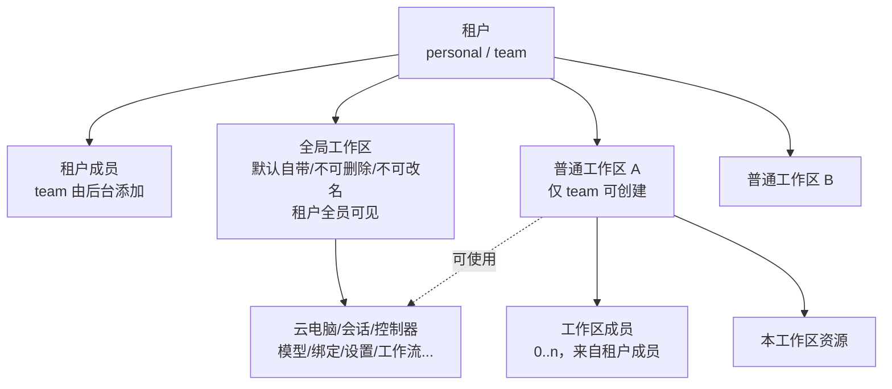
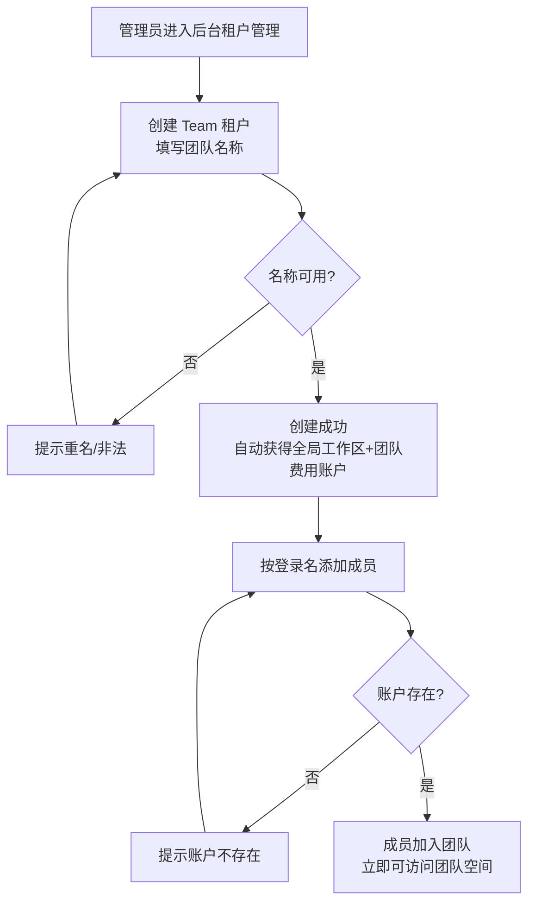
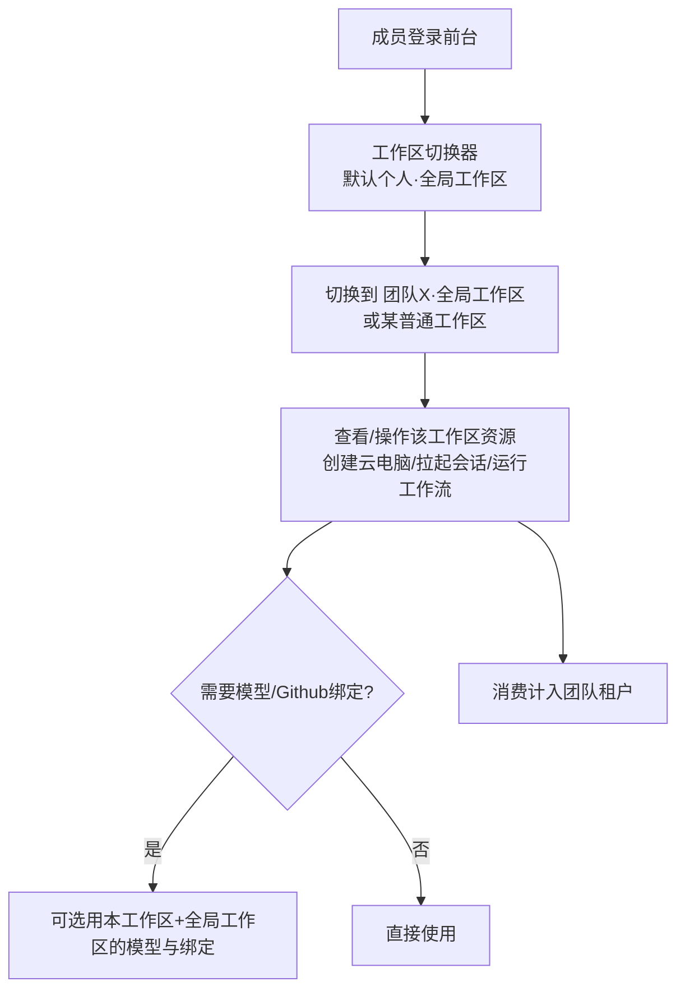
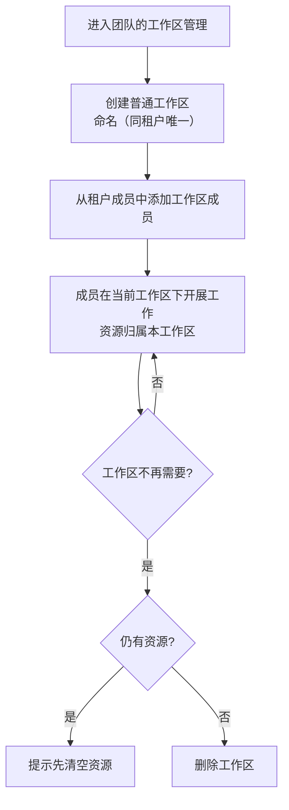

# 多租户二期

**功能名称**: 多租户二期（Team 类型租户与租户内工作区共享）
**PRD 版本**: v1.0
**创建日期**: 2026-10-28
**作者**: z-agent-bot
**需求来源**: [GitHub Issue Deliay/z-agent-gear#338](https://github.com/Deliay/z-agent-gear/issues/338)

## 背景与目标

### 1.1 背景

多租户一期已建成「账户→用户→租户」三层帐号体系：每个用户拥有同名的个人专属租户（单成员、不可删除、不可添加成员），余额按租户持有，全部用户数据按租户归属与隔离，且租户内数据仍跟随创建者本人（同一租户内成员之间也互不可见）。

二期在此基础上回答一个问题：**多人如何以团队形态协作使用平台**。一期的个人专属租户无法容纳多名成员，租户内也没有任何资源共享机制。本期引入两件事：

1. **Team 类型租户**：由后台创建，可把平台已存在的账户添加为成员，形成一个多人协作空间。
2. **工作区（Workspace）**：租户内组织与共享资源的单位。每个租户都自动拥有一个默认的「全局工作区」；Team 租户的成员还可以按需创建更多普通工作区，把资源按项目/小组分组，并控制谁可以看到和操作。

> 术语说明：本文的「工作区」是租户内组织资源的分组概念。平台既有的「项目工作区」（云电脑/控制器上的 Git 项目目录）是另一个概念，指代码所在目录，本文不涉及；两者命名相近但语义不同，界面文案上应加以区分。

### 1.2 目标

- **支持 Team 类型租户**：后台可创建 Team 租户并维护其成员，被添加的成员必须是平台上已存在的账户。
- **工作区模型落地**：工作区管理租户内存量与新增的资源；每个租户自动拥有名为「全局工作区」的默认工作区，全局工作区无法删除、无法改名。
- **仅 Team 租户可创建工作区**：personal（个人专属）租户依然拥有工作区形态，但有且仅有一个全局工作区，没有创建更多工作区的入口。
- **工作区成员协作**：普通工作区可包含 0 个或若干个成员（来自本租户成员）；工作区成员可以查看和操作本工作区的相关资源，无论资源由谁创建。
- **全局工作区全员共享**：全局工作区没有成员列表，其数据对租户全员可见可操作；普通工作区的容器/会话允许使用全局工作区的模型、Github 绑定等资源。
- **工作区设置继承**：以 Commit 设置为代表的工作区级设置，本工作区未设置时继承全局工作区的设置，全局也未设置时保持既有「未设置」行为。
- **个人用户零感知**：只属于个人专属租户的用户，升级前后使用体验完全一致。

### 1.3 成功标准

- 后台可成功创建 Team 租户，并可添加/移除成员；添加不存在的账户被明确拒绝；重复添加同一账户不产生重复成员。
- 升级后每个存量租户都自动拥有「全局工作区」，存量资源全部归入其中；个人用户升级后看到的数据、余额、可用功能与升级前完全一致。
- Team 租户成员可创建普通工作区、为工作区命名/改名、管理工作区成员；同租户内工作区名称唯一；仍持有资源的工作区无法被删除。
- 全局工作区不存在删除、改名、成员管理入口；其资源对租户全员可见可操作。
- 普通工作区的资源仅其成员可见可操作；非成员以任何方式访问均不可达。
- 普通工作区内拉起会话/使用云电脑时，可以选用全局工作区维护的模型与 Github 绑定。
- Commit 设置的三段继承（本工作区 → 全局工作区 → 未设置）按 §3.2 功能点 7 的矩阵逐一成立。
- 团队工作区内产生的消费计入团队租户的费用账户，成员个人租户的余额不受影响；后台可为 Team 租户充值并立即生效。

## 用户分析

### 2.1 目标用户

- **团队用户（开发者群体）**：以 Team 租户成员身份共用平台资源与费用，按工作区组织协作。
- **后台管理员（平台运营）**：负责开通 Team 租户、维护团队成员、为团队充值。
- **个人用户**：平台的既有使用者，本期对其零感知——个人专属租户有且仅有全局工作区。

### 2.2 用户场景

| 场景 | 用户角色 | 目标 | 痛点 |
|--|--|--|--|
| 开通团队 | 后台管理员 | 创建 Team 租户并把同事的账户加进来 | 一期只有个人专属租户，无法组建多人团队 |
| 团队协作开发 | 团队成员 | 共用云电脑、会话、工作流等研发资源 | 一期数据仅创建者本人可见，团队内无法共享 |
| 按项目分组资源 | 团队成员 | 不同项目的资源放在不同工作区，仅项目成员可见 | 缺少租户内更细粒度的分组与可见性控制 |
| 团队统一配置 | 团队成员 | 在全局工作区统一维护模型、Github 绑定等，供全团队及各工作区使用 | 每个成员重复配置，口径不一致 |
| 团队统一结算 | 后台管理员/团队负责人 | 团队消费走团队账户，统一充值对账 | 团队资源由个人垫付，费用归属混乱 |
| 个人用户日常使用 | 个人用户 | 一切照旧 | 担心升级改变既有体验或数据丢失 |

## 功能需求

### 3.1 功能概述

本期为平台引入「Team 租户 + 工作区」的两级协作模型：后台开通 Team 租户并维护其成员；每个租户自带一个不可删除、不可改名的「全局工作区」，Team 租户成员还可创建普通工作区并按需管理成员；云电脑、会话、控制器、供应商设置、可用模型、Github 绑定、Commit 设置、工作流实例、已配置工作流与自定义工作流模板等资源按工作区归属；全局工作区对租户全员共享，普通工作区仅成员可见；普通工作区可使用全局工作区的模型与绑定类资源，设置类配置支持向全局工作区继承；团队内消费统一计入团队租户。

### 3.2 功能列表

#### 功能点 1: Team 类型租户（后台开通与成员管理）

- **描述**: 后台支持创建 Team 类型租户（填写团队名称，平台内租户名称唯一）。Team 租户支持添加其他用户为成员——被添加的成员必须是平台上**已经存在的账户**（按登录名添加）；也支持将成员移出租户。Team 租户创建成功即自动拥有「全局工作区」和独立的租户费用账户（零余额）。个人专属租户维持一期口径：单成员、不可删除、不可添加成员，后台对 personal 租户不提供成员管理入口。租户本身仍不提供删除能力。
- **用户价值**: 平台运营可以开办多人团队，团队拥有独立的资源空间与费用账户。
- **验收标准**:
  - [ ] 后台可创建 Team 租户；名称重复或非法时创建失败并提示具体原因
  - [ ] 可按登录名添加已存在账户为租户成员；添加后立即生效，该成员登录前台即可看到团队空间
  - [ ] 添加不存在的账户失败并明确提示「账户不存在」
  - [ ] 重复添加同一账户不产生重复成员（幂等或明确提示已是成员）
  - [ ] 可将成员移出 Team 租户；移出后该成员立即失去该团队全部工作区的访问，且其个人专属租户不受影响
  - [ ] personal 租户不存在添加/移除成员入口，非常规方式的尝试同样被拒绝
  - [ ] Team 租户创建后即可被充值、可正常消费（费用账户零余额起步）

#### 功能点 2: 工作区与全局工作区

- **描述**: 工作区是租户内组织资源的分组单位。每个租户（含全部存量租户）自动拥有且仅拥有一个名为「**全局工作区**」的默认工作区：它**无法删除、无法改名、没有成员列表**（其可见性规则见功能点 3）。Team 租户的成员可以创建普通工作区：自定义名称（同租户内唯一）、可改名、可删除。删除保护：工作区内仍持有任何资源时不允许删除，需先清空。**personal 租户依然有工作区，但只有一个全局工作区**：不提供创建、改名、删除工作区的任何入口。
- **用户价值**: 团队可以按项目、按小组组织资源；默认形态对所有人（含个人用户）天然成立，无需任何初始化动作。
- **验收标准**:
  - [ ] 每个存量租户升级后自动拥有「全局工作区」，名称恒为「全局工作区」
  - [ ] 每个新建租户（personal/team）创建时自动拥有「全局工作区」
  - [ ] 全局工作区在任何界面都没有删除、改名、成员管理入口；非常规方式的尝试被拒绝
  - [ ] Team 租户成员可创建普通工作区；同租户内重名被拒绝并提示
  - [ ] Team 租户成员可对工作区改名、删除；删除仍持有资源的工作区被拒绝并提示需先清空
  - [ ] personal 租户不存在创建工作区入口，也没有第二个工作区

#### 功能点 3: 工作区成员与资源可见性

- **描述**: 普通工作区可以包含 **0 个或若干个成员**，成员从本租户的成员中选取（可添加、可移除）。工作区成员可以**查看和操作**本工作区的相关资源——云电脑、会话、控制器、工作流等，无论资源由谁创建；非成员看不到该工作区及其资源。成员列表允许为空：**0 成员的工作区对任何人都不可见不可操作**，此时任何租户成员都可以把自己加入该工作区（认领），加入后即恢复可见可管理。**全局工作区没有成员列表、不允许添加和删除成员**——其下的数据**租户内全员**都有权限查看和操作。被移出某工作区的成员立即失去该工作区的访问；被移出租户的成员失去该租户全部工作区的访问。无论何种移出，相关成员先前创建的资源都保留在原工作区内（资源归属工作区，而非个人）。
- **用户价值**: 资源归属从「个人」升级为「工作区」，成员进出不影响团队资产连续性；细粒度可见性控制满足分组隔离诉求。
- **验收标准**:
  - [ ] 工作区成员可在列表与详情中看到并操作本工作区全部资源（含他人创建）
  - [ ] 非成员的任何入口都看不到普通工作区及其资源；直接以标识访问按「不存在」拒绝
  - [ ] 全局工作区资源对租户全员可见可操作，且无成员管理入口
  - [ ] 0 成员工作区可被任一租户成员认领（把自己加为成员）后恢复管理
  - [ ] 被移出工作区/租户的成员立即失去相应访问，其创建的资源留在原工作区
  - [ ] 工作区成员只能从本租户成员中选取，无法把其他租户的人加进来

#### 功能点 4: 资源按工作区归属

- **描述**: 以下资源归属于工作区（创建时归属创建者当前所在的工作区）：
  - 云电脑、云电脑下的会话、控制器
  - 供应商设置、可用模型、Github 绑定、Commit 设置
  - 工作流实例、已配置工作流、自定义的工作流模板

  以下资源**不属于**工作区：
  - 系统内置工作流模板（继续面向全体用户可用，不归属任何工作区）

  未列入上述清单的其他数据（如个人 MCP 配置、待办通知、本地控制器上的项目工作区等）维持一期口径，仍跟随用户本人，不进入工作区共享范围。升级时，全部存量资源自动归入其租户的「全局工作区」。资源创建后在本期内不支持跨工作区移动。
- **用户价值**: 资源边界清晰，团队资产集中管理；存量数据平滑过渡。
- **验收标准**:
  - [ ] 在当前工作区创建的云电脑/会话/控制器/工作流等资源，归属并仅出现在该工作区（共享规则见功能点 6）
  - [ ] 供应商设置、可用模型、Github 绑定、Commit 设置的维护与展示均跟随当前工作区
  - [ ] 系统内置工作流模板在创建工作流时对所有工作区可用
  - [ ] 存量资源升级后全部归入本租户全局工作区，无遗漏、无错挂
  - [ ] 个人 MCP 配置、待办通知等个人向数据的可见范围与升级前一致

#### 功能点 5: 当前工作区与工作区切换

- **描述**: 前台提供工作区切换器，按租户分组列出「我可以访问的全部工作区」：我的个人专属租户的全局工作区、我所在各团队的全局工作区、以及我在各团队中加入的普通工作区。用户选定一个「当前工作区」后，前台的资源列表、设置页、创建动作都在该工作区上下文下进行。默认进入个人专属租户的全局工作区。只属于个人专属租户的用户（未加入任何团队）只有一个可访问工作区，切换器退化为其提供无感知的默认形态。
- **用户价值**: 团队成员在个人空间与多个团队空间之间自由穿梭，上下文清晰。
- **验收标准**:
  - [ ] 切换器按租户分组展示全部可访问工作区（个人 + 各团队）
  - [ ] 切换工作区后，资源列表、设置页、新建入口均作用于新的当前工作区
  - [ ] 刷新/重新登录后当前工作区选择可恢复
  - [ ] 未加入任何团队的用户体验与升级前一致（始终处于个人全局工作区）

#### 功能点 6: 全局工作区资源共享

- **描述**: 普通工作区的容器/会话允许使用**全局工作区**的模型、Github 绑定等资源。具体地：在普通工作区内拉起会话或创建云电脑时，可用模型范围 = 本工作区自有的可用模型 ∪ 全局工作区的可用模型（供应商设置同理）；Git 项目设置等场景可选用全局工作区绑定的 Github 帐号。普通工作区也可以维护自己的供应商、模型与 Github 绑定（仅本工作区可用）。全局工作区资源的维护入口在「全局工作区」上下文下；对普通工作区而言它们是只读的可用来源。个人专属租户只有一个全局工作区，该共享规则对其无额外影响。
- **用户价值**: 团队统一维护一套模型与帐号绑定，各工作区直接复用，避免重复配置。
- **验收标准**:
  - [ ] 普通工作区拉起会话时，模型可选范围包含全局工作区的可用模型
  - [ ] 普通工作区创建云电脑/配置 Git 项目时，可选用全局工作区的 Github 绑定
  - [ ] 普通工作区内无法修改/删除全局工作区的供应商、模型与绑定（需切换到全局工作区维护）
  - [ ] 普通工作区自有模型/绑定与全局的同名共存时不冲突，可区分来源
  - [ ] 全局工作区的模型/绑定被删除后，普通工作区相应入口随即不可用

#### 功能点 7: 工作区设置继承（以 Commit 设置为例）

- **描述**: 设置类配置按工作区分别维护；当本工作区没有设置时，自动使用全局工作区的设置。以 Commit 设置为例的三段规则：
  - 本工作区 Commit 设置已设置 → 使用本工作区的设置
  - 本工作区未设置、全局工作区已设置 → 使用全局工作区的设置
  - 本工作区未设置、全局工作区也未设置 → 保持既有「未设置」行为（与升级前一致）

  设置页在普通工作区上下文下应展示当前生效值的来源（本工作区 / 继承自全局工作区 / 未设置），对本工作区的编辑只影响本工作区。全局工作区作为租户内兜底配置。个人专属租户因只有全局工作区，行为与升级前完全一致。
- **用户价值**: 团队可以统一定义默认规范，又允许特定工作区按需覆盖。
- **验收标准**:
  - [ ] 本工作区已设置时，生效值=本工作区设置
  - [ ] 本工作区未设置且全局已设置时，生效值=全局设置，页面标注「继承自全局工作区」
  - [ ] 两级均未设置时行为与升级前的「未设置」一致
  - [ ] 在普通工作区保存/清除设置不影响全局工作区的设置
  - [ ] 个人专属租户的 Commit 设置行为与升级前一致

#### 功能点 8: 团队消费计入团队租户

- **描述**: 工作区内产生的一切消费（云电脑创建费、模型调用计费等）按**工作区所属租户**的口径计费：团队工作区的消费从团队租户余额扣减、账单与收据归属团队租户；个人全局工作区的消费仍计入个人专属租户（与一期一致）。后台可为 Team 租户充值，充值为既有能力，立即生效。成员个人租户的余额不受团队消费影响。
- **用户价值**: 团队开支统一结算、统一对账；成员个人账目不受团队使用牵连。
- **验收标准**:
  - [ ] 团队工作区内创建云电脑/调用模型产生的费用从团队租户余额扣减
  - [ ] 团队租户的账单、收据可按租户口径在后台检索与核对
  - [ ] 后台为 Team 租户充值后余额立即可见、可消费
  - [ ] 同一用户在个人空间与团队空间的消费分别计入对应租户，互不影响
  - [ ] 余额不足拦截、欠费止损等既有资金规则在团队租户口径下行为不变

### 3.3 用户操作流程

团队开通流程（后台）：

团队协作流程（前台）：

工作区组织流程（Team 租户成员）：

### 3.4 页面/界面描述

| 页面 | 描述 | 关键元素 |
|------|------|---------|
| 前台工作区切换器 | 选择当前工作区 | 按租户分组的可访问工作区列表；当前工作区标识；个人用户退化为无感知默认形态 |
| 前台工作区管理页 | Team 租户内组织工作区 | 工作区列表（名称、类型、成员数）、创建入口、改名、删除（非空拦截）、成员管理（添加/移除、0 成员认领入口） |
| 前台各资源列表页 | 云电脑/会话/控制器/工作流等 | 内容随当前工作区切换；共享资源（来自全局工作区的模型/绑定）标注来源 |
| 前台设置页 | 供应商/模型/Github 绑定/Commit 设置 | 跟随当前工作区上下文；Commit 设置展示生效来源（本工作区/继承全局/未设置） |
| 前台「我的费用」 | 费用口径随当前工作区所属租户 | 个人空间看个人租户账目，团队空间看团队租户账目 |
| 后台租户列表页 | 全部租户一览（一期已有） | 类型列区分 personal/team；team 租户进入成员管理 |
| 后台租户详情页 | 租户概要 + 成员管理 | Team 租户：成员列表、按登录名添加成员、移除成员；personal 租户维持只读 |
| 后台费用中心 | 充值入口（一期已有） | Team 租户与个人租户同等可检索、可充值 |

### 3.5 异常与边界情况

| 情况 | 预期行为 |
|------|---------|
| 添加成员时账户不存在 | 添加失败并明确提示「账户不存在」 |
| 重复添加同一成员 | 不产生重复成员（幂等返回或明确提示已是成员） |
| 为 personal 租户添加/移除成员 | 无入口；非常规尝试一律被拒绝 |
| 为 Team 租户创建重名工作区 | 创建失败并提示同租户内名称已存在 |
| 删除/改名「全局工作区」 | 无入口；非常规尝试一律被拒绝 |
| 删除仍持有资源的工作区 | 删除被拒绝，提示需先清空资源 |
| 非成员访问普通工作区资源 | 一律按「不存在」处理，不泄露工作区或资源的存在性 |
| 0 成员工作区无法管理 | 任何租户成员可把自己加入（认领）后恢复可见可管理 |
| 成员被移出工作区/租户时其资源与进行中的会话 | 资源保留在原工作区归团队继续使用；该成员立即失去访问 |
| 成员被移出租户后又重新加入 | 恢复租户级访问（全局工作区立即可见）；普通工作区成员关系不自动恢复，需重新添加 |
| 普通工作区引用的全局工作区模型/绑定被删除 | 相关入口随即不可用；进行中的会话不受影响（按会话已确定的配置继续） |
| 团队租户余额不足 | 与既有一致：创建/调用被拦截并提示充值，止损规则不变 |
| 个人用户（不属于任何团队）升级后首次登录 | 无感知：默认且仅有「个人·全局工作区」，全部既有数据原样可见 |

## 四、非功能需求

### 4.1 性能要求

- 工作区上下文解析与可见性过滤不得引入用户可感知的额外延迟：常用列表查询响应时间与升级前相比无显著劣化。
- 存量数据归属迁移在可接受窗口内完成，迁移过程不阻塞平台正常服务。

### 4.2 安全性要求

- 工作区可见性是安全红线：任何对普通工作区资源的访问都必须以成员资格为前提，禁止任何形式的绕过；非成员访问一律按「不存在」处理，不泄露存在性。
- 全局工作区的「租户全员可见」以租户成员资格为前提；被移出租户后立即失去全部访问。
- 后台的租户与成员管理操作保留操作记录，可追溯操作人与时间。

### 4.3 兼容性要求

- 存量个人用户升级后零感知：登录方式、数据、余额、设置（含 Commit 设置生效结果）与升级前完全一致。
- 已签发的各类凭据（如模型调用 API Key）升级后继续有效。
- 系统内置工作流模板保持对全体用户可用，不因工作区改造出现可见性回退。

## 五、依赖与约束

### 5.1 依赖

- 依赖多租户一期已建成的三层帐号体系、租户隔离与租户口径计费能力（见 [[20261027-multi-tenant-phase1.md]]）。
- 依赖后台管理面既有的管理员登录鉴权与费用中心充值能力。

### 5.2 约束

- 本期**不做**租户/工作区内的角色体系（如 owner/管理员/只读成员）：Team 租户成员在租户层权限相同，工作区成员在其工作区内权限相同。
- 个人专属租户「单成员、不可删除、不可添加成员」的一期约束继续保持；其有且仅有全局工作区。
- 本期**不做**资源跨工作区移动；资源创建即定归属，如需迁移须删除重建（后续期次评估）。
- 本期**不做**租户删除；Team 租户创建后不可删除（同一期口径）。
- 后台管理面维持一期口径：不做多租户设计，仅新增 Team 租户的创建与成员管理。
- 未列入工作区资源清单的数据（个人 MCP 配置、待办通知等）维持按用户本人的一期口径，不进入工作区共享。
- 「全局工作区」名称固定为「全局工作区」，不可改名、不可删除，且每租户恰好一个。

## 六、相关文档

- 需求来源：[GitHub Issue Deliay/z-agent-gear#338 — 多租户二期](https://github.com/Deliay/z-agent-gear/issues/338)
- 前置文档：[[20261027-multi-tenant-phase1.md]]（多租户一期：三层帐号体系与数据按租户隔离）
- 技术提案：[[../../engineering/proposals/20261028-feat-multi-tenant-phase2.md]]
- 关联文档：[[20261027-commit-author-settings.md]]（Commit 设置，工作区设置继承的样本）、[[20261018-credits-billing.md]]（费用中心，团队计费的计费基础）
