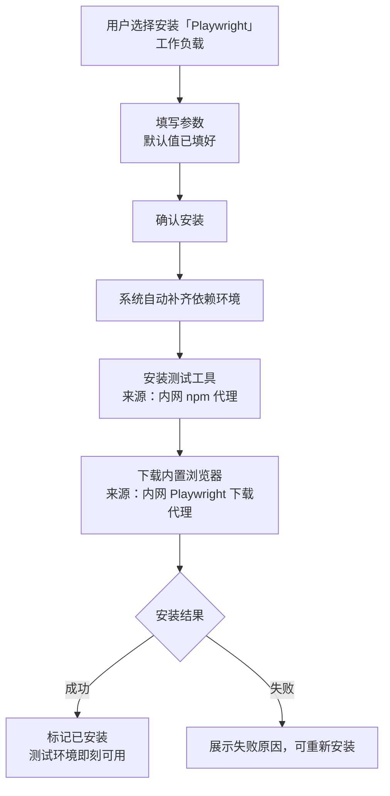
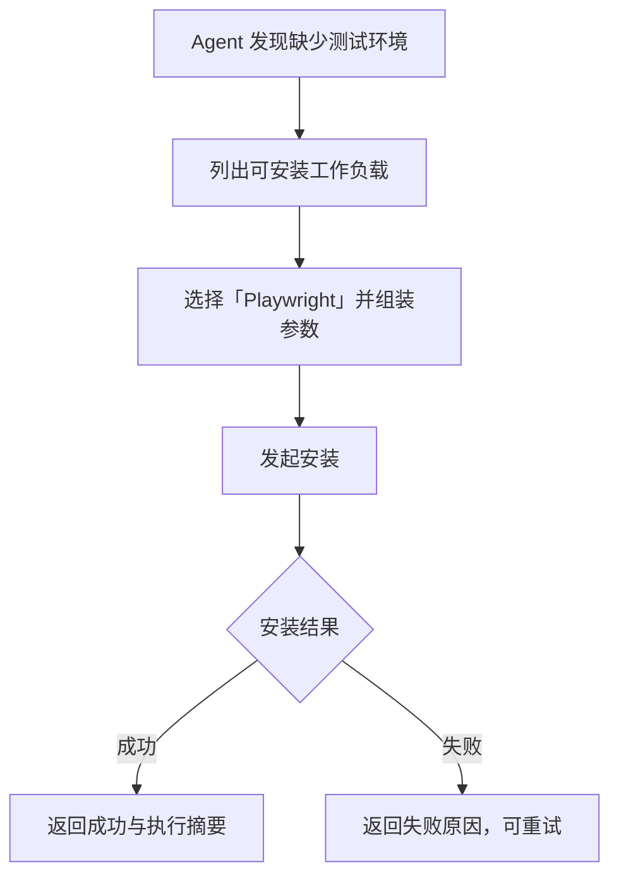

# 增加工作负载「Playwright」

**功能名称**: 增加工作负载「Playwright」
**PRD 版本**: v1.0
**创建日期**: 2026-10-28
**作者**: ZeroAsh Agent

## 背景与目标

### 1.1 背景

平台已具备完整的工作负载体系：管理员可维护带参数、带依赖的工作负载，在云端工作容器启动时挂载执行，并内置了 Docker、Node.js、.NET、Aspire、Github 等预制工作负载（见 [[20261017-cloud-controller-workload]]、[[20261018-workload-phase1]]）；工作负载还支持在云主机拉起后由用户或 Agent 按需安装（见 [[20261021-github-workload]]）。

用户在云主机上开发 Web 项目时，普遍需要**端到端浏览器自动化测试能力**（Playwright）：对页面交互、跨浏览器兼容性做回归验证，或让 Agent 在会话中直接执行 E2E 测试任务。目前平台没有提供该环境，用户只能进入容器手工安装测试工具并下载浏览器：

1. **手工步骤繁琐**：安装测试工具、逐个下载浏览器二进制，容易漏装、错装；
2. **浏览器下载依赖公网**：浏览器二进制默认从公网下载，在内网/出网受限环境下慢甚至不可达，与平台「下载统一走内网代理」的策略不一致；
3. **环境不可复现**：每台云主机都要重复一遍手工过程，Agent 遇到缺失环境时也只能望洋兴叹。

需求来源：GitHub Issue #342「工作负载增加 playwright」。本期以预制工作负载的形式补齐该能力。

### 1.2 目标

- 新增「Playwright」预制工作负载：安装后容器内具备完整的 Playwright 浏览器自动化测试环境（测试工具命令 + 内置浏览器），可直接运行 Playwright 测试。
- 安装的下载来源统一走内网代理（测试工具走内网 npm 代理、浏览器走内网 Playwright 下载代理），默认配置下不访问公网；浏览器下载来源可按次调整。
- 使用方式与既有工作负载完全一致：启动时挂载、云主机设置中拉起后安装、Agent 发起安装三入口皆可。

### 1.3 成功标准

- 升级后工作负载列表中自动出现「Playwright」预制工作负载（带预制标识，且只出现一次）。
- 安装完成后容器内 Playwright 测试工具命令可用、内置浏览器就绪，无需任何手工补充即可运行 Playwright 测试。
- 默认配置下安装过程不访问公网，工具与浏览器均来自内网代理。
- 重复安装幂等成功，已安装状态在列表中标记且不提供卸载入口。
- 安装失败时反馈可读的失败原因，可重新安装且不影响云主机其余能力。

## 用户分析

### 2.1 目标用户

- **前台用户**：在云主机上开发 Web 项目，需要运行 Playwright 端到端测试。
- **Agent（系统内）**：在会话中执行测试任务，需要可运行的 Playwright 测试环境。
- **平台管理员**：维护「Playwright」预制工作负载（与既有预制工作负载管理方式一致）。

### 2.2 用户场景

| 场景 | 用户角色 | 目标 | 痛点 |
|--|--|--|--|
| 在云主机上跑 E2E 测试 | 前台用户 | 装好即用，直接运行 Playwright 测试 | 手工装工具、逐个下浏览器，步骤繁琐易错 |
| 内网环境下准备测试环境 | 前台用户 | 浏览器从内网代理快速下载 | 公网下载慢甚至不可达 |
| 创建云主机即带测试环境 | 前台用户 | 启动时勾选挂载，拉起即就绪 | 无法预装，落成后重复手工操作 |
| Agent 自主补齐测试环境 | Agent | 发现缺环境时自行安装 | 环境缺失导致测试任务无法进行 |
| 换下载来源 | 平台管理员 | 按次调整浏览器下载地址 | 地址写死无处可调，只能改脚本 |

## 功能需求

### 3.1 功能概述

新增「Playwright」预制工作负载：一次安装即获得 Playwright 测试工具与内置浏览器（Chromium、Firefox、WebKit）的完整测试环境，安装下载统一走内网代理，与既有工作负载共享同一套安装、参数、状态与日志机制。

### 3.2 功能列表

#### 功能点 1: 「Playwright」预制工作负载

- **描述**: 新增内置预制工作负载「Playwright」，升级后自动出现在工作负载列表中（遵循既有预制工作负载规则：一次性加入、只增不改、管理员可改可删、不被覆盖）：
  - 安装 Playwright 测试工具（全局安装，包来源为内网 npm 代理）；
  - 安装内置浏览器：Chromium、Firefox、WebKit（浏览器下载来源为内网 Playwright 下载代理）；
  - 安装幂等：环境中已具备可用的 Playwright 工具与浏览器时直接成功，不重复下载；
  - 安装完成以「工具命令可用 + 浏览器就绪」为准入校验，不满足即视为失败。
- **用户价值**: 测试环境开箱即装、来源可信，一次安装完整可用。
- **验收标准**:
  - [ ] 升级后工作负载列表出现「Playwright」预制工作负载，带预制标识，且只出现一次
  - [ ] 安装该工作负载后容器内 Playwright 测试工具命令可用
  - [ ] 安装后 Chromium、Firefox、WebKit 内置浏览器就绪，可直接运行 Playwright 测试
  - [ ] 工具与浏览器均来自内网代理，不访问不可信外部源
  - [ ] 重复执行安装幂等成功，不产生副作用
  - [ ] 管理员修改/删除后不被系统自动覆盖或恢复

#### 功能点 2: 浏览器下载来源可按次调整

- **描述**: 工作负载提供「浏览器下载地址」参数，默认值为内网 Playwright 下载代理地址；每次安装时可见、可按次调整（例如切换到其他缓存代理）；地址缺失或无效时快速失败并给出填写指引。
- **用户价值**: 下载来源可见、可调，出问题时无需改脚本。
- **验收标准**:
  - [ ] 安装时参数表单中展示「浏览器下载地址」，默认值已填好内网下载代理地址
  - [ ] 按默认值安装不访问公网
  - [ ] 调整地址后安装按新地址下载浏览器
  - [ ] 地址缺失/无效时快速失败，提示中包含正确的地址形态

#### 功能点 3: 三入口安装与状态反馈（复用既有能力）

- **描述**: 「Playwright」与既有工作负载使用方式完全一致：
  - 启动云主机时可勾选挂载，随启动初始化执行；
  - 云主机设置的工作负载列表中可拉起后安装（含参数填写、已安装标识）；
  - Agent 可通过工具列出并发起安装；
  - 安装过程的进度、执行日志、失败原因展示与既有工作负载一致；执行记录中可区分触发来源。
- **用户价值**: 无需学习新流程，任一入口都能拿到同一份能力。
- **验收标准**:
  - [ ] 启动时挂载安装成功，云主机就绪后测试环境可用
  - [ ] 在云主机设置中安装成功，进度与结果可见
  - [ ] Agent 发起安装成功并获得成功/失败结果
  - [ ] 三种入口共享同一套执行与记录机制，执行记录可区分触发来源
  - [ ] 已安装的工作负载在列表中标记为已安装，不提供卸载入口

#### 功能点 4: 依赖自动补齐与安装后可用保障

- **描述**: 「Playwright」依赖的 Node.js 运行环境在安装时自动补齐（依赖项各执行一次，进度中可见）；安装完成即代表环境可用——工具命令可执行且浏览器就绪，任一环节失败则整体失败并展示可读原因，可重新安装。
- **用户价值**: 无需关心前置条件，成功即用。
- **验收标准**:
  - [ ] 未预装 Node.js 环境时自动补齐依赖后完成安装
  - [ ] 安装成功后无需手工补充即可运行 Playwright 测试
  - [ ] 工具安装成功但浏览器下载失败时整体判为失败，原因可读
  - [ ] 重试安装可成功，且对已成功部分幂等

### 3.3 用户操作流程

#### 启动时挂载 / 拉起后安装（用户）

#### Agent 发起安装

### 3.4 页面/界面描述

| 页面 | 描述 | 关键元素 |
|------|------|---------|
| 工作负载列表（云主机设置） | 展示可安装工作负载 | 「Playwright」条目、预制标识、已安装标识、安装入口 |
| 安装参数表单 | 安装前填写参数 | 「浏览器下载地址」（默认值已填好）、确认/取消 |
| 安装进度/执行记录 | 展示安装过程 | 依赖补齐与安装各步骤状态、执行日志、失败原因 |

### 3.5 异常与边界情况

| 情况 | 预期行为 |
|------|---------|
| 云主机不在线 | 不允许发起安装，提示等待云主机在线 |
| 内网 npm 代理不可达 | 工具安装失败，原因可读，可重试 |
| 内网 Playwright 下载代理不可达 | 浏览器下载失败，整体判为失败，原因可读，可重试 |
| 「浏览器下载地址」缺失或无效 | 快速失败，提示包含正确的地址形态 |
| 重复安装同一工作负载 | 幂等执行，结果仍为已安装 |
| 已安装的工作负载 | 标记已安装，不提供卸载入口 |
| 依赖的 Node.js 环境缺失 | 自动补齐依赖后安装，进度中可见 |
| 工具安装成功但浏览器下载失败 | 整体判为失败；重试时已成功部分幂等跳过 |
| 安装耗时较长（浏览器体积较大） | 过程有进度反馈；失败可重试，不影响云主机其余能力 |
| 管理员对预制项做过修改/删除 | 尊重管理员的定制，不被系统覆盖或恢复 |

## 四、非功能需求

### 4.1 性能要求

- 正常内网条件下，安装在分钟级内完成（浏览器下载为主要耗时）。
- 安装进度状态刷新延迟不超过 3 秒。

### 4.2 安全性要求

- 安装来源仅限内网代理（npm 代理与 Playwright 下载代理），不访问不可信外部源。
- 工作负载脚本仍仅管理员可维护；安装来源与参数随执行记录留档。

### 4.3 兼容性要求

- 不影响既有工作负载与启动时挂载流程；未使用本期能力的云主机行为与现状一致。
- 存量云主机升级后可直接使用「Playwright」工作负载。
- 拉起后安装仅云主机支持（本地/自定义主机不出现入口），沿用既有口径。

## 五、依赖与约束

### 5.1 依赖

- 已上线的工作负载体系（[[20261017-cloud-controller-workload]]、[[20261018-workload-phase1]]、[[20261018-workload-phase3]]）：参数、依赖、预制负载、执行记录与拉起后安装能力。
- 内网 npm 代理可用（测试工具安装来源）。
- 内网 Playwright 下载代理（`playwright-proxy`）可用（浏览器下载来源）。

### 5.2 约束

- 已安装的工作负载不支持卸载。
- 一期浏览器范围固定为内置三件（Chromium、Firefox、WebKit），不支持按需选择浏览器子集、不支持自定义浏览器版本（后续按需扩展）。
- 一期测试工具版本跟随上游最新版，不做版本固定（后续按需扩展）。
- 不修改任何既有工作负载的行为。

## 六、相关文档

- [[20261017-cloud-controller-workload]] — 云控制器工作负载功能 PRD
- [[20261018-workload-phase1]] — 工作负载一期 PRD（参数、依赖与预制工作负载）
- [[20261018-workload-phase3]] — 工作负载三期 PRD（必须工作负载）
- [[20261021-github-workload]] — Github 工作负载与云主机 Git 项目设置 PRD
- [[20261022-workload-optimization]] — 工作负载优化 PRD
- 技术提案：`docs/engineering/proposals/20261028-feat-playwright-workload.md`
