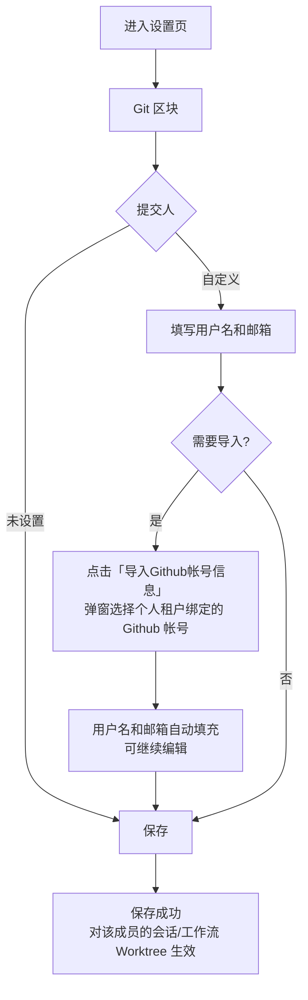
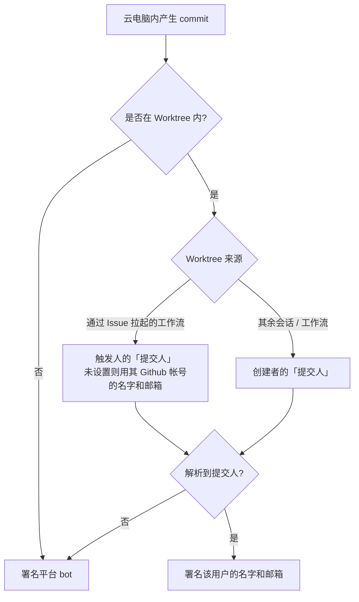

# Commit 作者设置优化

**功能名称**: Commit 作者设置优化（成员独立提交人、「Git」区块与提交身份下发）
**PRD 版本**: v1.0
**创建日期**: 2026-10-29
**作者**: ZeroAsh Agent

## 背景与目标

### 1.1 背景

「Commit 提交人设置」已上线：用户设置提交人后，云电脑内的 AI 提交会使用该设置署名。上线后暴露出三个问题：

- **提交人是团队共享配置**：团队内所有成员共用一份提交人设置，成员无法用自己的名字和邮箱署名，个人提交被记到他人或团队名下；
- **设置位置不清晰**：提交人混在「Commit 设置」区块中、紧挨着 GitHub 绑定，用户难以定位，也与「这是我的 Git 身份」的心智不符；
- **填写与下发粒度不足**：提交人只能选「Github帐号」或从零手填，无法以帐号信息为基础微调；且一份配置同步到整台云电脑，无法区分「云电脑自身」与「某个人的会话/工作流」的提交归属，多成员共用一台云电脑时互相串扰。

### 1.2 目标

- 提交人由团队共享配置改为**成员独立配置**：团队内每位成员都有自己的个性化提交人设置；
- 设置页**新增「Git」区块**承载「提交人」设置，提交人从「Commit 设置」中移出；
- 「自定义」填写支持**「导入Github帐号信息」**一键填充；**移除「Github帐号」**提交人类型，存量选择自动转换为「自定义」；
- 提交身份**按上下文下发**：云电脑自身固定署名平台 bot；勾选 Worktree 的会话/工作流署名创建者（通过 Issue 拉起的工作流署名触发人）。

### 1.3 成功标准

- 团队内两名成员各自保存提交人设置互不影响，同一成员在任何工作区使用同一份设置；
- 「自定义」下点击「导入Github帐号信息」，选择帐号后用户名和邮箱被填充且可继续编辑、可保存；
- 存量「Github帐号」提交人转换为「自定义」后，实际署名与转换前完全一致；
- 云电脑内非 Worktree 提交署名平台 bot；Worktree 会话/工作流提交署名创建者；Issue 拉起的工作流提交署名触发人。

## 用户分析

### 2.1 目标用户

使用云电脑进行仓库开发的注册用户，尤其是关注 commit 归属与协作审计的团队成员与项目维护者。

### 2.2 用户场景

| 场景 | 用户角色 | 目标 | 痛点 |
|--|--|--|--|
| 团队协作开发 | 团队成员 | 以自己的名字和邮箱提交 | 提交人是团队共享配置，署名不是自己 |
| 个人开发 | 个人开发者 | AI 提交署自己的名字 | 需要手工逐字填写名字和邮箱，容易填错 |
| Issue 驱动的自动化 | 项目参与者 | 由我拉起的工作流提交归属到我 | 工作流提交归属与拉起人无关，无法追溯 |
| 云电脑自身操作 | 项目维护者 | 平台自身的提交可识别为机器提交 | 平台提交与人的提交混同，审计困难 |

## 功能需求

### 3.1 功能概述

提交人设置改为成员独立，移入新的「Git」区块；「自定义」填写支持「导入Github帐号信息」并移除「Github帐号」类型；提交身份按「云电脑 / 会话与工作流（Worktree）」上下文下发，通过 Issue 拉起的工作流归属触发人。

> **口径说明**：原「提交人模式」（仅Agent / Co-Author / 仅人类）随本次调整**下线**——署名归属不再由模式配置决定，改由功能点 4 的下发规则固定（云电脑 = 平台 bot，Worktree = 人）。原「Commit 设置」区块随之移除。

### 3.2 功能列表

#### 功能点 1: 提交人改为成员独立配置

- **描述**: 提交人设置由团队共享改为成员独立：团队内每位成员都可以维护自己的个性化提交人（用户名和邮箱）。设置不再有共享/继承口径——不再有「全局设置」，每位成员一份设置，对其全部工作区生效。
- **用户价值**: 提交署名回到成员本人，团队协作与审计可追溯到人。
- **验收标准**:
  - [ ] 团队成员 A、B 各自设置提交人，互不影响
  - [ ] 同一成员在不同工作区使用同一份提交人设置
  - [ ] 不再存在团队共享/继承的提交人设置口径

#### 功能点 2: 「Git」区块（提交人迁出「Commit 设置」）

- **描述**: 设置页新增独立区块「Git」，承载「提交人」设置；「提交人」从「Commit 设置」中移除，原「Commit 设置」区块不再展示。「Git」区块头部保留提示：设置仅对云电脑环境生效。原「提交人模式」（仅Agent / Co-Author / 仅人类）随本次调整下线，署名归属由功能点 4 的下发规则决定。
- **用户价值**: Git 身份设置有独立、清晰的归属位置，符合用户「配置我的 Git 身份」的心智。
- **验收标准**:
  - [ ] 设置页出现「Git」区块，其中包含「提交人」设置
  - [ ] 设置页不再出现「Commit 设置」区块与「提交人模式」选项
  - [ ] 区块头部展示「仅对云电脑环境生效」提示

#### 功能点 3: 提交人填写优化（导入Github帐号信息 / 移除Github帐号 / 存量转换）

- **描述**: 「提交人」在「自定义」「未设置」中二选一（「Github帐号」类型移除）。
  - **自定义**：显示用户名、邮箱两个输入框；新增按钮**「导入Github帐号信息」**，点击后弹出弹窗，列出当前账户自身对应的个人租户绑定的全部「Github帐号」；选择一个帐号后读取该帐号的名字和邮箱，填入自定义的用户名和邮箱（填充后可继续编辑）；
  - **未设置**：不声明提交人，行为见功能点 4 的回退规则；
  - **存量转换**：之前选择「Github帐号」的设置自动转换为「自定义」，用户名和邮箱取该帐号对应的名字和邮箱，转换前后实际署名一致。
- **用户价值**: 复用已绑定 Github 帐号信息免手填、可微调；设置项收敛、无歧义。
- **验收标准**:
  - [ ] 「自定义」下出现「导入Github帐号信息」按钮，弹窗列出个人租户绑定的全部 Github 帐号
  - [ ] 选择帐号后用户名和邮箱被填充，且可继续编辑后保存
  - [ ] 「提交人」不再提供「Github帐号」选项
  - [ ] 存量「Github帐号」设置转换为「自定义」，署名与转换前一致

#### 功能点 4: 提交身份下发优化

- **描述**: 改为成员独立后，提交身份按上下文条件下发（不再存在一份全局设置）：

  | 场景 | commit 提交人 |
  |--|--|
  | 云电脑自身（含未勾选 Worktree 的会话/工作流） | 平台 bot，无视个人设置 |
  | 勾选 Worktree 的会话 | 会话创建者的「提交人」 |
  | 勾选 Worktree 的工作流（含其节点会话） | 工作流创建者的「提交人」 |
  | 通过 Issue 拉起的工作流 | 触发人（为 Issue 加上触发标签的人）的「提交人」；触发人未设置时用其 Github 帐号的名字和邮箱 |
  | 应下发「提交人」但创建者未设置 / 无法识别触发人 | 平台 bot |

  Worktree 的提交人随该 Worktree 初始化写入，仅对该 Worktree 内的提交生效；同一成员多份 Worktree 互不串扰。通过 Issue 拉起的工作流以触发人为准（而非工作流的发起配置属主）。
- **用户价值**: 「谁的会话/工作流，提交就署谁」；平台自身的提交固定可识别为机器提交；Issue 驱动的自动化提交可追溯到触发人。
- **验收标准**:
  - [ ] 云电脑内非 Worktree 的提交署名平台 bot（与个人设置无关）
  - [ ] 勾选 Worktree 的会话内提交署名会话创建者
  - [ ] 勾选 Worktree 的工作流内提交署名工作流创建者
  - [ ] Issue 拉起的工作流内提交署名触发人（加触发标签的人）
  - [ ] 创建者未设置提交人时，该 Worktree 内提交署名平台 bot
  - [ ] 同一台云电脑上不同成员的会话/工作流提交互不串扰

### 3.3 用户操作流程

### 3.4 页面/界面描述

| 页面 | 描述 | 关键元素 |
|------|------|---------|
| 设置页 - 「Git」区块 | 设置页新增的独立区块 | 区块标题「Git」、头部提示「仅对云电脑环境生效」、「提交人」选择（自定义 / 未设置）、保存按钮 |
| 提交人 - 自定义 | 提交人选择「自定义」时显示 | 用户名输入框、邮箱输入框、「导入Github帐号信息」按钮 |
| 导入Github帐号信息弹窗 | 点击「导入Github帐号信息」弹出 | 个人租户绑定的 Github 帐号列表（头像 + 帐号名）、选择与确认、空态引导（先到「GitHub 绑定」绑定帐号） |

### 3.5 异常与边界情况

| 情况 | 预期行为 |
|------|---------|
| 成员未设置提交人 | 其会话/工作流 Worktree 内提交署名平台 bot |
| Issue 触发人未设置提交人 | 使用该触发人 Github 帐号的名字和邮箱署名 |
| Issue 触发人无法识别（未绑定帐号） | 署名平台 bot |
| 创建者在工作流运行中修改提交人 | 不影响已创建的 Worktree（以 Worktree 创建时的设置为准） |
| 自定义用户名为空、邮箱格式非法或含换行等非法字符 | 拦截保存并提示 |
| 导入弹窗无可用帐号 | 空态提示并引导先到「GitHub 绑定」绑定帐号 |
| 存量「Github帐号」对应帐号已解绑 | 转换为「自定义」，使用该帐号转换时可得的名字和邮箱；无法取得则转为「未设置」 |
| 旧版本云电脑 | Worktree 提交人不生效，沿用云电脑级（平台 bot）署名，不报错 |
| 未设置用户在云电脑自身的提交 | 署名平台 bot（有意的行为变化：此前为未配置身份） |

## 四、非功能需求

### 4.1 性能要求

- 提交人设置的读取与保存在 2 秒内完成；
- 「导入Github帐号信息」弹窗打开与填充在 2 秒内完成；
- Worktree 创建后的提交人生效不引入可感知延迟（随 Worktree 初始化一次完成）。

### 4.2 安全性要求

- 提交身份仅包含用户名与邮箱，不引入任何新凭据；
- 导入仅读取 Github 帐号的名字和邮箱，不读取、不暴露其他隐私信息；
- 自定义输入需校验：不允许换行等非法字符，邮箱格式合法。

### 4.3 兼容性要求

- 存量「Github帐号」提交人自动转换为「自定义」，转换前后实际署名一致（无损）；
- 存量团队共享提交人设置自动迁移为成员个人设置（个人租户设置归本人；团队共享设置归其最后编辑人，其余成员为「未设置」）；
- 旧版本云电脑优雅降级：不支持 Worktree 提交人时沿用云电脑级署名，不产生错误；
- 有意的行为变化：「提交人模式」（仅Agent / Co-Author / 仅人类）下线；未设置用户在云电脑自身的提交从未配置身份变为署名平台 bot。

## 五、依赖与约束

### 5.1 依赖

- GitHub 帐号绑定（已上线）：导入弹窗的帐号来源；
- Git Worktree 支持（已上线）：会话/工作流的 Worktree 提交人承载；
- 云电脑 GitHub Issues 联动工作流（已上线）：Issue 触发人识别与归属；
- 多租户团队与工作区（已上线）：成员独立设置的口径基线（取代其中「Commit 设置三段继承」的共享口径）。

### 5.2 约束

- 提交人设置仅对云电脑环境生效，本地控制器环境不适用；
- 仅支持 github.com；
- 每位成员一份提交人设置，对其全部工作区生效；
- 通过 Issue 拉起的工作流，触发人以「为 Issue 加上触发标签」这一动作为准。

## 六、相关文档

- [[20261027-commit-author-settings.md]] — 云容器 Commit 提交人设置（本文档取代其「提交人模式」与团队共享口径，其余仍然有效）
- [[20261028-multi-tenant-phase2.md]] — 多租户二期（其中「Commit 设置三段继承」共享口径被本文档取代）
- [[20261025-github-issues-workflow.md]] — 云电脑 GitHub Issues 联动工作流
- [[20261026-issues-workflow-force-worktree.md]] — GitHub Issues 联动工作流强制 Worktree 隔离
- [[released/20260709-github-account-binding.md]] — GitHub 帐号绑定
- [[released/20260523-git-worktree-support-prd.md]] — Git Worktree 支持
- 技术提案：[[../../engineering/proposals/20261029-feat-commit-author-settings-optimization.md]]
