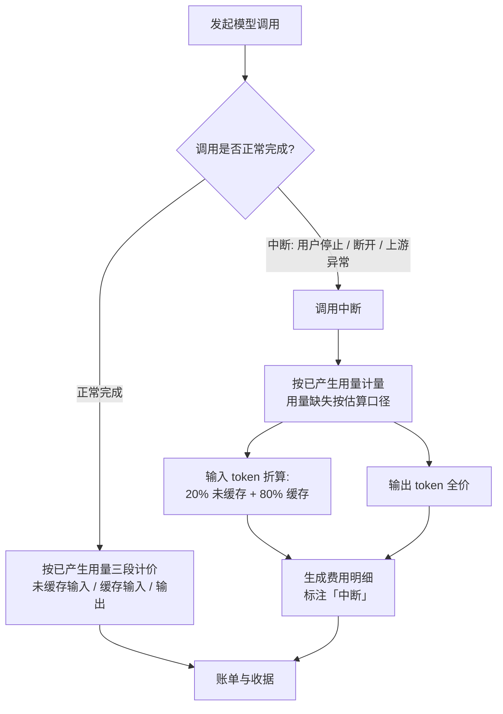

# 调用中断的 token 计费优化

**功能名称**: 中断调用 token 计费优化
**PRD 版本**: v1.0
**创建日期**: 2026-10-29
**作者**: ZeroAsh Agent

## 背景与目标

### 1.1 背景

费用中心（Credits 计费）对模型调用按「输入 / 缓存输入 / 输出」三段 token 计价，其中缓存输入单价显著低于未缓存输入。现行口径下，**调用中断（用户停止生成、连接断开、上游异常/超时）也按已产生用量全价计费**，仅在费用明细上标注「中断」：

- 用户主动停止或因网络原因中断的调用并未获得完整结果，输入部分却按全价计费，「没用完却收全价」观感不公平；
- 中断的输入内容大概率会被用户重新发送并命中缓存，按「缓存为主」的口径计价更贴近实际成本；
- 现行口径源自《费用中心（Credits 计费）》，需要一次明确的口径修订（来源：GitHub Issue Deliay/z-agent-gear#355）。

### 1.2 目标

- 中断的模型调用：**输入 token 按「20% 未缓存 + 80% 已缓存」计价**；
- 中断的模型调用：**输出 token 依然全价**（未产生输出则不计）；
- 正常完成的模型调用计费口径完全不变；
- 中断调用照常产生费用明细并标注「中断」，不产生逃费。

### 1.3 成功标准

- 中断调用的费用明细中，输入部分拆为「未缓存输入（20%）」与「缓存输入（80%）」两条计价明细，输出明细为全价，整体金额低于全价口径；
- 正常完成调用的费用金额与本需求上线前完全一致；
- 历史已出账单不发生任何变化（不追溯调整）；
- 用量缺失的中断调用按估算口径计量后，同样按 20/80 拆分计价并标注「估算」。

## 用户分析

### 2.1 目标用户

使用平台模型调用能力（会话、云电脑内 Harness 调用）、关注费用明细的注册用户与后台账户使用者。

### 2.2 用户场景

| 场景 | 用户角色 | 目标 | 痛点 |
|--|--|--|--|
| 生成过程中主动点「停止」 | 个人开发者 | 未完成的调用不要收全价 | 中断调用输入按全价计费 |
| 网络抖动 / 连接断开导致调用中断 | 个人开发者 | 非本人原因中断也应少付 | 被迫为中断调用付全价输入费用 |
| 上游异常 / 超时导致调用中断 | 个人开发者 | 异常调用计价合理 | 异常调用与正常调用同价 |
| 核对费用明细 | 用户 / 账户管理员 | 明细能看出中断与计价口径 | 明细只有「中断」标注，无法体现折算 |

## 功能需求

### 3.1 功能概述

对中断的模型调用，输入 token 按「20% 未缓存 + 80% 已缓存」两段计价，输出 token 保持全价；费用明细保留「中断」标注，并体现输入两段的拆分。

### 3.2 功能列表

#### 功能点 1: 中断调用输入 token 折算计价

- **描述**: 中断的模型调用（含用户停止、连接断开、上游异常/超时），其输入 token 不再按实际缓存命中比例计价，而是统一折算为：20% 按未缓存输入单价、80% 按缓存输入单价。折算以输入 token 总量为基数，两段之和恰为输入总量（取整与边界见 3.5）。
- **用户价值**: 中断调用的输入费用显著降低，计价更贴近「输入大概率会被重发并命中缓存」的实际成本。
- **验收标准**:
  - [ ] 中断调用费用明细中输入部分为两条：未缓存输入数量 = 输入总量的 20%，缓存输入数量 = 输入总量的 80%，两段之和恰为输入总量；
  - [ ] 两段分别按对应单价计价，合计低于按全价口径的金额；
  - [ ] 正常完成调用的计价不受影响。

#### 功能点 2: 输出 token 全价不变

- **描述**: 中断调用已产生的输出 token 仍按输出单价全价计费；未产生输出则不计费。
- **用户价值**: 输出是模型已实际生成的内容，保持全价口径，避免过度让利与逃费。
- **验收标准**:
  - [ ] 中断调用的输出明细单价与正常调用一致；
  - [ ] 无输出的中断调用不产生输出明细。

#### 功能点 3: 中断标注与明细展示

- **描述**: 中断调用照常产生费用明细并标注「中断」；输入两段拆分后在明细中分别展示（未缓存输入 / 缓存输入 / 输出），费用描述注明中断原因与折算口径。
- **用户价值**: 用户能从明细直接看出「为什么便宜了」，计价口径透明。
- **验收标准**:
  - [ ] 明细中三段（未缓存输入 / 缓存输入 / 输出）均带「中断」标注；
  - [ ] 费用描述含中断原因，并注明输入按 20% 未缓存 + 80% 缓存计价；
  - [ ] 费用中心「我的费用」与后台费用中心展示口径一致。

### 3.3 用户操作流程

### 3.4 页面/界面描述

| 页面 | 描述 | 关键元素 |
|--|--|--|
| 费用中心 - 我的费用 | 调用费用明细列表 | 中断调用显示「中断」标注；明细金额按折算口径计算 |
| 后台费用中心 | 账户调用费用明细 | 与前台一致的中断标注与折算口径 |

界面结构不做调整，仅金额与明细口径变化。

### 3.5 异常与边界情况

| 情况 | 预期行为 |
|--|--|
| 中断且无任何输出 | 仅输入两段计价，不产生输出明细 |
| 中断且用量缺失（无法获得） | 按既有估算口径计量并标注「估算」，估算出的输入同样按 20/80 拆分计价 |
| 输入 token 很少（如 1 个） | 拆分取整后两段之和恰为输入总量，不重不漏；允许其中一段为 0，为 0 的段不产生明细 |
| 中断原因不同（用户停止 / 断开 / 上游异常 / 超时） | 折算口径一致，仅标注的中断原因不同 |
| 正常完成的调用 | 计费口径与本需求上线前完全一致 |
| 上线前发生、上线后才入账的中断调用 | 按新口径计价（此前未出账）；已出账的历史账单不追溯调整 |
| 同一调用重复出账（重试 / 补投） | 沿用既有防重复机制，金额与首次出账一致 |

## 四、非功能需求

### 4.1 性能要求

折算为常数级计算，不引入额外等待；出账时延与现状一致。

### 4.2 安全性要求

折算只降低费用、不产生负值；不得因折算产生逃费——中断调用照常出账、照常可对账。

### 4.3 兼容性要求

- 金额取整沿用现有规则（不足 0.01 credits 按 0.01 credits 计）；
- 明细展示沿用现有「中断」标注体系，无需新增页面元素；
- 存量账单、收据、用量记录保持不变。

## 五、依赖与约束

### 5.1 依赖

- 费用中心（Credits 计费）已上线的三段计价（输入 / 缓存输入 / 输出）与中断标注能力。

### 5.2 约束

- 输出 token 保持全价，不得随输入一起折算；
- 20/80 为固定比例，不按每次调用的实际缓存命中情况浮动；
- 不改变「中断照常计费、不逃费」的既有原则。

## 六、相关文档

- [GitHub Issue #355 调用中断的token计费优化](https://github.com/Deliay/z-agent-gear/issues/355)
- [[20261018-credits-billing.md]] — 费用中心（Credits 计费）（本需求修订其中「中断调用按已产生用量计费」的计价口径）
- 技术提案：[[../../engineering/proposals/20261029-feat-interrupted-call-token-billing.md]]
