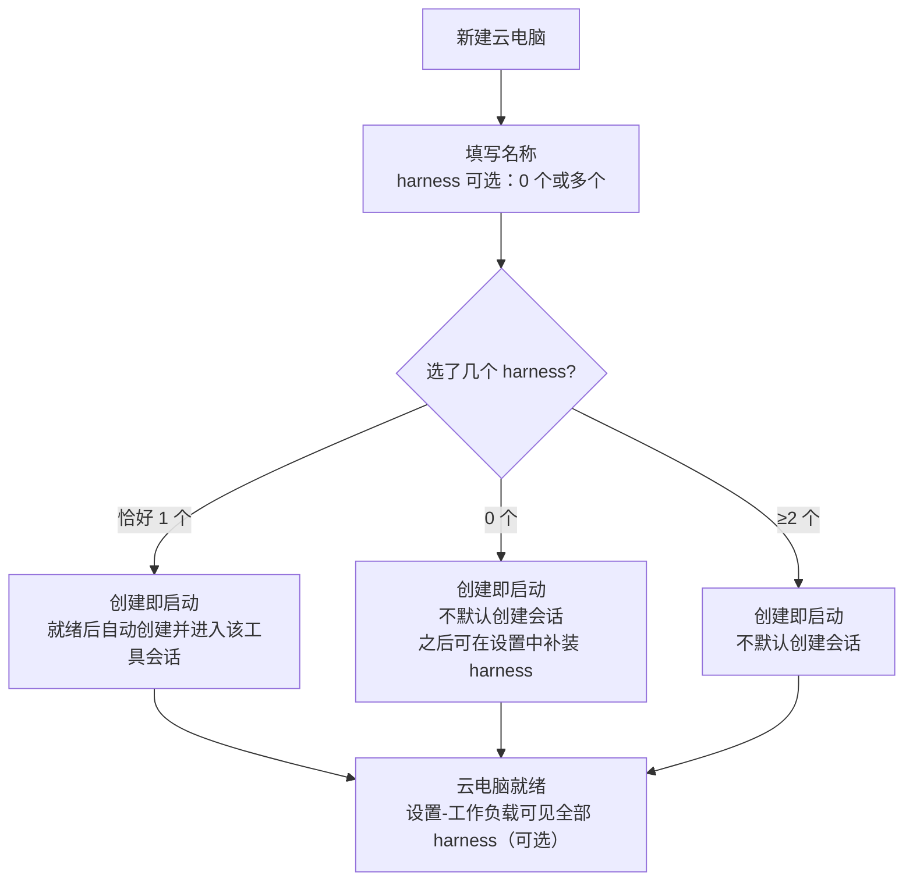
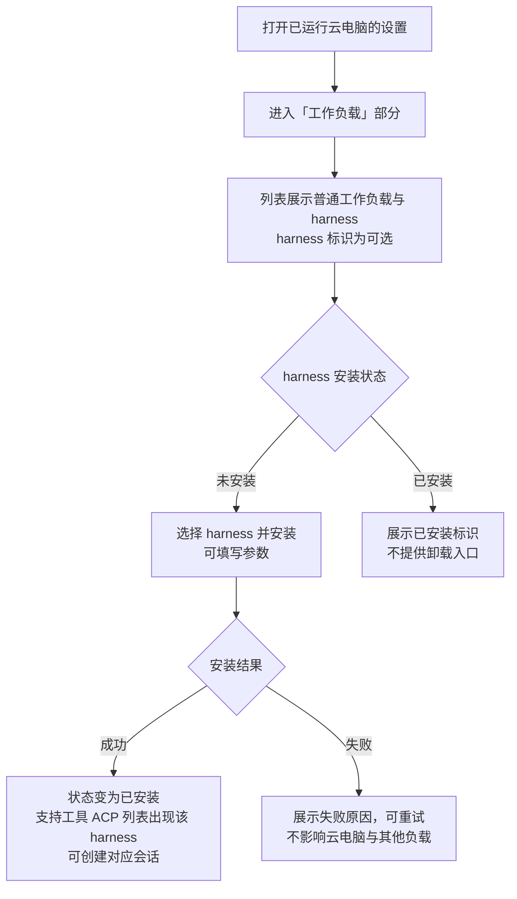

# 云电脑组件安装切换 pnpm 与工作负载 Harness 可选化

**功能名称**: 云电脑组件安装切换 pnpm、设置-工作负载显示可选 harness
**PRD 版本**: v1.0
**创建日期**: 2026-10-29
**作者**: ZeroAsh Agent

> 术语：「云电脑」「harness 工具」沿用《容器启动任务支持 harness 类型》（[[20261020-container-harness-support.md]]）的口径；「工作负载」「必须工作负载」沿用工作负载系列（[[20261018-workload-phase1.md]]、[[20261018-workload-phase3.md]]）的口径。
>
> 本期包含两部分：① 云电脑内组件（harness 工具与其他工作负载）的安装方式由 npm 全局安装统一切换为 **pnpm**；② 已运行云电脑的「设置 → 工作负载」部分**显示 harness**，作为**可选**（而非必须）工作负载，支持后期按需安装——由此调整创建口径：创建云电脑时 **harness 改为可选**（可以不选，后期补装），原「至少选择一个」的强制要求取消。
>
> 口径变更说明：本期将《容器启动任务支持 harness 类型》（v5.0）中「harness 工具必选、至少一个」的口径放宽为「可选、可后期补装」，默认会话规则（恰好选 1 个 → 就绪后自动创建并进入会话；选 0 个或 ≥2 个 → 不默认创建会话）保持不变。

## 背景与目标

### 1.1 背景

云电脑（云端工作容器）中的大量组件——包括 harness 工具（OpenCode / Kimi Code / DeepSeek Harness 等）以及其他工具类工作负载——目前都是通过 **npm 全局安装**的方式装进容器的。随着组件数量与安装频次增加，npm 全局安装的体验短板越来越明显：

1. **安装慢、占空间**：npm 全局安装各包独立铺开，重复依赖反复下载解压，安装耗时与磁盘占用都偏高；
2. **安装方式不统一**：各类组件、各 harness 的安装脚本各写各的 npm 命令，口径散落；
3. **容器内没有顺手的统一包管理器**：用户或 Agent 进入容器后想再装点工具，也只能沿用 npm，体验与速度都不理想。

同时，harness 的装配时机过于「前置」：

1. **创建时必须选定 harness**：创建云电脑时必须至少选择一个 harness 工具，之后想换、想加（比如先用 OpenCode、后来想试试 Kimi Code）缺少产品入口，只能重建云电脑；
2. **设置 → 工作负载看不到 harness**：已运行云电脑的「设置 → 工作负载」部分只展示普通工作负载，harness 不在其中——用户无法感知「这台云电脑还能装哪些 harness」，更没有后期安装的入口；
3. **harness 的定位不够灵活**：harness 实质上是「按需选用的工具」，却在创建流程里被当作必须步骤，与「工作负载可选装」的产品直觉不符。

需求来源：GitHub Issue #369「云电脑npm全局安装的工作负载改为pnpm」。

### 1.2 目标

- 云电脑环境**预装 pnpm**；组件与工作负载（含 harness 工具与其他工具类负载）的安装**统一由 pnpm 完成**，不再使用 npm 全局安装。
- 安装来源、安装结果与现状一致（仍走内网代理、安装后工具开箱可用），对用户透明；容器内用户与 Agent 可直接使用 pnpm。
- **已运行云电脑的「设置 → 工作负载」部分显示 harness**：harness 作为**可选**工作负载出现在列表中（与普通工作负载并列展示、明确标识为可选/非必须），未安装的可后期按需安装，已安装的展示已安装标识。
- **harness 安装时机后置**：创建云电脑时 harness **改为可选**（可以一个都不选，后期在设置-工作负载中补装）；创建时勾选、运行中补装两条路径得到的 harness 能力一致（安装后即可用于创建会话）。
- harness 不属于「必须工作负载」：harness 缺失或安装失败不影响云电脑的可用性。

### 1.3 成功标准

- 新创建的云电脑内 `pnpm` 可直接使用；各类工作负载（含各 harness）安装后工具开箱可用，安装过程不再出现 npm 全局安装口径。
- 安装来源仍为内网代理，默认配置下不访问公网；安装行为幂等、失败可重试。
- 已运行云电脑的「设置 → 工作负载」列表中可见 harness 条目（如 OpenCode / Kimi Code / DeepSeek Harness），与普通工作负载并列，标识为**可选**（非必须工作负载）。
- 对未安装的 harness 发起安装成功后：该 harness 在主机的支持工具（ACP）列表中变为可用，可创建对应会话；列表状态同步为「已安装」，不提供卸载入口。
- 创建云电脑时**不选任何 harness** 也能完成创建并进入就绪状态（不再提示「至少选择一个」）；之后可在设置-工作负载中补装 harness 并正常使用。
- 创建时恰好选 1 个 harness 的默认会话规则不变（就绪后自动创建并进入该工具的会话）。
- 必须工作负载的既有语义完全不变：harness 安装失败只影响该 harness，不阻断云电脑。

## 用户分析

### 2.1 目标用户

- **前台用户（云电脑使用者）**：创建并使用云电脑，按需装配 harness 与工具类工作负载。
- **多 harness 用户**：先用一个 harness 起步，运行中想追加/更换其他 harness。
- **Agent（系统内）**：在会话中列出、安装工作负载（含 harness），为任务补齐工具环境。
- **平台管理员**：维护工作负载目录（含 harness 类工作负载）。

### 2.2 用户场景

| 场景 | 用户角色 | 目标 | 痛点 |
|--|--|--|--|
| 创建云电脑还不确定用哪个 harness | 前台用户 | 先创建云电脑，之后再定 harness | 创建时被强制至少选一个 harness |
| 运行中追加一个 harness | 多 harness 用户 | 在设置-工作负载里看到并安装新 harness | 设置里看不到 harness，只能重建云电脑 |
| 让 Agent 补装工具 | Agent | 统一经 pnpm 列出并安装负载 | 安装口径散落（npm），速度慢 |
| 容器内临时装个小工具 | 前台用户 | 直接用预装的 pnpm 安装 | 容器内没有顺手的统一包管理器 |
| 安装工作负载要快 | 前台用户 | 安装耗时更短、磁盘更省 | npm 全局安装慢且占空间 |

## 功能需求

### 3.1 功能概述

本需求包含两部分：一是云电脑内组件与工作负载（含 harness）的安装统一由 npm 全局安装切换为 **pnpm**（环境预装 pnpm，安装来源与结果口径不变）；二是 harness 进入「设置 → 工作负载」列表、以**可选**工作负载形态支持后期按需安装，并据此把创建云电脑时的 harness 选择从「必选」放宽为「可选」。

### 3.2 功能列表

#### 功能点 1: 组件安装统一切换为 pnpm（环境预装 pnpm）

- **描述**: 云电脑环境**预装 pnpm**（容器就绪后 pnpm 直接可用）；此后各类组件与工作负载（harness 工具、其他工具类负载）的安装统一由 **pnpm** 完成，不再使用 npm 全局安装：
  - 安装来源不变：仍走内网代理，默认配置下不访问公网；
  - 安装结果不变：安装完成后工具命令开箱可用（以既有可用性校验为准）；
  - 安装行为幂等：重复安装不产生副作用，失败可重试；
  - 容器内用户与 Agent 可直接使用 pnpm 安装自己的工具（属于容器内常规操作，不新增产品入口）。
- **用户价值**: 安装更快、磁盘占用更低；安装口径统一；容器内即获顺手的统一包管理器。
- **验收标准**:
  - [ ] 新创建云电脑就绪后，容器内 `pnpm` 可直接使用
  - [ ] 各类工作负载（含各 harness）安装过程使用 pnpm，工具安装后开箱可用
  - [ ] 安装来源仍为内网代理，默认配置不访问公网
  - [ ] 重复安装幂等；安装失败可重试且原因可读
  - [ ] 既有工作负载的参数、依赖、执行记录、三入口安装行为完全不变

#### 功能点 2: 设置-工作负载显示 harness（可选工作负载、可后期安装）

- **描述**: 已运行云电脑的「设置 → 工作负载」部分**显示 harness** 条目（OpenCode / Kimi Code / DeepSeek Harness 等，随平台支持范围），与普通工作负载并列：
  - **可选标识**：harness 条目明确标识为**可选**（非必须工作负载）——harness 缺失或安装失败不影响云电脑可用性；
  - **状态**：未安装 → 显示可安装入口；安装中 → 显示进度；已安装 → 显示已安装标识（不提供卸载入口）；
  - **后期安装**：对未安装的 harness 可发起安装（含参数填写、进度、失败原因、可重试，与普通工作负载一致）；
  - **安装即入列**：安装成功后该 harness 出现在主机的支持工具（ACP）列表中，可用于创建会话；harness 自带的既有体验（如使用前登录引导、模型配置注入）保持不变；
  - 与普通工作负载同一套展示、状态与执行记录机制，执行记录可区分触发来源。
- **用户价值**: 「这台云电脑还能装哪些 harness」一目了然，想换、想加随时补装，不必重建云电脑。
- **验收标准**:
  - [ ] 已运行云电脑的设置-工作负载列表中可见 harness 条目，与普通工作负载并列展示
  - [ ] harness 条目标识为可选（非必须工作负载），与必须工作负载的展示区分清晰
  - [ ] 未安装的 harness 可发起安装；安装成功后状态变为已安装，不提供卸载入口
  - [ ] 安装成功后该 harness 在主机支持工具（ACP）列表中可用，可创建对应会话
  - [ ] harness 自带的既有体验不变（如 Kimi Code 使用前登录引导、DeepSeek Harness 模型配置注入）
  - [ ] 安装失败时原因可读、可重试；不影响云电脑与其他工作负载
  - [ ] Agent 侧列出的可安装负载与界面一致（含 harness）

#### 功能点 3: 创建云电脑时 harness 改为可选（可后期补装）

- **描述**: 创建云电脑时 harness 工具选择从「必选、至少一个」放宽为「**可选**」：
  - 可以**不选任何 harness** 完成创建；创建表单不再因未选 harness 阻止提交；
  - 仍可创建时勾选（含多选），勾选即启动时预装；
  - **默认会话规则不变**：恰好选 **1 个** harness → 就绪后自动创建并进入该工具的会话；选 **0 个或 ≥2 个** → 不默认创建会话（0 个时待后期补装 harness 后自行创建会话）；
  - 创建时未选的 harness 之后可在「设置 → 工作负载」中补装（功能点 2），补装后可正常创建会话。
- **用户价值**: 创建零负担，harness 完全按需装配；「创建时预装」与「后期补装」两条路径等价。
- **验收标准**:
  - [ ] 不选任何 harness 可正常创建并进入就绪状态，无「至少选择一个」类校验拦截
  - [ ] 创建时勾选 harness（含多选）行为与现状一致（预装、恰好 1 个时自动创建会话）
  - [ ] 选 0 个 harness 时不默认创建会话，补装 harness 后可创建对应会话
  - [ ] 创建后在设置-工作负载中补装的 harness 与创建时预装的 harness 能力一致

### 3.3 用户操作流程

#### 创建云电脑（harness 可选）

#### 运行中补装 harness（设置 → 工作负载）

#### 组件安装统一经 pnpm（用户视角）

### 3.4 页面/界面描述

| 页面 | 描述 | 关键元素 |
|------|------|---------|
| 新建云电脑对话框 | harness 改为可选 | 名称输入、harness 多选（**可不选**）、默认会话规则提示（恰好 1 个时自动创建会话）、提交/取消 |
| 设置 → 工作负载（已运行云电脑） | 普通工作负载与 harness 并列展示 | harness 条目（**可选标识**）、安装状态（未安装/安装中/已安装）、安装入口、参数表单、执行记录 |
| 主机界面 | 安装结果生效处 | 支持的 Harness 工具（ACP）列表随安装更新 |
| 安装进度/执行记录 | 展示安装过程 | 各步骤状态、执行日志、失败原因、触发来源 |

### 3.5 异常与边界情况

| 情况 | 预期行为 |
|------|---------|
| 创建时不选任何 harness | 允许创建并就绪，不默认创建会话 |
| 运行中补装 harness 失败 | 原因可读、可重试；云电脑与其他负载不受影响 |
| 重复安装已安装的 harness | 幂等成功，状态仍为已安装 |
| 已安装的 harness | 标识已安装，不提供卸载入口 |
| 云电脑不在线时发起安装 | 不允许发起，提示等待云电脑在线 |
| 内网代理不可达 | 安装失败，原因可读，可重试 |
| 安装 harness 后创建会话 | 与创建时预装的 harness 走同一条会话创建路径，体验一致 |
| 安装 Kimi Code 后首次使用 | 沿用既有使用前登录引导，不因安装时机变化而改变 |
| 安装 DeepSeek Harness 后使用 | 沿用既有模型配置注入口径，不因安装时机变化而改变 |
| 必须工作负载失败 | 既有语义不变（硬失败）；harness 不属于必须工作负载，其失败不阻断云电脑 |
| 存量已运行的云电脑 | 可直接在设置-工作负载中看到并安装 harness；组件安装口径随平台升级生效 |

## 四、非功能需求

### 4.1 性能要求

- 工作负载安装耗时较 npm 全局安装口径有可感知的缩短（pnpm 共享存储、硬链接复用）。
- 设置-工作负载列表加载与状态刷新延迟不超过 3 秒。

### 4.2 安全性要求

- 安装来源仍仅限内网代理，不因安装方式切换而放宽来源约束。
- 工作负载脚本仍仅管理员可维护；安装来源与参数随执行记录留档。

### 4.3 兼容性要求

- 既有工作负载（Docker / Node.js / .NET / Aspire / Github / MongoDB / Playwright 等）的定义、参数、依赖、执行记录与三入口安装行为完全不受影响；仅安装方式内部切换为 pnpm。
- 既有云电脑的创建、会话、停止即销毁等生命周期行为不变；仅 harness 选择的必选校验放宽。
- 创建时预装的 harness 与运行中补装的 harness 能力一致，harness 自带体验（登录引导、模型注入等）不变。

## 五、依赖与约束

### 5.1 依赖

- 工作负载体系（[[20261017-cloud-controller-workload]]、[[20261018-workload-phase1]]、[[20261018-workload-phase3]]）：参数、依赖、预制负载、执行记录与三入口安装能力。
- harness 体系（[[20261020-container-harness-support]]、[[20261025-kimi-code-harness]]、[[20261025-deepseek-harness]]）：harness 工具的安装、可用性校验、会话与既有体验。
- 内网代理可用（组件与工作负载安装来源）。

### 5.2 约束

- harness 永远是**可选**工作负载，不进入「必须工作负载」语义。
- 已安装的工作负载（含 harness）不支持卸载。
- 不改变既有工作负载的安装结果口径（工具可用性校验、幂等要求保持一致）。
- 产品文档不包含技术实现细节，实现方案以关联技术提案为准。

## 六、相关文档

- [[20261020-container-harness-support.md]] — 容器启动任务支持 harness 类型（云电脑与 harness 口径来源）
- [[20261025-kimi-code-harness.md]] — 增加工作负载「Kimi Code」（Harness）
- [[20261025-deepseek-harness.md]] — 增加工作负载「DeepSeek Harness」（Harness）
- [[20261018-workload-phase1.md]] — 工作负载一期（参数、依赖与预制工作负载）
- [[20261018-workload-phase3.md]] — 工作负载三期（必须工作负载硬失败）
- [[20261022-workload-optimization.md]] — 工作负载优化（云电脑负载展示与 MCP 安装）
- 需求来源：[GitHub Issue #369](https://github.com/Deliay/z-agent-gear/issues/369)
- 技术提案：`docs/engineering/proposals/20261029-feat-pnpm-workload-and-harness-optional.md`
