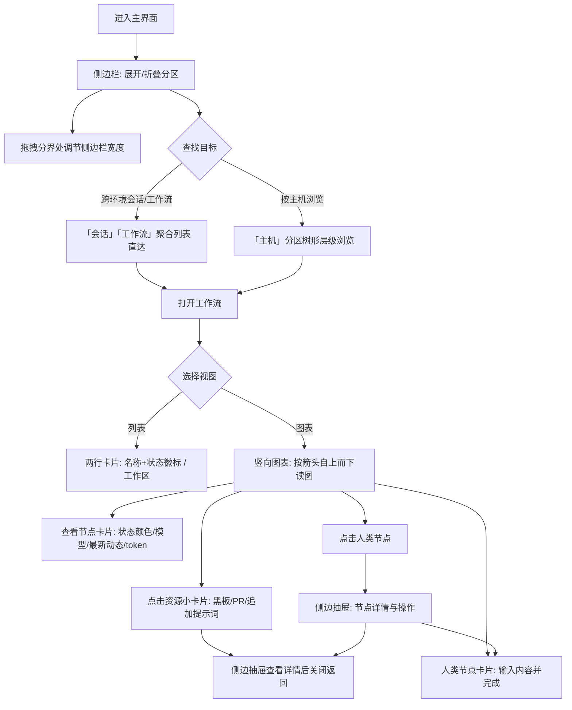

# UI 优化四期（侧边栏与工作流视图）

**功能名称**: UI 优化四期（侧边栏与工作流视图）
**PRD 版本**: v1.0
**创建日期**: 2026-10-30
**作者**: ZeroAsh Agent（需求来源：Deliay）

## 背景与目标

### 1.1 背景

需求来源：GitHub Issue [Deliay/z-agent-gear#345](https://github.com/Deliay/z-agent-gear/issues/345)「261030-UI优化」。产品此前已进行过三期 UI 优化（见 [[20260526-ui-optimization]]、[[20260526-ui-optimization-phase2]]、[[20260528-frontend-ui-optimization]]），工作流能力也已多轮迭代（见 [[20260808-agent-workflow]]、[[20260821-workflow-optimization]]）。随着用户接入的主机、会话、工作流数量增长，现有界面出现两类体验问题：

**侧边栏**：

- 侧边栏为固定窄宽度，工作流名、会话名、主机层级内容普遍被截断，空间利用率低。
- 会话、工作流、网关按主机（环境）分组嵌套在主机树内，跨环境查找一个会话或工作流需要逐个主机展开，环境多时定位成本高。
- 主机层级的缩进与视觉层级不清晰，难以一眼分辨父子关系。
- 无会话、无工作流、无网关时显示「无会话」等占位文字，浪费纵向空间。
- 宽度不可调节，用户无法按自己的屏幕与阅读习惯调整。

**工作流视图**：

- 工作流卡片把「工作区 · 控制器 · 状态」挤在一行，状态是纯文字，扫视时难以快速区分运行中与已结束。
- 工作流「图表」视图画布高度固定且节点横向排布，节点多时横向拉长、视觉上不可用。
- 图表节点卡片在深色主题下仍是白底，与主题割裂。
- 节点卡片信息过少（仅类型、Harness、状态）：看不到模型、看不到进行中节点的最新动态、看不到消耗的 token、看不到关联 PR 与返工次数；人类节点还要跳出图表才能完成。
- 黑板、关联 PR、追加提示词只能在右侧折叠列表里逐个展开查看，无法在图上与对应节点建立直观联系。
- 节点状态（进行中/等待中/已完成/失败/打回/返工）没有整体颜色区分，连接线没有粗细与方向，图的阅读动线不清晰。

### 1.2 目标

1. 侧边栏改为「宽度占满 + 类 VSCode 可折叠分区」布局，支持拖拽调宽；工作流、会话跨环境聚合显示；主机保留现有视图内容并升级层级视觉；空态不再显示占位文字。侧边栏现有交互逻辑保持不变。
2. 工作流卡片信息重新组织：突出工作流名称与状态，第二行显示工作区。
3. 工作流图表视图默认竖向排布、画布占满可用高度；节点卡片跟随主题、信息完整（模型、Harness、实时动态、token、PR、检查项、返工次数）；人类节点可在卡片上直接输入并完成；黑板/PR/追加提示词以限高限宽的小卡片上图并与节点关联；六种节点状态整体配色区分；连接线加粗并带箭头。

### 1.3 成功标准

| 指标 | 目标值 |
|------|--------|
| 侧边栏折叠分区 | 「主机」「工作流」「会话」「网关」四个分区均支持折叠；默认展开「工作流」「会话」，「主机」「网关」默认折叠 |
| 跨环境聚合 | 「工作流」「会话」分区显示全部环境的实例/会话，无需逐个主机查找 |
| 侧边栏宽度 | 可拖拽调节并在合理范围内记忆，最大宽度不超过设计上限 |
| 空态占位文字 | 无会话/无工作流/无网关时不再出现「无会话」等文字 |
| 工作流卡片 | 100% 卡片按「名称 + 状态徽标 / 工作区」两行展示 |
| 图表布局 | 图表默认竖向排布，画布高度占满视图区域 |
| 主题一致性 | 深色主题下图表卡片不再出现纯白底，亮/深两套主题观感一致 |
| 进行中 AI 节点动态 | 100% 进行中的 AI 节点卡片展示最新一行动态（思考/工具调用/总结） |
| 人类节点直达操作 | 人类节点可在图表卡片上输入内容并完成节点，点击可打开详情抽屉 |
| 资源上图 | 黑板、关联 PR、追加提示词在图上与所属节点关联展示，点击可查看详情；垃圾桶不展示 |
| 状态区分 | 进行中/等待中/已完成/失败/打回/返工六种状态可凭颜色一眼区分 |
| 连接线 | 节点连接线加粗且带箭头指向下一节点 |

## 用户分析

### 2.1 目标用户

使用本产品管理多台主机、多个会话并用工作流编排多 Agent 协作开发的用户，以开发者为主。

### 2.2 用户场景

| 场景 | 用户角色 | 目标 | 痛点 |
|------|----------|------|------|
| 在多台主机、多个环境中找一个会话 | 开发者 | 快速定位目标会话 | 会话按主机分组嵌套，要逐个主机展开查找 |
| 盯着工作流执行进度 | 开发者 | 一眼看出哪个节点在跑、卡在哪 | 图表横向排布不可用，卡片信息少、状态无颜色 |
| 审查 AI 节点产出 | 开发者 | 知道 AI 正在干什么、用了多少 token | 进行中节点看不到最新动态，完成后看不到消耗 |
| 在图表上处理人类节点 | 开发者 | 输入内容并完成节点，不打断读图 | 必须跳出图表到列表/详情页操作 |
| 对照节点查看黑板产物与 PR | 开发者 | 在图上看到节点的产物与 PR 关联 | 只能在右侧折叠列表逐个展开，与节点对不上 |
| 换屏幕/分屏办公 | 所有用户 | 按需加宽或收窄侧边栏 | 宽度固定，名称截断或主内容区被挤压 |
| 深色模式下查看工作流 | 所有用户 | 与主题一致的观感 | 图表白卡刺眼 |

## 功能需求

### 3.1 功能概述

本期为纯界面布局与展示优化，分两大部分：**侧边栏视图优化**（可折叠分区、跨环境聚合、层级视觉、拖拽调宽、空态收敛、人类节点详情抽屉交互）与**工作流 UI 优化**（卡片信息重组、图表视图竖向布局与画布占满、节点卡片信息增强与主题跟随、资源上图、状态配色、连线加粗带箭头）。侧边栏现有交互逻辑保持不变，仅改变布局与样式。

### 3.2 功能列表

#### 功能点 1: 侧边栏可折叠分区布局

- **描述**: 左侧侧边栏改为宽度占满的类 VSCode 可折叠设计，含「主机」「工作流」「会话」「网关」四个可折叠分区。分区标题行占满侧边栏宽度，点击标题行即可展开/折叠。默认展开「工作流」和「会话」，「主机」「网关」默认为折叠形态。分区内的元素宽度尽量占满侧边栏，充分利用空间，名称过长时截断。
- **用户价值**: 常用的「工作流」「会话」开箱可见，不常用分区收起后节省纵向空间；宽度占满后名称更完整可读。
- **验收标准**:
  - [ ] 四个分区均支持展开/折叠，标题行点击可切换
  - [ ] 默认展开「工作流」「会话」，默认折叠「主机」「网关」
  - [ ] 展开/折叠状态在刷新后保持
  - [ ] 分区内元素宽度占满侧边栏，长名称截断显示

#### 功能点 2: 工作流与会话跨环境聚合显示

- **描述**: 「工作流」「会话」分区不再按主机（环境）分组，而是把所有环境的工作流、会话聚合显示在一起，形成统一列表。「主机」分区保留现有的视图内容不变。「网关」分区聚合显示所有环境的网关暴露。
- **用户价值**: 跨环境查找工作流、会话不再需要逐个主机展开，一个列表直达。
- **验收标准**:
  - [ ] 「工作流」分区显示全部环境的工作流实例（含已归档分组）
  - [ ] 「会话」分区显示全部环境的会话
  - [ ] 列表条目的点击行为与现在一致（进入对应会话/工作流）
  - [ ] 「主机」分区保留现有视图内容与点击行为

#### 功能点 3: 主机层级视觉优化

- **描述**: 「主机」分区内容不变，仅样式修改：层级关系视觉效果改为 VSCode 那样清晰的树形层级，下一级缩进约 2 个空格宽度；保留每个主机的设置按钮。
- **用户价值**: 主机 → 工作区 → 会话的父子关系一眼可辨，操作入口（设置按钮）不丢失。
- **验收标准**:
  - [ ] 主机树每一级缩进一致（约 2 空格宽度）
  - [ ] 父子层级视觉可辨（缩进 + 层级引导效果）
  - [ ] 每个主机的设置按钮保留且可点击

#### 功能点 4: 空态收敛

- **描述**: 无会话、无工作流、无网关暴露等场景下，不再显示「无会话」「无工作流实例」「无网关暴露」等占位文字，而是显示为空的展开效果（分区可正常展开，内容区为空）。
- **用户价值**: 界面干净，不为空内容浪费视觉焦点。
- **验收标准**:
  - [ ] 无内容时分区展开后内容区为空，无占位文字
  - [ ] 分区标题、展开/折叠行为不受空态影响

#### 功能点 5: 侧边栏宽度拖拽调节

- **描述**: 侧边栏与主内容区之间的分界处支持按住拖拽调节宽度；设置合理的最小宽度与最大宽度（上限取值需适配会话名/工作流名较长、主机树多级缩进的场景，同时保证主内容区不被过度挤压），拖到边界即停止；宽度在用户本地记忆，下次进入保持。
- **用户价值**: 按自己的屏幕与内容习惯调整侧边栏宽窄，名称看得更全或主内容区更大。
- **验收标准**:
  - [ ] 拖拽分界处可实时调节侧边栏宽度
  - [ ] 宽度不超上限、不低于下限
  - [ ] 刷新后保持上次宽度
  - [ ] 移动端布局不受影响（保持现有移动布局）

#### 功能点 6: 人类节点详情抽屉

- **描述**: 点击人类节点后，从侧边滑出一个抽屉详情页，展示该节点的完整信息（名称、阶段、状态、说明、输入内容、节点产物、关联 PR 与检查项、返工记录、打回/失败原因等）与操作（输入内容、完成节点、打回）。抽屉覆盖在当前视图之上，关闭后回到原视图，不打断浏览上下文。
- **用户价值**: 处理人类节点时不必离开当前页面，信息与操作集中在一处。
- **验收标准**:
  - [ ] 点击人类节点弹出侧边抽屉，展示节点详情
  - [ ] 抽屉内可输入内容并完成节点、可打回
  - [ ] 关闭抽屉后回到原视图，浏览位置不变
  - [ ] 图表视图与列表视图的节点均可打开抽屉

#### 功能点 7: 工作流卡片信息展示优化

- **描述**: 工作流卡片信息重组为两行：
  第一行：工作流名称（保持强调的字号与字色）+ 状态徽标（badge 形式，颜色与状态对应）；
  第二行：工作区名称。
  不再在卡片上显示控制器名称。
- **用户价值**: 扫视列表时先看名称与状态，工作区其次，信息层级与阅读习惯一致。
- **验收标准**:
  - [ ] 第一行为工作流名称（强调样式）+ 状态徽标
  - [ ] 第二行为工作区名称
  - [ ] 不再显示控制器名称
  - [ ] 状态徽标颜色与节点状态配色体系一致

#### 功能点 8: 图表视图竖向布局与画布占满

- **描述**: 工作流「图表」视图默认改为竖向排布（按依赖方向自上而下），画布高度占满整个视图区域（不再固定高度、不再横向拉长）；保留缩放、平移、缩略图等画布能力。
- **用户价值**: 图表可用性恢复正常，节点多的工作流也能顺着竖向动线读图。
- **验收标准**:
  - [ ] 图表默认竖向排布
  - [ ] 画布高度占满视图区域，随窗口高度自适应
  - [ ] 节点多时可平移/缩放查看全图

#### 功能点 9: 图表节点卡片优化

- **描述**: 重新设计图表节点卡片，满足以下要求：
  1. 适合竖向排布的卡片形态（宽度统一、高度随内容自适应）。
  2. 人类节点可直接在卡片上输入内容并完成节点。
  3. AI 节点显示模型与 Harness 类型。
  4. 进行中的 AI 节点留出一行显示最新动态，前置转圈图标，按实时消息流的最后一条消息展示：
     - 思考：前置显示「思考中」，后续跟随思考内容结尾截断的若干字符（只显示内容结尾部分）；
     - 工具调用：显示工具调用的标题（与会话中工具调用标题口径一致）；
     - 普通文本：显示「总结中」，内容展示逻辑同思考。
  5. 已完成的 AI 节点显示「已完成」与消耗的 token 数量（无用量信息则不显示 token）。
  6. 显示节点对应的 PR、检查项徽标、返工次数（无则不显示对应项）。
  7. 卡片颜色跟随主题（深色主题下不再是白底卡片）。
- **用户价值**: 读图即知每个节点在干什么、用什么模型、消耗多少；人类节点就地处理；深色主题观感一致。
- **验收标准**:
  - [ ] 卡片宽度统一、适合竖向排布，深/浅主题均跟随主题配色
  - [ ] 人类节点卡片上可输入内容并完成节点
  - [ ] AI 节点显示模型与 Harness
  - [ ] 进行中 AI 节点显示转圈图标 + 最新动态一行（思考/工具调用标题/总结中，思考与总结显示内容结尾截断）
  - [ ] 已完成 AI 节点显示「已完成」与 token 消耗，无用量信息时不显示 token
  - [ ] 有对应信息时显示 PR、检查项徽标、返工次数

#### 功能点 10: 图表资源节点与关联排布

- **描述**: 图表视图中增加「黑板」「PR」「追加提示词」资源小卡片（垃圾桶不渲染）：在图上横向排布并与对应的节点关联（节点竖向排布，每个节点的资源横向排布）；资源小卡片限高限宽，超出截断；点击后在侧边抽屉查看详情。图表视图下不再显示右侧这几项的展开树（列表视图保持不变）。
- **用户价值**: 节点的产物、PR、追加提示词与节点在图上直接对应，无需在侧栏逐个展开查找。
- **验收标准**:
  - [ ] 黑板条目、关联 PR、追加提示词以资源小卡片显示在图上并与所属节点关联
  - [ ] 节点竖向排布，节点的资源横向排布
  - [ ] 资源小卡片限高限宽，超长截断
  - [ ] 点击资源小卡片弹出侧边抽屉查看详情
  - [ ] 垃圾桶内容不渲染
  - [ ] 图表视图下右侧不再显示这几项的展开树

#### 功能点 11: 节点状态整体颜色区分与连线方向

- **描述**: 为进行中、等待中、已完成、失败、打回、返工六种节点状态设计整体颜色区分（卡片、状态标识整体着色，一眼可辨）；节点之间的连接线加粗，并带上箭头指向下一个节点。
- **用户价值**: 读图时凭颜色定位节点状态，凭箭头理清执行方向。
- **验收标准**:
  - [ ] 六种状态的整体配色互相可区分，且深/浅主题下均清晰
  - [ ] 连接线明显加粗
  - [ ] 连接线带箭头指向下游节点

### 3.3 用户操作流程

### 3.4 页面/界面描述

| 页面 | 描述 | 关键元素 |
|------|------|---------|
| 主界面侧边栏 | 宽度占满、类 VSCode 可折叠分区布局，宽度可拖拽 | 「主机」「工作流」「会话」「网关」四个分区标题行、展开/折叠箭头、聚合列表条目、主机树层级（缩进 2 空格 + 设置按钮）、宽度拖拽分界、底部功能栏 |
| 工作流卡片（列表/侧边栏） | 两行信息布局 | 第一行：工作流名称（强调字号字色）+ 状态徽标；第二行：工作区名称 |
| 工作流图表视图 | 竖向排布、画布占满高度 | 节点卡片、资源小卡片（黑板/PR/追加提示词）、加粗带箭头的连接线、缩放/平移/缩略图控件 |
| 图表节点卡片 | 随主题配色的节点卡片 | 节点名称、状态整体着色、类型（人类/AI）、AI 节点的模型与 Harness、进行中动态一行（转圈图标 + 思考/工具调用标题/总结中）、已完成节点的 token 消耗、PR / 检查项 / 返工次数徽标、人类节点的输入框与完成按钮 |
| 节点/资源详情抽屉 | 从侧边滑出的详情页 | 节点详情与操作（输入、完成、打回）、资源完整内容（键值、Markdown 展示）、PR 链接与检查项、返工记录 |

### 3.5 异常与边界情况

| 情况 | 预期行为 |
|------|---------|
| 无会话 / 无工作流 / 无网关暴露 | 对应分区展开后内容区为空，不显示占位文字 |
| 所有环境均无内容 | 各分区正常展开/折叠，内容区为空 |
| 图表只有一个节点 | 竖向排布正常展示，画布占满高度 |
| 节点存在并行分支 | 主干竖向排布，同层节点横向并列，箭头指向各自下游 |
| 进行中 AI 节点尚无任何消息 | 动态行不显示内容或显示等待中的中性态，不报错 |
| 已完成 AI 节点无用量信息 | 只显示「已完成」，不显示 token |
| 节点无 PR / 无检查项 / 未返工 | 对应徽标不显示 |
| 追加提示词未关联到具体节点 | 在图上的实例级位置展示，仍可点击查看 |
| 深色/浅色主题切换 | 卡片、状态色、资源小卡片即时跟随主题 |
| 拖拽宽度至上/下限 | 停止继续缩放，保持边界宽度 |
| 超长的工作流名 / 会话名 / 资源内容 | 截断显示，详情抽屉中完整可读 |
| 移动端 | 保持现有移动布局，不引入拖拽调宽 |
| 打回 / 失败 / 返工中的节点 | 按状态配色整体着色，详情抽屉中展示原因 |

## 四、非功能需求

### 4.1 性能要求

- 节点数量较多（数十个节点、上百资源小卡片）时图表渲染与平移缩放保持流畅。
- 进行中节点的动态行随消息流更新时不引起整图抖动或明显卡顿。
- 侧边栏聚合列表在会话/工作流数量较多时滚动流畅。

### 4.2 安全性要求

- 本期为展示层优化，不改变权限与数据可见性口径：各环境条目仍按用户既有可见范围展示。

### 4.3 兼容性要求

- 深色 / 浅色 / 跟随系统三种主题模式均正常展示。
- 桌面端为主要适配目标；移动端保持现有布局与交互，不回归。
- 侧边栏现有交互逻辑（点击进入、导航、操作入口）全部保持不变，仅布局与样式变化。

## 五、依赖与约束

### 5.1 依赖

- 工作流、会话、网关、主机的现有数据展示口径（名称、状态、工作区、产物、PR 关联、返工次数、用量信息等）。
- 会话的实时消息展示口径（思考、工具调用标题、文本块），与会话页保持一致。

### 5.2 约束

- 侧边栏现有交互逻辑不变，只改变布局和样式。
- 「主机」分区保留现有视图内容（含设置按钮），仅层级视觉与缩进修改。
- 不改变后端数据与既有功能行为；本期为纯前端展示优化。
- 深色主题下不得出现不随主题变化的固定配色元素。

## 六、相关文档

- 需求来源：[Deliay/z-agent-gear#345](https://github.com/Deliay/z-agent-gear/issues/345)
- [[20260526-ui-optimization]] — UI 优化一期
- [[20260526-ui-optimization-phase2]] — UI 优化二期
- [[20260528-frontend-ui-optimization]] — 前端界面优化三期
- [[20260808-agent-workflow]] — Agent 工作流
- [[20260821-workflow-optimization]] — 工作流优化 0821
- [[20261028-conversation-rendering]] — 重构对话渲染（工具调用标题口径来源）
