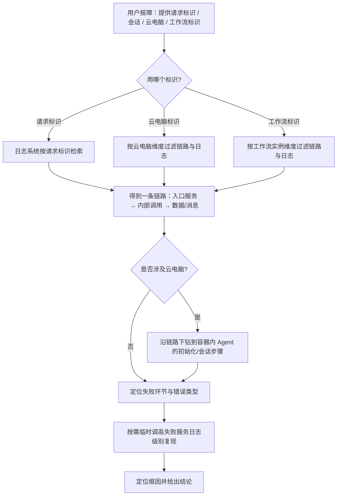

# 规范化日志与全链路可观测性

**功能名称**: 规范化日志与增加可观测性接入
**PRD 版本**: v1.0
**创建日期**: 2026-10-30
**作者**: ZeroAsh

> **需求原文（Issue #376）**：
>
> 1. 给所有服务增加 otel 接入，包括云电脑的 jobs 也需要 otel 接入
> 2. 增加日志 pino，输出 json 格式，替换仓库内所有 console.log/error
>
> **本文口径**：产品文档只描述能力与可验证结果——「统一结构化日志」与「全链路可观测性（含云电脑）」；具体技术选型、字段定义、接入方式与落地顺序见技术提案 [[../../engineering/proposals/20261030-feat-unified-logging-and-otel.md]]。需求原文中的 otel / pino 是本期必须满足的技术标准与选型约束，已写入「四、非功能需求」与「五、依赖与约束」，不在本文字面展开实现细节。

## 背景与目标

### 1.1 背景

平台当前已从单一后端扩展为多运行时协同的形态：

- 若干后端服务（面向用户的接口服务、面向管理后台的服务、控制器服务、云端工作容器控制器）；
- 本地/云端 Agent 控制器（运行在用户机器或云电脑内部的常驻进程）；
- 运行在云端工作容器（云电脑）内、由集群任务拉起的工作进程；
- 两个 Web 前端。

这些运行时目前各自用最朴素的方式输出日志：直接在代码里打印自由文本，格式、级别、字段完全靠开发者习惯；没有统一的日志级别开关，没有请求/链路标识，也没有任何跨服务的调用串联。随着云电脑、工作流、计费、多租户等跨多个服务的功能上线，**「一次用户操作跨了哪些服务、在哪一步失败」已经无法从日志回答**。用户报障时，运维要逐台机器、逐个容器去 `grep` 关键字，靠时间戳猜测关联关系；云电脑内 Agent 的日志与平台侧日志更是彼此孤立。

同时，日志内容的规范性也存在现实风险：令牌、模型密钥、GitHub 凭据等敏感值一旦进入日志就会被采集、扩散，且难以回收。

### 1.2 目标

- **统一日志形态**：平台所有运行时（各后端服务、控制器、云电脑内 Agent 进程、Web 前端采集口径）输出**统一格式的结构化日志**，可被日志系统直接解析、检索、聚合；彻底取消自由文本式打印。
- **统一字段语义**：服务名、版本、环境、时间、级别、消息、组件、错误、请求标识、用户/租户维度等字段语义固定，跨服务一致，任何人看任意服务的日志都不用重新学习一套格式。
- **全链路可观测**：一次用户操作（一次接口请求、一次会话消息、一次云电脑创建/启动、一次工作流节点推进）能形成一条**贯穿所有涉及运行时**的调用链；云电脑内 Job 与 Agent 进程必须纳入同一条链路，而不是链路在「进入云电脑」处断掉。
- **日志与链路互相定位**：每条日志自动携带其所属链路标识，可从链路下钻到日志、从日志跳转到链路，排障不再依赖时间戳猜测。
- **可配置的日志级别**：无需改代码即可调整输出详细程度（常态收敛、排障时放大），且对所有运行时口径一致。
- **敏感信息不落日志**：令牌、密钥、密码、凭据、授权头等敏感值在进入日志前被统一拦截；行为可验证、可回归。
- **可观测性数据外发可控**：默认不外发；由部署方按环境配置采集端；采集端缺失或故障时业务零影响。

### 1.3 成功标准

- **形态统一**：所有运行时的日志均为**单行结构化记录**，可被日志系统 100% 解析（解析失败率 0）。
- **无自由文本打印**：运行时代码中「直出控制台打印」的残留为 **0**，并由自动化校验守住（新增一处即构建失败）。
- **跨服务链路可追溯**：任选一条跨服务的用户操作（如「创建云电脑」），都能看到从入口服务 → 内部接口 → 云电脑容器的完整父子调用关系，链路内各环节耗时与失败点可直接读出。
- **云电脑覆盖**：云电脑 Job 内运行的 Agent 具备**可独立辨识的服务身份**，其追踪数据带容器、云电脑、用户、租户维度，且与触发它的平台侧操作处于同一链路。
- **日志—链路双向可用**：任取一条日志，能拿到它所属链路标识；任取一条链路，能列出该链路上所有服务的日志。
- **脱敏有效**：以固定清单校验，令牌/密钥/密码/凭据/授权头在日志中**出现次数为 0**；审计所需的例外（首次初始管理员密码提示）保留明确且唯一的受控出口。
- **外发可控**：未配置采集端时，**外发请求数为 0**，业务功能与既有日志可见性不受影响；配置采集端后，服务追踪数据在采集端可查。
- **排障效率**：同类「云电脑起不来 / 会话卡住 / 工作流不推进」问题的定位方式，从「登录多台机器逐容器 grep」收敛为「一个链路标识 + 关键字过滤」，定位到失败环节所需的命令行操作次数显著下降（以验收演示为准）。

## 用户分析

### 2.1 目标用户

- **平台运维 / SRE（主要用户）**：日常巡检、故障响应、容量与异常趋势判断，需要一次性看到「哪个服务、哪个环节、什么错误」。
- **平台研发（后端 / 前端 / 客户端）**：本地开发与线上问题定位，需要可读的日志、可复现的调用链、能直达出问题的代码路径。
- **技术支持 / 客服**：面对用户报障，需要在不打扰研发的前提下，凭用户提供的会话/云电脑/工作流标识快速给出判断。
- **管理员（管理后台视角）**：验收云电脑与工作流等付费/关键能力是否「可用且可诊断」。

### 2.2 用户场景

| 场景 | 用户角色 | 目标 | 痛点 |
|--|--|--|--|
| 用户反馈「云电脑一直转圈起不来」 | 技术支持 / SRE | 快速判断是创建扣费、容器拉起、工作负载初始化还是会话创建失败 | 现状要分别登录多个服务与集群逐个容器看日志，且日志格式不一，无法确认先后顺序 |
| 线上某接口偶发 500 | 后端研发 | 找到这次请求在链路上唯一对应的全部日志与错误堆栈 | 自由文本日志没有请求标识，同一秒内多条请求的日志互相混杂 |
| 用户会话消息「发出去没响应」 | 后端研发 | 判断消息在入口服务、控制器、Agent 三段的哪一段丢失 | 三段日志时间戳不同源、格式不同，无法证明因果关系 |
| 工作流节点长时间不推进 | 研发 / 运维 | 看清引擎、事件回调、检查项同步各环节状态 | 只能靠 `grep` 关键字与人工比对，缺少统一时间线与关联标识 |
| 排查 worker 回连失败 | SRE | 临时放大日志级别看逐请求细节 | 只有个别服务支持级别开关，其余服务要么全量刷屏要么完全静默 |
| 安全审计 / 事故复盘 | SRE / 安全 | 确认日志中没有令牌与密钥 | 现有代码多处直接打印错误对象与请求上下文，无法证明脱敏 |

## 功能需求

### 3.1 功能概述

为平台全部运行时建立**统一的日志与可观测性底座**：日志统一为可解析的结构化记录并按统一语义字段输出、级别可配置、敏感信息统一拦截；同时引入全链路追踪，把跨服务调用、消息通道、以及**云电脑内 Job 与 Agent 进程**纳入同一条链路，实现「一次操作一条链路、一条链路串起所有日志」。

### 3.2 功能列表

#### 功能点 1: 统一结构化日志

- **描述**: 平台所有运行时输出统一格式的结构化日志记录：一条日志一行、字段语义固定、机器可解析、人也可读（键值清晰）。同一份日志在开发环境可切换为人类友好的着色输出，在生产环境保持机器可解析形态。
- **用户价值**: 日志系统可直接索引与聚合；跨服务对照不再需要「先学会每种格式」；异常统计、错误率、慢请求统计成为可能。
- **验收标准**:
  - [ ] 全部运行时的日志均为单行结构化记录，抽样解析成功率 100%
  - [ ] 每条记录包含统一语义字段：时间、级别、服务名、服务版本、环境、消息、组件；错误记录包含可读的错误类型与堆栈
  - [ ] 级别输出为可读文本（而非数字代号），且顺序语义为 debug < info < warn < error
  - [ ] 开发环境可切换人类友好输出，生产环境默认结构化输出
  - [ ] 同一服务内同一类事件（如启动、失败、重试）字段口径一致，不因开发者不同而漂移

#### 功能点 2: 取消自由文本打印（全仓库收敛）

- **描述**: 仓库内运行时代码不再直接向控制台打印自由文本；所有日志必须经统一日志能力输出。对确需保留的控制台输出（如前端浏览器调试、脚本/工具类一次性输出）以显式、可审计的例外方式管理，不默认放开。
- **用户价值**: 保证「功能点 1」的形态统一不被局部代码破坏；避免「有的日志能检索、有的不能」的长期腐化。
- **验收标准**:
  - [ ] 全部后端服务、控制器、云端控制器、Agent 控制器运行时代码中直出控制台打印残留为 0
  - [ ] 前端浏览器侧的调试输出收敛为受控入口（生产环境默认不输出，开发环境可开启）
  - [ ] 存在自动化校验：新增一处直出打印即校验失败（在 CI/单测环节拦截）
  - [ ] 例外清单有明确记载（位置、原因、是否受环境开关控制）

#### 功能点 3: 全链路追踪（跨服务）

- **描述**: 一次用户操作在其经过的每个运行时中形成一条链路：入口请求 → 内部服务调用 → 数据访问/消息投递，链路内每一步都有独立记录且父子关系明确；失败环节可直接定位。追踪数据的采集与导出遵循行业标准协议，可对接任意兼容的采集与展示系统。
- **用户价值**: 不再靠时间戳猜因果关系；跨服务问题的定位从「多机 grep」变为「看一条链路」；可量化各环节耗时，为性能优化提供依据。
- **验收标准**:
  - [ ] 跨服务内部调用自动串联（服务 A 发起、服务 B 接收，链路标识一致、父子关系正确）
  - [ ] 服务对外入口（HTTP/GraphQL）自动产生链路记录，含方法、路由、状态码、耗时
  - [ ] 数据访问与缓存访问作为链路子步骤可见（至少具备耗时与失败原因）
  - [ ] 消息通道（发布/订阅、长连接事件）在链路中保持因果关联，不出现「断链」
  - [ ] 链路数据带服务名、版本、环境、主机/实例维度，可区分多副本

#### 功能点 4: 云电脑（Job 与容器内 Agent）纳入同一链路

- **描述**: 云电脑由平台请求拉起，运行在集群 Job 中的工作进程与 Agent 必须延续同一条链路：从「平台发起创建/启动」到「容器内 Agent 完成初始化、建立会话」的每一步都可追溯；云电脑侧的追踪数据具备独立服务身份，并附带容器、云电脑、用户、租户维度，便于按用户/云电脑检索。
- **用户价值**: 云电脑是当前最复杂的跨层能力（平台 → 集群 → 容器 → Agent → 模型调用），此前链路在进入容器处断裂；补齐后可回答「卡在哪一层」这一高频问题。
- **验收标准**:
  - [ ] 云电脑 Job 内的进程输出结构化日志，且携带链路标识与服务身份
  - [ ] 平台侧发起创建/启动的链路与容器内 Agent 的初始化链路**因果相连**（同一条链路可看到跨层父子关系）
  - [ ] 云电脑侧追踪数据带容器标识、云电脑标识、用户与租户维度，可按其中任一维度检索
  - [ ] 云电脑内日志与平台侧日志可通过同一链路标识关联，无需人工比对时间戳
  - [ ] 未升级的旧版容器进程在缺失追踪能力时**优雅降级**（仅日志，不报错、不影响启动）

#### 功能点 5: 日志与链路的关联标识

- **描述**: 每次外部请求分配一个可回传的请求标识（客户端可提供、也可由服务生成），并在响应中回传；该标识同时写入该请求产生的全部日志与链路数据，成为排障的统一入口。
- **用户价值**: 用户/客服只需提供一个标识，研发即可还原整个请求；跨服务排障有了「唯一坐标」。
- **验收标准**:
  - [ ] 外部请求响应头中回传请求标识；客户端提供时沿用、未提供时生成
  - [ ] 同一请求产生的所有日志都包含该标识
  - [ ] 该标识与链路标识可互相映射
  - [ ] 错误响应体不因新增标识而改变既有结构与语义（不破坏兼容）

#### 功能点 6: 敏感信息脱敏与审计例外

- **描述**: 令牌、模型密钥、GitHub 凭据、密码、授权头、Cookie 等敏感值在日志输出前被统一拦截（以字段名单方式声明，而不是靠调用方自觉）；既有「错误信息中不得包含凭据」的约定继续有效并纳入校验。审计所需的例外（首次初始化管理员密码提示）保留唯一受控出口并明确标注。
- **用户价值**: 降低凭据泄漏风险；事故复盘时可证明「日志中不含敏感值」，满足审计诉求。
- **验收标准**:
  - [ ] 以固定清单校验：授权头、Cookie、令牌、密钥、密码字段在日志中不出现明文
  - [ ] 错误对象/异常堆栈输出不携带请求凭据
  - [ ] 审计例外仅一处且带明确标识，可被检索与告知
  - [ ] 新增敏感字段时有明确登记位置（名单制），不需要逐个调用点修改

#### 功能点 7: 日志级别与可观测性开关（运维可控）

- **描述**: 所有运行时的日志级别由统一的部署配置控制（无需改代码、无需重新构建）；可观测性数据的外发开关与采样比例同样由部署配置控制，默认不外发。开发环境提供人类友好输出。
- **用户价值**: 常态下控制日志成本，故障时一键放大细节；不同环境（本地/预发/生产/集群）行为可预期。
- **验收标准**:
  - [ ] 全部运行时遵守同一日志级别配置口径（默认 info，可调 debug/warn/error）
  - [ ] 调整级别后无需重新构建镜像或修改代码
  - [ ] 未配置采集端时外发请求数为 0，服务启动、健康检查与业务功能完全正常
  - [ ] 采集端不可达/超时不影响请求成功率与响应时延（有明确超时与丢弃策略）
  - [ ] 采样比例可配置，且「父链路已采样则子链路跟随」的语义成立

### 3.3 用户操作流程

### 3.4 页面/界面描述

本期**不新增平台页面、不改变任何既有界面**。日志与链路的查看发生在部署方选择的日志/追踪系统（如集群日志、日志平台、追踪平台）中，平台只负责按统一口径产出数据。相关「体验面」如下：

| 界面/入口 | 描述 | 关键元素 |
|------|------|---------|
| 服务标准输出（容器日志） | 运维最直接的入口：`kubectl logs` / 编排日志仍可读，内容由自由文本变为结构化单行记录 | 时间、级别、服务名、消息、链路标识 |
| 日志平台检索 | 按服务、级别、请求标识、链路标识、用户/租户/云电脑维度过滤 | 过滤维度、时间范围、错误聚合 |
| 追踪平台链路视图 | 跨服务、跨云电脑的调用瀑布图 | 服务节点、耗时、状态、错误 |
| 本地开发终端 | 开发环境人类友好输出（着色、缩进、可读错误堆栈） | 级别着色、组件前缀、错误摘要 |
| 管理后台（无变化） | 本期不新增任何后台配置页；级别与采样由部署配置控制 | — |

### 3.5 异常与边界情况

| 情况 | 预期行为 |
|------|---------|
| 未配置采集端（如本地开发、未接入追踪的环境） | 不外发任何数据；结构化日志照常输出；服务启动与业务零影响 |
| 采集端不可达 / 超时 / 返回错误 | 丢弃该批数据并**只记一条降级提示**（不逐条刷屏），不重试放大、不阻塞请求；业务成功率不变 |
| 日志量激增（如 debug 级别长时间开启、异常循环） | 有明确级别默认值与采样控制；单条日志过长时按既有截断约定处理，不因超长日志导致进程阻塞 |
| 敏感字段被误传入日志 | 由名单拦截，输出为占位符；校验用例覆盖常见路径（授权头、Cookie、令牌、密钥、密码） |
| 旧版本云电脑容器/Agent 未具备新能力 | 平台侧链路在容器处自然终止；容器按旧行为运行，**不报错、不阻断启动**；日志仍可读 |
| 客户端自带的请求标识异常（超长、含控制字符、重复） | 归一化或重新生成，并在日志中标注「已替换」，避免日志注入与串号 |
| 链路采样丢弃了某次请求 | 该请求的日志仍完整输出（日志与采样解耦），仅追踪数据缺失；日志中链路标识可缺省 |
| 多副本 / 多集群 | 服务身份字段包含实例维度，可按实例区分；采集端地址按环境独立配置 |
| 日志被容器运行时截断或轮转 | 依赖既有 stdout 采集口径；单行结构化记录便于按行恢复，不做跨行拼接 |
| 首次初始化管理员密码的审计输出 | 保留唯一受控出口：仅首次初始化时打印一次、带明确标记、可被检索；不进入常规请求日志 |
| 前端浏览器环境 | 生产构建默认不输出调试信息；开发构建可按开关开启；不参与服务端日志采集 |

## 四、非功能需求

### 4.1 性能要求

- 引入统一日志与追踪后，接口 **p99 时延增幅不超过 5%**，吞吐不下降（以既有压测/基准脚本对照，验收时给出前后对比数据）。
- 日志写入为**同步直出标准输出**（不引入额外中间进程、不使用需要额外线程/文件的传输方式），保证容器日志采集口径不变。
- 追踪数据导出为**批量异步**，单次导出有超时与队列上限；队列满时丢弃最旧数据而非阻塞业务。
- 高频路径（会话消息分片、ACP 流式输出、工作负载日志轮询）不得逐条产生追踪记录，避免放大开销。

### 4.2 安全性要求

- 敏感值（授权头、Cookie、令牌、模型密钥、GitHub 凭据、密码）**不得**以明文进入日志；脱敏为默认行为，不依赖调用方自觉。
- 追踪数据不得携带请求体、响应体、凭据与用户隐私内容；仅允许标识类维度（用户/租户/会话/云电脑 ID）。
- 外发目标由部署方配置（可内网采集端），默认关闭；不引入任何第三方 SaaS 默认地址。
- 审计例外（首次初始管理员密码提示）必须唯一、可检索、且不得随请求日志重复出现。

### 4.3 兼容性要求

- **不改变任何对外 API 契约语义**：不新增/删除 GraphQL 字段，不改变错误响应结构；仅新增响应头（请求标识）与内部通道的可选字段。
- **向后兼容旧客户端与旧容器**：旧版 Agent/旧版容器不认识新增的可选字段时按原行为运行；新版服务不得因缺失链路标识而报错。
- 集群日志采集口径不变（仍是容器标准输出），`kubectl logs` 与编排日志依旧可用。
- 所有服务仍支持既有的日志级别配置项语义，并对齐到统一口径，不破坏既有排查手册。

## 五、依赖与约束

### 5.1 依赖

- 各运行时现有的服务框架与运行时版本（Node.js 运行环境）。
- 部署方的日志采集（容器标准输出）与追踪采集端（可选，按环境提供）。
- 服务编排与部署产物（本地编排、容器编排、集群部署清单）需要同步注入日志级别与采集端配置。
- 云电脑 Job 的启动链路需要把链路标识与采集端配置传递到容器内进程。

### 5.2 约束

- **技术选型约束（来自需求原文）**：追踪必须采用 OpenTelemetry 标准与生态；日志必须采用 pino 并输出 JSON。
- **全量收敛约束**：仓库内 `console.log/error` 等直出打印必须全部替换，不留「以后再改」的口子；由自动化校验守住。
- 不为单个服务引入独有的日志格式或字段命名，跨服务字段语义必须一致。
- 云电脑容器内的能力需考虑镜像体积与安装时长（容器启动时会安装 Agent），不得因可观测性依赖显著拖慢启动。
- 每个服务独立构建与发布（镜像构建上下文为服务目录），可观测性能力不得要求改造成跨服务共享发布物之外的新构建体系。
- 变更需按「先小范围试点、再全量铺开」推进，任一阶段可独立回滚。

## 六、相关文档

- 需求来源：[Issue #376 规范化日志和增加 otel 接入](https://github.com/Deliay/z-agent-gear/issues/376)
- 技术提案：[[../../engineering/proposals/20261030-feat-unified-logging-and-otel.md]]
- 开发规范：[[../../engineering/common-rules.md]]、[[../../engineering/backend-rules.md]]
- 相关既有能力：云电脑与工作容器（[[20261014-cloud-agent-phase2.md]]）、工作负载体系（[[20261018-workload-phase1.md]]）、云电脑保活（[[20261025-cloud-host-keepalive.md]]）、工作流引擎（[[20260811-agent-workflow-phase2.md]]）
