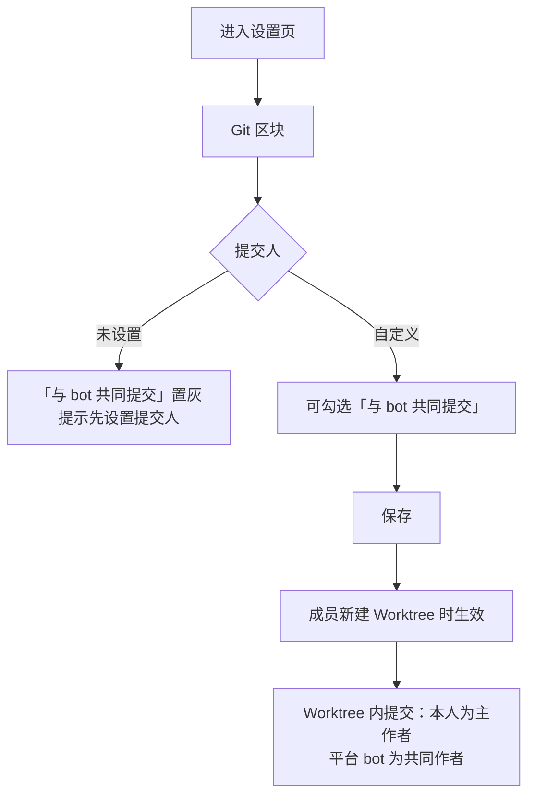
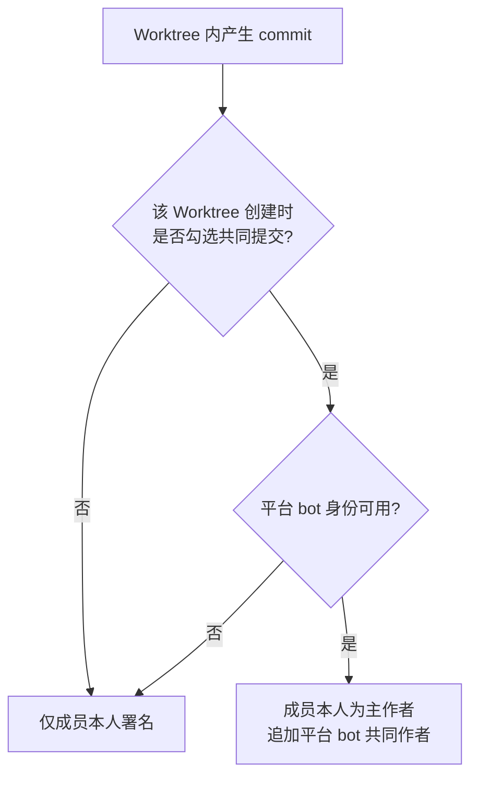

# Commit 与 bot 共同提交

**功能名称**: Commit 与 bot 共同提交（Worktree Co-Author）
**PRD 版本**: v1.0
**创建日期**: 2026-10-31
**作者**: ZeroAsh Agent

## 背景与目标

### 1.1 背景

`20261029-commit-author-settings-optimization` 下线了「提交人模式」（仅Agent / Co-Author / 仅人类）。下线后，「谁的 Worktree 提交就署谁」的规则已经生效，但希望同时保留「平台 bot 也参与过本次提交」这一审计痕迹的用户，没有任何可配置入口。

典型诉求：成员以自己的名字和邮箱作为主作者，同时让平台 bot 以 `Co-authored-by` 共同作者的形式出现在 commit 记录里，便于区分「Agent 辅助完成」与「完全人工完成」。

### 1.2 目标

- 在设置页「Git」区块的「提交人」下新增「与 bot 共同提交」勾选项；
- 勾选后，成员在 Worktree 内的提交以**成员本人为主作者**、**平台 bot 为共同作者**；
- 不勾选时，行为与当前版本完全一致（仅成员本人署名）；
- 不改变「云电脑自身提交恒为平台 bot」的既有规则。

### 1.3 成功标准

- 成员可在「Git」区块勾选 / 取消「与 bot 共同提交」并保存；
- 勾选后，该成员新创建的 Worktree 内产生的提交，作者为成员本人，并带有平台 bot 的共同作者署名；
- 未勾选、未设置提交人、旧版本云电脑、bot 身份不可用等场景均不报错，提交仍可正常完成；
- 同一条提交重复执行（追加提交、`--amend`）不会出现重复的共同作者署名。

## 用户分析

### 2.1 目标用户

使用云电脑进行仓库开发、关注 commit 审计与来源归属的注册用户，尤其是需要区分「Agent 辅助」与「人工完成」的团队成员和项目维护者。

### 2.2 用户场景

| 场景 | 用户角色 | 目标 | 痛点 |
|--|--|--|--|
| Agent 辅助开发 | 团队成员 | 提交署自己的名字，同时标记 Agent 参与 | Co-Author 下线后没有任何「共同署名」入口 |
| 审计与统计 | 项目维护者 | 区分纯人工提交与 Agent 参与提交 | 只有单一作者，无法看出 Agent 是否参与 |
| 多人共用云电脑 | 团队成员 | 每人的勾选互不影响 | 云电脑是共享资源，设置必须跟着人走 |

## 功能需求

### 3.1 功能概述

「Git」区块的「提交人」下新增「与 bot 共同提交」勾选项。勾选后，成员在 Worktree 内的提交以本人为主作者，平台 bot 以共同作者身份追加到提交信息中；云电脑自身（非 Worktree）的提交仍固定由平台 bot 单独署名。

### 3.2 功能列表

#### 功能点 1: 「与 bot 共同提交」勾选项

- **描述**: 设置页「Git」区块新增勾选项「与 bot 共同提交」，默认不勾选；保存后随成员的提交人设置一起生效。
- **用户价值**: 用一个开关表达「这次提交 Agent 也参与了」，无需手工填写共同作者。
- **验收标准**:
  - [ ] 「Git」区块出现「与 bot 共同提交」勾选项，默认不勾选
  - [ ] 勾选状态可保存，重新进入设置页后正确回显
  - [ ] 同一成员在任何工作区下看到的是同一份勾选状态

#### 功能点 2: 勾选后 bot 成为共同作者

- **描述**: 勾选「与 bot 共同提交」且「提交人」为「自定义」时，成员在 Worktree 内产生的提交以成员本人为主作者，平台 bot 作为共同作者追加署名。取消勾选后，新创建的 Worktree 恢复为仅成员本人署名。
- **用户价值**: 提交记录同时保留「人」与「Agent」两条归属线索。
- **验收标准**:
  - [ ] 勾选后，Worktree 内提交作者为成员本人，提交信息中包含平台 bot 的共同作者署名
  - [ ] 同一条提交重复执行或 `--amend` 后，共同作者署名不重复
  - [ ] 取消勾选后，新创建的 Worktree 内提交不再包含共同作者署名
  - [ ] 云电脑自身（非 Worktree）的提交仍为平台 bot 单独署名，不出现重复署名

#### 功能点 3: 与「提交人」的联动约束

- **描述**: 「与 bot 共同提交」只在「提交人」为「自定义」时可用；「提交人」为「未设置」时勾选项置灰，并提示需先设置提交人。
- **用户价值**: 避免出现「没有人类主作者却要求 bot 共同署名」的无意义组合。
- **验收标准**:
  - [ ] 「提交人」为「未设置」时勾选项不可操作，并展示引导提示
  - [ ] 「提交人」为「未设置」时保存不会保留勾选状态
  - [ ] 「提交人」为「自定义」时可正常勾选并保存

#### 功能点 4: 生效范围与生效时点

- **描述**: 勾选只影响成员本人在 Worktree 内产生的提交，包括勾选 Worktree 的会话、工作流，以及通过 Issue 拉起的工作流；对未勾选 Worktree 的会话/工作流（云电脑自身）不生效。勾选状态在 Worktree 创建时确定，之后修改设置不影响已创建的 Worktree。
- **用户价值**: 行为可预期，不会因为中途改设置而让历史提交的来源判断混乱。
- **验收标准**:
  - [ ] 勾选 Worktree 的会话/工作流内提交带共同作者署名
  - [ ] 通过 Issue 拉起的工作流内提交按触发人的勾选状态生效
  - [ ] 云电脑自身（未勾选 Worktree）的提交不受勾选影响
  - [ ] 修改勾选状态不影响已创建的 Worktree

#### 功能点 5: 降级与兼容

- **描述**: 平台 bot 身份暂时无法获取时，提交仍按成员本人署名，只是不追加共同作者署名；旧版本云电脑不支持该能力时，同样按成员本人署名，不报错。成员未设置提交人时，Worktree 提交仍沿用平台 bot，勾选项不产生额外署名。
- **用户价值**: 任何异常都只影响「共同署名」这一附加信息，不影响正常提交。
- **验收标准**:
  - [ ] bot 身份不可用时不阻断提交，且不出现错误提示
  - [ ] 旧版本云电脑上提交正常完成，仅缺少共同作者署名
  - [ ] 未设置提交人时提交署名为平台 bot，且不重复追加 bot

### 3.3 用户操作流程

### 3.4 页面/界面描述

| 页面 | 描述 | 关键元素 |
|------|------|---------|
| 设置页 - 「Git」区块 | 承载成员的提交人设置 | 区块标题「Git」、头部提示「仅对云电脑环境生效」、「提交人」（自定义 / 未设置）、「与 bot 共同提交」勾选项、保存按钮 |
| 提交人 - 自定义 | 选择自定义时展示 | 用户名输入框、邮箱输入框、「导入Github帐号信息」按钮、「与 bot 共同提交」勾选项 |
| 提交人 - 未设置 | 选择未设置时展示 | 「与 bot 共同提交」置灰并提示「设置提交人后可勾选」 |

### 3.5 异常与边界情况

| 情况 | 预期行为 |
|--|--|
| 提交人为「未设置」时勾选共同提交 | 勾选项置灰不可操作；保存不保留勾选状态 |
| 平台 bot 身份暂时不可用 | 提交仍按成员本人署名，不追加共同作者署名，不报错 |
| 旧版本云电脑 | 提交正常完成，仅缺少共同作者署名 |
| 修改勾选状态时已有 Worktree 正在使用 | 已创建的 Worktree 行为不变（以创建时的勾选状态为准） |
| 同一条提交重复追加或 `--amend` | 共同作者署名保持一条，不重复 |
| 未经 Worktree 的云电脑自身提交 | 仍为平台 bot 单独署名，勾选状态不产生额外署名 |

## 四、非功能需求

### 4.1 性能要求

- 保存勾选状态与读取设置在 2 秒内完成；
- 追加共同作者署名不引入可感知的提交延迟。

### 4.2 安全性要求

- 共同作者信息只包含平台 bot 的帐号名与 GitHub noreply 邮箱，不引入任何新凭据；
- 提交信息中的共同作者署名不得成为命令注入入口。

### 4.3 兼容性要求

- 未勾选成员的提交行为与当前版本完全一致；
- 旧版本云电脑优雅降级，不产生错误；
- 勾选状态按成员独立保存，不受工作区切换影响。

## 五、依赖与约束

### 5.1 依赖

- 成员级「提交人」设置（已上线）：勾选项依附于「自定义」提交人；
- Worktree 级提交人能力（已上线）：共同作者署名随 Worktree 创建写入；
- 平台 bot 身份（已上线）：共同作者的帐号名与 noreply 邮箱来源。

### 5.2 约束

- 仅对云电脑环境生效，本地控制器环境不适用；
- 共同作者固定为平台 bot，不支持自定义共同作者；
- 云电脑自身（非 Worktree）的提交固定由平台 bot 单独署名，不叠加共同作者。

## 六、相关文档

- [[shipping/20261029-commit-author-settings-optimization.md]] — Commit 作者设置优化（本文档在其「提交人模式下线」基础上补充共同作者开关）
- [[draft/20261027-commit-author-settings.md]] — 云容器 Commit 提交人设置（原 Co-Author 模式，已下线）
- [[released/20260523-git-worktree-support-prd.md]] — Git Worktree 支持
- 技术提案：[[../../engineering/proposals/20261031-feat-commit-with-bot-coauthor.md]]
- 实现计划：[[../../engineering/plan/20261031-feat-commit-with-bot-coauthor.md]]
