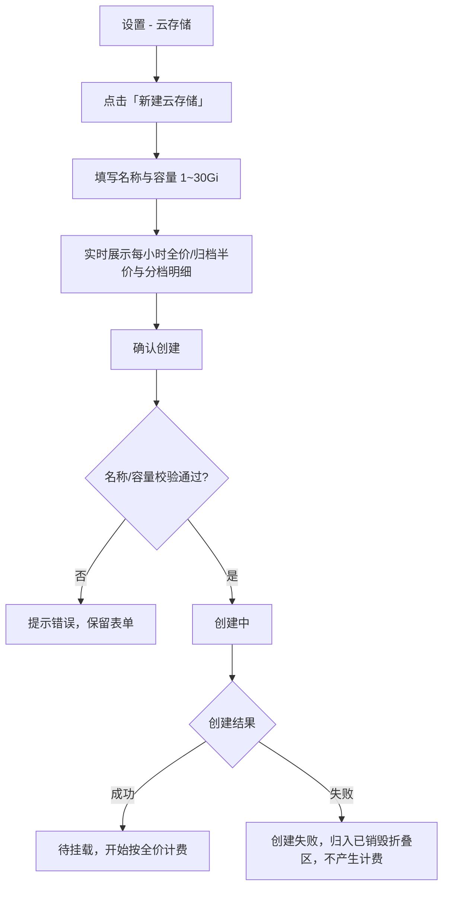
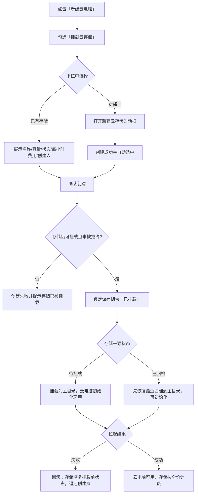
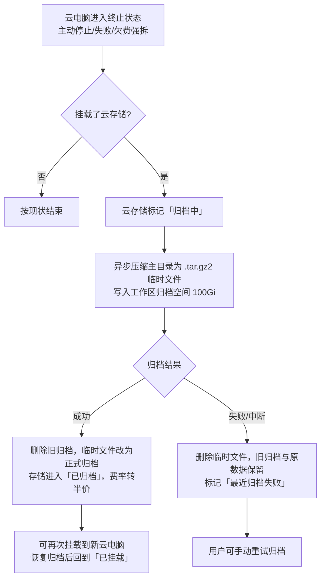
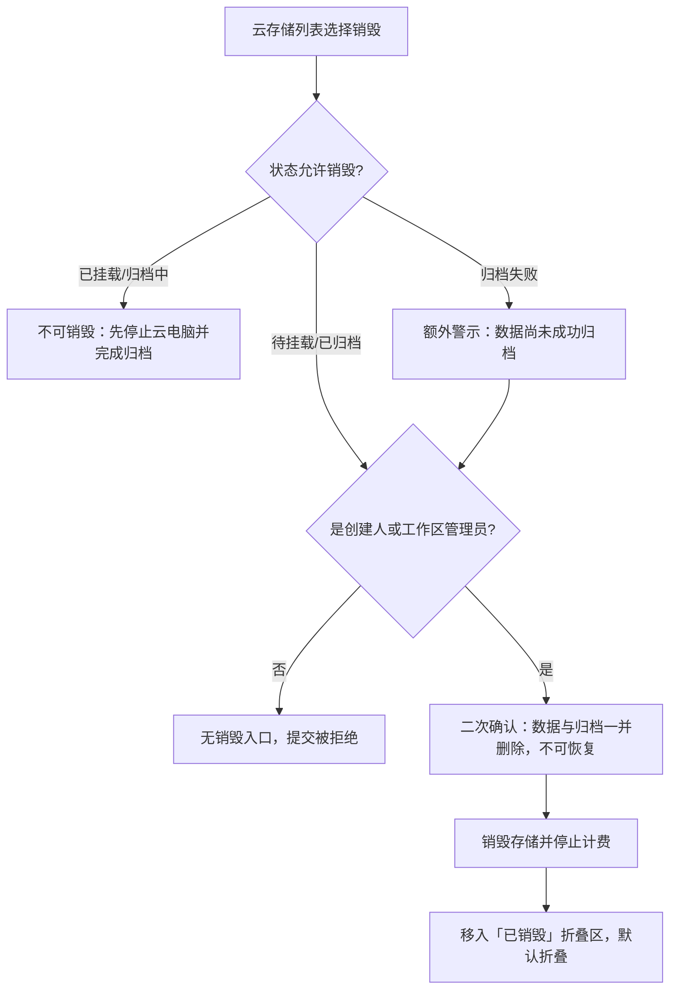

# 云电脑支持申请存储（云存储）

**功能名称**: 云电脑云存储
**PRD 版本**: v1.1
**创建日期**: 2026-11-02
**作者**: z-agent-bot
**需求来源**: GitHub Issue [Deliay/z-agent-gear#405](https://github.com/Deliay/z-agent-gear/issues/405)「云电脑支持申请存储」

**修订记录**:

| 版本 | 日期 | 说明 |
|------|------|------|
| v1.0 | 2026-11-02 | 初版（PR #406） |
| v1.1 | 2026-11-02 | 按 PR #406 评审意见重构：① 挂载点由主目录下子目录改为**整块存储挂载为云电脑主目录**，挂载在初始化工作负载之前完成，所有工作负载支持在已有环境上重复安装；② 云存储状态机改为**待挂载/已挂载/归档中/已归档/已销毁/创建失败**，归档时机固定为销毁云电脑时且**替换旧归档**（先写临时文件，成功后删旧文件再改名，中断则清理临时文件）；③ 计费区分**已归档半价、已挂载全价**；④ 设置页已销毁（含创建失败）单独折叠展示，默认折叠；⑤ 各挂载相关状态展示实际占用大小。 |

## 背景与目标

### 1.1 背景

云电脑当前的生命周期是「创建即启动、停止即销毁」：容器内的一切数据（项目代码、构建产物、依赖缓存、开发工具链、临时数据）都存放在随容器销毁而消失的临时空间里。用户一旦停止云电脑，容器内数据即不可找回；想继续同一份工作，只能在新的云电脑里重新 clone、重新安装、重新构建。

这带来三个具体问题：

1. **重复初始化成本高**：代码、依赖缓存、构建产物、工具链（Node/pnpm/工作负载）都无法跨云电脑保留，每次重建都要重新准备环境，而云电脑本身按分钟计费，重复初始化直接放大用户费用。
2. **数据无持久化手段**：平台没有任何用户可自主管理的持久存储；用户只能把数据推到外部代码仓库或网盘，既不方便也无法覆盖大文件/运行态数据。
3. **销毁即丢失，缺少兜底**：云电脑因欠费、失败或用户误操作销毁时，容器内数据没有任何留存手段，用户没有反悔空间。

平台已具备费用中心（Credits 计费）、多租户工作区与云电脑创建编排能力，具备向用户提供「可申请、可挂载、可计费、可归档」的持久存储的基础。

### 1.2 目标

1. **可申请**：设置中新增「云存储」，用户可命名并指定容量（最大 30Gi）创建属于自己的持久存储。
2. **可挂载**：创建云电脑时可勾选「云存储」并选择一块已创建的存储，也可就地新建；**整块存储挂载为云电脑的主目录（`~`）**，挂载在云电脑初始化工作负载之前完成。
3. **环境随存储走**：存储承载整个主目录——代码、依赖、工具链与配置都在其中。首次挂载一块空存储时自动完成环境初始化；再次挂载（恢复归档后）直接回到上次的环境，所有工作负载在已有环境上重复安装不报错、不返工。
4. **归属清晰**：云存储归属当前工作区，工作区成员可见可用；同时记录创建人，销毁等高危操作仅创建人与工作区管理员可执行。
5. **独占挂载**：一块云存储同一时间只能挂载到一台云电脑，避免多台云电脑并发写同一份数据造成损坏。
6. **销毁有兜底**：云电脑销毁（主动停止、失败、欠费强拆）时，自动把主目录整体压缩为 `.tar.gz2` 归档，写入工作区归档空间；新归档原子替换旧归档，中断/失败不破坏旧归档与原数据。
7. **状态透明**：云存储有明确状态（待挂载/已挂载/归档中/已归档/已销毁，创建失败归入已销毁），挂载相关状态展示实际占用大小。
8. **按量付费**：按容量分档、按小时计费；**已挂载（含待挂载、归档中）按全价，已归档按半价**；创建前即可看到每小时费用与预估；销毁后停止计费。
9. **数据不因欠费被删除**：余额不足时限制新建与挂载，但不自动删除用户数据。

### 1.3 成功标准

| 指标 | 目标值 |
|------|--------|
| 创建云存储成功率（容量与名称合法时） | ≥ 99% |
| 同一云存储被两台云电脑同时挂载的次数 | 0 |
| 云电脑销毁后归档触发率 | 100%（挂载了云存储的云电脑） |
| 归档中断/失败时旧归档与原数据保留 | 100%（旧归档在新归档成功前不被删除） |
| 再次挂载后环境可用（工作负载重复安装不报错） | 100% |
| 云电脑内主目录可写（云电脑默认用户） | 100% |
| 计费口径一致性（页面展示 / 账单实际扣费，含归档半价） | 100% |
| 跨工作区读取或挂载他人云存储 | 0 次 |
| 既有云电脑（未挂载云存储）行为回归 | 全部通过，零变化 |

## 用户分析

### 2.1 目标用户

- **前台注册用户（开发者）**：在云电脑中持续开发同一个项目，需要跨云电脑保留代码、依赖、构建产物与工具链。
- **团队工作区成员**：团队共享一份数据（如数据集、共享配置），由一名成员创建、其他成员按需挂载使用。
- **平台运营/管理员**：关注存储资源占用、计费准确性与数据安全，需要可追溯的创建人/挂载记录。

### 2.2 用户场景

| 场景 | 用户角色 | 目标 | 痛点 |
|------|----------|------|------|
| 跨云电脑继续开发 | 前台用户 | 新云电脑挂载同一存储后直接看到上次的代码、构建缓存与工具链 | 云电脑销毁后数据全丢，只能重新 clone/安装 |
| 环境随存储复活 | 前台用户 | 再次挂载时工具链与工作负载已就绪，无需重装 | 每次新云电脑都要重新初始化环境 |
| 保存大数据/模型文件 | 前台用户 | 把大文件放在持久存储里，不随容器销毁 | 临时空间有限且随容器消失 |
| 创建时顺手新建存储 | 前台用户 | 不用先跳去设置页，创建云电脑时直接新建并挂载 | 现有流程无存储选项，需来回切换页面 |
| 团队共享数据集 | 工作区成员 | 一位成员创建，其他成员挂载使用 | 缺少工作区级共享资源，私有存储无法协作 |
| 误停云电脑后留存数据 | 前台用户 | 销毁时自动归档，下次挂载即可恢复 | 销毁即丢失，无任何留存手段 |
| 闲置期降低成本 | 前台用户 | 存储不使用时（已归档）只付半价 | 闲置也要全价付费 |
| 控制存储成本 | 前台用户/管理员 | 创建前明确每小时费用，按需选择容量 | 无价格信息，无法预估成本 |

## 功能需求

### 3.1 功能概述

在设置中新增「云存储」能力：用户按名称与容量（1~30Gi）创建持久存储，归属当前工作区并记录创建人，按容量分档、按小时计费。创建云电脑时可勾选「云存储」，从当前工作区可挂载的存储中选择一块——**整块存储挂载为云电脑的主目录（`~`）**，挂载在云电脑初始化工作负载之前完成；同一块存储同一时间只能挂载到一台云电脑。

云存储是一个带状态的生命周期资源：**待挂载**（刚创建成功，相当于一个待用的申请）→ **已挂载**（正在云电脑上使用）→ **归档中**（云电脑销毁，正在把主目录压缩为 `.tar.gz2` 写入工作区归档空间）→ **已归档**（归档完成，可用于下次挂载）→ 再次挂载回到**已挂载**，循环往复；用户在待挂载/已归档时可主动销毁，进入**已销毁**；创建失败的存储归入已销毁一类。已挂载（含待挂载、归档中）按全价计费，已归档按半价计费，已销毁停止计费。

### 3.2 功能列表

#### 功能点 1: 设置中的「云存储」入口与列表

- **描述**: 设置页新增「云存储」区块，分两个区域：
  - **主列表**：展示当前工作区全部未销毁的云存储，列为：名称、容量、状态（待挂载/已挂载/归档中/已归档）、**实际占用大小**（已挂载/归档中/已归档展示，待挂载为空不展示）、当前每小时费用、创建人、创建时间；已挂载项同时展示所挂载的云电脑名称；操作提供「详情」「销毁」（按状态可用性禁用）。无存储时展示空态与新建引导。
  - **「已销毁」折叠区**：单独分区展示已销毁与创建失败的云存储（名称、容量、最终状态、创建人、销毁/失败时间），**默认折叠**，点击展开；仅作留痕查看，无操作入口。
- **用户价值**: 用户在同一处完成查看、创建、状态确认、用量确认与费用确认；已销毁记录可溯但不干扰日常使用。
- **验收标准**:
  - [ ] 设置页可见「云存储」入口，点击后展示当前工作区的云存储列表
  - [ ] 列表逐项展示名称、容量、状态、实际占用大小（已挂载/归档中/已归档）、每小时费用、创建人、创建时间
  - [ ] 已挂载项展示所挂载的云电脑名称
  - [ ] 已销毁与创建失败的存储出现在「已销毁」折叠区且默认折叠，不出现在主列表
  - [ ] 空工作区展示空态与「新建云存储」引导
  - [ ] 切换工作区后列表只展示当前工作区的云存储

#### 功能点 2: 创建云存储（命名 + 容量 + 费用预估）

- **描述**: 点击「新建云存储」打开对话框，填写：
  - **名称**：1~64 字符，同一工作区内不可重名。
  - **容量**：1~30Gi 整数，默认 10Gi；创建后不可扩容或缩容。
  - **费用预估**：根据容量实时展示每小时费用（全价与归档半价）与分档明细，并在确认前提示「创建成功即开始计费」。
  - 确认后进入创建流程；创建成功变为「**待挂载**」并开始按全价计费；创建失败标记为「**创建失败**」（归入已销毁折叠区），展示失败原因且不产生计费。
- **用户价值**: 创建前即可明确容量与成本，避免盲目申请。
- **验收标准**:
  - [ ] 名称/容量为空或越界时无法提交，并给出明确提示
  - [ ] 同一工作区内重名时创建失败并提示名称已存在
  - [ ] 对话框实时展示容量对应的每小时全价、归档半价与分档明细
  - [ ] 创建成功后列表出现「待挂载」状态的新存储，账单开始按小时计费
  - [ ] 创建失败时展示失败原因、归入「已销毁」折叠区、不产生账单，可销毁留痕记录后重新创建

#### 功能点 3: 云存储按小时阶梯计费（已归档半价）

- **描述**: 云存储按容量分档、按小时计费，自创建成功（待挂载）起算，不足 1 小时按 1 小时计；每满 1 小时自动出账。计费口径：

  | 容量区间 | 每小时费用（全价） |
  |----------|-----------|
  | 1Gi ~ 10Gi（含 10Gi） | 固定 5 credits |
  | 超过 10Gi 至 25Gi 的部分 | 每 Gi 1 credit |
  | 超过 25Gi 至 30Gi 的部分 | 每 Gi 3 credits |

  费率按状态区分：

  | 状态 | 费率 |
  |------|------|
  | 待挂载 / 已挂载 / 归档中 | 全价 |
  | 已归档 | **半价**（全价 × 50%） |
  | 已销毁 / 创建失败 | 不计费 |

  计费示例（每小时）：

  | 容量 | 全价（待挂载/已挂载/归档中） | 半价（已归档） |
  |------|-----------|------------|
  | 5Gi | 5 credits | 2.5 credits |
  | 10Gi | 5 credits | 2.5 credits |
  | 15Gi | 10 credits | 5 credits |
  | 20Gi | 15 credits | 7.5 credits |
  | 25Gi | 20 credits | 10 credits |
  | 30Gi | 35 credits | 17.5 credits |

  - 状态在一小时之内发生切换时，该小时按结算时刻所处状态的费率计费。
  - 销毁后停止计费，已产生费用不退；销毁时对不足 1 小时的尾段按 1 小时结算。
  - 归档空间（每工作区 100Gi）不向用户计费。
  - 账单在「我的费用」中按「存储」分类展示，描述可辨识到具体云存储与费率（全价/归档半价）。
- **用户价值**: 容量越大单价越高，成本与资源占用匹配；不使用时归档享受半价，费用透明、可核对。
- **验收标准**:
  - [ ] 各容量档位每小时费用与上表一致，页面展示值与账单实际扣费一致
  - [ ] 已归档期间每小时出账金额为同容量全价的一半
  - [ ] 最近一小时不足 1 小时按 1 小时计
  - [ ] 存储存在期间每小时产生一条存储消费账单，描述可定位到具体云存储与费率
  - [ ] 销毁存储后不再产生新账单，已产生账单保留
  - [ ] 同一小时不重复出账（网络重试/服务重启不产生重复账单）

#### 功能点 4: 云存储归属工作区并记录创建人

- **描述**:
  - 云存储归属**创建时所在的工作区**，同工作区成员均可在列表中看到，并可挂载到自己创建的云电脑；
  - 列表与详情记录并展示**创建人**；
  - 跨工作区不可见、不可挂载；
  - 销毁云存储仅**创建人**与**工作区管理员**可执行；
  - 全局工作区下角色为开发者（只读）时，不可创建/销毁，只能查看与使用已有存储。
- **用户价值**: 团队共享资源的同时，破坏性操作有明确责任人边界。
- **验收标准**:
  - [ ] 同工作区其他成员可见并可使用该云存储，创建人展示正确
  - [ ] 另一工作区成员看不到、也无法通过任何入口挂载该云存储
  - [ ] 非创建人且非工作区管理员看不到销毁入口，绕过提交被拒绝
  - [ ] 全局工作区只读角色无法创建/销毁，已有存储可正常挂载

#### 功能点 5: 创建云电脑时挂载云存储（挂载为主目录）

- **描述**: 「新建云电脑」对话框新增「云存储」区块：
  - 勾选「挂载云存储」后，从当前工作区「**待挂载**」或「**已归档**」状态的存储中选择一块；下拉项展示名称、容量、状态、每小时费用、创建人；
  - 下拉中包含「新建…」选项，点击后打开「新建云存储」对话框；创建成功后自动回填并选中新存储，无需离开创建流程；
  - 一台云电脑最多挂载一块云存储；
  - 未勾选时不传任何存储参数，创建行为与现状完全一致；
  - 创建对话框同时展示所选存储的每小时费用，并计入费用说明；
  - **挂载效果**：整块存储即云电脑的主目录（`~`），挂载在云电脑初始化工作负载之前完成——
    - 挂载「待挂载」（全新）存储：云电脑首次启动时自动完成环境初始化（开发工具链与工作负载照常安装，全部落入存储）；
    - 挂载「已归档」存储：云电脑启动前先把最近一次归档恢复到存储中，工具链、代码、依赖与上次销毁时一致，工作负载在已有环境上重复安装不报错、不返工；
  - 挂载「已归档」存储的恢复过程需要一定时间（随数据量增长），创建对话框与云电脑状态中有明确提示。
- **用户价值**: 创建与挂载一步完成；环境随存储走，换云电脑不换环境。
- **验收标准**:
  - [ ] 新建云电脑对话框可见「云存储」区块与「新建…」入口
  - [ ] 下拉仅展示当前工作区「待挂载/已归档」的存储，展示名称/容量/状态/每小时费用/创建人
  - [ ] 通过「新建…」创建成功后，新存储自动选中且可直接提交创建
  - [ ] 请求中最多包含一块云存储；未勾选时不改变既有创建报文与行为
  - [ ] 创建对话框展示所选存储的每小时费用
  - [ ] 挂载「待挂载」存储后，云电脑主目录可读写且环境初始化正常完成
  - [ ] 挂载「已归档」存储后，主目录内容与上次销毁时一致，工作负载重复安装不报错
  - [ ] 挂载「已归档」存储时用户能看到「正在恢复数据」的明确状态

#### 功能点 6: 一块云存储同时只能挂载一台云电脑

- **描述**: 云存储被挂载后状态变为「已挂载」，并从其他云电脑的可选列表中移除；并发创建两台云电脑争抢同一块存储时，只有一台成功，另一台创建失败并提示「该云存储已被其他云电脑挂载」。云电脑销毁且归档完成后，存储进入「已归档」，可再次挂载；归档期间不可挂载。
- **用户价值**: 避免多台云电脑同时写同一份数据导致内容损坏。
- **验收标准**:
  - [ ] 已挂载的存储不出现在其他云电脑创建对话框的可选列表
  - [ ] 并发提交同一存储时仅一台成功，另一台失败且不产生云电脑与扣费
  - [ ] 云电脑停止且归档完成后，存储进入「已归档」并可再次挂载
  - [ ] 归档中的存储不可挂载
  - [ ] 云电脑创建失败（如拉起失败、恢复归档失败）时，存储回到挂载前状态（待挂载/已归档），不残留「已挂载」

#### 功能点 7: 云电脑销毁时自动归档（替换旧归档）

- **描述**: 云电脑进入终止状态（用户主动停止、运行失败、欠费强拆）时，若挂载了云存储：
  1. 系统自动将主目录整体压缩为一个 `.tar.gz2` 文件，文件名包含云电脑名称与归档时间，写入该工作区的归档空间（容量 100Gi）；
  2. **每块存储只保留一份最新归档**：新归档先以临时文件写入，**归档成功后删除旧归档文件、再把临时文件改为正式文件**；归档被中断或失败时，**删除中断的临时文件，旧归档保持可用**；
  3. 归档期间云存储显示「**归档中**」并展示实际占用大小，不可挂载、不可销毁；
  4. 归档成功后云存储进入「**已归档**」，展示实际占用大小与归档时间，**费率转为半价**，可再次挂载到新云电脑；
  5. 归档失败时云存储保持「归档中」并标注「最近归档失败」，原数据与旧归档均不丢失，支持手动重试；归档详情可查看文件名、大小、时间、状态与失败原因；
  6. 归档为异步过程，不阻塞「停止云电脑」操作完成。
- **用户价值**: 销毁也有兜底，且始终只有一份最新副本，归档空间占用可控；闲置期半价降低成本。
- **验收标准**:
  - [ ] 挂载了云存储的云电脑停止后自动触发归档，停止操作本身不被归档阻塞
  - [ ] 归档成功后旧归档文件被替换，归档信息（文件名/大小/时间/状态）可见
  - [ ] 归档中断/失败时临时文件被清理，旧归档与原数据保持不变，可手动重试并成功
  - [ ] 归档期间该存储不可挂载、不可销毁
  - [ ] 归档成功后存储费率转为半价，账单体现
  - [ ] 未挂载云存储的云电脑销毁流程与现状一致，无额外等待

#### 功能点 8: 销毁云存储

- **描述**: 用户可主动销毁不再需要的云存储：
  - 「**待挂载**」「**已归档**」状态的存储提供「销毁」入口；「已挂载」状态不允许销毁（需先停止所挂载的云电脑并完成归档）；「归档中」不允许销毁，归档失败的可先重试，也可在明确提示「数据尚未成功归档，销毁后不可恢复」后销毁；
  - 销毁需二次确认，明确提示「销毁后存储数据与归档一并删除，不可恢复」；
  - 销毁后停止计费，存储进入「已销毁」，从主列表移除，出现在「已销毁」折叠区；
  - 仅创建人与工作区管理员可销毁。
- **用户价值**: 用完即销毁，避免持续产生费用；留痕可查。
- **验收标准**:
  - [ ] 「待挂载」「已归档」状态可销毁并二次确认
  - [ ] 「已挂载」「归档中」状态无销毁入口，绕过提交被拒绝
  - [ ] 归档失败的存储销毁时有「数据未归档」的额外警示
  - [ ] 销毁后不再产生新账单，存储移入「已销毁」折叠区
  - [ ] 非创建人且非工作区管理员无销毁入口，绕过提交被拒绝

### 3.3 用户操作流程

#### 创建云存储

#### 创建云电脑并挂载云存储

#### 云电脑销毁与归档（存储状态循环）

#### 销毁云存储

### 3.4 页面/界面描述

| 页面 | 描述 | 关键元素 |
|------|------|---------|
| 设置 - 云存储 | 当前工作区云存储的统一管理入口 | 新建按钮、主列表（名称/容量/状态/实际占用/每小时费用/创建人/创建时间/挂载的云电脑/操作）、「已销毁」折叠区（默认折叠）、空态引导 |
| 新建云存储对话框 | 创建云存储 | 名称输入、容量输入（1~30Gi）、每小时全价与归档半价及分档明细、创建/取消 |
| 云存储详情 | 查看与管理单块存储 | 基本信息、状态、实际占用大小、当前费率、当前归档信息（文件名/大小/时间/状态/失败原因）、重试归档、销毁 |
| 新建云电脑对话框 - 云存储区块 | 创建时挂载存储 | 「挂载云存储」勾选、存储下拉（名称/容量/状态/费用/创建人）、「新建…」入口、所选存储每小时费用、已归档存储的恢复耗时提示 |
| 云电脑配置页 | 展示云电脑已挂载的存储 | 存储名称、容量、状态、跳转云存储设置 |
| 我的费用 | 查看存储消费 | 「存储」分类账单、按云存储区分的描述、全价/归档半价费率标识、每小时费用与累计消费 |

### 3.5 异常与边界情况

| 情况 | 预期行为 |
|------|---------|
| 名称重复（同一工作区） | 创建失败，提示「名称已存在」，表单保留可修改 |
| 名称为空/超长/含非法字符 | 无法提交并提示 |
| 容量为 0、负数、小数或超过 30Gi | 无法提交并提示容量范围 |
| 创建过程中网络中断/重复提交 | 同一创建只产生一块存储与一条计费起点，不重复创建 |
| 创建失败（资源不足等） | 标记「创建失败」并归入已销毁折叠区，展示原因，不产生计费 |
| 创建云电脑时存储被他人抢先挂载 | 云电脑创建失败并提示存储已被挂载；不产生云电脑、不扣创建费 |
| 云电脑拉起失败 | 存储恢复挂载前状态（待挂载/已归档），创建费自动退回，用户可重新创建 |
| 挂载「已归档」存储时恢复失败 | 云电脑创建失败并提示恢复失败，存储保持「已归档」，归档不丢失，可重试 |
| 云电脑异常终止（非主动停止） | 同样触发归档；归档完成后存储进入「已归档」 |
| 归档过程中服务重启 | 归档自动重试或明确标记失败；中断的临时文件被清理，旧归档与原数据不丢 |
| 归档空间不足 | 归档失败并提示「归档空间不足」，旧归档与原数据保留；用户可销毁不再需要的存储释放归档空间后重试 |
| 归档文件损坏/不完整 | 归档标记失败，临时文件不转为正式归档；旧归档与原数据不受影响 |
| 存储处于「已挂载」时尝试销毁 | 无销毁入口，绕过提交被拒绝并提示先停止云电脑 |
| 存储处于「归档中」时尝试挂载 | 不出现在可选列表，绕过提交被拒绝 |
| 欠费导致云电脑被强拆 | 归档照常执行；云存储不因欠费删除，但欠费期间不能新建存储、不能挂载 |
| 余额不足时创建存储 | 拒绝创建并提示余额不足与当前余额 |
| 同一工作区并发创建同名存储 | 仅一个成功，另一个提示名称已存在 |
| 工作区存在云存储时删除工作区 | 拒绝删除并提示工作区非空（需先销毁存储） |
| 跨工作区访问存储 | 不可见、不可挂载，任何绕过请求被拒绝 |
| 已销毁存储的查看 | 仅在「已销毁」折叠区展示，无操作入口 |

## 四、非功能需求

### 4.1 性能要求

- 云存储列表与详情加载不阻塞设置页其他区块，常规网络下 2 秒内可见。
- 创建云存储从确认到「待挂载」的目标 ≤ 30 秒，期间展示「创建中」。
- 云电脑销毁不因归档而明显变慢：停止操作在容器回收完成后即返回，归档在后台执行；归档耗时随数据量增长，不设固定上限，期间持续展示「归档中」与实际占用大小。
- 挂载「已归档」存储的恢复耗时随数据量增长，创建云电脑时明确提示，云电脑状态可区分「正在恢复数据」。
- 归档为单工作区串行执行，同一工作区多台云电脑同时销毁时按顺序归档，先完成的先转入「已归档」。

### 4.2 安全性要求

- 云存储数据只在所属工作区内可见可用，跨工作区不可见、不可挂载；所有权限判定以服务端为准，前端隐藏不作为放行依据。
- 销毁云存储仅创建人与工作区管理员可执行，且必须二次确认。
- 云电脑内主目录的服务进程身份与云电脑默认用户一致，不额外提升容器权限；其他云电脑无法同时挂载同一存储。
- 归档文件仅由平台内部流程写入与读取，不向无权限用户暴露文件内容；界面只展示归档元信息（文件名/大小/时间/状态）。
- 名称、容量等输入做服务端校验。

### 4.3 兼容性要求

- 未挂载云存储的云电脑，创建、初始化、停止、销毁、计费与现有行为完全一致。
- 存量云存储上线前不存在，无需数据迁移；存量云电脑不自动挂载任何存储。
- 挂载云存储的云电脑需要新版云电脑环境支持（随功能一同发布）；旧版云电脑环境不开放挂载入口。
- 本地/自定义主机（非云电脑）不出现「云存储」入口与相关能力。
- 设置页新增区块不改变既有区块的顺序与行为；移动端同样可访问。

### 4.4 容量与保留要求

- 单块云存储容量 1~30Gi；同一工作区可创建多块，本期不限制数量。
- 每个工作区归档空间固定 100Gi；每块存储只保留一份最新归档；释放归档空间通过销毁不再需要的存储完成，本期不做自动清理。
- 已销毁云存储的记录在折叠区留痕展示，本期不提供清除记录入口。

## 五、依赖与约束

### 5.1 依赖

- 云电脑创建、停止与销毁编排（[[20261027-unlimited-cloud-hosts]]、[[20261020-container-harness-support]]）。
- 云电脑保活与 worker 用户、工作负载安装体系（[[20261025-cloud-host-keepalive]]、[[20261018-workload-phase1]]、[[20261029-pnpm-workload-and-harness-optional]]）。
- 费用中心 Credits 计费：账户余额、账单、收据与欠费口径（[[20261018-credits-billing]]）。
- 多租户工作区与角色体系：工作区归属、成员可见性、创建人记录与工作区删除保护（[[20261028-multi-tenant-phase2]]）。
- 云电脑设置与新建对话框（[[20261022-cloud-container-optimization-phase1]]、[[20261026-default-workspace-optimization]]）。

### 5.2 约束

- **计费口径假设**：需求原文「前 10Gi 每小时 5 credit，10Gi 之后每 Gi 每小时 1 credit，25Gi 之后每 Gi 每小时 3 credit」按「**累计分档**」理解：10Gi 以内固定 5 credits/小时，10~25Gi 的部分每 Gi 1 credit/小时，25~30Gi 的部分每 Gi 3 credits/小时；**已归档半价 = 同容量全价 × 50%**。若实际预期为其他口径，需在评审时确认后调整本 PRD 与技术方案。
- **状态费率切换口径**：一小时之内状态切换（如已挂载 → 已归档）时，该小时按结算时刻所处状态的费率计费。
- **压缩格式**：需求要求输出 `.tar.gz2`，本期按字面使用该扩展名，实际压缩算法为 bzip2（解压使用 `tar -xjf`），文件名与扩展名保持一致。
- **挂载方式**：整块存储挂载为云电脑主目录（`~`），挂载在初始化工作负载之前完成；一块云存储同一时间只能挂载一台云电脑；一台云电脑最多挂载一块云存储。
- **归档语义**：归档时机固定为销毁云电脑时；每块存储只保留一份最新归档，新归档成功后替换旧归档；中断/失败清理临时文件且不破坏旧归档。
- 云存储创建后容量不可调整；需要更大容量时新建存储。
- 归档文件本期只做留存与下次挂载恢复，不提供下载/导出能力。
- 欠费不自动删除云存储与归档；欠费期间禁止新建与挂载，已挂载的云电脑按费用中心既有口径处理（欠费 10 分钟强拆，随后归档）。
- 归档空间 100Gi 为工作区级硬上限，本期不做自动清理与扩容。

## 六、相关文档

- [技术提案](../../engineering/proposals/20261102-feat-cloud-storage.md)
- [[20261018-credits-billing]] — 费用中心（Credits 计费）
- [[20261020-container-harness-support]] — 容器启动任务支持 harness 类型（云电脑）
- [[20261025-cloud-host-keepalive]] — 云电脑保活与 worker 用户
- [[20261027-unlimited-cloud-hosts]] — 用户开放无限制云电脑支持（创建收费与运行计费）
- [[20261028-multi-tenant-phase2]] — 多租户二期（工作区与角色）
- [[20261026-default-workspace-optimization]] — 默认工作区优化
- [[20261029-pnpm-workload-and-harness-optional]] — 云电脑组件安装切换 pnpm 与工作负载 Harness 可选化
- [[../AGENTS.md]] — 产品文档管理规范
- [需求来源：GitHub Issue #405](https://github.com/Deliay/z-agent-gear/issues/405)
