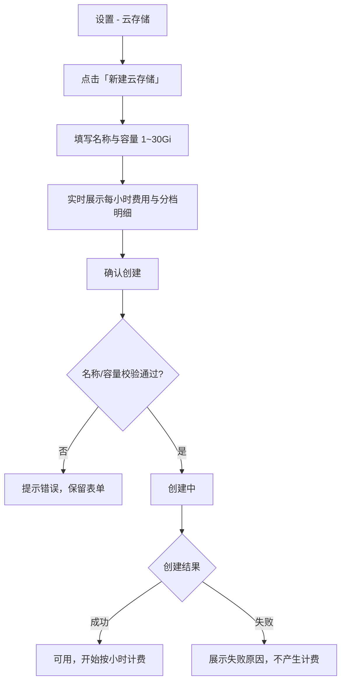
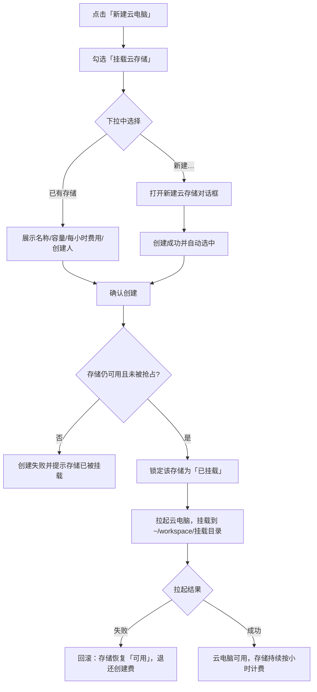
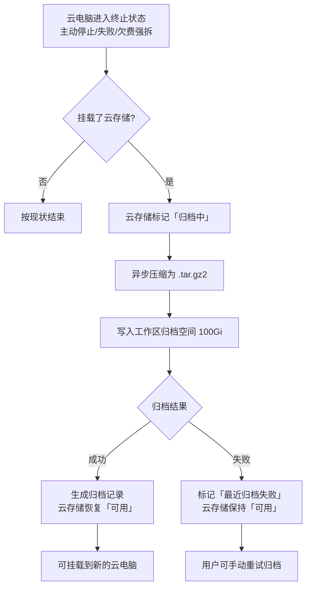
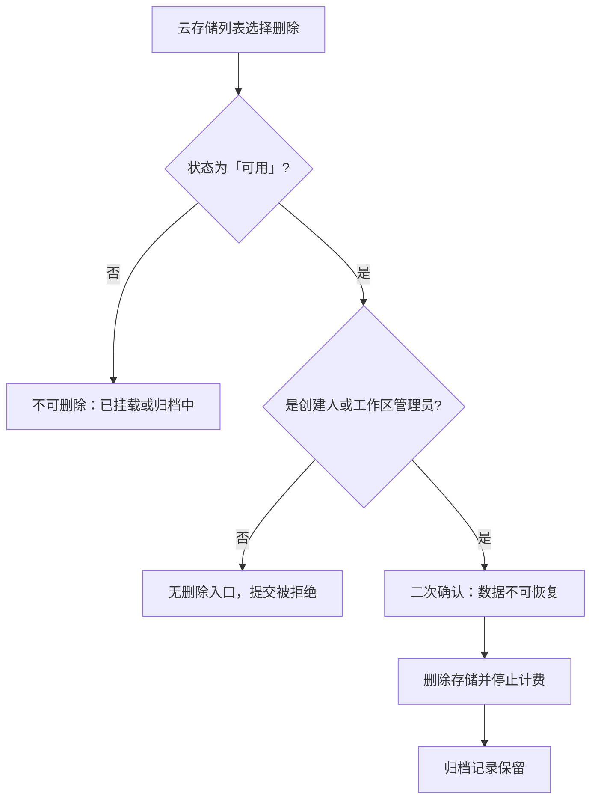

# 云电脑支持申请存储（云存储）

**功能名称**: 云电脑云存储
**PRD 版本**: v1.0
**创建日期**: 2026-11-02
**作者**: z-agent-bot
**需求来源**: GitHub Issue [Deliay/z-agent-gear#405](https://github.com/Deliay/z-agent-gear/issues/405)「云电脑支持申请存储」

## 背景与目标

### 1.1 背景

云电脑当前的生命周期是「创建即启动、停止即销毁」：容器内的一切数据（项目代码、构建产物、依赖缓存、临时数据）都存放在随容器销毁而消失的临时空间里。用户一旦停止云电脑，容器内数据即不可找回；想继续同一份工作，只能在新的云电脑里重新 clone、重新安装、重新构建。

这带来三个具体问题：

1. **重复初始化成本高**：依赖缓存、构建产物、`.env` 等无法跨云电脑保留，每次重建都要重新准备环境，而云电脑本身按分钟计费，重复初始化直接放大用户费用。
2. **数据无持久化手段**：平台没有任何用户可自主管理的持久存储；用户只能把数据推到外部代码仓库或网盘，既不方便也无法覆盖大文件/运行态数据。
3. **销毁即丢失，缺少兜底**：云电脑因欠费、失败或用户误操作销毁时，容器内数据没有任何留存手段，用户没有反悔空间。

平台已具备费用中心（Credits 计费）、多租户工作区与云电脑创建编排能力，具备向用户提供「可申请、可挂载、可计费、可归档」的持久存储的基础。

### 1.2 目标

1. **可申请**：设置中新增「云存储」，用户可命名并指定容量（最大 30Gi）创建属于自己的持久存储。
2. **可挂载**：创建云电脑时可勾选「云存储」并选择一块已创建的存储；也可在创建流程中直接新建；云电脑内以用户主目录下的工作区子目录形式访问。
3. **归属清晰**：云存储归属当前工作区，工作区成员可见可用；同时记录创建人，删除等高危操作仅创建人与工作区管理员可执行。
4. **独占挂载**：一块云存储同一时间只能挂载到一台云电脑，避免多台云电脑并发写同一份数据造成损坏。
5. **销毁有兜底**：云电脑销毁时，自动把挂载的云存储内容压缩为 `.tar.gz2` 归档，写入工作区归档空间，供后续追溯。
6. **按量付费**：按容量分档、按小时计费，创建前即可看到每小时费用与预估，费用进入既有费用中心账单。
7. **数据不因欠费被删除**：余额不足时限制新建与挂载，但不自动删除用户数据。

### 1.3 成功标准

| 指标 | 目标值 |
|------|--------|
| 创建云存储成功率（容量与名称合法时） | ≥ 99% |
| 创建完成后可挂载成功率 | 100%（工作区内、无并发抢占时） |
| 同一云存储被两台云电脑同时挂载的次数 | 0 |
| 云电脑销毁后归档触发率 | 100%（挂载了云存储的云电脑） |
| 归档失败时用户数据丢失量 | 0（原云存储内容保持不变） |
| 云电脑内挂载目录可写（云电脑默认用户） | 100% |
| 计费口径一致性（页面展示 / 账单实际扣费） | 100% |
| 跨工作区读取或挂载他人云存储 | 0 次 |
| 既有云电脑（未挂载云存储）行为回归 | 全部通过，零变化 |

## 用户分析

### 2.1 目标用户

- **前台注册用户（开发者）**：在云电脑中持续开发同一个项目，需要跨云电脑保留代码、依赖与构建产物。
- **团队工作区成员**：团队共享一份数据（如数据集、共享配置），由一名成员创建、其他成员按需挂载使用。
- **平台运营/管理员**：关注存储资源占用、计费准确性与数据安全，需要可追溯的创建人/挂载记录。

### 2.2 用户场景

| 场景 | 用户角色 | 目标 | 痛点 |
|------|----------|------|------|
| 跨云电脑继续开发 | 前台用户 | 新云电脑直接看到上次的代码与构建缓存 | 云电脑销毁后数据全丢，只能重新 clone/安装 |
| 保存大数据/模型文件 | 前台用户 | 把大文件放在持久存储里，不随容器销毁 | 临时空间有限且随容器消失 |
| 创建时顺手新建存储 | 前台用户 | 不用先跳去设置页，创建云电脑时直接新建并挂载 | 现有流程无存储选项，需来回切换页面 |
| 团队共享数据集 | 工作区成员 | 一位成员创建，其他成员挂载使用 | 缺少工作区级共享资源，私有存储无法协作 |
| 误停云电脑后留存数据 | 前台用户 | 归档记录可确认容器内数据已留存，便于事后追溯 | 销毁即丢失，无任何留存手段 |
| 控制存储成本 | 前台用户/管理员 | 创建前明确每小时费用，按需选择容量 | 无价格信息，无法预估成本 |

## 功能需求

### 3.1 功能概述

在设置中新增「云存储」能力：用户可按名称与容量（1~30Gi）创建持久存储，归属当前工作区并记录创建人，按容量分档、按小时计费。创建云电脑时可勾选「云存储」，从当前工作区可用的存储中选择一块挂载，云电脑内以 `~/workspace/<挂载目录>` 目录访问（挂载目录由存储名称生成，特殊字符由系统安全转换）；同一块存储同一时间只能挂载到一台云电脑。云电脑销毁（主动停止、失败、欠费强拆）时，系统自动将挂载内容压缩为 `.tar.gz2` 并写入工作区归档空间，归档记录可在云存储页面查看与清理；原云存储内容不受影响，可继续挂载到新云电脑。

### 3.2 功能列表

#### 功能点 1: 设置中的「云存储」入口与列表

- **描述**: 设置页新增「云存储」区块。列表展示当前工作区的全部云存储：名称、容量、状态（创建中 / 可用 / 已挂载 / 归档中 / 异常）、每小时费用、创建人、创建时间、最近一次归档结果；提供「新建云存储」按钮。无存储时展示空态与新建引导。
- **用户价值**: 用户在同一处完成查看、创建、挂载状态确认与费用确认。
- **验收标准**:
  - [ ] 设置页可见「云存储」入口，点击后展示当前工作区的云存储列表
  - [ ] 列表逐项展示名称、容量、状态、每小时费用、创建人、创建时间
  - [ ] 已挂载项展示所挂载的云电脑名称
  - [ ] 空工作区展示空态与「新建云存储」引导
  - [ ] 切换工作区后列表只展示当前工作区的云存储

#### 功能点 2: 创建云存储（命名 + 容量 + 费用预估）

- **描述**: 点击「新建云存储」打开对话框，填写：
  - **名称**：1~64 字符，同一工作区内不可重名；名称决定云电脑内挂载目录名。
  - **容量**：1~30Gi 整数，默认 10Gi；创建后不可扩容或缩容。
  - **费用预估**：根据容量实时展示每小时费用与分档明细，并在确认前提示「创建成功即开始计费」。
  - 确认后进入「创建中」，创建成功变为「可用」并开始计费；失败展示失败原因且不产生计费。
- **用户价值**: 创建前即可明确容量与成本，避免盲目申请。
- **验收标准**:
  - [ ] 名称/容量为空或越界时无法提交，并给出明确提示
  - [ ] 同一工作区内重名时创建失败并提示名称已存在
  - [ ] 对话框实时展示容量对应的每小时费用与分档明细
  - [ ] 创建成功后列表出现「可用」状态的新存储，账单开始按小时计费
  - [ ] 创建失败时展示失败原因并标记「异常」，不产生账单，可删除后重新创建

#### 功能点 3: 云存储按小时阶梯计费

- **描述**: 云存储按容量分档、按小时计费，自创建成功（可用）起算，不足 1 小时按 1 小时计；每满 1 小时自动出账。计费口径：

  | 容量区间 | 每小时费用 |
  |----------|-----------|
  | 1Gi ~ 10Gi（含 10Gi） | 固定 5 credits |
  | 超过 10Gi 至 25Gi 的部分 | 每 Gi 1 credit |
  | 超过 25Gi 至 30Gi 的部分 | 每 Gi 3 credits |

  计费示例：

  | 容量 | 每小时费用 | 说明 |
  |------|-----------|------|
  | 5Gi | 5 credits | 10Gi 以内固定价 |
  | 10Gi | 5 credits | 10Gi 以内固定价 |
  | 15Gi | 10 credits | 5 + 5×1 |
  | 20Gi | 15 credits | 5 + 10×1 |
  | 25Gi | 20 credits | 5 + 15×1 |
  | 30Gi | 35 credits | 5 + 15×1 + 5×3 |

  - 存储只要存在（可用、已挂载、归档中）即持续计费；删除后停止计费，已产生费用不退。
  - 归档空间（每工作区 100Gi）不向用户计费。
  - 账单在「我的费用」中按「存储」分类展示，描述可辨识到具体云存储。
- **用户价值**: 容量越大单价越高，成本与资源占用匹配；费用透明、可核对。
- **验收标准**:
  - [ ] 各容量档位每小时费用与上表一致，页面展示值与账单实际扣费一致
  - [ ] 最近一小时不足 1 小时按 1 小时计
  - [ ] 存储存在期间每小时产生一条存储消费账单，描述可定位到具体云存储
  - [ ] 删除存储后不再产生新账单，已产生账单保留
  - [ ] 同一小时不重复出账（网络重试/服务重启不产生重复账单）

#### 功能点 4: 云存储归属工作区并记录创建人

- **描述**:
  - 云存储归属**创建时所在的工作区**，同工作区成员均可在列表中看到，并可挂载到自己创建的云电脑；
  - 列表与详情记录并展示**创建人**；
  - 跨工作区不可见、不可挂载；
  - 删除云存储、清理归档仅**创建人**与**工作区管理员**可执行；
  - 全局工作区下角色为开发者（只读）时，不可创建/删除，只能查看与使用已有存储。
- **用户价值**: 团队共享资源的同时，破坏性操作有明确责任人边界。
- **验收标准**:
  - [ ] 同工作区其他成员可见并可使用该云存储，创建人展示正确
  - [ ] 另一工作区成员看不到、也无法通过任何入口挂载该云存储
  - [ ] 非创建人且非工作区管理员看不到删除入口，绕过提交被拒绝
  - [ ] 全局工作区只读角色无法创建/删除，已有存储可正常挂载

#### 功能点 5: 创建云电脑时挂载云存储

- **描述**: 「新建云电脑」对话框新增「云存储」区块：
  - 勾选「挂载云存储」后，从当前工作区「可用」状态的存储中选择一块；下拉项展示名称、容量、每小时费用、创建人；
  - 下拉中包含「新建…」选项，点击后打开「新建云存储」对话框；创建成功后自动回填并选中新存储，无需离开创建流程；
  - 一台云电脑最多挂载一块云存储；
  - 未勾选时不传任何存储参数，创建行为与现状完全一致；
  - 创建对话框同时展示所选存储的每小时费用，并计入费用说明。
- **用户价值**: 创建与挂载一步完成，不必先绕去设置页。
- **验收标准**:
  - [ ] 新建云电脑对话框可见「云存储」区块与「新建…」入口
  - [ ] 下拉仅展示当前工作区「可用」的存储，展示名称/容量/每小时费用/创建人
  - [ ] 通过「新建…」创建成功后，新存储自动选中且可直接提交创建
  - [ ] 请求中最多包含一块云存储；未勾选时不改变既有创建报文与行为
  - [ ] 创建对话框展示所选存储的每小时费用
  - [ ] 挂载成功后，云电脑内 `~/workspace/<挂载目录>` 可读写，且内容与存储一致

#### 功能点 6: 一块云存储同时只能挂载一台云电脑

- **描述**: 云存储被挂载后状态变为「已挂载」，并从其他云电脑的可选列表中移除；并发创建两台云电脑争抢同一块存储时，只有一台成功，另一台创建失败并提示「该云存储已被其他云电脑挂载」。云电脑销毁归档完成后，存储回到「可用」，可再次挂载。
- **用户价值**: 避免多台云电脑同时写同一份数据导致内容损坏。
- **验收标准**:
  - [ ] 已挂载的存储不出现在其他云电脑创建对话框的可选列表
  - [ ] 并发提交同一存储时仅一台成功，另一台失败且不产生云电脑与扣费
  - [ ] 云电脑停止且归档完成后，存储状态回到「可用」并可再次挂载
  - [ ] 云电脑创建失败（如拉起失败）时，存储回到「可用」，不残留「已挂载」

#### 功能点 7: 云电脑销毁时自动归档

- **描述**: 云电脑进入终止状态（用户主动停止、运行失败、欠费强拆）时，若挂载了云存储：
  1. 系统自动将云存储内容压缩为 `.tar.gz2` 文件，文件名包含云电脑名称与归档时间；
  2. 归档文件写入该工作区的归档空间（容量 100Gi）；
  3. 归档期间云存储显示「归档中」，不可挂载、不可删除；
  4. 归档成功后云存储回到「可用」，**原内容保持不变**；列表展示最近一次归档结果；
  5. 「云存储」详情内展示归档记录（来源云存储、来源云电脑、归档时间、状态、文件名），创建人与工作区管理员可删除归档记录以释放归档空间；
  6. 归档为异步过程，不阻塞「停止云电脑」操作完成；归档失败时云存储保持「可用」并标注「最近归档失败」，支持手动重试。
- **用户价值**: 销毁也有兜底，误操作或失败后仍有数据副本可追溯。
- **验收标准**:
  - [ ] 挂载了云存储的云电脑停止后自动触发归档，停止操作本身不被归档阻塞
  - [ ] 归档成功后归档记录可见，文件名包含云电脑名称与时间，状态为成功
  - [ ] 归档失败时云存储仍可用、数据不丢，可手动重试并成功
  - [ ] 归档期间该存储不可挂载、不可删除
  - [ ] 删除归档记录后归档空间释放，云存储与其他记录不受影响
  - [ ] 未挂载云存储的云电脑销毁流程与现状一致，无额外等待

#### 功能点 8: 删除云存储

- **描述**: 仅「可用」状态（未挂载、非归档中）的云存储可删除；删除需二次确认，明确提示「删除后数据不可恢复，归档记录将保留」。删除后停止计费，存储从列表移除。
- **用户价值**: 用完即删，避免持续产生费用。
- **验收标准**:
  - [ ] 「可用」状态可删除并二次确认
  - [ ] 「已挂载」「归档中」状态无删除入口，绕过提交被拒绝
  - [ ] 删除后不再产生新账单，列表不再展示该存储
  - [ ] 删除后归档记录仍保留，可继续查看

### 3.3 用户操作流程

#### 创建云存储

#### 创建云电脑并挂载云存储

#### 云电脑销毁与归档

#### 删除云存储

### 3.4 页面/界面描述

| 页面 | 描述 | 关键元素 |
|------|------|---------|
| 设置 - 云存储 | 当前工作区云存储的统一管理入口 | 新建按钮、列表（名称/容量/状态/每小时费用/创建人/创建时间/挂载的云电脑）、空态引导 |
| 新建云存储对话框 | 创建云存储 | 名称输入、容量输入（1~30Gi）、每小时费用与分档明细、创建/取消 |
| 云存储详情 | 查看与管理单块存储 | 基本信息、挂载状态与挂载路径、最近归档结果、归档记录列表（含删除）、删除存储 |
| 新建云电脑对话框 - 云存储区块 | 创建时挂载存储 | 「挂载云存储」勾选、存储下拉（名称/容量/费用/创建人）、「新建…」入口、所选存储每小时费用 |
| 云电脑配置页 | 展示云电脑已挂载的存储 | 存储名称、容量、挂载目录 `~/workspace/<挂载目录>`、跳转云存储设置 |
| 我的费用 | 查看存储消费 | 「存储」分类账单、按云存储区分的描述、每小时费用与累计消费 |

### 3.5 异常与边界情况

| 情况 | 预期行为 |
|------|---------|
| 名称重复（同一工作区） | 创建失败，提示「名称已存在」，表单保留可修改 |
| 名称为空/超长/含非法字符 | 无法提交并提示；挂载目录名由系统安全转换，不因特殊字符导致失败 |
| 容量为 0、负数、小数或超过 30Gi | 无法提交并提示容量范围 |
| 创建过程中网络中断/重复提交 | 同一创建只产生一块存储与一条计费起点，不重复创建 |
| 创建失败（资源不足等） | 存储标记「异常」并展示原因，不产生计费；可删除后重新创建 |
| 创建云电脑时存储被他人抢先挂载 | 云电脑创建失败并提示存储已被挂载；不产生云电脑、不扣创建费 |
| 云电脑拉起失败 | 存储恢复「可用」，创建费自动退回，用户可重新创建 |
| 云电脑异常终止（非主动停止） | 同样触发归档；归档完成后存储恢复「可用」 |
| 归档过程中服务重启 | 归档自动重试或明确标记失败；云存储不丢数据，可手动重试 |
| 归档空间不足 | 归档失败并提示「归档空间不足」，云存储保持可用；用户可清理旧归档后重试 |
| 归档文件损坏/不完整 | 归档标记失败，不生成成功记录；原云存储不受影响 |
| 存储处于「已挂载」时尝试删除 | 无删除入口，绕过提交被拒绝并提示先停止云电脑 |
| 存储处于「归档中」时尝试挂载 | 不出现在可选列表，绕过提交被拒绝 |
| 欠费导致云电脑被强拆 | 归档照常执行；云存储不因欠费删除，但欠费期间不能新建存储、不能挂载 |
| 余额不足时创建存储 | 拒绝创建并提示余额不足与当前余额 |
| 同一工作区并发创建同名存储 | 仅一个成功，另一个提示名称已存在 |
| 工作区存在云存储或归档记录时删除工作区 | 拒绝删除并提示工作区非空（需先清理存储与归档） |
| 跨工作区访问存储 | 不可见、不可挂载，任何绕过请求被拒绝 |
| 归档记录被删除后再查看 | 记录消失、归档空间释放，云存储本身与其他记录不受影响 |

## 四、非功能需求

### 4.1 性能要求

- 云存储列表与详情加载不阻塞设置页其他区块，常规网络下 2 秒内可见。
- 创建云存储从确认到「可用」的时间与创建一块同容量持久存储的耗时可接受（目标 ≤ 30 秒），期间展示「创建中」。
- 云电脑销毁不因归档而明显变慢：停止操作在容器回收完成后即返回，归档在后台执行；归档耗时随数据量增长，不设固定上限但在界面上持续展示「归档中」。
- 归档为单工作区串行执行，多个云电脑同时销毁时按顺序归档，先完成的先释放。

### 4.2 安全性要求

- 云存储数据只在所属工作区内可见可用，跨工作区不可见、不可挂载；所有权限判定以服务端为准，前端隐藏不作为放行依据。
- 删除云存储、删除归档等破坏性操作仅创建人与工作区管理员可执行，且必须二次确认。
- 云电脑内挂载目录的服务进程身份与云电脑默认用户一致，不额外提升容器权限；其他云电脑无法同时挂载同一存储。
- 归档文件仅由平台内部流程写入与读取，不向无权限用户暴露文件内容；归档记录只展示元信息。
- 名称、容量等输入做服务端校验，挂载目录名经过安全转换，禁止路径穿越。

### 4.3 兼容性要求

- 未挂载云存储的云电脑，创建、初始化、停止、销毁、计费与现有行为完全一致。
- 存量云存储上线前不存在，无需数据迁移；存量云电脑不自动挂载任何存储。
- 本地/自定义主机（非云电脑）不出现「云存储」入口与相关能力。
- 设置页新增区块不改变既有区块的顺序与行为；移动端同样可访问。

### 4.4 容量与保留要求

- 单块云存储容量 1~30Gi；同一工作区可创建多块，本期不限制数量。
- 每个工作区归档空间固定 100Gi；归档记录可手动删除以释放空间，本期不做自动清理。
- 删除云存储不删除归档记录；删档记录本期只读展示，不提供下载与恢复。

## 五、依赖与约束

### 5.1 依赖

- 云电脑创建、停止与销毁编排（[[20261027-unlimited-cloud-hosts]]、[[20261020-container-harness-support]]）。
- 费用中心 Credits 计费：账户余额、账单、收据与欠费口径（[[20261018-credits-billing]]）。
- 多租户工作区与角色体系：工作区归属、成员可见性、创建人记录与工作区删除保护（[[20261028-multi-tenant-phase2]]）。
- 云电脑设置与新建对话框（[[20261022-cloud-container-optimization-phase1]]、[[20261026-default-workspace-optimization]]）。

### 5.2 约束

- **计费口径假设**：需求原文「前 10Gi 每小时 5 credit，10Gi 之后每 Gi 每小时 1 credit，25Gi 之后每 Gi 每小时 3 credit」按「**累计分档**」理解：10Gi 以内固定 5 credits/小时，10~25Gi 的部分每 Gi 1 credit/小时，25~30Gi 的部分每 Gi 3 credits/小时。若实际预期为「每 Gi 5 credits」等其他口径，需在评审时确认后调整本 PRD 与技术方案。
- **压缩格式**：需求要求输出 `.tar.gz2`，本期按字面使用该扩展名，实际压缩算法为 bzip2（解压使用 `tar -xjf`），文件名与扩展名保持一致。
- 一块云存储同一时间只能挂载一台云电脑；一台云电脑最多挂载一块云存储（与创建对话框的单选交互一致）。
- 云存储创建后容量不可调整；需要更大容量时新建存储。
- 归档文件本期只做留存与追溯，不提供下载/恢复能力。
- 欠费不自动删除云存储与归档；欠费期间禁止新建与挂载，已挂载的云电脑按费用中心既有口径处理（欠费 10 分钟强拆，随后归档）。
- 归档空间 100Gi 为工作区级硬上限，本期不做自动清理与扩容。

## 六、相关文档

- [技术提案](../../engineering/proposals/20261102-feat-cloud-storage.md)
- [[20261018-credits-billing]] — 费用中心（Credits 计费）
- [[20261020-container-harness-support]] — 容器启动任务支持 harness 类型（云电脑）
- [[20261027-unlimited-cloud-hosts]] — 用户开放无限制云电脑支持（创建收费与运行计费）
- [[20261028-multi-tenant-phase2]] — 多租户二期（工作区与角色）
- [[20261026-default-workspace-optimization]] — 默认工作区优化
- [[../AGENTS.md]] — 产品文档管理规范
- [需求来源：GitHub Issue #405](https://github.com/Deliay/z-agent-gear/issues/405)
