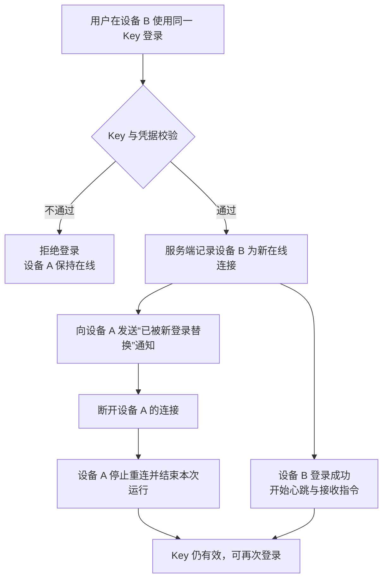

# 云控制器重复登录改为新连接接管

**功能名称**: 云控制器重复登录接管（踢出旧连接）
**PRD 版本**: v1.1
**创建日期**: 2026-11-02
**作者**: ZeroAsh Agent（需求来源：[Deliay/z-agent-gear#386](https://github.com/Deliay/z-agent-gear/issues/386)）
**需求来源**: GitHub Issue #386「云控制器重复登录行为变为踢掉之前的链接」

> v1.1 变更：根据 PR #404 评审意见，明确本需求的核心场景是 **controller-api 重启后云容器内客户端自动重连仍被提示「已在线」**，补充该场景的背景、目标、验收标准与边界情况，并同步补充技术方案中的重启链路确认与并发巡检保护。

## 背景与目标

### 1.1 背景

云控制器使用一个控制器 Key 标识一台控制器（本地开发机、服务器或云电脑）。为避免同一个 Key 被两处同时使用导致指令下发错乱，当前产品采用了「一个 Key 同一时间只允许一个在线连接」的策略，但执行方式是：**新连接被拒绝，旧连接保留**。

最典型、最需要优先修复的场景是 **controller-api 重启**：

1. controller-api 重启前，某台云电脑内的控制器已经用 Key 登录并保持在线；
2. controller-api 进程重启后，云电脑内的客户端按既有重连机制自动重连；
3. 服务端仍保留着重启前的在线占用记录，而云电脑内的客户端不会回传重启前保存的恢复凭据；
4. 服务端据此判定「该 Key 已在线」，拒绝这次自动重连，云端客户端只能反复重试或失败退出，用户看到「已经在线」的提示，但旧连接实际上已经随着 controller-api 重启而消失。

这导致**正常的服务端重启会把云电脑控制器挡在门外**，必须等待在线记录超时或人工清理后才能恢复。除重启外，以下同类场景也会触发：

- **新设备/新进程无法登录**：用户重装控制器、重启进程、迁移到另一台机器，或在云电脑重建后重新登录时，只要旧连接还残留在服务端（例如网络中断、进程被强杀、云端连接未及时超时），新连接就会被拒绝，用户只能等待旧连接超时或人工干预。
- **旧连接已经不可用却长期占位**：旧连接可能实际已经失去响应，但在服务端判定离线前仍占用该 Key，形成「幽灵在线」。
- **用户无法自助恢复**：被拒绝后，客户端只能反复重试或退出，用户看不到明确原因，也不知道应该等待多久。

与用户直觉相反：同一个 Key 再次登录，通常意味着用户主动换了设备、重启了进程，**新连接才代表用户当前真实的意图**。

### 1.2 目标

1. **新连接优先**：同一 Key 再次登录时，新连接立即完成登录并进入在线状态；**包括 controller-api 重启后云容器客户端的自动重连**。
2. **旧连接退出**：旧连接在接管发生后被服务端主动断开，并收到明确的「已被新登录替换」通知。
3. **旧连接不再骚扰**：被替换的旧连接不得自动重连形成「抢登」循环；也不得因为被替换而删除 Key、解绑控制器或影响新连接。
4. **凭据校验前置**：只有通过 Key 校验的登录才允许接管，非法 Key 不能踢掉合法在线连接。
5. **既有能力零回归**：心跳、离线判定、会话下发、注销、云电脑生命周期等既有行为保持不变。

### 1.3 成功标准

| 指标 | 目标值 |
|------|--------|
| **controller-api 重启后云容器客户端重连成功率** | **100%（不再出现「已在线」提示，无需等待超时或人工清理）** |
| 重复登录接管成功率 | 100%（同一 Key 的第二次及后续登录均能成功接管） |
| 旧连接被断开时延 | 接管发生后 5 秒内断开并收到替换通知 |
| 非法 Key 误踢次数 | 0 |
| 接管导致的 Key 删除 / 控制器解绑 | 0 |
| 接管后新连接在线状态正确率 | 100%（控制器列表显示为新连接在线） |
| 旧连接自动重连形成抢登循环 | 0（被替换连接不再自动重连） |
| 既有功能回归 | 心跳、离线判定、注销、云电脑生命周期相关验收全部通过 |

## 用户分析

### 2.1 目标用户

- **个人开发者**：在本地电脑、另一台机器或多个终端上使用同一个控制器 Key。
- **云电脑用户**：云电脑重建、迁移或恢复后，以同一 Key 重新登录控制器。
- **平台运维**：需要控制器在线状态与用户实际操作一致，减少「幽灵在线」导致的工单。

### 2.2 用户场景

| 场景 | 用户角色 | 目标 | 痛点 |
|------|----------|------|------|
| controller-api 重启后云容器客户端自动重连 | 云电脑用户 | 客户端自动恢复在线，无需人工干预 | 服务端保留旧在线记录且客户端没有恢复凭据，重连被提示「已在线」 |
| 用户在新设备上使用同一 Key 登录 | 个人开发者 | 新设备立即可用 | 新设备被拒绝，提示「Key 已在线」，无法自助恢复 |
| 用户重装/重启控制器 | 个人开发者 | 重新登录后恢复使用 | 旧进程残留连接未释放，新进程一直登录失败 |
| 云电脑重建后重新登录 | 云电脑用户 | 新云电脑接管旧连接 | 旧云电脑连接已不可达但仍占用 Key |
| 网络抖动导致客户端重连 | 个人开发者 | 重连快速恢复 | 服务端仍认为旧连接在线，拒绝重连 |
| 两个进程同时使用同一 Key | 个人开发者 | 保留最后一次登录，避免双端同时在线 | 无法判断哪一端才是用户当前操作端 |
| 有人使用错误 Key 尝试登录 | 所有用户 | 非法登录不得影响在线控制器 | 担心错误凭据把正常连接踢下线 |

## 功能需求

### 3.1 功能概述

调整同一控制器 Key 的重复登录策略：由「拒绝新连接、保留旧连接」改为「**接受新连接、踢出旧连接**」。接管完成后，新连接立即在线，旧连接收到明确通知后退出，且不删除 Key、不影响新连接。

### 3.2 功能列表

#### 功能点 1: 新登录直接接管在线中的 Key

- **描述**: 当同一 Key 已有在线连接时，新的登录请求通过凭据校验后不再被拒绝，而是立即接管该 Key；新连接登录成功并成为该 Key 唯一的在线连接。**controller-api 重启后云容器客户端自动重连同样适用**：重启后残留的在线记录视为可被新连接覆盖的旧连接。
- **用户价值**: 用户换设备、重启进程、云电脑重建或平台重启后可立即恢复使用，不再等待旧连接超时。
- **验收标准**:
  - [ ] 同一 Key 在已有一处在线连接时，第二处登录能够成功，并收到登录成功响应。
  - [ ] **controller-api 重启后，云容器内客户端自动重连成功，不再出现「已在线」提示，不需要重启容器或人工清理在线记录。**
  - [ ] 接管完成后，控制器列表中该 Key 对应的在线连接为新连接。
  - [ ] 接管后新连接的指令下发、心跳、会话操作均正常。
  - [ ] 接管过程不要求用户等待旧连接超时，也不需要管理员介入。

#### 功能点 2: 旧连接被主动断开并收到替换通知

- **描述**: 接管发生后，服务端主动断开旧连接，并向旧连接发送「当前登录已被新的登录替换」的明确原因；旧连接据此结束本次连接，不再继续发送心跳或接收指令。
- **用户价值**: 用户能明确知道当前设备为什么掉线，而不是无声消失或反复重连。
- **验收标准**:
  - [ ] 接管发生后 5 秒内，旧连接被断开。
  - [ ] 旧连接收到可识别的替换通知（包含「已被新登录替换」语义）。
  - [ ] 旧连接收到通知后不再自动重连；本地控制器进程按服务端终止语义退出，不进入重试循环。
  - [ ] 旧连接被断开后，其后续心跳、指令、会话上报均不再生效。

#### 功能点 3: 被替换不清理凭据与绑定关系

- **描述**: 「被替换」只结束当前这一条连接，不删除 Key、不解除 Key 与控制器/云电脑的绑定，也不清除用户本地配置中的 Key。用户可以用同一 Key 继续在新连接上使用。
- **用户价值**: 换设备或重连不会导致 Key 失效，不需要重新生成或重新绑定。
- **验收标准**:
  - [ ] 接管后 Key 仍然有效，可直接用于后续登录。
  - [ ] 接管后控制器与 Key 的绑定关系保持，控制器名称、归属等既有信息不被重置。
  - [ ] 旧连接收到替换通知后，用户本地配置中的 Key 不被清除。
  - [ ] 接管不会触发「注销成功」「Key 已撤销」等终止语义。

#### 功能点 4: 仅通过校验的登录可以接管

- **描述**: 接管发生在 Key 存在性、凭据、版本等校验通过之后；错误 Key、错误凭据、版本不兼容的登录仍然被拒绝，且不会影响当前在线连接。
- **用户价值**: 防止任意登录请求把正常用户踢下线，保障在线稳定性。
- **验收标准**:
  - [ ] 使用不存在的 Key 登录被拒绝，在线连接不受影响。
  - [ ] 使用错误凭据登录被拒绝，在线连接不受影响。
  - [ ] 使用不兼容版本的控制器登录被拒绝，在线连接不受影响。
  - [ ] 被拒绝的登录不会清理、替换或刷新在线连接的会话状态。

#### 功能点 5: 以最后一次成功登录为准

- **描述**: 同一 Key 在短时间内多次登录（例如连续重启、并发重连）时，以最后一次成功登录为在线连接；此前所有连接均被替换。系统状态始终收敛到「一个 Key 一个在线连接」。
- **用户价值**: 用户反复重启或网络抖动时不会出现双端同时在线或状态错乱。
- **验收标准**:
  - [ ] 连续多次登录后，仅最后成功的一次保持在线。
  - [ ] 任意时刻同一 Key 至多一个连接可以下发/接收控制器指令。
  - [ ] 并发登录不会造成两个连接都认为自己在线，或旧连接反向踢掉新连接。

#### 功能点 6: 接管事件可观测

- **描述**: 服务端记录接管发生的时间、Key 归属、旧连接与新连接标识等信息，便于用户支持与问题排查；用户侧在控制器列表中看到该 Key 当前在线的是新连接。
- **用户价值**: 掉线原因可追溯，减少「为什么突然掉线」的困惑与工单。
- **验收标准**:
  - [ ] 接管发生时产生可检索的日志/审计记录，包含「新连接接管旧连接」语义。
  - [ ] 日志不包含完整 Key 等敏感凭据。
  - [ ] 控制器列表在线状态在接管后与新连接一致。

### 3.3 用户操作流程

### 3.4 页面/界面描述

| 页面 | 描述 | 关键元素 |
|------|------|---------|
| 控制器列表 | 接管后该 Key 对应控制器显示为在线，在线来源为新连接；不新增交互 | 控制器名称、在线状态、最后在线时间 |
| 控制器登录/启动界面（旧设备） | 旧设备被替换后结束本次运行，并提示「已在其他位置登录，本连接已断开」；提示不使用「Key 已失效/已撤销」措辞 | 断开原因提示 |
| 控制器登录/启动界面（新设备） | 登录成功，正常进入运行状态 | 登录成功状态 |
| 云电脑详情 | 云电脑重建后重新登录时，不因旧连接残留而失败；云电脑生命周期不受接管影响 | 云电脑状态 |

### 3.5 异常与边界情况

| 情况 | 预期行为 |
|------|---------|
| **controller-api 重启后，云容器客户端自动重连** | **视为旧连接已被替换：新连接直接接管并成功登录；不提示「已在线」，不需要等待超时或人工清理。旧连接已不存在，不产生额外断开动作。** |
| controller-api 重启期间旧控制器状态尚未落库更新 | 重连后的新连接成为在线状态；后台的离线巡检不得把刚重连的新连接误判为离线或再次断开 |
| 使用错误 Key 或错误凭据登录 | 拒绝新登录，旧连接保持在线，不产生接管 |
| 版本不兼容的控制器登录 | 拒绝新登录，旧连接保持在线 |
| 旧连接实际已离线但服务端尚未判定 | 新登录直接接管，旧连接不产生额外影响 |
| 两次登录几乎同时发生 | 以最后成功写入的登录为准，最终仅一个连接在线；不出现双端互踢循环 |
| 接管后旧连接尝试发送心跳或指令 | 服务端不再接受其心跳与指令，不影响新连接 |
| 旧连接在接管瞬间发送主动注销 | 不因旧连接的注销动作删除 Key 或解除新连接的在线状态 |
| 新连接登录后立即断开 | 该 Key 进入离线状态；用户可再次登录，不受历史接管记录影响 |
| 云电脑控制器被新连接替换 | 只影响控制器连接，不触发云电脑销毁、停止或重建 |
| 旧版本客户端收到替换通知 | 旧版本可能以通用错误结束本次连接；不得因此删除 Key 或形成持续抢登 |
| Key 已被删除/撤销后再登录 | 按现有无效 Key 逻辑拒绝，不涉及接管 |

## 四、非功能需求

### 4.1 性能要求

- 接管判断与旧连接断开在秒级完成，用户侧感知为「新设备立即可用」。
- **controller-api 重启后，云容器客户端应在其正常重连节奏内完成恢复，不引入额外的等待或人工步骤。**
- 接管逻辑不引入额外的明显登录延迟；正常单连接登录性能与现状一致。

### 4.2 安全性要求

- 接管必须以凭据校验通过为前提，非法登录不得影响在线连接。
- 日志与提示中不得输出完整 Key、凭据或令牌。
- 接管不得改变 Key 的所有权、租户/工作区归属与控制器绑定关系。

### 4.3 兼容性要求

- 不改变 Key 的生成、展示、注销流程。
- 被替换连接仍以「服务端终止」语义结束，避免被本地保活机制反复拉起。
- 旧版本控制器与新版本服务端混部时，不得出现两端持续互踢；旧版本行为可降级为「结束本次连接并按通用错误处理」。
- **controller-api 重启、滚动升级等平台侧重启场景不得要求用户重启云容器或重新生成 Key。**
- 云电脑的登录与生命周期行为保持不变，接管只结束控制器登录连接，不影响云电脑的启动、停止、销毁与重建。

## 五、依赖与约束

### 5.1 依赖

- 依赖现有控制器 Key 登录校验与在线状态维护能力。
- 依赖现有控制器客户端对服务端终止通知的处理机制。
- 云电脑重建/恢复链路复用现有控制器 Key 生命周期，无需额外产品流程。

### 5.2 约束

- 「一个 Key 同一时间最多一个在线连接」的产品约束保持不变，仅调整冲突时的处理方向。
- 不新增用户可配置的「允许多端同时在线」开关。
- 不改变 Key 失效、撤销、注销的既有语义。
- 在平台当前部署形态下生效；未来平台扩容或调整部署形态时需另行评估接管行为。

## 六、相关文档

- [技术提案：云控制器重复登录新连接接管](../../engineering/proposals/20261102-feat-controller-session-takeover.md)
- [控制器 WebSocket 契约](../../../contracts/agent-controller-websocket.md)
- [需求来源：GitHub Issue #386](https://github.com/Deliay/z-agent-gear/issues/386)
