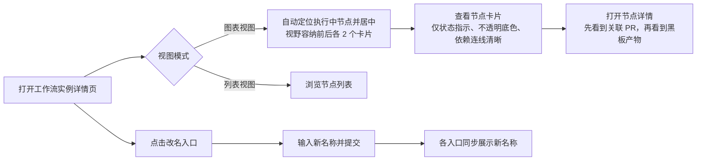
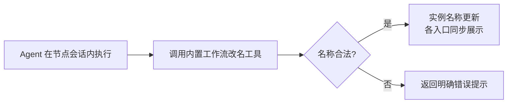

# 工作流迭代

**功能名称**: 工作流迭代
**PRD 版本**: v1.0
**创建日期**: 2026-11-03
**作者**: z-agent-bot
**需求来源**: GitHub Issue [Deliay/z-agent-gear#414](https://github.com/Deliay/z-agent-gear/issues/414)「工作流迭代」

## 背景与目标

### 1.1 背景

工作流功能上线并经过多轮优化后，用户（含工作流内执行的 Agent）在实际使用中积累了一批体验问题：实例创建后名称不可修改，执行中的节点卡片持续滚动思考与输出内容造成视觉噪音，节点间的依赖连线不可见导致流程结构难以辨认，详情中 Pull Request 被排在黑板产物之后不利于评审导向的用法，token 文案「消耗」与实际口径（当前上下文长度）不符，卡片半透明底色在复杂背景下可读性差，进入图表视图后无法直接聚焦正在执行的节点。

### 1.2 目标

一次性解决上述 7 项体验问题，使工作流实例可管理（可改名）、执行状态更聚焦（卡片只呈现状态指示）、结构更清晰（连线可见、卡片不透明）、信息更契合评审场景（PR 优先展示、自动定位执行中节点），并使 token 数值口径与描述一致。

### 1.3 成功标准

- 用户可为任意未删除的工作流实例修改名称，且工作流内执行的 Agent 也能修改所属实例名称，改名后各入口展示一致。
- 执行中的节点卡片不再滚动展示思考/输出文本，仅显示「正在思考」状态指示。
- 图表视图中所有节点依赖连线清晰可见。
- 节点详情中 Pull Request 信息排在黑板产物之前。
- 已完成节点的 token 展示文案为「{} tokens」，不再出现「消耗」字样。
- 节点卡片底色不透明，在任何画布背景下内容清晰可读。
- 打开/切换图表视图时，正在执行的节点卡片自动居中，视野恰好容纳其前、后各 2 个节点卡片。

## 用户分析

### 2.1 目标用户

- 工作流使用者：在平台上编排、执行、跟进工作流实例的用户。
- 工作流内执行的 Agent：作为节点执行者，需要通过内置工作流工具维护实例信息（如按阶段更新实例名称）。

### 2.2 用户场景

| 场景 | 用户角色 | 目标 | 痛点 |
|--|--|--|--|
| 实例进入不同阶段后想标识进展 | 工作流使用者 / Agent | 修改实例名称以反映当前内容 | 名称创建后不可修改 |
| 跟进执行中的工作流 | 工作流使用者 | 快速看到哪个节点在运行 | 卡片滚动播放思考与输出，视觉干扰大 |
| 查看流程结构 | 工作流使用者 | 看清节点依赖关系 | 依赖连线不可见 |
| 评审节点产出 | 工作流使用者 | 优先看到 Pull Request | PR 排在黑板产物之后，需滚动查找 |
| 理解 token 数值 | 工作流使用者 | 正确理解数值含义 | 「消耗」描述与实际口径（当前上下文长度）不符 |
| 复杂背景下阅读卡片 | 工作流使用者 | 卡片内容清晰可读 | 卡片半透明，背景透出干扰阅读 |
| 打开执行中的工作流 | 工作流使用者 | 直接看到执行中的节点及上下文 | 默认视野未定位到执行中节点 |

## 功能需求

### 3.1 功能概述

对工作流实例的展示与操作做一轮迭代：实例名称可修改（人类用户与执行中 Agent 均可），节点卡片动态行收敛为状态指示，修复依赖连线渲染，详情中 Pull Request 前置，token 文案修正口径，卡片底色改为不透明，图表视图自动定位并居中正在执行的节点卡片。

### 3.2 功能列表

#### 功能点 1: 工作流实例改名

- **描述**: 用户可在工作流实例详情页修改实例名称；工作流实例内执行的 Agent 也可通过其内置工作流工具修改所属实例的名称。改名立即生效，列表、详情等所有展示入口同步更新。
- **用户价值**: 实例名称可随工作进展更新（如「需求 X：方案阶段」），便于在列表中识别；Agent 可在完成阶段工作时自助更新名称，无需人工介入。
- **验收标准**:
  - [ ] 实例详情页提供改名入口，提交后名称即时更新，刷新后保持
  - [ ] Agent 在工作流实例会话内可调用内置工作流工具修改所属实例名称，各入口同步展示新名称
  - [ ] 空名称、纯空白名称被拒绝并给出明确提示
  - [ ] 已删除的实例不可改名

#### 功能点 2: 节点卡片动态行收敛为状态指示

- **描述**: 执行中的节点卡片不再滚动显示思考（thinking）与输出（output）内容，只显示「正在思考」的状态指示（含加载动画）。
- **用户价值**: 去除持续滚动的文本噪音，画布更安静；需要查看具体内容时仍可打开节点会话。
- **验收标准**:
  - [ ] 执行中的 AI 节点卡片仅显示「正在思考」指示，不出现思考或输出的具体文本
  - [ ] 卡片不再因文本滚动而内容抖动
  - [ ] 节点会话入口不受影响，用户仍可通过详情/会话查看完整内容

#### 功能点 3: 修复节点依赖连线不可见

- **描述**: 修复图表视图中节点之间依赖关系连线不显示的问题，使每条依赖边清晰可见（含方向箭头）。
- **用户价值**: 流程结构一目了然，能理解节点执行顺序与依赖。
- **验收标准**:
  - [ ] 图表视图中每对存在依赖关系的节点之间均渲染连线与箭头
  - [ ] 连线在浅色/深色主题下均清晰可见
  - [ ] 执行中节点的入边保持高亮/动画效果

#### 功能点 4: 节点详情中 Pull Request 优先于黑板产物

- **描述**: 节点详情中，关联的 Pull Request 信息排在黑板产物之前展示。
- **用户价值**: 评审导向的用法下，打开详情即可直达 PR，不必滚过黑板产物。
- **验收标准**:
  - [ ] 同时存在关联 PR 与黑板产物时，PR 区块在前
  - [ ] 仅存在其中一类信息时展示不受影响

#### 功能点 5: token 文案口径修正

- **描述**: 节点卡片完成态的 token 文案由「消耗 {} tokens」改为「{} tokens」（该数值实际为会话当前上下文长度，并非消耗量）。
- **用户价值**: 文案与口径一致，避免误导用户把上下文长度理解为累计消耗。
- **验收标准**:
  - [ ] 已完成节点展示「{} tokens」，不出现「消耗」字样
  - [ ] 无数值时的展示（仅「已完成」）不受影响

#### 功能点 6: 节点卡片不透明

- **描述**: 节点卡片底色改为不透明，状态色仍通过状态色脊与状态徽标表达。
- **用户价值**: 复杂画布背景下卡片内容清晰可读，不被透出内容干扰。
- **验收标准**:
  - [ ] 卡片底色不透明，任何背景下文字清晰
  - [ ] 状态色脊与状态徽标的语义配色保持不变
  - [ ] 浅色/深色主题下均正常

#### 功能点 7: 图表视图自动定位执行中节点

- **描述**: 打开图表视图（或执行中节点发生切换）时，视图自动定位，使正在执行的节点卡片居中，且视野恰好容纳该节点前、后各 2 个节点卡片；没有执行中节点时保持整体视野。
- **用户价值**: 进入工作流即聚焦当前进展，并能看到紧邻的上下游上下文，无需手动寻找。
- **验收标准**:
  - [ ] 存在执行中节点时，首屏视图以其为中心，视野容纳前、后各 2 个节点卡片
  - [ ] 执行中节点切换（上一节点完成、下一节点开始）时，视图自动切换到新的执行中节点
  - [ ] 不存在执行中节点时，保持现有整体视野行为
  - [ ] 用户手动平移/缩放不被持续打断（仅在执行中节点变化时重新定位）

### 3.3 用户操作流程

### 3.4 页面/界面描述

| 页面 | 描述 | 关键元素 |
|------|------|---------|
| 工作流实例详情页 | 标题区新增改名入口；图表视图自动定位执行中节点 | 实例名称、改名入口、视图切换、图表画布 |
| 图表视图节点卡片 | 不透明底色；执行中仅显示「正在思考」指示；完成态显示「{} tokens」；依赖连线与箭头可见 | 状态色脊、状态徽标、状态指示、token 文案、连线 |
| 节点详情 | 关联 Pull Request 区块排在黑板产物区块之前 | PR 区块、产物区块 |

### 3.5 异常与边界情况

| 情况 | 预期行为 |
|------|---------|
| 改名为空白名称 | 拒绝并提示名称不能为空 |
| 已删除实例改名 | 拒绝并提示实例已删除 |
| 多个节点同时执行中 | 视野定位首个执行中节点（其余仍可通过平移查看） |
| 执行中节点位于图首/图尾，前/后不足 2 个卡片 | 视野容纳实际存在的相邻卡片即可 |
| 无执行中节点（未开始/已完成/已阻断） | 保持整体视野，不做定位 |
| 节点无 token 数值 | 仅显示「已完成」，不显示 token 文案 |

## 四、非功能需求

### 4.1 性能要求

- 视图自动定位不得引起画布持续抖动；仅在执行中节点集合变化时触发一次定位。
- 卡片动态行收敛后，执行中卡片的渲染频率不高于现状。

### 4.2 安全性要求

- 改名仅允许实例所有者及该实例会话内的 Agent 发起；不得越权修改他人实例。

### 4.3 兼容性要求

- 浅色与深色主题下连线、卡片底色、文案均正常展示。
- 移动端与桌面端行为一致（图表视图为桌面端主要场景，移动端保持可用手势平移缩放）。

## 五、依赖与约束

### 5.1 依赖

- 现有工作流实例、节点状态、黑板、Pull Request 联动等能力均已上线，本次为其上的展示与操作迭代。

### 5.2 约束

- 不改变工作流节点状态机与执行语义，本次仅涉及名称维护与展示层调整。
- 不改 token 数值的采集口径，仅修正展示文案。

## 六、相关文档

- 需求来源：[Deliay/z-agent-gear#414](https://github.com/Deliay/z-agent-gear/issues/414)
- 技术提案：`docs/engineering/proposals/20261103-feat-workflow-iteration.md`
