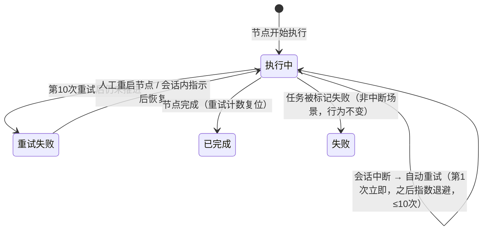
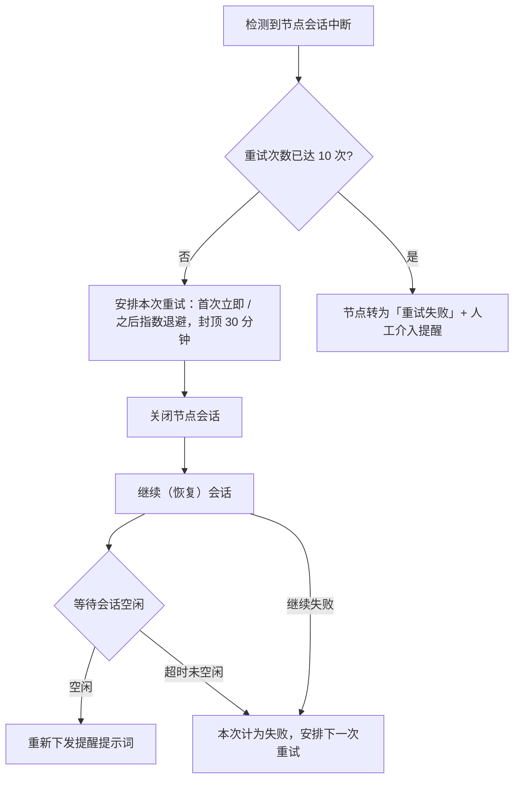

# 工作流节点中断处理迭代（Workflow Node Interruption Retry）

**功能名称**: 工作流节点中断处理迭代
**PRD 版本**: v1.0
**创建日期**: 2026-11-03
**作者**: ZeroAsh Agent（需求来源：[Deliay/z-agent-gear#407](https://github.com/Deliay/z-agent-gear/issues/407)）

## 一、背景与目标

### 1.1 背景

Agent 工作流中，AI 节点由平台拉起的 Agent 会话执行。节点执行期间，会话可能因为多种原因中断、节点停在「执行中/返工中」不再推进，例如：Agent 进程异常退出、权限审批超时导致本轮执行停止、会话被意外结束等。

当前平台对这类中断的处理方式是：**最多自动恢复 1 次**——系统检测到会话中断后，直接在原会话上补发一条提醒提示词；如果会话再次中断，就将节点标记为「失败」，阻断整个工作流并等待人工介入。

这一行为在实际使用中暴露出两个问题：

1. **仅 1 次恢复机会，容错不足**：偶发性中断（网络抖动、进程重启、资源竞争、审批超时等）占比不低，很多本可自愈的中断在第二次发生时就被判为失败，工作流频繁被打断、人工介入成本高。
2. **直接补发提示词的恢复成功率有限**：被中断的原会话本身可能已处于不健康状态（卡在审批、进程状态残留），在其上直接追加提示词往往无法让会话真正恢复运转。

### 1.2 目标

1. **中断自动恢复能力增强**：工作流中断后最多自动重试 10 次；第一次中断立即重试，之后重试间隔指数增大，单次重试间隔最长 30 分钟。
2. **重试方式迭代**：自动重试不再直接在原会话上补发提示词，改为「关闭当前会话 → 继续（恢复）该会话 → 等待会话回到空闲 → 重新下发提示词」，以干净、完整的会话上下文提高恢复成功率。
3. **新增节点状态「重试失败」**：重试次数用尽后节点转入「重试失败」状态，不再自动重试，流程阻断并明确提醒人工处理；人工可通过既有入口恢复（重启节点 / 在会话中给出指示后恢复）。

### 1.3 成功标准

- 偶发中断的 AI 节点在 10 次自动重试预算内恢复并继续推进，全程无需人工介入。
- 重试节奏符合「首次立即、之后指数增大、单次间隔封顶 30 分钟」；用户可在节点上看到重试进度。
- 第 10 次重试后节点仍未推进时，节点进入「重试失败」状态、产生人工介入提醒，且不再发生任何自动重试。
- 人工对「重试失败」节点执行「重启节点」或在会话中给出指示恢复后，节点回到「执行中」、重试计数重新开始。
- 平台服务重启后，尚未到期的自动重试计划不丢失、到期照常执行。

## 二、用户分析

### 2.1 目标用户

- **个人开发者**：使用工作流自动串联需求开发流程，希望工作流长跑稳定、偶发中断自愈。
- **进阶用户**：自定义工作流模板与节点编排，关注节点状态的可观测性与失败后的恢复手段。

### 2.2 用户场景

| 场景 | 用户角色 | 目标 | 痛点 |
|--|--|--|--|
| 发起长跑工作流后离开电脑 | 开发者 | 偶发中断自动恢复，回来看到流程继续推进 | 中断第 2 次发生节点即失败，回来发现流程早已阻断 |
| 节点因审批超时反复停滞 | 开发者 | 系统多给几次恢复机会，而不是立刻判失败 | 只有 1 次自动恢复机会，容错不足 |
| 节点确实无法自愈 | 开发者 | 系统在真正用尽手段后才提醒，并给出明确处理入口 | 「失败」语义混杂，分不清是任务本身失败还是中断恢复失败 |
| 查看中断中的节点 | 开发者 | 看到自动重试进度与当前状态 | 重试过程不可见，不知道系统是否在处理 |

## 三、功能需求

### 3.1 功能概述

迭代工作流 AI 节点会话中断的自动恢复机制：自动重试次数由 1 次提升为 10 次并引入指数退避节奏；重试动作由「直接补发提示词」改为「关闭并继续会话、待空闲后重发提示词」；重试次数用尽后节点转入新状态「重试失败」，停止自动重试并转入人工处理流程。

### 3.2 功能列表

#### 功能点 1：中断自动重试（最多 10 次 + 指数退避）

- **描述**: AI 节点会话发生中断（会话意外结束、或会话已空闲但节点未推进）时，平台自动发起恢复重试：
  - 第 1 次中断**立即**重试；
  - 第 2 次起重试间隔按指数增大；
  - 单次重试间隔封顶 **30 分钟**（达到后保持 30 分钟一次）；
  - 每个节点累计最多自动重试 **10 次**；
  - 节点发生有效推进或人工操作（完成、打回、返工、重启、恢复）后，重试计数复位，之后再次中断重新按 10 次预算计算。
- **用户价值**: 偶发中断有充分的自愈窗口，工作流长跑不再轻易被一次性故障阻断；指数退避避免对异常会话进行密集无效重试。
- **验收标准**:
  - [ ] 节点会话首次中断后立即触发第 1 次自动重试。
  - [ ] 后续重试间隔逐次指数增大，达到 30 分钟后保持每次 30 分钟。
  - [ ] 同一节点第 10 次重试执行后仍未推进时，不再发起第 11 次自动重试。
  - [ ] 节点完成/被重启/被恢复等之后，重试计数清零。

#### 功能点 2：重试方式迭代（关闭并继续会话后重发提示词）

- **描述**: 每次自动重试不再直接向原会话补发提示词，而是按固定顺序执行恢复动作：
  1. **关闭**当前节点会话；
  2. **继续**（恢复）该会话；
  3. **等待会话回到空闲**状态；
  4. 会话空闲后，**重新下发提醒提示词**，引导其完成当前节点操作。

  等待空闲设有超时保护：超过时限仍未空闲，视为本次重试失败，计入重试次数并按退避节奏安排下一次重试。
- **用户价值**: 以干净、完整重建的会话上下文恢复执行，避免在已不健康的会话上无效补发，恢复成功率更高。
- **验收标准**:
  - [ ] 每次自动重试均按「关闭 → 继续 → 等待空闲 → 重发提示词」顺序执行，不直接在运行中的原会话上补发。
  - [ ] 原会话已结束的中断场景，跳过关闭步骤直接继续会话。
  - [ ] 等待空闲超时未完成时，本次重试计为失败并进入下一次重试安排。
  - [ ] 重试期间会话被人工操作（重启节点、删除实例等）时，放弃本次重试后续动作。

#### 功能点 3：节点状态「重试失败」

- **描述**: 新增节点状态「重试失败」。节点第 10 次自动重试后仍未推进时，由「执行中/返工中」转入「重试失败」：
  - **流程阻断**：下游节点不会激活（与「失败」一致）；
  - **不再自动重试**：该状态下系统不再发起任何自动恢复动作；
  - **明确区别于「失败」**：界面独立展示「重试失败」，用户能区分「任务本身被标记失败」与「中断自动恢复已用尽」；
  - **人工处理入口**：与「失败」状态一致的恢复路径——可「重启节点」（关闭旧会话、以全新会话重新执行，支持调整执行配置），或在节点会话中给出指示后恢复执行；
  - **人工介入提醒**：进入「重试失败」时产生人工介入待办提醒。
- **用户价值**: 自动恢复与人工接管边界清晰；状态语义准确，排查与处理更高效。
- **验收标准**:
  - [ ] 重试次数用尽的节点状态为「重试失败」，界面以独立文案与配色展示。
  - [ ] 「重试失败」节点不再发生自动重试，下游节点保持等待。
  - [ ] 「重试失败」节点可执行「重启节点」，重启后回到「执行中」且重试计数清零。
  - [ ] 「重试失败」节点可在会话中经人工指示后恢复执行。
  - [ ] 进入「重试失败」时产生人工介入待办。

#### 功能点 4：重试过程可见性

- **描述**: 节点执行期间发生自动重试时，节点上可见重试进度（已用重试次数/总次数，以及下一次重试的预计时间）；「重试失败」节点在待办中有明确提醒。
- **用户价值**: 用户随时掌握系统是否在自动处理、处理到哪一步，减少误判与重复干预。
- **验收标准**:
  - [ ] 自动重试排期中的节点可见当前为第几次重试及下次重试时间。
  - [ ] 无重试计划的节点不展示重试信息。
  - [ ] 「重试失败」节点产生的人工介入待办可见且可定位到对应节点。

### 3.3 用户操作流程

节点中断自动恢复状态机：

单次自动重试的执行流程：

### 3.4 页面/界面描述

| 页面 | 描述 | 关键元素 |
|------|------|---------|
| 工作流实例详情 | 节点状态新增「重试失败」展示；重试排期中的节点展示重试进度 | 「重试失败」状态徽标（区别于「失败」）；重试次数与下次重试时间 |
| 节点详情 | 展示中断自动重试的执行情况 | 已用重试次数、下次重试时间、重试失败原因摘要 |
| 待办列表 | 「重试失败」节点的人工介入提醒 | 待办条目含工作流与节点信息，可定位到节点 |

### 3.5 异常与边界情况

| 情况 | 预期行为 |
|------|---------|
| 重试排期/执行期间人工重启、打回或恢复节点 | 取消后续自动重试安排，按人工操作结果推进 |
| 工作流实例被删除 | 该实例全部自动重试计划取消，不再执行 |
| 重试执行中会话无法继续（控制器离线、会话已被移除等） | 本次重试计为失败，按退避节奏安排下一次；用尽后转「重试失败」 |
| 等待会话空闲超时 | 本次重试计为失败，计入重试次数并安排下一次 |
| 平台服务重启 | 未到期的重试计划保留，到期照常执行；等待空闲中的重试按超时口径处理 |
| 节点因非中断原因失败（AI 主动标记失败、会话启动失败被移除） | 维持现有「失败」语义与处理路径，不进入自动重试 |
| 人类节点、旗帜节点 | 无会话机制，不涉及本功能，行为不变 |

## 四、非功能需求

### 4.1 性能要求

- 重试计时精度为分钟级；自动重试的调度与执行不得阻塞同实例及其他实例节点的正常推进。
- 重试间隔最长 30 分钟，单个节点 10 次重试的最长恢复窗口约 2 小时。

### 4.2 安全性要求

- 无新增安全面：重试动作复用既有会话关闭/继续/消息下发能力，权限模型不变。

### 4.3 兼容性要求

- 存量「失败」状态语义与人工恢复路径不变。
- 已存在的工作流实例（含执行中的节点）升级后自动适用新重试机制；历史节点状态数据不受影响。
- 节点状态集合新增「重试失败」，历史实例不出现该状态。

## 五、依赖与约束

### 5.1 依赖

- 现有 Agent 工作流（节点状态机、黑板、人工介入待办）。
- 现有节点会话生命周期事件（会话结束、会话空闲、会话被移除）。
- 现有「重启节点」与「失败后恢复」人工处理入口。

### 5.2 约束

- 本功能仅适用于 AI 节点；人类节点与旗帜节点不涉及。
- 自动重试仅针对「中断」类场景（会话意外结束 / 空闲未推进）；任务被主动标记失败、会话启动失败被移除的场景维持原有「失败」路径。
- 重试节奏参数（10 次、首次立即、指数退避、封顶 30 分钟）为产品定义口径，调整需修订本文档。

## 六、相关文档

- 需求来源：[Deliay/z-agent-gear#407 — 工作流中节点中断处理迭代](https://github.com/Deliay/z-agent-gear/issues/407)
- 技术提案：[[../../engineering/proposals/20261103-feat-workflow-node-interrupt-retry.md]]
- 关联 PRD：[[../released/20260808-agent-workflow.md]] — Agent 工作流
- 关联 PRD：[[20260821-workflow-optimization.md]] — 工作流优化 0821
