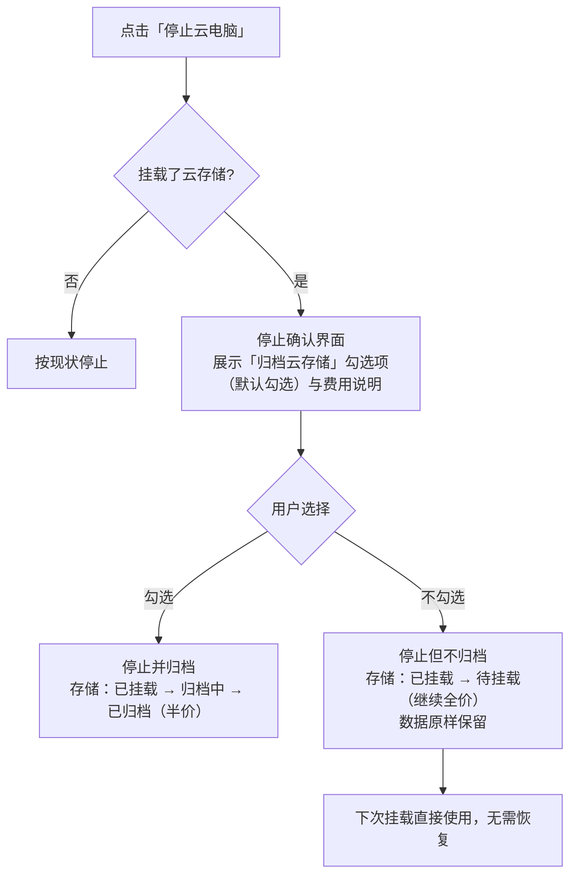
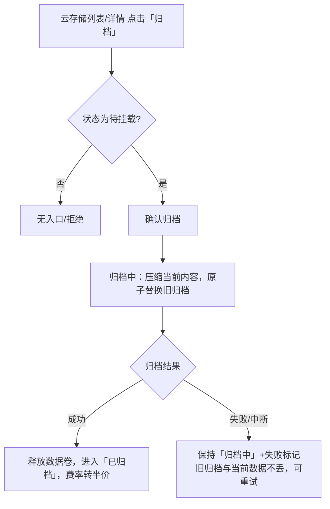
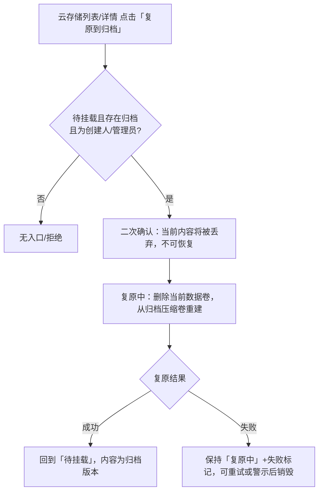
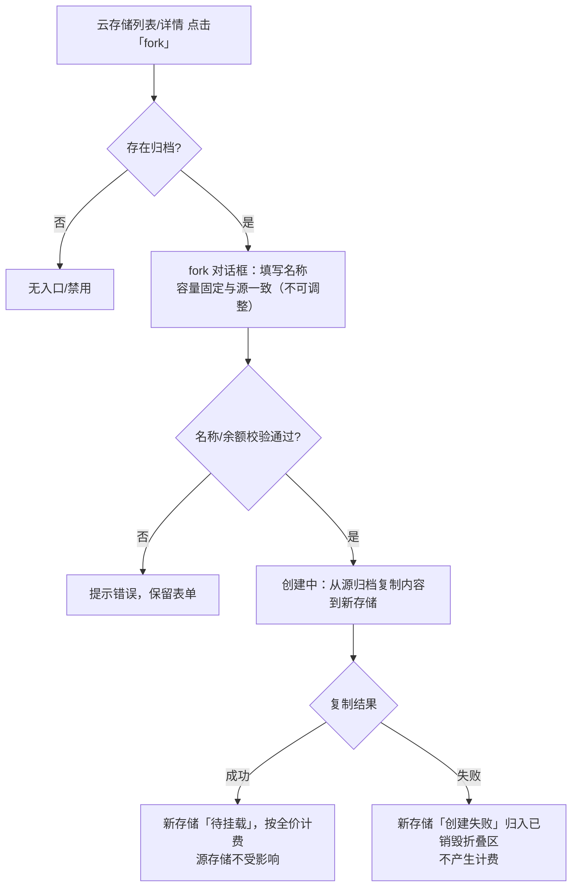

# 云存储归档优化

**功能名称**: 云存储归档优化（停止归档可选 + 归档/复原/fork 操作）
**PRD 版本**: v1.0
**创建日期**: 2026-11-04
**作者**: z-agent-bot
**需求来源**: GitHub Issue [Deliay/z-agent-gear#434](https://github.com/Deliay/z-agent-gear/issues/434)「云存储归档优化」

## 背景与目标

### 1.1 背景

云存储（[[20261102-cloud-storage]]）上线后，云电脑销毁时**强制归档**：主目录整体压缩为 `.tar.gz2` 写入工作区归档空间、释放源存储、费率转半价。实际使用中暴露出三个问题：

1. **归档被强制且不可跳过**：用户只是短暂停止云电脑（换个配置再开、临时释放资源），数据下次还要原样用，却被迫等待「压缩 → 下次挂载再解压恢复」的完整往返。数据量越大，停止与再次可用之间的等待越长。
2. **闲置存储只能二选一**：一块不再挂载但暂时不想销毁的存储，只能保持「待挂载」按全价计费，或整体销毁。缺少「把当前内容归档起来、费率转半价」的主动入口。
3. **归档内容没有再利用手段**：归档只服务于「同一块存储的下次挂载」。用户无法把存储内容回滚到归档版本（误删/污染环境后反悔），也无法从一份归档复制出一块新存储（把一份环境/数据复制给另一台云电脑或另一位成员）。

### 1.2 目标

1. **停止时归档可选**：停止挂载了云存储的云电脑时，提供「归档云存储」勾选项——勾选则按现有逻辑归档；不勾选则云电脑删除后存储直接回到「**待挂载**」，数据原样保留在存储中，下次挂载即可用，**期间照常计费（全价）**。
2. **可主动归档**：「待挂载」状态的存储提供「归档」操作，把当前内容归档（与停止时勾选归档完全同逻辑：原子替换旧归档、释放数据卷、费率转半价）。
3. **可回滚到归档版本**：存在归档的存储提供「复原到归档」操作——丢弃当前内容，从归档压缩卷重建，用于误操作后的反悔。
4. **可复制归档**：存在归档的存储提供「fork」操作——从归档复制出一块**新的**云存储，容量与源一致、不可调整，用于环境/数据复制。
5. **口径一致、状态透明**：三个操作与停止勾选归档复用同一套归档/恢复语义与计费口径；过程中存储有明确状态与结果反馈。

### 1.3 成功标准

| 指标 | 目标值 |
|------|--------|
| 停止云电脑（不勾选归档）后存储进入「待挂载」且数据原样保留 | 100% |
| 停止云电脑（勾选归档）行为与现状一致 | 全部回归通过，零变化 |
| 不勾选归档的存储在「待挂载」期间持续按全价出账 | 账单口径一致率 100% |
| 手动归档与原销毁归档产物一致（原子替换、释放数据卷、费率半价） | 100% |
| 复原到归档后存储内容与归档版本一致 | 100% |
| fork 产生的新存储内容与源归档一致、容量与源一致 | 100% |
| 归档/复原/fork 失败时旧归档与原数据不丢失 | 100% |
| 未挂载云存储的云电脑停止流程回归 | 零变化 |

## 用户分析

### 2.1 目标用户

- **前台注册用户（开发者）**：频繁停止/重建云电脑，需要快速停机而不必每次归档往返；需要误操作后的回滚手段。
- **团队工作区成员**：需要把一份环境/数据集从归档复制给另一台云电脑使用（fork）。
- **成本敏感用户**：存储闲置时希望主动归档转半价，而不是必须挂一台云电脑再销毁。

### 2.2 用户场景

| 场景 | 用户角色 | 目标 | 痛点 |
|------|----------|------|------|
| 短暂停止后原样继续使用 | 前台用户 | 停止云电脑但不归档，下次挂载数据原样在 | 强制归档带来压缩/解压往返等待 |
| 环境误删/污染后反悔 | 前台用户 | 把存储内容回滚到最近一次归档 | 归档只能在新挂载时恢复，无法主动回滚 |
| 闲置存储降本 | 前台用户 | 不挂载的情况下直接把存储归档转半价 | 只有销毁云电脑才会触发归档 |
| 复制一份环境给另一台云电脑 | 前台用户/团队成员 | 从归档复制一块新存储挂载使用 | 归档无法复制，只能人工搬运数据 |
| 停止时明确费用差异 | 前台用户 | 停止前知道「归档后半价 / 不归档继续全价」 | 停止对话框无存储费用提示 |

## 功能需求

### 3.1 功能概述

本需求在云存储（[[20261102-cloud-storage]]）基础上做两处增强：

1. **停止云电脑时归档可选**：停止挂载了云存储的云电脑时，停止确认界面提供「归档云存储」勾选项（**默认勾选**，与现状一致）。不勾选时，云电脑删除后存储直接回到「待挂载」，数据原样保留在存储中、**继续按全价计费**，下次挂载直接使用、无需恢复；勾选时行为与现状完全一致（归档、释放数据卷、费率转半价）。
2. **云存储三个新操作**：云存储设置界面按状态提供「归档」「复原到归档」「fork」：
   - **归档**（待挂载可用）：把当前内容归档，与「停止云电脑时勾选归档」逻辑一致；
   - **复原到归档**（待挂载且存在归档时可用）：丢弃当前内容，删除当前数据卷并从归档压缩卷重建；
   - **fork**（存在归档时可用，含已归档）：从归档复制一块新云存储，**容量与源一致、规格不可调整**，创建后为「待挂载」并按全价计费。

状态机在原有基础上新增瞬态「**复原中**」（复原到归档执行期间）；「待挂载 → 归档中 → 已归档」手动归档路径与停止归档路径完全同构。

### 3.2 功能列表

#### 功能点 1: 停止云电脑时归档可选

- **描述**: 停止挂载了云存储的云电脑时，停止确认界面展示「归档云存储」勾选项与费用说明：
  - **勾选（默认）**：与现状一致——云电脑销毁后自动归档（原子替换旧归档、释放数据卷），存储进入「已归档」并按半价计费；
  - **不勾选**：云电脑删除后存储直接回到「**待挂载**」，数据原样保留在存储中，**继续按全价计费**；下次挂载该存储直接使用其中的数据，无需恢复等待；
  - 勾选项仅在云电脑挂载了云存储时出现；未挂载时停止流程与现状完全一致；
  - 勾选状态随「继续停止」一并提交，停止后立即生效、不可中途更改；
  - **非用户主动停止**（运行失败、欠费强拆等系统销毁）**仍自动归档**，保持数据兜底语义不变。
- **用户价值**: 短暂停机不必付出归档/恢复往返的时间成本；费用差异（全价 vs 半价）在停止前明示。
- **验收标准**:
  - [ ] 停止挂载云存储的云电脑时，确认界面出现「归档云存储」勾选项，默认勾选
  - [ ] 勾选项附带费用说明：勾选 = 归档后半价；不勾选 = 回到待挂载并继续全价
  - [ ] 不勾选停止后：存储状态为「待挂载」、数据原样保留、下次挂载无需恢复即可用、账单继续按全价出账
  - [ ] 勾选停止后：行为与现状完全一致（归档中原子替换、已归档半价）
  - [ ] 未挂载云存储的云电脑停止界面不出现勾选项，行为零变化
  - [ ] 失败/欠费强拆等非主动销毁仍自动归档

#### 功能点 2: 云存储「归档」操作（待挂载 → 已归档）

- **描述**: 「待挂载」状态的存储在列表与详情提供「归档」操作：
  - 确认后把存储当前内容压缩归档，**与停止云电脑时勾选归档的逻辑完全一致**：原子替换旧归档（中断/失败不破坏旧归档与原数据）、归档成功后释放数据卷、费率转半价；
  - 归档期间存储显示「归档中」，不可挂载、不可销毁、不可执行其他操作；
  - 归档失败保持「归档中」并标注失败原因，可重试；归档成功后进入「已归档」。
- **用户价值**: 闲置存储不必挂载云电脑再销毁即可转入半价归档态，降本路径直接。
- **验收标准**:
  - [ ] 「待挂载」存储可见「归档」入口；其他状态（已挂载/归档中/已归档/复原中）无此入口
  - [ ] 归档成功后存储进入「已归档」，旧归档被原子替换，账单转为半价
  - [ ] 归档中断/失败时旧归档与当前数据不丢失，可重试并成功
  - [ ] 从未挂载过的存储也可归档（归档内容为初始空环境）

#### 功能点 3: 云存储「复原到归档」操作（回滚到归档版本）

- **描述**: 「待挂载」且**存在归档**的存储提供「复原到归档」操作：
  - 二次确认，明确提示「当前内容将被丢弃并回滚到归档版本，不可恢复」；
  - 执行时删除当前数据卷、从归档压缩卷重建，期间存储显示「**复原中**」，不可挂载、不可销毁、不可执行其他操作；
  - 复原成功后存储回到「待挂载」，内容为归档版本；归档本身保持不动；
  - 复原失败时存储保持「复原中」并标注失败原因，可重试（重新从归档重建），也可在明确警示后销毁；
  - 复原为**丢弃当前数据**的破坏性操作，仅创建人与工作区管理员可执行。
- **用户价值**: 误删文件、污染环境后可一键回滚到最近一次归档，不必销毁重建。
- **验收标准**:
  - [ ] 「待挂载」且有归档的存储可见「复原到归档」入口；无归档时不可见或禁用
  - [ ] 复原需二次确认并明确提示数据将被丢弃
  - [ ] 复原成功后存储内容与归档版本一致，状态回到「待挂载」
  - [ ] 复原失败可重试；重试仍从归档完整重建
  - [ ] 非创建人且非工作区管理员无此入口，绕过提交被拒绝

#### 功能点 4: 云存储「fork」操作（从归档复制新存储）

- **描述**: 存在归档的存储（「待挂载」或「已归档」）提供「fork」操作：
  - 打开 fork 对话框，填写新存储**名称**（同一工作区不可重名）；容量固定与源存储一致、**不可调整**，对话框如实展示；
  - 确认后从源存储的当前归档复制创建一块新存储：新存储内容为该归档版本，创建成功即为「待挂载」并开始按全价计费；
  - fork 期间源存储不受任何影响（不归档、不复原、状态不变）；
  - fork 失败时新存储标记「创建失败」（归入已销毁折叠区），不产生计费，源存储与归档不受影响；
  - 余额不足以承担新存储首小时费用时拒绝创建。
- **用户价值**: 一份归档可以复制出多块存储，环境/数据集可分发到多台云电脑或多位成员。
- **验收标准**:
  - [ ] 有归档的存储可见「fork」入口；无归档的存储不可见或禁用
  - [ ] fork 对话框容量与源一致且不可编辑，名称按既有规则校验（含重名）
  - [ ] fork 成功：新存储为「待挂载」、内容与源归档一致、容量与源一致、开始按全价计费
  - [ ] fork 失败：新存储归入「已销毁」折叠区并展示原因、不产生计费，源存储与归档不受影响
  - [ ] 余额不足时 fork 被拒绝并提示

### 3.3 用户操作流程

#### 停止云电脑（归档可选）

#### 手动归档（待挂载 → 已归档）

#### 复原到归档（回滚）

#### fork（从归档复制新存储）

### 3.4 页面/界面描述

| 页面 | 描述 | 关键元素 |
|------|------|---------|
| 停止云电脑确认界面 | 停止挂载云存储的云电脑 | 「归档云存储」勾选项（默认勾选）、勾选/不勾选的费用说明（归档后半价 / 待挂载继续全价）、既有活动会话告警 |
| 设置 - 云存储列表 | 每行按状态提供操作 | 待挂载：「归档」「复原到归档」（有归档时）「fork」（有归档时）；已归档：「fork」；已挂载/归档中/复原中：无上述操作；既有「详情」「销毁」不变 |
| 云存储详情 | 单块存储管理 | 同列表操作入口；状态含「复原中」；归档/复原失败原因与重试入口 |
| fork 对话框 | 从归档复制新存储 | 名称输入、容量展示（与源一致、不可编辑）、每小时费用（全价/归档半价）、确认提示「创建成功即开始计费」 |
| 复原到归档确认 | 破坏性操作确认 | 明确提示「当前内容将被丢弃并回滚到归档版本，不可恢复」 |

### 3.5 异常与边界情况

| 情况 | 预期行为 |
|------|---------|
| 停止时不勾选归档 | 存储回「待挂载」，数据原样保留，继续全价计费；下次挂载直接使用 |
| 不勾选停止后再次挂载 | 与挂载普通「待挂载」存储一致，无恢复等待 |
| 不勾选停止后想转为半价 | 在「待挂载」状态使用「归档」操作 |
| 不勾选停止后想回滚到旧归档 | 在「待挂载」状态使用「复原到归档」（丢弃当前内容） |
| 非主动销毁（失败/欠费强拆） | 仍自动归档（数据兜底），不提供勾选 |
| 停止勾选状态提交后服务异常 | 停止失败保持可重试；勾选项随重试一并提交 |
| 手动归档/复原进行中尝试挂载 | 不出现在可选列表，绕过提交被拒绝 |
| 手动归档/复原进行中尝试销毁 | 不可销毁；失败后可先重试，或在额外警示后销毁 |
| 复原时归档损坏/容量异常 | 复原失败并标注原因，归档保持不动，可重试 |
| fork 时源归档正被新归档替换 | 由平台串行化归档类操作；fork 读取的是确认时的归档版本，失败可重试 |
| fork 名称与现有存储重名 | 创建失败并提示名称已存在 |
| fork/复原/归档并发点击 | 同一存储同一时刻只执行一个操作，其余被拒绝或禁用 |
| 已挂载存储尝试归档/复原/fork | 无入口；需先停止云电脑（停止时可勾选归档） |
| 无归档存储尝试复原/fork | 无入口或禁用 |
| 余额不足时 fork | 拒绝创建并提示余额不足 |
| 只读角色（全局工作区开发者） | 不可执行归档/复原/fork，仅可查看 |

## 四、非功能需求

### 4.1 性能要求

- 不勾选归档的停止流程耗时不高于现状（少了归档等待，停止应更快感知完成）。
- 手动归档/复原/fork 均为异步过程，耗时随数据量增长，不设固定上限；期间持续展示对应进行中状态。
- 同一工作区的归档类操作（归档/复原/fork 恢复）串行执行，与既有「归档为单工作区串行」口径一致。

### 4.2 安全性要求

- 「复原到归档」丢弃当前数据，仅创建人与工作区管理员可执行且必须二次确认。
- 「归档」「fork」为工作区成员操作（只读角色除外）；所有权限判定以服务端为准。
- fork/复原只读取归档内容，不向用户暴露归档文件本体；界面只展示归档元信息。
- 跨工作区不可见、不可操作，与既有口径一致。

### 4.3 兼容性要求

- 未挂载云存储的云电脑停止流程与现状完全一致。
- 旧版客户端不传归档勾选项时，停止行为保持现状（视为勾选归档）。
- 既有「待挂载/已挂载/归档中/已归档/已销毁」状态语义不变；新增「复原中」为瞬态。
- 既有计费口径不变：待挂载/已挂载/归档中/复原中全价，已归档半价。

## 五、依赖与约束

### 5.1 依赖

- 云存储基础能力（[[20261102-cloud-storage]]）：状态机、归档原子替换、挂载恢复、阶梯计费与归档半价。
- 费用中心（Credits 计费）（[[20261018-credits-billing]]）。
- 多租户工作区与角色体系（[[20261028-multi-tenant-phase2]]）。

### 5.2 约束

- **不归档口径**：不勾选归档时存储回到「待挂载」并继续全价计费（需求原文「同时也需要计费」）；数据保留在存储中，平台不再额外生成归档。
- **非主动销毁仍归档**：运行失败、欠费强拆等系统销毁不提供勾选，保持自动归档作为数据兜底。
- **操作互斥**：同一存储同一时刻只允许一个归档类操作（归档/复原/fork 恢复/挂载/销毁）。
- **fork 规格**：新存储容量与源一致且不可调整（需求原文「规格无法调整」）；名称可自定。
- **复原语义**：「复原到归档」= 丢弃当前内容、从归档重建（需求原文「删除当前 PVC，然后从归档的压缩卷里重建」）；归档本身不动。
- **按钮可见性（评审确认项）**：需求原文表述为「每个已归档的云存储增加三个按钮」，本 PRD 按状态可用性落为：待挂载可见「归档」（+有归档时「复原到归档」「fork」），已归档可见「fork」；已挂载不直接提供，需先停止云电脑。若评审要求其他口径，在此修订。
- **归档单份**：每块存储仍只保留一份最新归档，fork/复原读取的都是该份归档。

## 六、相关文档

- [技术提案](../../engineering/proposals/20261104-feat-cloud-storage-archive-optimization.md)
- [[20261102-cloud-storage]] — 云电脑支持申请存储（云存储）
- [[20261018-credits-billing]] — 费用中心（Credits 计费）
- [[20261028-multi-tenant-phase2]] — 多租户二期（工作区与角色）
- [[../AGENTS.md]] — 产品文档管理规范
- [需求来源：GitHub Issue #434](https://github.com/Deliay/z-agent-gear/issues/434)
