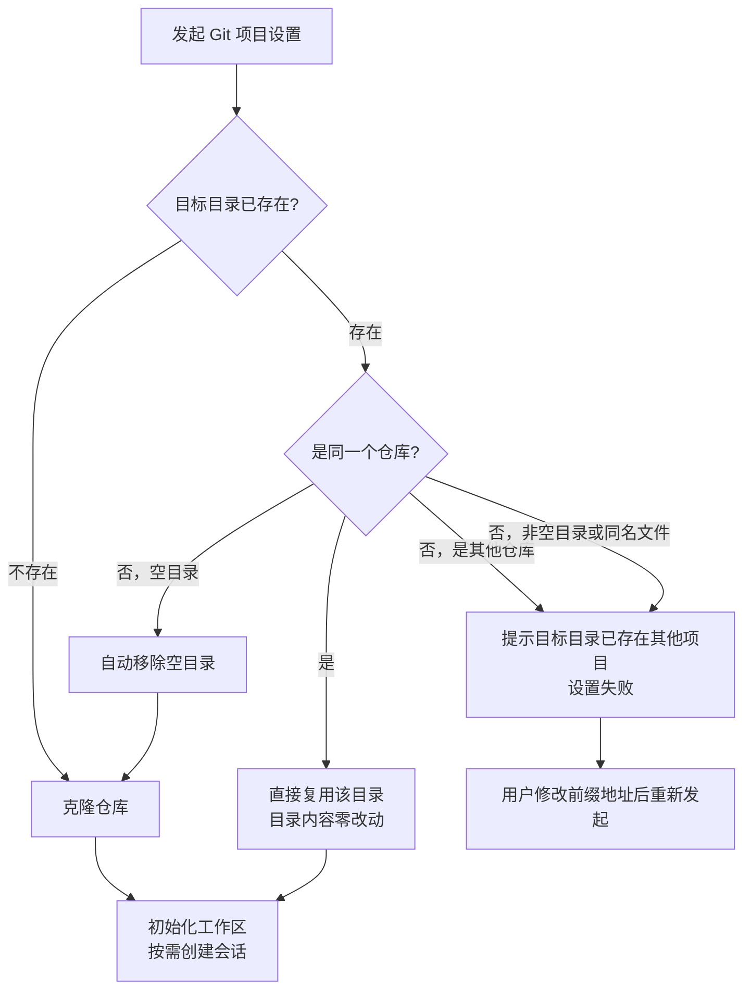

# Github 项目设置优化

**功能名称**: Github 项目设置优化
**PRD 版本**: v1.0
**创建日期**: 2026-11-04
**作者**: z-agent-bot

## 背景与目标

### 1.1 背景

云电脑的「Git 项目设置」会把用户选择的 Github 仓库克隆到云电脑内的目标目录（由「前缀地址 + 仓库名」拼接而成）。当目标目录已经存在时——例如同一台云电脑重复设置同一仓库、设置失败后重试、Issue 联动工作流在已就绪的云电脑上自动准备项目——当前设置流程会因目录已存在而直接报错退出（来源：GitHub Issue [Deliay/z-agent-gear#435](https://github.com/Deliay/z-agent-gear/issues/435)）：

1. 目标目录已经是同一个仓库时，设置流程仍尝试对目录做更新操作，遇到目录内已有工作内容、分支状态变化等情况即报错退出，用户无法完成设置。
2. 目标目录是一个空文件夹时，用户期望流程自动处理后继续，而不是中断等待人工清理。
3. 目标目录被其他项目占用时，需要明确告知用户「目标目录已存在其他项目」，而不是含糊的底层报错。

### 1.2 目标

1. 目标目录已是本次要设置的同一个仓库时，直接复用该目录完成设置，目录内的全部工作内容原样保留，不再执行任何改动目录内容的操作。
2. 目标目录为空目录时，自动清理该空目录后继续克隆，全程无需用户介入。
3. 目标目录被其他项目占用（是其他仓库、非空普通目录或同名文件）时，以明确的提示文案结束设置，引导用户修改前缀地址，且被占用内容不被改动。

### 1.3 成功标准

1. 对同一台云电脑、同一仓库重复发起「Git 项目设置」（含设置失败后的重试、Github Issues 联动工作流的自动项目准备）时，只要目标目录是该仓库，设置即可成功完成，目录内已有工作内容保持不变。
2. 目标目录为空文件夹时设置直接成功，用户无感知。
3. 目标目录被其他项目占用时，设置流程失败并展示「目标目录已存在其他项目」的明确提示；占用内容在设置失败前后完全一致。

## 用户分析

### 2.1 目标用户

- 使用云电脑（云端工作容器）并通过 Github 项目搭建工作环境的平台用户。
- 使用 Github Issues 联动工作流、由平台自动在云电脑上准备项目工作区的团队。

### 2.2 用户场景

| 场景 | 用户角色 | 目标 | 痛点 |
|--|--|--|--|
| 同一云电脑重复设置同一仓库（含设置失败后重试） | 云电脑用户 | 直接复用已克隆的项目目录完成设置 | 重复设置时流程报错退出，只能登录云电脑手工处理 |
| 在已克隆的项目中开展工作后再次发起设置 | 云电脑用户 | 目录内已有工作内容原样保留，设置照常完成 | 更新操作失败导致整个设置失败，工作内容面临风险感知 |
| Issue 联动工作流在已就绪云电脑上自动准备项目 | 使用 Issues 联动的团队 | 项目已存在时直接复用并启动工作流 | 自动准备因目录已存在而失败，工作流无法启动 |
| 目标位置存在一个空文件夹 | 云电脑用户 | 无需手工清理即可完成设置 | 空目录也会导致流程中断 |
| 目标位置被其他项目占用 | 云电脑用户 | 明确知道冲突原因，调整前缀地址后重试 | 报错文案不直观，无法判断目录里是什么 |

## 功能需求

### 3.1 功能概述

优化「Git 项目设置」在目标目录已存在时的处理策略：同一仓库直接复用、空目录自动清理后继续克隆、其他占用以明确提示失败且不改动任何内容。

### 3.2 功能列表

#### 功能点 1: 同一仓库目录直接复用

- **描述**: 设置流程发现目标目录已经是一个仓库时，检查其与本次设置的仓库是否为同一个；是同一个则直接复用该目录继续后续流程（初始化工作区、按需创建会话），不再对目录内容做任何改动。目录内已有的提交、分支状态与工作内容全部原样保留。
- **用户价值**: 重复设置、失败重试、Issue 联动自动准备等场景都能稳定完成；用户与 Agent 在云电脑里的工作成果零风险。
- **验收标准**:
  - [ ] 目标目录为同一个仓库时设置成功，流程不执行任何会改动目录内容的操作
  - [ ] 目录内存在未推送的本地提交、处于任意分支状态时，设置仍能成功
  - [ ] 目标目录是其他仓库时按功能点 3 处理

#### 功能点 2: 空目录自动清理后继续

- **描述**: 设置流程发现目标目录是一个不含任何内容的空文件夹时，自动移除该空文件夹并继续克隆。
- **用户价值**: 用户无需登录云电脑手工清理空目录，设置一次完成。
- **验收标准**:
  - [ ] 目标目录为空文件夹时设置成功完成
  - [ ] 仅移除空目录；目录内有任何内容时不得删除（按功能点 3 处理）

#### 功能点 3: 目录被其他项目占用时明确提示

- **描述**: 目标目录是其他仓库、非空的普通目录，或目标位置已存在同名文件时，设置流程以失败结束，并展示「目标目录已存在其他项目」的明确提示，引导用户修改前缀地址后重新发起。任何情况下不得删除或改动被占用的目录或文件内容。
- **用户价值**: 冲突原因一目了然，且已有数据绝对安全。
- **验收标准**:
  - [ ] 三类占用情况（其他仓库 / 非空普通目录 / 同名文件）均以失败结束并展示明确提示
  - [ ] 提示中带出可操作的引导（修改前缀地址）
  - [ ] 占用内容在设置失败前后保持完全一致

### 3.3 用户操作流程

### 3.4 页面/界面描述

| 页面 | 描述 | 关键元素 |
|------|------|---------|
| Git 项目设置对话框 | 表单与现状一致，无新增输入项 | Github 账号、仓库、前缀地址、最终地址预览 |
| 设置进度对话框 | 占用冲突时展示「目标目录已存在其他项目」的明确提示，支持修改前缀地址后重试 | 分步进度、失败提示、重试入口 |
| 新建云电脑对话框 Github 项目区块 | 复用同一处理策略，无新增输入项 | 与 Git 项目设置对话框一致 |

### 3.5 异常与边界情况

| 情况 | 预期行为 |
|------|---------|
| 目标目录为同一个仓库且含本地工作内容 | 直接复用，内容零改动，设置成功 |
| 目标目录为同一个仓库但分支状态特殊（如分离状态、浅克隆） | 直接复用，设置成功 |
| 上次克隆中断留下的不完整目录 | 按「目标目录已存在其他项目」提示失败，不自动删除，等待用户处理 |
| 目标目录为空文件夹 | 自动移除后继续克隆，设置成功 |
| 目标目录为非空普通目录 | 提示已存在其他项目，失败，内容不变 |
| 目标位置为同名文件 | 提示已存在其他项目，失败，内容不变 |
| 目标目录为其他仓库 | 提示已存在其他项目，失败，内容不变 |
| 设置失败后重试 | 幂等，可重复执行直至成功 |

## 四、非功能需求

### 4.1 性能要求

重复设置（复用场景）的耗时不高于现状；不再执行目录更新操作后通常更快。

### 4.2 安全性要求

任何分支都不得删除或覆盖非空目录的内容；仅允许移除不含任何内容的空目录。

### 4.3 兼容性要求

存量已完成设置的云电脑不受影响；失败重试、Issue 联动自动准备等既有入口自动复用同一处理策略，无需用户或管理员额外操作。

## 五、依赖与约束

### 5.1 依赖

- 依赖现有「Git 项目设置」设置流程（含新建云电脑流程中的 Github 项目区块）。
- 依赖 Github Issues 联动工作流的项目准备能力（复用同一设置流程）。

### 5.2 约束

- 不改变设置流程的步骤结构与进度展示形态。
- 不引入新的用户输入项。
- 任何场景下不删除用户或 Agent 在云电脑内已有的工作内容。

## 六、相关文档

- GitHub Issue：[Deliay/z-agent-gear#435 GIthub项目设置优化](https://github.com/Deliay/z-agent-gear/issues/435)
- 技术提案：[[../../engineering/proposals/20261104-fix-github-project-setup-optimization.md]]
- 关联 PRD：[[20261021-github-workload.md]]（Git 项目设置）、[[20261026-default-workspace-optimization.md]]（默认工作区优化）、[[20261025-github-issues-workflow.md]]（Issues 联动工作流）
