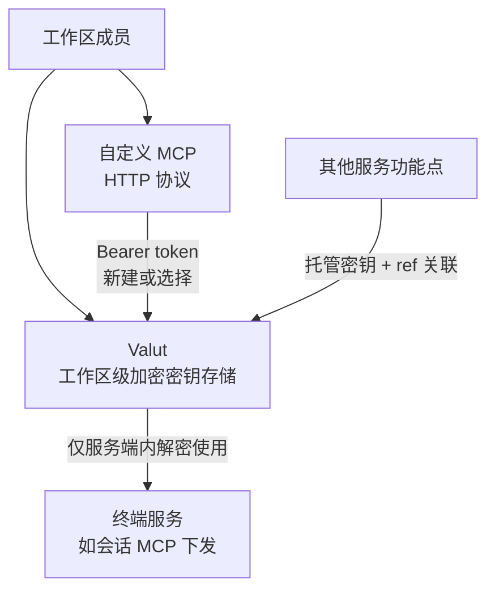
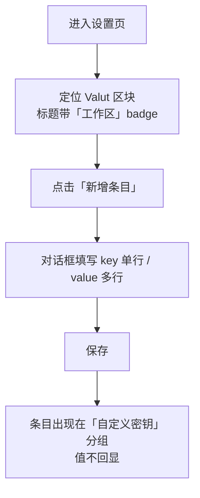
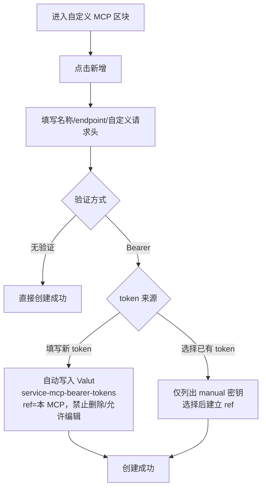
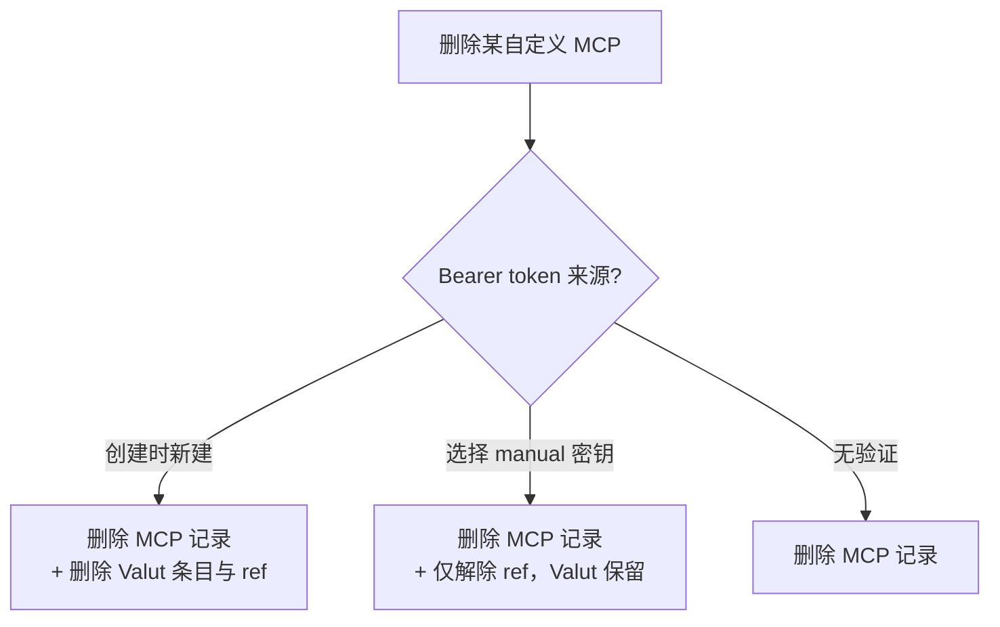

# MCP+Valut 功能迭代

**功能名称**: MCP+Valut 功能迭代（Valut 工作区密钥管理 + 自定义 MCP）
**PRD 版本**: v1.1
**创建日期**: 2026-11-04
**作者**: z-agent-bot
**需求来源**: [GitHub Issue Deliay/z-agent-gear#448](https://github.com/Deliay/z-agent-gear/issues/448)
**版本说明**:
- v1.0（2026-11-04）初版。
- v1.1（2026-11-04，评审返工）按评审意见调整自定义 MCP 的对外提供方式：改为**平台代理转发**——由服务端与真实 MCP 服务通讯，对使用方（会话）暴露的是平台代理地址与访问密钥，真实 endpoint 与凭据不离开服务端；访问密钥随会话签发、会话在线可用、离线即失效；删除自定义 MCP 后所有已签发的访问入口同时失效。同步修订 §1.2/§3.1/§3.2 功能点 7、8/§3.5/§5.2。

## 背景与目标

### 1.1 背景

平台当前缺少两样能力：

1. **统一的密钥管理能力**：用户在 Agent 场景中需要维护各类 secret（第三方服务 token、内部系统凭据等）。目前这些值只能散落在各功能点各自的配置里，既无法复用，也无法保证「值不被泄露」的统一口径。
2. **MCP 接入方式陈旧**：现有 MCP 接入依赖「MCP 代理」（本地代理密钥注册）链路，对云电脑与团队协作场景不友好；用户无法直接登记一个远端的 HTTP MCP 服务并为其配置凭据。

本期引入「Valut」——工作区级的加密 key-value 密钥存储，作为平台统一的 secret 底座；并对 MCP 功能做迭代：下线「MCP 代理」前端入口，新增工作区级的「自定义 MCP」（HTTP 协议），其 Bearer 凭据直接落在 Valut 中。

### 1.2 目标

- **Valut 落地**：以工作区为单位管理加密 key-value 条目；值加密存储，任何前端界面、日志中都看不到明文；只允许在服务端内部（终端服务链路）使用解密后的值。
- **namespace 体系**：每条 Valut 条目归属于一个 namespace——手动创建的为 `manual`（展示名「自定义密钥」）；服务功能点托管的为 `service-{功能点}`（如 `service-mcp-bearer-tokens`）。namespace 全局跨租户唯一，功能点在服务启动时自检并自动创建缺失的 namespace。
- **工作区权限**：Valut 遵循工作区权限构造——全局工作区的条目租户内全员可见、可用、可查看，仅管理员可编辑；自定义（普通）工作区的条目工作区成员可见、可用、可查看，全部成员可编辑。任何场景下值本身均不可见。
- **服务间引用（refs）**：其他服务功能点可以把数据写入 Valut，也可以引用一条已存在的 Valut 条目；引用关系（哪个功能点的哪条数据引用了这条 secret）独立记录、可多条，并支持在界面上按 refs 展示。
- **MCP 迭代**：前端移除「MCP 代理」入口与相关请求；新增「自定义 MCP（工作区）」——支持添加 HTTP 协议的 MCP，验证方式支持「无验证」与「Bearer」（填写新 token 或选择一条 `manual` namespace 的既有 Valut 条目）。自定义 MCP 经**平台代理转发**对外提供：由服务端与真实 MCP 服务通讯，使用方（会话中的 Agent）获得的是平台代理地址与访问密钥，真实 endpoint、自定义请求头与 Bearer 凭据不离开服务端。
- **删除/编辑联动**：删除自定义 MCP 时，创建它时新建的 Valut 记录一并删除，选择既有 Valut 的仅解除引用；编辑 MCP 时可更新自己创建的 token，引用手动密钥的场景给出穿透链接跳转到对应 Valut 条目编辑。

### 1.3 成功标准

- 用户可在设置页 Valut 区块按 namespace 聚合并逐行查看 key-value 条目（值不回显），可新增、编辑、删除条目（受编辑属性约束）。
- 全局工作区的 Valut 条目对租户全员可见可用、仅管理员可编辑；普通工作区条目对成员可见可用、全员可编辑；非成员以任何方式访问均不可达。
- 任何界面、接口返回、日志中均不出现 Valut 明文值；解密仅在服务端内部发生。
- 服务功能点启动时自动创建缺失的 namespace（全局唯一）；其他服务存储 secret 时必须携带「功能点 + 数据标识」形成 ref，界面上可看到每条 secret 被哪些数据引用。
- 外部功能选择「已存在的 secret」时只能选到 `manual` namespace 的条目。
- 设置页不再出现「MCP 代理」入口，相关前端请求不再发出。
- 用户可在工作区下新增自定义 HTTP MCP：选「无验证」直接可用；选「Bearer」可填写新 token（自动写入 Valut 的 `service-mcp-bearer-tokens` namespace 并与该 MCP 建立 ref，条目「禁止删除、允许编辑」）或选择一条已有的 `manual` 密钥。
- 删除自定义 MCP 时联动正确：自建 token 的 Valut 记录被删除；引用 `manual` 密钥的仅解除 ref、Valut 条目保留。
- 会话使用自定义 MCP 时仅获得平台代理地址与访问密钥（真实 endpoint 与凭据不出服务端）；密钥随会话生灭（会话离线即失效）；删除自定义 MCP 后所有已签发入口同时失效。
- 编辑自定义 MCP 时可更新自建 token；引用 `manual` 密钥时展示穿透链接，点击跳转到对应 Valut 条目。

## 用户分析

### 2.1 目标用户

- **团队管理员**：在工作区（尤其是全局工作区）统一维护团队共享密钥与自定义 MCP 配置。
- **团队开发 / 个人用户**：在自己的工作区维护私有或共享密钥，登记团队内部或第三方的 HTTP MCP 服务供 Agent 使用。

### 2.2 用户场景

| 场景 | 用户角色 | 目标 | 痛点 |
|--|--|--|--|
| 统一管理密钥 | 团队管理员 | 在全局工作区集中维护团队 secret，成员可用但看不到值 | 密钥散落在个人手里，流转靠私下传递，泄露面大 |
| 个人密钥保管 | 开发者 | 把自己的 token 存进工作区 Valut，随取随用但不担心泄露 | 明文写在笔记/聊天里，容易误发误贴 |
| 密钥复用 | 开发者 | 一条 secret 被多个功能（如多个自定义 MCP）引用 | 同一 token 重复录入多处，轮换时要逐处修改 |
| 接入内部 MCP | 开发者 | 把团队内部的 HTTP MCP 服务配进来，带上鉴权头 | 现有 MCP 代理链路依赖本地代理，云端与团队场景不适用 |
| 托管凭据可审计 | 团队管理员 | 看到某条 secret 被哪些功能数据引用 | 不知道删一条密钥会影响什么 |

## 功能需求

### 3.1 功能概述

本期包含两大块：**Valut**（工作区级加密密钥存储：namespace 聚合、值加密不回显、工作区权限、refs 引用展示、对外仅可选 `manual` 条目）与 **MCP 迭代**（移除「MCP 代理」前端入口；新增工作区级「自定义 MCP」，HTTP 协议 + 无验证/Bearer 验证，Bearer 凭据与 Valut 深度联动；自定义 MCP 经平台代理转发对会话提供，访问密钥随会话生灭，删除即全端点失效）。

### 3.2 功能列表

#### 功能点 1: Valut 基础存储与加密

- **描述**: Valut 是 key-value 形式存储的 secrets，每条条目关联到具体的工作区。条目字段至少包含：namespace、key、value（加密存储）、编辑属性（是否允许删除、是否允许编辑）、创建人、创建/更新时间。所有值使用同一个加密 key 加密，加密 key 由环境变量指定；加密、解密只发生在服务端，明文只允许在服务内部使用，任何前端界面与日志都不得出现具体值。（仅约束 Valut 自身的取值方式——若终端服务自行展示了解密后的值，与本模块无关。）
- **用户价值**: secret 有统一的安放之处，且「存进去就看不到」提供了明确的防泄露预期。
- **验收标准**:
  - [ ] 创建的条目在数据库中不以明文存储；任何查询接口的返回中都不包含 value 明文
  - [ ] 前端任何页面、任何状态（含编辑态）都看不到已保存的 value
  - [ ] 日志输出中不出现 value 明文
  - [ ] 加密 key 来自环境变量；未配置时服务给出明确错误而非静默降级

#### 功能点 2: namespace 体系

- **描述**: 每条 Valut 条目都有一个 namespace 属性。手动创建的条目固定为 `manual`，展示名称为「自定义密钥」；服务功能点托管的条目 namespace 为 `service-{功能点}`（本期首个为 `service-mcp-bearer-tokens`）。namespace 全局跨租户唯一；每个功能点在服务启动时检查自己的 namespace 是否存在，不存在则自动创建。`manual` namespace 随系统初始化即存在。
- **用户价值**: 条目按来源分组归类，一眼区分「自己维护的」与「系统托管的」。
- **验收标准**:
  - [ ] 手动创建条目时 namespace 恒为 `manual`，界面展示「自定义密钥」
  - [ ] 服务功能点启动后其 `service-{功能点}` namespace 自动存在（幂等，重复启动不重复创建）
  - [ ] namespace 名称全局唯一，不同功能点不会互相覆盖

#### 功能点 3: Valut 工作区权限

- **描述**: Valut 的权限按工作区构造（本文中「（工作区）」标记即指此权限模式）：
  - **全局工作区**的条目：租户内全部人可见、可使用、可查看（遵守 secret 无法看到值的设定）；仅**管理员**可编辑（新增/修改/删除）。
  - **自定义（普通）工作区**的条目：工作区成员可见、可使用、可查看（同样看不到值）；工作区**所有成员**都可编辑。
- **用户价值**: 团队共享密钥由管理员统一把关，项目级密钥由成员自助维护。
- **验收标准**:
  - [ ] 全局工作区条目对租户全员可见可用；非管理员的一切新增/修改/删除被拒绝
  - [ ] 普通工作区条目对该工作区成员可见可用可编辑；非成员以任何方式访问均按「不存在」处理
  - [ ] 编辑条目不因权限放行而泄露旧值（编辑 = 重新写入新值）

#### 功能点 4: 服务间存储与 refs 引用

- **描述**: 其他服务功能点使用 Valut 存储时，除条目本身字段外，还必须传入「是哪个功能点、哪条数据」引入了这条 Valut（即 ref），以便展示与审计。其他服务也可以选择一条**已存在**的 Valut 条目建立引用；多个服务（或同一服务的多条数据）可以引用同一条条目。ref 不记录在 Valut 条目实体上，而是由独立的关联关系承载，一条条目可挂多条 ref。数据库中的值都是加密的，任何消费方都必须经过 Valut 的服务进行解密。
- **用户价值**: 密钥的「被谁使用」全程可追溯；一处维护、多处复用。
- **验收标准**:
  - [ ] 服务托管写入条目时必须同时登记 ref（功能点 + 数据标识），缺 ref 的托管写入被拒绝
  - [ ] 一条条目可被多条 ref 引用；ref 的增减不影响条目本身
  - [ ] 界面可查看某条 secret 的 refs 列表（哪个功能点的哪条数据在用）
  - [ ] 选择已存在条目建立引用时，可选范围仅限 `manual` namespace

#### 功能点 5: Valut 前端界面

- **描述**: 设置页新增 Valut 区块，标题后跟一个「工作区」badge（表示该区块数据按工作区归属）。内容为一个按行展示的 key-value 表格，按 namespace 聚合分组。「新增条目」按钮点击后弹出对话框：key 为单行文本输入，value 支持多行填写。支持按 refs 展示哪些数据使用了这条 secret。编辑条目时value 不回显，只允许重新填写。
- **用户价值**: 与既有设置体验一致的位置完成密钥管理；分组与引用信息一目了然。
- **验收标准**:
  - [ ] 设置页出现 Valut 区块，标题右侧带「工作区」badge，内容随当前工作区切换
  - [ ] 表格按 namespace 聚合展示，每行展示 key（值不回显）
  - [ ] 「新增条目」对话框：key 单行、value 多行；保存后出现在 `manual` 分组
  - [ ] 每条目可展开查看 refs（引用它的功能点与数据）
  - [ ] 当前上下文无编辑权限时（如开发角色在全局工作区），编辑/删除入口收敛为不可用或隐藏

#### 功能点 6: 移除「MCP 代理」前端入口

- **描述**: 前端移除「MCP 代理」入口（设置页中的 MCP 代理密钥管理区块）及其相关请求；相关空态文案同步清理。后端既有代理链路不在本期下线范围内，仅前端入口移除。
- **用户价值**: 收口 MCP 接入路径，避免新旧两套入口并存造成困惑。
- **验收标准**:
  - [ ] 设置页不再出现「MCP 代理」区块与相关按钮
  - [ ] 页面加载与操作时不再发出 MCP 代理密钥相关请求
  - [ ] 其他 MCP 相关区块（如 MCP 管理列表）不受影响

#### 功能点 7: 自定义 MCP（工作区）

- **描述**: 新增工作区级的「自定义 MCP」管理能力（权限模式同 Valut 的「（工作区）」标记：全局工作区仅管理员可编辑、普通工作区成员可编辑）。支持添加 **HTTP 协议**的 MCP，基础属性包括：名称、描述（可选）、验证方式（无验证 / Bearer）、endpoint、自定义请求头（一个 header 名可对应多个值），以及归属工作区、租户、创建人与创建/更新时间。验证方式：
  - **无验证**：不附加任何凭据；
  - **Bearer**：二选一——**填写一个 token**（背后逻辑是在 Valut 中新建一条记录），或**选择一个 token**（只允许选择 namespace 为 `manual` 的既有 Valut 条目）。

  自定义 MCP 对使用方以**平台代理转发**方式提供：由服务端负责与真实 MCP 服务通讯（携带自定义请求头与 Bearer 凭据），会话中的 Agent 访问的是平台为本次会话生成的**代理地址与访问密钥**——真实 endpoint、请求头与凭据不离开服务端、不对使用方暴露。访问密钥**随会话签发、生命周期随会话管理**：会话在线期间可用，会话关闭或离线后立即失效；密钥只能访问本次会话被授权的自定义 MCP，无法用于其他条目或其他会话。本期访问密钥仅在「下发给云容器对话」场景签发。
- **用户价值**: 团队成员直接登记远端 HTTP MCP 服务并安全地携带凭据，无需本地代理；凭据与真实地址全程不暴露给使用方，密钥随会话生灭，泄露面最小。
- **验收标准**:
  - [ ] 可在当前工作区新增自定义 MCP：填写名称、endpoint、验证方式与可选的自定义请求头
  - [ ] 选择「无验证」时创建后即为可用状态
  - [ ] 选择「Bearer-填写 token」时，token 自动写入 Valut（namespace 为 `service-mcp-bearer-tokens`），ref 指向该 MCP 记录，条目编辑属性为「禁止删除、允许编辑」
  - [ ] 选择「Bearer-选择已有」时，候选列表仅出现 `manual` namespace 的条目；保存后建立 ref 关联
  - [ ] 自定义请求头支持同名 header 多个值
  - [ ] 会话使用自定义 MCP 时，获得的是平台代理地址与访问密钥，而非真实 endpoint 与凭据；真实 endpoint/请求头/token 不出现在会话可见的任何配置与报文中
  - [ ] 访问密钥随会话签发：会话在线可用；会话关闭/离线后立即失效；继续使用需重新建立会话获得新密钥
  - [ ] 访问密钥无法访问未授权给该会话的自定义 MCP
  - [ ] 列表与详情随当前工作区切换；权限不足时编辑入口收敛

#### 功能点 8: 自定义 MCP 的删除与编辑联动

- **描述**: 删除自定义 MCP 时检查其 Bearer 凭据来源：若 token 是创建该 MCP 时新建的（Valut 条目在 `service-mcp-bearer-tokens` namespace），则**一并删除** Valut 中的对应记录与 ref；若 token 是选择的已存在 `manual` 条目，则**不删除** Valut 记录，仅解除 ref 关联关系。**删除自定义 MCP 后，所有已签发的访问入口同时失效**：各会话中指向该 MCP 的代理地址继续调用一律失败（不影响其他自定义 MCP 与其他会话密钥的可用性）。编辑自定义 MCP 时：自建 token 支持直接更新（写入同一条 Valut 记录）；引用 `manual` 条目的不提供就地编辑，而是给出**穿透链接**，跳转到对应 Valut 条目进行编辑。
- **用户价值**: 凭据的生命周期跟随其来源自动打理：自建的随 MCP 生灭，共享的手动密钥不被误删；删除即全端点失效，避免残留入口被继续调用。
- **验收标准**:
  - [ ] 删除自建 token 的 MCP 后，对应 Valut 记录与 ref 均被删除
  - [ ] 删除引用 `manual` 密钥的 MCP 后，Valut 记录保留、仅 ref 被移除
  - [ ] 删除自定义 MCP 后，所有会话中该 MCP 的代理入口立即失效，继续调用被拒绝
  - [ ] 编辑 MCP 时更新自建 token 成功，Valut 对应记录值被更新（旧值不展示）；更新后新发起的调用使用新值
  - [ ] 编辑引用 `manual` 密钥的 MCP 时展示穿透链接，点击后定位到 Valut 区块中对应条目
  - [ ] `service-mcp-bearer-tokens` 下的条目在 Valut 区块中不提供删除入口（禁止删除），但允许编辑值

### 3.3 用户操作流程

新增 Valut 条目流程：

自定义 MCP 创建流程（Bearer）：

自定义 MCP 删除流程：

### 3.4 页面/界面描述

| 页面 | 描述 | 关键元素 |
|------|------|---------|
| 设置页 - Valut 区块 | 工作区级密钥管理（标题带「工作区」badge） | 按 namespace 聚合的 key-value 表格（值不回显）、「新增条目」按钮、每行的编辑/删除（受编辑属性与权限约束）、refs 展开查看 |
| Valut 新增/编辑对话框 | 填写或重写条目 | key 单行输入、value 多行输入（编辑时 value 为空待重填，不显示旧值） |
| Valut refs 展示 | 查看条目被哪些数据引用 | 功能点名称、数据标识（如 MCP 名称）、可跳转到对应功能入口 |
| 设置页 - 自定义 MCP 区块 | 工作区级自定义 MCP 管理（标题带「工作区」badge） | MCP 列表（名称、endpoint、验证方式）、新增/编辑/删除入口 |
| 自定义 MCP 新增/编辑对话框 | 配置 HTTP MCP | 名称、描述、endpoint、验证方式（无验证/Bearer）、Bearer 下的「填写 token / 选择 token」二选一（选择态仅列 manual 密钥）、自定义请求头编辑器（同名多值）；编辑引用 manual 密钥时展示穿透链接 |
| 设置页 - MCP 区域 | 移除「MCP 代理」 | 不再出现 MCP 代理密钥区块及相关请求 |

### 3.5 异常与边界情况

| 情况 | 预期行为 |
|------|---------|
| 加密 key 环境变量未配置 | 相关读写操作失败并给出明确错误提示；不静默存明文 |
| 非管理员在全局工作区新增/编辑/删除 Valut 条目或自定义 MCP | 操作被拒绝并提示无权限；查看与使用不受影响 |
| 非成员访问普通工作区的 Valut 条目 / 自定义 MCP | 一律按「不存在」处理，不泄露存在性 |
| 删除仍被 refs 引用的 `manual` 条目 | 删除被拒绝，提示先解除引用，并展示当前 refs |
| 删除 `service-mcp-bearer-tokens` 下的条目 | 无删除入口；非常规方式尝试被拒绝（禁止删除） |
| 编辑条目 | 任何场景均不回显旧值，只能重新写入新值 |
| 选择已有 token 时 | 候选仅 `manual` namespace；其他 namespace 条目不可选 |
| 引用某条 `manual` 密钥的 MCP 被删除 | 仅解除 ref；Valut 条目保留，其他引用不受影响 |
| 多条 MCP 引用同一条 `manual` 密钥 | 各自独立建立 ref；删除其中一条 MCP 只移除自己的 ref |
| 会话关闭/离线后继续调用代理地址 | 访问密钥已失效，调用被拒绝 |
| 删除自定义 MCP 后，旧代理地址被调用 | 一律按已失效处理；其他自定义 MCP 与其他会话不受影响 |
| 用某会话的访问密钥调用未授权给该会话的自定义 MCP | 被拒绝 |
| MCP 的真实 endpoint 不可达 | 由使用侧（会话）按既有机制造错，管理功能本身不受阻 |
| 切换工作区 | Valut 与自定义 MCP 区块内容随当前工作区切换，按权限收敛操作入口 |

## 四、非功能需求

### 4.1 性能要求

- Valut 区块与自定义 MCP 列表的加载响应时间与既有设置区块相当，无明显可感知劣化。
- namespace 自检在服务启动期完成，不阻塞服务就绪。

### 4.2 安全性要求

- **值不可见是安全红线**：Valut 的 value 在任何前端界面、接口响应、日志输出中都不得出现明文；解密只允许发生在服务端内部消费链路。
- 数据库中的 value 一律加密存储；加密 key 仅由环境变量注入，不得入库、不得出现在日志与配置导出中。
- 工作区权限为安全红线：任何跨工作区访问按「不存在」处理，不泄露存在性。
- refs 关联关系必须完整：托管写入缺 ref 即拒绝，保证「每条托管密钥都可追溯」。

### 4.3 兼容性要求

- 既有 MCP 管理列表（代理注册、平台内置）的展示与使用不受影响；本期仅移除「MCP 代理」前端入口。
- 存量用户数据零迁移负担：Valut 与自定义 MCP 为全新能力，无存量数据。
- 各工作区互不影响：个人用户（个人专属租户）在其全局工作区下即为管理员，体验自洽。

## 五、依赖与约束

### 5.1 依赖

- 依赖多租户二期已落地的工作区体系（全局工作区/普通工作区、租户角色）——Valut 与自定义 MCP 的权限构造复用该体系。
- 依赖设置页既有「工作区」上下文切换能力。

### 5.2 约束

- Valut 条目值永不可见（含编辑态）；编辑=重新写入。
- 对外提供服务（选择已存在 secret 关联）时只允许选择 `manual` namespace 的条目。
- 本期不做 Valut 的跨工作区共享/继承；条目严格归属单一工作区。
- 本期不做「MCP 代理」后端链路的下线，仅移除前端入口与相关请求。
- 自定义 MCP 本期仅支持 HTTP 协议；验证方式仅「无验证」与「Bearer」两种。
- 自定义 MCP 仅经平台代理转发对外提供：真实 endpoint、自定义请求头与 Bearer 凭据不离开服务端、不对使用方暴露；访问密钥随会话签发，会话离线即失效。
- 本期访问密钥仅在「下发给云容器对话」场景签发，生命周期随会话管理；其他消费形态（如长期密钥、脱离会话的独立端点）后续期次评估。
- namespace 全局跨租户唯一，由功能点在服务启动时自检创建，不提供用户侧管理入口。

## 六、相关文档

- 需求来源：[GitHub Issue Deliay/z-agent-gear#448 — MCP+Valut功能迭代](https://github.com/Deliay/z-agent-gear/issues/448)
- 技术提案：[[../../engineering/proposals/20261104-feat-mcp-valut-iteration.md]]
- 关联文档：[[20261028-multi-tenant-phase2.md]]（工作区与角色权限体系，本期「（工作区）」权限模式的基础）
