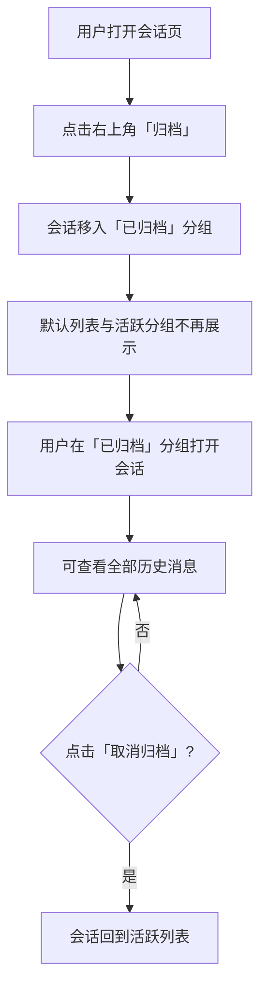
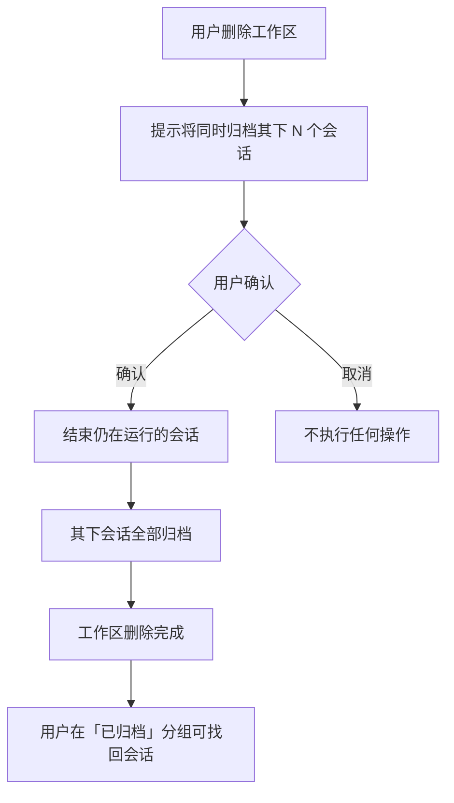
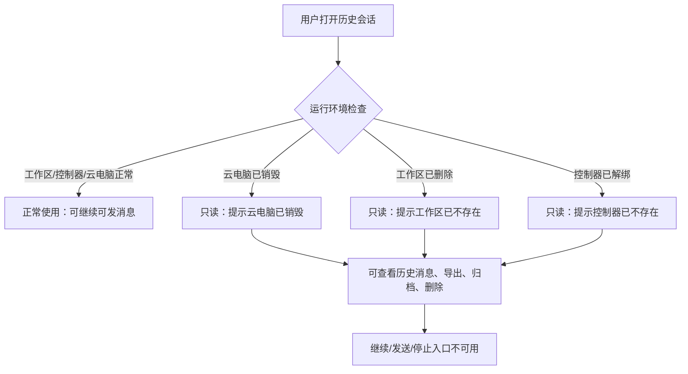

# 会话管理优化

**功能名称**: 会话管理优化
**PRD 版本**: v1.0
**创建日期**: 2026-11-04
**作者**: z-agent-bot
**需求来源**: GitHub Issue [Deliay/z-agent-gear#447](https://github.com/Deliay/z-agent-gear/issues/447)「会话管理优化」

## 背景与目标

### 1.1 背景

随着用户积累的会话越来越多，会话管理暴露出三类问题：

1. **会话无法收纳**：工作流实例早已支持归档（归档后移入侧边栏「已归档」分组，不再占用活跃列表），但会话没有对应能力。大量已结束的历史会话长期堆在会话列表中，用户想保留记录又想让列表干净，只能二选一。
2. **删除工作区会连带丢失会话入口**：用户删除一个工作区后，其下的会话记录虽然在数据上仍然存在，但在「主机 → 工作区 → 会话」的组织视图里失去了归属入口，用户感知上等同于会话被「连带删除」，历史记录难以找回。
3. **失去运行环境的会话仍可「继续」**：会话所属的工作区被删除、控制器被解绑、或云电脑被销毁后，会话实际上已经失去运行环境，但部分场景下用户仍然可以点「继续」或发送消息，操作发向一个不存在的运行环境，最终表现为无响应或状态卡死，造成困惑。目前云电脑场景已部分收敛为只读，工作区/控制器缺失场景尚未覆盖。

### 1.2 目标

- 会话与工作流实例一样支持归档/取消归档，归档后从默认列表移入「已归档」分组，记录完整保留。
- 删除工作区时，其下会话不再「连带消失」，而是自动归档，用户可随时在「已归档」分组中找到并查看。
- 会话失去运行环境（工作区/控制器/云电脑不存在或已销毁）时统一表现为只读回看：可打开查看全部历史消息，但不能继续对话，界面明确告知原因。

### 1.3 成功标准

- 用户可在会话页面对任意会话执行归档/取消归档；已归档会话默认不出现在会话活跃列表与侧边栏活跃分组，统一收纳进「已归档」分组且可正常打开查看。
- 删除工作区后，该工作区下的全部会话自动进入「已归档」分组，历史消息一条不丢；用户取消归档后会话回到活跃列表。
- 工作区/控制器/云电脑任一缺失或已销毁的会话：打开后可完整查看历史消息，「继续」「发送」「停止」等对话操作入口不可用，页面对只读原因有明确提示；云电脑场景已有的只读行为不回退。
- 普通（运行环境完好）的会话行为与上线前完全一致：可继续、可发消息、可归档、可删除。

## 用户分析

### 2.1 目标用户

- 平台前台用户：日常使用会话与 Agent 协作的个人用户与团队成员，会话数量随使用持续累积。
- 团队工作区成员：在共享工作区中查看他人创建的会话记录，需要一致的收纳与只读语义。

### 2.2 用户场景

| 场景 | 用户角色 | 目标 | 痛点 |
|--|--|--|--|
| 整理历史会话 | 前台用户 | 把不再活跃但想保留记录的会话收纳起来 | 会话没有归档能力，只能删除或任由列表膨胀 |
| 清理废弃工作区 | 前台用户 | 删除不再使用的工作区 | 工作区删掉后其下会话在组织视图里消失，历史记录找不回 |
| 回看历史会话 | 前台用户 | 打开一个很早之前的会话查看当时的对话 | 会话的运行环境（工作区/控制器/云电脑）已不存在，仍可点「继续」但操作无效，体验困惑 |
| 云电脑销毁后查记录 | 前台用户 | 云电脑销毁后查看当时的会话记录 | 已部分只读，但不同缺失场景提示与行为不一致 |

## 功能需求

### 3.1 功能概述

为会话补齐「归档」生命周期：用户可手动归档/取消归档会话；删除工作区时其下会话自动归档；失去运行环境的会话统一只读回看，形成「活跃 → 归档 → （删除）」的完整会话管理闭环。

### 3.2 功能列表

#### 功能点 1: 会话归档

- **描述**: 会话页右上角按钮组新增「归档」入口（位置与风格对齐工作流实例页的归档按钮）。点击后会话立即归档：从默认会话列表与侧边栏活跃分组移除，收纳进「已归档」分组；已归档会话可执行「取消归档」回到活跃列表。归档仅改变收纳位置，不删除任何数据、不终止会话进程、不影响会话内已有消息。
- **用户价值**: 用户可以把暂时不用但想保留记录的会话收纳起来，保持活跃列表聚焦当前工作，且随时可以找回。
- **验收标准**:
  - [ ] 任意会话（活跃或已结束）均可在会话页执行归档，归档后立即从默认会话列表与侧边栏活跃分组消失。
  - [ ] 侧边栏会话区出现「已归档（N）」分组（对齐工作流的已归档分组交互，默认折叠），展开可见全部已归档会话，点击可正常打开查看。
  - [ ] 已归档会话在会话页显示归档状态，按钮组提供「取消归档」，取消后回到活跃列表。
  - [ ] 归档中的活跃会话不被强制结束，其运行状态在归档分组中如实展示；取消归档后可继续正常使用。
  - [ ] 归档/取消归档操作不删除消息记录，工作流节点会话不在手动归档范围内（其生命周期由工作流实例管理）。

#### 功能点 2: 删除工作区连带归档会话

- **描述**: 删除工作区（含「清空」工作区）时，其下全部普通会话自动归档而非「连带消失」：会话记录与消息完整保留并移入「已归档」分组。归档的同时，仍在运行的会话被正常结束（终止 Agent 进程），避免进程残留。用户之后可在「已归档」分组中找到这些会话、查看历史，也可取消归档将其恢复到活跃列表（恢复后因工作区已不存在而只读，见功能点 3）。
- **用户价值**: 清理废弃工作区不再意味着丢失会话记录，历史协作过程可追溯。
- **验收标准**:
  - [ ] 删除单个工作区后，其下全部普通会话（不含工作流节点会话）自动进入「已归档」分组，消息记录完整。
  - [ ] 「清空」工作区时，被清工作区下的会话同样自动归档。
  - [ ] 删除工作区前，界面明确提示将同时归档其下会话的数量。
  - [ ] 删除时仍在运行的会话被正常结束（进程终止），状态如实展示为已结束。
  - [ ] 已删除工作区的会话取消归档后回到活跃列表，但因运行环境缺失而只读（只允许查看）。

#### 功能点 3: 失去运行环境的会话统一只读

- **描述**: 会话的运行环境缺失时——所属工作区已删除、所属控制器已解绑（不存在）、或所属云电脑已停止/销毁/删除——会话统一表现为只读：可打开查看全部历史消息，但「继续」「发送消息」「停止生成」等对话操作不可用，页面以明确文案提示只读原因。云电脑场景已有的只读能力（停止/销毁后只读）保留并纳入同一套口径；工作区缺失、控制器缺失两个场景本次补齐，服务端与界面同时拦截。
- **用户价值**: 用户对「为什么这个会话不能继续」有确定预期，不再遇到点了「继续」却石沉大海的困惑；历史记录始终可安全回看。
- **验收标准**:
  - [ ] 工作区已删除的会话：打开可查看历史，继续/发送/停止入口隐藏或不可用，提示工作区已不存在。
  - [ ] 控制器已解绑（不存在）的会话：同上，提示控制器已不存在。
  - [ ] 云电脑已停止/销毁/删除的会话：维持既有只读行为，提示云电脑已销毁。
  - [ ] 上述场景下即使用户绕过界面直接调用，服务端同样拒绝继续/发送/停止操作并返回一致的可读原因。
  - [ ] 运行环境完好的会话（含控制器暂时离线的会话）行为不变：控制器离线仅是暂时状态，恢复在线后仍可继续。
  - [ ] 只读会话仍允许归档、取消归档、删除、导出对话记录。

### 3.3 用户操作流程

#### 归档/取消归档会话

#### 删除工作区连带归档

#### 只读会话查看

### 3.4 页面/界面描述

| 页面 | 描述 | 关键元素 |
|------|------|---------|
| 会话页 | 右上角按钮组新增「归档/取消归档」入口，位于既有按钮（能力清单、导出、关闭/继续、删除）之中，风格与工作流实例页归档按钮一致 | 归档按钮、归档状态标识、只读提示条 |
| 侧边栏-会话分区 | 活跃会话列表保持现状；底部新增「已归档（N）」自折叠分组，收纳全部已归档会话 | 已归档分组（默认折叠）、归档会话条目 |
| 侧边栏-工作流分区 | 既有「已归档」分组交互不变，会话归档分组与其视觉一致 | — |
| 工作区管理界面 | 删除工作区（含清空）时提示连带归档的会话数量 | 删除确认提示（含会话数量） |
| 只读会话页 | 历史消息完整展示；顶部出现只读原因提示条；输入区与「继续」入口不出现 | 只读提示条（按原因分文案）、历史消息区、导出/归档/删除入口 |

### 3.5 异常与边界情况

| 情况 | 预期行为 |
|------|---------|
| 归档一个仍在运行的会话 | 允许，归档不终止会话；其状态在归档分组中如实展示，取消归档后可继续操作 |
| 删除工作区时其下会话正在运行 | 先正常结束会话（终止进程），再随工作区删除一并归档 |
| 工作流节点会话 | 不参与手动归档；删除工作区连带归档也不涵盖节点会话（由工作流实例生命周期管理） |
| 取消归档一个工作区已被删除的会话 | 允许回到活跃列表，但因运行环境缺失展示为只读 |
| 控制器暂时离线（未解绑） | 不视为「缺失」，会话不转只读；恢复在线后可正常继续（维持现状） |
| 重复归档/取消归档 | 幂等：重复操作结果一致，不报错 |
| 他人会话（团队工作区） | 归档/取消归档遵循既有可见性口径：可见即可操作；只读判定对全体成员一致 |
| 旧会话（功能上线前已存在） | 一律视为未归档；只读判定按运行环境现状即时计算，无需用户做任何迁移 |

## 四、非功能需求

### 4.1 性能要求

- 归档/取消归档、删除工作区连带归档为轻量操作：单工作区会话数量级（通常 ≤ 数十条）内即时完成，不引入用户可感知等待。
- 侧边栏「已归档」分组默认折叠，不增加首屏渲染负担。

### 4.2 安全性要求

- 归档、取消归档、删除工作区连带归档均遵循既有归属与租户工作区隔离口径，用户不能归档或查看无权限的会话。
- 只读拦截在服务端强制执行，不依赖界面隐藏，绕过界面的直接调用同样被拒绝。

### 4.3 兼容性要求

- 功能上线前已存在的会话一律视为未归档，列表行为与上线前一致；只读判定按运行环境现状即时生效，无需数据迁移或用户操作。
- 云电脑会话既有只读行为不回退、口径不分裂。

## 五、依赖与约束

### 5.1 依赖

- 工作流实例归档能力（归档语义与「已归档」分组交互以其为对齐基准）。
- 云电脑会话只读能力（已上线，本需求将其口径推广到工作区/控制器缺失场景）。

### 5.2 约束

- 归档仅做收纳语义，不引入新的会话状态机状态，不终止进程、不删除数据。
- 工作流节点会话的归档不在本期范围（其生命周期由工作流实例管理）。
- 删除工作区连带归档仅覆盖普通会话。

## 六、相关文档

- 技术提案：`docs/engineering/proposals/20261104-feat-session-management-optimization.md`
- 需求来源：GitHub Issue [Deliay/z-agent-gear#447](https://github.com/Deliay/z-agent-gear/issues/447)
