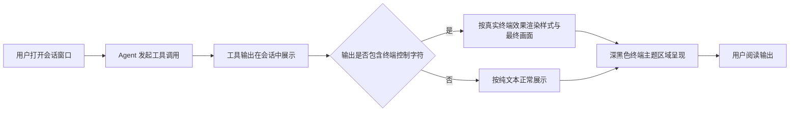

# 会话窗口中工具调用展示优化

**功能名称**: 工具调用终端输出渲染优化
**PRD 版本**: v1.0
**创建日期**: 2026-11-04
**作者**: Agent Gear Workflow
**关联 Issue**: https://github.com/Deliay/z-agent-gear/issues/420

## 背景与目标

### 1.1 背景

在会话窗口中，工具调用的结果（尤其是命令行/终端输出）目前是直接以文本方式展示的。一些控制台字符没有被正确渲染：终端程序输出的颜色控制、光标移动、进度条覆写等控制字符，要么以乱码形式直接暴露在文本里，要么被简单丢弃后导致展示内容与真实终端输出不一致（例如进度条刷屏、同一行内容被重复拼接、颜色信息丢失）。用户难以阅读工具实际产出的内容，影响对 Agent 工作过程的理解与排查。

### 1.2 目标

- 会话窗口中工具调用的终端输出按真实终端的显示效果渲染：颜色、加粗等样式正确呈现；进度条、覆盖写、清屏等动态输出按终端最终画面收敛，不出现控制字符乱码。
- 终端渲染区域采用深黑色主题配色，与真实终端观感一致，并与整体界面深色体系协调。

### 1.3 成功标准

- 包含终端控制字符的工具输出在会话窗口中无可见乱码（不出现裸露的转义序列、私有控制记号）。
- 典型动态输出（进度条、行内覆写、光标移动）渲染结果与真实终端最终画面一致，不出现重复堆叠。
- 终端渲染区域为深黑色背景主题，用户肉眼可感知与真实终端一致；抽样典型工具输出，渲染正确性评审通过。

## 用户分析

### 2.1 目标用户

- 使用 Agent 完成编码、运维等任务的开发者：会话中大量工具调用涉及命令行输出。
- 排查问题、阅读 Agent 工作过程的普通用户：需要直接看懂工具输出。

### 2.2 用户场景

| 场景 | 用户角色 | 目标 | 痛点 |
|--|--|--|--|
| Agent 执行构建/测试命令 | 开发者 | 阅读带颜色与动态刷新的命令输出 | 控制字符未正确渲染，输出乱码或失真 |
| Agent 运行带进度条的下载/安装 | 开发者 | 看到进度最终状态而非满屏进度行 | 进度条覆写语义丢失，内容堆叠刷屏 |
| 回顾历史会话中的工具调用 | 用户 | 快速理解工具当时输出了什么 | 输出与真实终端不一致，难以还原现场 |

## 功能需求

### 3.1 功能概述

会话窗口中工具调用的终端输出以「真实终端」的显示效果进行渲染，并采用深黑色主题配色。

### 3.2 功能列表

#### 功能点 1: 终端输出正确渲染

- **描述**: 工具调用产出的终端文本按终端语义正确渲染：颜色、加粗、下划线等样式正确呈现；光标移动、行内覆写、清屏、进度条刷新等控制字符按真实终端的显示效果收敛为最终画面；不再以原始文本形式裸露控制记号。
- **用户价值**: 用户看到的就是在真实终端里执行该命令所看到的画面，输出可读、可信，排查效率提升。
- **验收标准**:
  - [ ] 含颜色/加粗等样式的输出正确呈现样式，不出现裸露转义记号
  - [ ] 含进度条/行内覆写/光标移动的输出收敛为最终画面，不重复堆叠
  - [ ] 普通纯文本输出渲染结果与现状一致，无回归
  - [ ] 异常、截断、不完整控制字符序列不会破坏整体展示

#### 功能点 2: 终端深黑色主题配色

- **描述**: 终端渲染区域采用深黑色背景的主题配色，前景文字与彩色输出在深黑底上清晰可辨，整体观感与主流深色终端一致；在界面浅色/深色模式下终端区域均保持深黑色主题。
- **用户价值**: 与真实终端观感一致，彩色输出对比度好，长时间阅读舒适。
- **验收标准**:
  - [ ] 终端渲染区域背景为深黑色，文字与彩色输出清晰可读
  - [ ] 切换界面浅色/深色模式时，终端区域保持深黑色主题
  - [ ] 终端区域与会话窗口其余部分视觉协调（边距、圆角、滚动等不破坏布局）

### 3.3 用户操作流程

### 3.4 页面/界面描述

| 页面 | 描述 | 关键元素 |
|------|------|---------|
| 会话窗口 | 会话消息流中展示工具调用卡片 | 工具调用卡片内的终端输出区域 |
| 工具调用终端输出区域 | 以深黑色主题展示工具产出的终端文本 | 深黑背景、彩色/加粗文本、内部滚动 |

### 3.5 异常与边界情况

| 情况 | 预期行为 |
|------|---------|
| 输出中混入截断/不完整控制字符 | 优雅降级：不产生乱码、不吞掉后续正常文本 |
| 输出为空或仅空白 | 正常展示空内容区域或占位，不报错 |
| 超长输出（数万行） | 正常渲染且页面可滚动浏览，不卡死 |
| 输出中包含 HTML 特殊字符 | 按纯文本安全展示，不执行任何标记 |
| 输出中包含图片等不可显示字符 | 忽略不可显示字符，可见文本正常展示 |

## 四、非功能需求

### 4.1 性能要求

- 常规工具输出（千行级）渲染不产生可感知卡顿；超长输出渲染不阻塞会话窗口的其余交互。

### 4.2 安全性要求

- 工具输出内容一律按不可信内容处理，仅做展示，不产生任何脚本执行或链接伪造风险。

### 4.3 兼容性要求

- 支持主流桌面浏览器与移动端浏览器的会话窗口展示；不改变工具调用数据的采集与存储方式，历史会话中的旧输出在升级后同样按新效果渲染。

## 五、依赖与约束

### 5.1 依赖

- 依赖会话窗口既有的工具调用展示入口（消息流中的工具调用内容展示），本需求仅优化其渲染效果。

### 5.2 约束

- 仅涉及会话窗口的展示效果优化，不改变用户操作流程与会话功能语义。
- 需在主流浏览器上稳定工作，不引入仅特定浏览器可用的能力。

## 六、相关文档

- 关联 Issue: https://github.com/Deliay/z-agent-gear/issues/420
- 关联技术提案: `docs/engineering/proposals/20261104-feat-tool-call-terminal-rendering.md`
- 关联产品文档: `docs/product/draft/20261028-conversation-rendering.md`（对话渲染重构，终端渲染现状来源）
