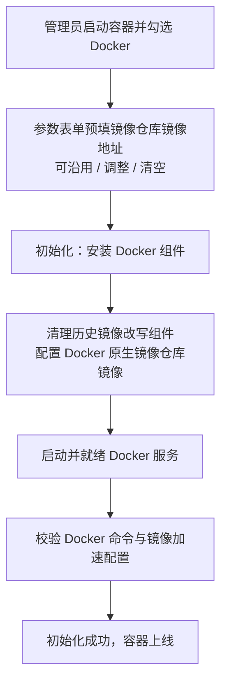
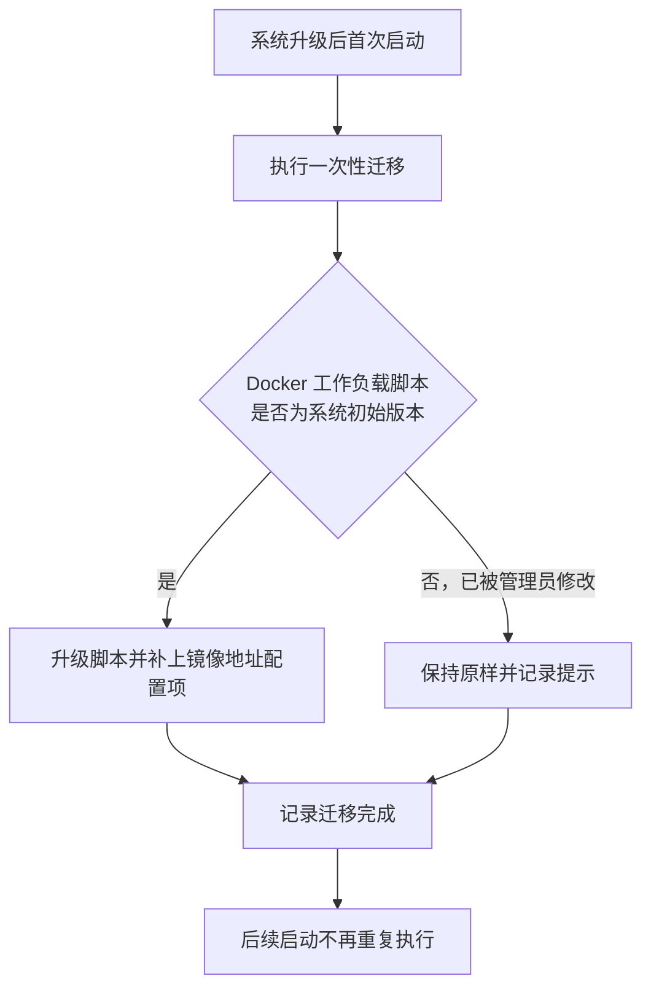

# 「Docker」工作负载取消镜像引用规范化脚本，改用 Docker 原生镜像仓库镜像配置

**功能名称**: 「Docker」工作负载镜像加速改用 Docker 原生镜像仓库镜像（registry mirror）配置
**PRD 版本**: v1.0
**创建日期**: 2026-11-05
**作者**: ZeroAsh

## 背景与目标

### 1.1 背景

云端工作容器选择「Docker」工作负载后，容器内即可使用 Docker。由于容器处于内网环境，直接拉取公网镜像仓库不可达且缓慢，因此「Docker」工作负载一直带有一段自定义的「镜像引用规范化」逻辑：在容器内执行拉取/运行镜像的命令时，自动把镜像地址改写到内部镜像代理（该逻辑由工作负载四期随安装脚本下沉到工作负载，见 [[20261018-workload-phase4.md]]）。

这段自定义逻辑逐渐暴露出几个问题（需求来源：GitHub Issue Deliay/z-agent-gear#463）：

1. **维护成本高**：改写规则是一段需要平台持续维护的自定义逻辑；镜像仓库形态变化（新增仓库、地址变体）都要跟着调整。
2. **覆盖不全、与原生行为不一致**：改写只能拦截有限的命令入口；镜像构建时的基础镜像拉取等场景不经过该入口，导致「同样一个镜像地址，有时走代理、有时不走」，行为与 Docker 原生机制不一致，排查问题时容易造成困惑。
3. **与 Docker 原生能力重复**：Docker 自身即提供「镜像仓库镜像（registry mirror）」配置能力，可以在 Docker 服务层面统一解决镜像拉取加速，无需任何自定义改写。

因此本期去掉这段自定义脚本，改为配置 Docker 自身的镜像仓库镜像能力。

### 1.2 目标

- 「Docker」工作负载不再包含任何镜像引用改写逻辑，容器内 docker 命令恢复为 Docker 原生行为。
- 镜像拉取加速由 Docker 原生镜像仓库镜像配置承担：默认填入内部镜像代理地址，配置项在启动容器时可见、可按次调整。
- 历史遗留自动清理：曾用旧版本初始化的环境在再次初始化时，自动清理旧版本安装的改写组件，docker 命令不再被拦截。
- 存量环境平滑升级：未被管理员定制过的「Docker」工作负载自动切换到新方式；定制过的不被覆盖，并给出明确提示。

### 1.3 成功标准

- 默认配置启动容器并选择「Docker」：初始化成功；拉取 Docker Hub 镜像（如 `docker pull ubuntu:24.04`）经内部镜像代理完成；加速对全部 docker 命令与镜像构建一致生效；在 Docker 服务信息中可见已配置的镜像地址。
- 容器内不再存在镜像引用改写组件：docker 命令直接来自 Docker 官方安装，无任何前置拦截逻辑。
- 启动时修改镜像地址：该次启动按新地址生效；清空地址则回退为 Docker 默认直连行为，初始化不因此失败，执行记录中可见「未配置镜像加速」的说明。
- 行为变化明确可预期：非 Docker Hub 仓库（如 ghcr.io）的镜像不再被自动改写，按 Docker 原生行为直接拉取；如需走内部代理，可在镜像引用中显式书写内部代理地址前缀（该写法此前即支持，行为不变）。
- 存量环境升级后：未定制的「Docker」工作负载自动获得新脚本与新配置项；定制过的不被覆盖，升级记录中可见提示。

## 用户分析

### 2.1 目标用户

- **平台管理员/运营人员**：维护预制工作负载、启动云端工作容器并挂载工作负载、排查环境初始化问题。
- **云端工作容器使用者（Agent 与任务脚本）**：在容器内直接使用 docker 拉取与构建镜像。

### 2.2 用户场景

| 场景 | 用户角色 | 目标 | 痛点 |
|--|--|--|--|
| 容器内拉取/构建镜像 | 容器使用者 | 拉取稳定走内部代理，且各种用法行为一致 | 自定义改写只覆盖部分命令入口，构建等场景不走改写，行为不一致 |
| 调整镜像代理地址 | 管理员 | 启动时直接改配置，不动脚本 | 代理地址固化在脚本里，只能改预制脚本 |
| 排查镜像拉取问题 | 管理员 | 用 Docker 原生手段排查，服务信息可见当前配置 | 自定义改写是黑盒，问题定位困难 |
| 升级存量环境 | 管理员 | 升级后自动切到新方式，自己改过的内容不丢 | 担心系统覆盖自己定制过的脚本 |

## 功能需求

### 3.1 功能概述

「Docker」工作负载移除镜像引用规范化脚本，改为在初始化时配置 Docker 原生的镜像仓库镜像（registry mirror），镜像地址作为工作负载的可见配置项（默认填入内部镜像代理地址）；配套历史改写组件的自动清理与存量环境的一次性升级机制。

### 3.2 功能列表

#### 功能点 1: 镜像拉取加速由 Docker 原生镜像仓库镜像配置承担

- **描述**: 「Docker」工作负载新增「镜像仓库镜像地址」配置项，默认值为内部镜像代理地址。初始化时先按该地址完成 Docker 原生镜像配置，再启动 Docker 服务；配置对全部 docker 命令与镜像构建一致生效。地址留空表示不配置镜像加速（回退 Docker 默认直连行为），不作为错误处理。
- **用户价值**: 用 Docker 原生机制解决拉取加速，行为标准、可预期、可自助排查（Docker 服务信息中可见当前配置）；地址可见可调，无需修改脚本。
- **验收标准**:
  - [ ] 「Docker」工作负载的参数表单中出现「镜像仓库镜像地址」，默认值已填入内部镜像代理地址
  - [ ] 按默认值启动容器并选择「Docker」：初始化成功，Docker 服务信息中可见该镜像地址；拉取 Docker Hub 镜像经内部代理完成；镜像构建中的基础镜像拉取同样生效
  - [ ] 启动时修改地址，该次初始化按修改后的地址配置
  - [ ] 清空地址：初始化正常完成且不配置镜像加速，执行记录中可见对应说明
  - [ ] 工作负载管理页可查看该配置项及其默认值，管理员可调整默认值

#### 功能点 2: 移除镜像引用规范化脚本并清理历史遗留

- **描述**: 「Docker」工作负载脚本不再包含任何镜像引用改写逻辑；容器内 docker 命令为 Docker 官方安装的原始命令。对曾用旧版本初始化的环境（重复初始化场景），初始化时自动检测并清理旧版本安装的改写组件，确保 docker 命令不再被拦截；检测只针对平台历史版本安装的组件，不误删环境内其他内容。
- **用户价值**: 彻底消除自定义改写的维护成本与行为不一致；存量环境再次初始化后同样回到原生行为。
- **验收标准**:
  - [ ] 初始化完成后，容器内不存在镜像引用改写组件，docker 命令为原生行为
  - [ ] 曾用旧版本初始化的环境再次执行初始化后，改写组件被清理，docker 恢复原生行为
  - [ ] 重复执行初始化幂等收敛，不产生副作用

#### 功能点 3: 存量环境一次性升级

- **描述**: 系统升级时通过一次性迁移，把「Docker」工作负载切换为新脚本并补上镜像地址配置项：
  - 仅当脚本内容仍是系统初始版本（管理员未修改过）时才自动升级；
  - 管理员修改过的脚本保持原样不覆盖，升级记录中给出提示，由管理员参照新版本自行调整；
  - 已升级过的环境不重复升级。
- **用户价值**: 存量环境无需人工介入即完成切换，同时尊重管理员的定制。
- **验收标准**:
  - [ ] 未定制过的「Docker」工作负载在升级后自动获得新脚本与镜像地址配置项
  - [ ] 定制过的脚本不被覆盖，升级记录中可见提示
  - [ ] 重复执行迁移不产生重复变更

### 3.3 用户操作流程

#### 启动容器（含 Docker）

#### 存量环境升级

### 3.4 页面/界面描述

本期不涉及新增页面；变化体现在既有页面的配置内容：

| 页面 | 描述 | 关键元素 |
|------|------|---------|
| 启动容器对话框 | 勾选「Docker」后参数表单含「镜像仓库镜像地址」，预填默认值 | 镜像地址输入框、「必须」开关 |
| 工作负载管理/编辑对话框 | 「Docker」工作负载可见「镜像仓库镜像地址」参数及其默认值 | 参数列表、默认值编辑 |
| 工作负载执行日志视图 | 镜像配置结果与历史组件清理动作可见 | 执行记录、脚本快照、输出日志 |
| 升级记录 | 存量升级结果可见，定制过的脚本有提示 | 迁移记录、提示信息 |

### 3.5 异常与边界情况

| 情况 | 预期行为 |
|------|---------|
| 镜像地址被清空 | 不配置镜像加速，初始化正常完成；执行记录说明当前为 Docker 默认直连行为 |
| 镜像地址不可达 | 初始化不因可达性失败（镜像配置在拉取时生效，与 Docker 原生口径一致），执行记录中可见已配置的地址；拉取阶段的报错为 Docker 原生报错，管理员修正地址后重建容器 |
| 非 Docker Hub 仓库镜像（如 ghcr.io） | 不再自动改写，按 Docker 原生行为直接拉取；需要走内部代理时显式书写内部代理地址前缀（既有写法，行为不变） |
| 镜像引用已显式带内部代理前缀 | 原样拉取，行为与升级前一致 |
| Docker 组件已安装、服务已就绪 | 跳过安装与启动；镜像配置有变化时更新配置并重启 Docker 服务后校验（幂等收敛） |
| 环境中存在非平台安装的同路径内容 | 不清理、不覆盖，执行记录中给出提示 |
| 未选择 Docker 工作负载，任务脚本中调用 Docker | 命令不存在，任务失败并在输出中可见（与既有「未选择即不可用」口径一致） |
| 存量环境中 Docker 脚本被管理员修改过 | 一次性迁移不覆盖，记录提示；管理员参照新版本自行调整 |
| 已启动/已结束的容器 | 不受影响；重建后才使用新配置 |

## 四、非功能需求

### 4.1 性能要求

- Docker Hub 镜像拉取走内部镜像代理，速度口径与升级前一致；镜像配置为 Docker 服务级配置，无逐命令的运行时开销。
- 配置项为单个文本项，启动对话框渲染与提交无额外开销。

### 4.2 安全性要求

- 默认镜像地址仅指向内部镜像代理，不指向公网；管理员调整为其他来源时责任在管理员，工作负载脚本仍仅管理员可查看与编辑。
- 取消自定义改写组件后，docker 命令链路无任何平台侧拦截与注入，缩小了命令劫持面。

### 4.3 兼容性要求

- 行为变化需周知：非 Docker Hub 仓库镜像不再自动改写（见 3.5）；Docker Hub 镜像拉取体验不变（仍走内部代理）。
- 不改变既有能力边界：未选择「Docker」工作负载即不可用 Docker；「必须」标记的失败语义不变。
- 已启动/已结束的容器及其执行记录不受影响。
- 存量环境一次性升级不覆盖管理员定制；定制脚本由管理员自行跟进。
- 初始化脚本的幂等、超时、日志截断等执行语义均不变。

## 五、依赖与约束

### 5.1 依赖

- 运维保障内部镜像代理以 Docker 镜像仓库镜像形态持续可用，且在容器初始化阶段可达。
- 工作负载一期的参数能力与一次性迁移机制已上线。

### 5.2 约束

- 本期只调整镜像拉取加速的实现方式，不改变 Docker 能力范围、不调整工作负载的依赖与「必须」语义。
- 配置在容器启动时生效，已运行容器需重建后才使用新配置。
- 一次性升级只处理「Docker」预制工作负载，其他预制项不变更。

## 六、相关文档

- [[20261018-workload-phase4.md]] — 工作负载四期 PRD（镜像改写逻辑随安装脚本下沉到工作负载，本期直接前因）
- [[20261018-docker-ce-apt-source.md]] — Docker CE 软件源地址补齐 PRD（同一工作负载的配置化与存量升级口径先例）
- 技术提案：`docs/engineering/proposals/20261105-feat-docker-registry-mirrors.md`
- 需求来源：GitHub Issue [Deliay/z-agent-gear#463](https://github.com/Deliay/z-agent-gear/issues/463)
