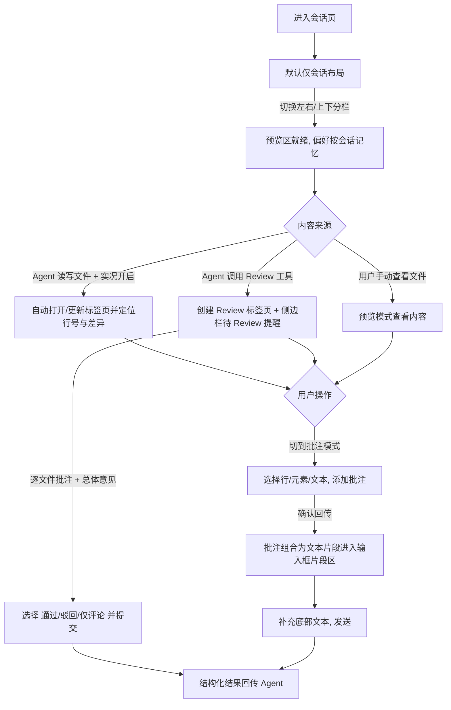

# 新版会话交互与内容预览

**功能名称**: 新版会话交互与内容预览
**PRD 版本**: v1.0
**创建日期**: 2026-11-05
**作者**: z-agent-gear 工作流（需求来源：Deliay）

## 背景与目标

### 1.1 背景

需求来源：GitHub Issue [Deliay/z-agent-gear#461](https://github.com/Deliay/z-agent-gear/issues/461)「新版会话交互与内容预览」。

当前会话界面为「对话流 + 输入框」的单栏形态，对话渲染能力已在 [[20261028-conversation-rendering.md]] 中得到系统性补齐，但用户在「看内容、审内容、反馈内容」三个环节上仍存在明显断点：

- **看不到完整内容**：Agent 读取/修改了哪些文件、改成了什么样，只能从对话流中的工具卡片窥见片段；想对照原文持续跟踪改动，需要离开会话自行打开文件。
- **无法指着内容说话**：代码、页面、文档只能看不能批注。想告诉 Agent「这几行不对」「这个按钮要改」「这一段重写」，只能在输入框里手工描述文件路径与行号，低效且易出错。
- **没有结构化评审通道**：Agent 交付一组文件后，用户无法像 GitHub Pull Request Review 那样逐文件行内批注并给出「通过 / 驳回 / 仅评论」的总体结论，Agent 也拿不到可驱动后续动作的结构化结果。
- **输入组织方式单一**：输入框只能承载一段纯文本，批注结果、截图与文字说明无法作为独立的提示词片段组合、管理与发送。

### 1.2 目标

把会话页从「单栏对话」升级为「对话 + 内容预览」双区工作台，并打通「内容批注 → 提示词片段 → 回传 Agent」的反馈闭环：

1. 提供代码、HTML、Markdown 三类内容组件，均支持预览模式与批注模式，批注结果以结构化数据回传到会话输入区。
2. 会话页支持代码分屏（仅会话 / 左右分栏 / 上下分栏），并提供「实况」模式：自动跟随 Agent 的文件读写行为定位到具体文件与行号、同步展示写入差异。
3. 提供会话内建 Review 工具：Agent 可对一组文件发起评审请求，用户在统一的 Review 界面逐文件批注并给出总体结论（通过 / 驳回 / 仅评论），结论以结构化结果回传 Agent。
4. 会话输入框重构为「附件式提示词片段 + 底部多行文本」的组合结构，本期支持文本与图片两类片段。

### 1.3 成功标准

| 指标 | 目标值 |
|------|--------|
| 分屏布局 | 仅会话 / 左右分栏 / 上下分栏三模式可切换，布局偏好按会话记忆，重开恢复准确率 100% |
| 代码组件定位 | 指定文件与行号后，目标行滚动居中并高亮，定位准确率 100% |
| 差异展示 | 写入差异的新增 / 删除 / 未变更行对齐正确且带行号 |
| 批注回传 | 三类组件的批注确认后，结构化数据 100% 到达会话输入区片段列表 |
| 实况跟随 | 开启实况后，Agent 每次写文件均在预览区自动打开 / 更新对应标签页并居中到差异位置；读文件自动更新共享预览标签页 |
| Review 闭环 | Agent 发起 Review → 用户提交 → Agent 收到含 `file_reviews` / `comment` / `status` 的结构化结果，全链路可用 |
| Review 不遗漏 | 进行中的 Review 请求 100% 出现在侧边栏「待 Review」列表 |
| 输入片段 | 文本 / 图片片段可添加、可单独删除、可发送；trim 为空的文本不产生片段（前端与后端口径一致） |

## 用户分析

### 2.1 目标用户

使用本产品与 Agent 协作进行软件开发、页面调整、文档编写的开发者与内容工作者，尤其是需要频繁审查 Agent 产出物的评审型用户。

### 2.2 用户场景

| 场景 | 用户角色 | 目标 | 痛点 |
|------|----------|------|------|
| 实时跟踪 Agent 的文件操作 | 开发者 | 不打断对话的情况下看到 Agent 正在读写哪个文件、改动差异是什么 | 只能在对话流里翻工具卡片，现场转瞬即逝 |
| 行内审查 Agent 的代码改动 | 开发者 | 像 GitHub Review 一样在行内写批注，最后一次性回传批注列表与总体意见 | 只能手工输入「某文件某行某问题」，低效易错 |
| 验收 Agent 产出的页面 / 文档 | 开发者、内容作者 | 直接看渲染效果，并指出具体元素 / 段落的问题 | 只有源码没有预览，问题定位靠文字描述 |
| 对一组交付文件做整体评审 | 评审者 | 逐文件批注后给出通过 / 驳回 / 仅评论的总体结论，结论被 Agent 直接消费 | 无结构化评审通道，批注与结论分散在对话里 |
| 组合式提问 | 所有用户 | 把批注结果、截图、文字说明作为独立片段组合后一次发送 | 单文本框只能把所有内容揉成一段 |

## 功能需求

### 3.1 功能概述

会话页新增可开关的内容预览区与代码、HTML、Markdown 三类内容组件；预览区采用多标签页设计并支持「实况」自动跟随 Agent 的文件读写；新增会话内建 Review 工具，让 Agent 发起结构化文件评审并由用户统一批注与结论；输入框重构为附件式提示词片段结构，预览区的批注结果一键回传为提示词片段。

### 3.2 功能列表

#### 功能点 1: 内容组件——代码组件

- **描述**: 代码查看组件，具备语法高亮与基础补全能力（本期不接入语言服务）；支持定位到指定行（目标行滚动居中并高亮）；支持差异展示（新增 / 删除 / 未变更行正确对齐并展示行号）；支持切换到批注模式——类似 GitHub 行内评审，选择一行（或连续多行）添加行内批注，批注汇聚为批注列表；批注完成后可填写一条总体意见，将批注列表与总体意见一并回传给上游（会话输入区）。
- **用户价值**: 在会话内即可完成接近 Pull Request Review 体验的代码审查与反馈，无需切换到外部工具。
- **验收标准**:
  - [ ] 指定文件与行号时，目标行滚动居中并高亮展示
  - [ ] 差异展示在插入多行、删除多行、连续修改场景下对齐正确，且每行带行号
  - [ ] 批注模式下可选择行添加行内批注，批注进入列表，可查看、可删除
  - [ ] 确认回传后，上游收到的数据包含：文件、行号、批注内容、总体意见

#### 功能点 2: 内容组件——HTML / Markdown 预览与批注

- **描述**: 对传入的 HTML 或 Markdown 内容进行渲染预览，可在「预览模式 / 批注模式」之间切换。批注模式下：HTML 可点选一个或多个元素，返回每个元素的内部 HTML 与其在页面中的唯一选择器；Markdown 可选择一段文本（视觉上呈现高亮），返回内容为该段文字的原文。两者在选择内容后弹出批注输入框，确认即追加到批注列表；批注模式按钮附近在选择内容后出现「确认回传」按钮，点击后将本次全部批注以结构化数据回传（由上游自行转换为所需形态）。
- **用户价值**: 直接对着渲染效果批注，「指哪说哪」，反馈不再依赖手工描述。
- **验收标准**:
  - [ ] HTML 批注模式支持点选一个或多个元素，返回元素的内部 HTML 与唯一选择器
  - [ ] Markdown 批注模式选择文本后视觉高亮，返回内容为原文
  - [ ] 选择内容后弹出批注输入框，确认追加到批注列表
  - [ ] 「确认回传」按钮在批注模式且已有选择内容时出现；点击后回传本次全部批注的结构化数据

#### 功能点 3: 会话代码分屏

- **描述**: 会话页顶部按钮栏新增布局切换按钮组：「仅会话 / 左右分栏 / 上下分栏」。视口宽度足够时才出现「左右分栏」入口；宽度不足时仅提供「上下分栏」。左右分栏时会话区与预览区宽度比例为 4:6；上下分栏时预览区占 7、会话区占 3。默认「仅会话」（与当前线上行为一致），布局偏好按会话 ID 在本地记忆。启用预览区后，代码组件选择行号、HTML 预览选择元素、各类批注确认等交互均支持直接回传到会话输入框的片段区。
- **用户价值**: 对话与内容同屏呈现，审查与反馈不打断对话上下文。
- **验收标准**:
  - [ ] 三种布局切换即时生效；宽度不足时不出现「左右分栏」入口
  - [ ] 分栏比例符合 4:6（左右）与 3:7（会话:预览，上下）
  - [ ] 布局偏好按会话记忆，重新打开同一会话自动恢复；不同会话互不影响
  - [ ] 预览区交互回传的内容进入会话输入框片段区

#### 功能点 4: 实况模式

- **描述**: 预览区启用后，展示「实况」开关型按钮。开启后根据会话中工具调用的文件读写行为自动定位：写文件（通常表现为一段差异）时，打开或更新该文件的常开标签页，同步展示差异并滚动居中到有差异的部分；读文件时，将该文件打开为一个「预览标签页」——所有读取共享同一个预览标签页（类似 VSCode 的预览页签），新的读取替换其内容；写入产生的标签页则常开保留。所有定位精确到行号。
- **用户价值**: 无需任何手工操作，即可实时跟踪 Agent 的文件操作现场。
- **验收标准**:
  - [ ] 实况开启时，每次写文件调用自动打开 / 聚焦对应常开标签页，展示差异并居中到首个差异块
  - [ ] 实况开启时，每次读文件调用更新共享预览标签页内容并定位到对应行号
  - [ ] 实况关闭时，不自动打开、更新或切换任何标签页
  - [ ] 定位粒度达到行号级别

#### 功能点 5: 会话内建 Review 工具

- **描述**: 系统提供会话内建工具（随会话拉起默认注入，无需用户配置）。Agent 调用 Review 工具并给出一个或多个文件后，会话内创建一个 Review 标签页：左侧为待评审文件的树状结构，右侧为当前选中文件的内容组件（只读、预览与批注模式；Markdown 与 HTML 使用各自专用组件，其余文件使用代码组件）。用户逐文件批注：每个文件产生一组批注（Review[]），按文件聚合（file_reviews）；最后填写一条总体评审意见，并选择「通过 / 驳回 / 仅评论」（对齐 GitHub Pull Request Review 语义）后提交，Agent 收到形如 `{ file_reviews: { [file: string]: Review[] }, comment, status: 'Approve' | 'Reject' | 'Comment' }` 的结构化结果。Review 标签页图标按状态着色：待评审为黄色、通过为绿色、驳回为红色、仅评论为灰色。
- **用户价值**: Agent 交付物的验收标准化、结构化，评审结论可直接驱动 Agent 的后续动作（修复、继续或解释）。
- **验收标准**:
  - [ ] Agent 调用 Review 工具后，会话内出现 Review 标签页（待评审状态）与文件树
  - [ ] 右侧内容区按文件类型正确选择组件：Markdown / HTML 走专用组件，其余走代码组件
  - [ ] 用户提交后，Agent 收到的结果包含 `file_reviews`（按文件聚合的批注数组）、`comment`（总体意见）、`status`（与所选结论一致）
  - [ ] Review 标签页图标四态颜色正确（黄 / 绿 / 红 / 灰）
  - [ ] 会话内建工具随会话拉起默认注入，无需用户手动配置

#### 功能点 6: Review 侧边栏

- **描述**: 左侧边栏新增 Review 折叠分区，汇总当前用户的全部 Review：默认展示「待 Review」列表；已完成的 Review 折叠收纳（交互逻辑与工作流「已归档」分组一致）。点击条目直达对应会话并打开对应的 Review 标签页。
- **用户价值**: 跨会话统一接收与处理评审请求，待办不遗漏。
- **验收标准**:
  - [ ] 「待 Review」列表实时包含全部进行中的 Review 请求
  - [ ] 已完成的 Review 默认折叠展示
  - [ ] 点击条目跳转到对应会话并打开对应 Review 标签页

#### 功能点 7: 会话输入框重构（附件式提示词片段）

- **描述**: 会话输入区改为按片段（part）组织的结构：底部保持现在的多行文本输入框与发送逻辑不变；顶部新增附件式、按行排列的提示词片段区。片段类型包括文本、图片、音频、视频（本期仅实现文本与图片两类）。预览区的交互回传（选择的代码行、HTML 元素、批注列表等）组合成文本片段进入片段区；每个片段可单独删除。发送时，底部多行文本同样作为一个片段传入（trim 为空则不产生该片段）；后端组装提示词时对 trim 为空的片段同样进行过滤。
- **用户价值**: 提示词可组合、可管理，批注与截图即点即发，表达更精确。
- **验收标准**:
  - [ ] 片段区支持文本与图片片段的添加、按行展示与单独删除
  - [ ] 预览区回传内容以文本片段形式进入片段区
  - [ ] 底部文本 trim 为空时不产生片段；后端组装时同样过滤 trim 为空的片段
  - [ ] 发送成功后片段区清空；Agent 收到的提示词与片段内容、顺序一致

### 3.3 用户操作流程

### 3.4 页面/界面描述

| 页面 | 描述 | 关键元素 |
|------|------|----------|
| 会话页 | 全部能力的承载页面 | 顶部按钮栏（布局切换、实况开关）、对话区、预览区、输入区（片段区 + 多行文本输入框） |
| 预览区 | 内容查看与批注的工作区 | 标签页栏（常开标签、共享预览标签、Review 标签含状态色）、内容区（代码 / HTML / Markdown 组件）、批注列表、确认回传按钮 |
| Review 标签页 | 结构化评审界面 | 左侧文件树、右侧只读内容组件（批注模式）、总体意见输入、通过 / 驳回 / 仅评论提交区 |
| 侧边栏 Review 分区 | 跨会话评审待办 | 待 Review 列表、已 Review 折叠分组、条目状态色 |

### 3.5 异常与边界情况

| 情况 | 预期行为 |
|------|----------|
| 视口宽度不足 | 隐藏「左右分栏」入口；不报错、不溢出 |
| 实况开启但文件读取失败（文件被删除 / 过大 / 二进制） | 标签页展示可读的错误态或截断提示，不阻塞会话与对话流 |
| Review 发起后用户长时间未处理 | Review 保持待评审状态与侧边栏提醒；到达等待上限后收敛为取消，Agent 收到取消语义结果 |
| Review 进行期间会话被关闭 / 结束 | 进行中的 Review 收敛为取消态，Agent 收到取消语义结果 |
| Agent 重复发起 Review | 每次调用创建独立的 Review 标签页与待办，互不干扰 |
| 无可发送内容（无片段且底部文本 trim 为空） | 发送按钮禁用 |
| 图片片段体积过大 | 添加时提示并阻止 |
| Markdown 选择跨越复杂结构（表格 / 图片 / 代码块边界） | 以原文文本为准返回；无法映射原文时不产生批注并提示 |
| HTML 内容为不可信来源 | 在隔离环境中渲染，页面内脚本不影响主应用 |
| 移动端窄视口 | 仅「仅会话 / 上下分栏」可用，预览区不产生横向溢出 |
| 历史会话（无本能力数据） | 布局偏好取默认「仅会话」，其余行为与线上一致 |

## 四、非功能需求

### 4.1 性能要求

- 大文件（数千行级）预览与差异展示不阻塞对话滚动与输入框输入。
- 分屏切换、标签页切换即时响应；实况跟随的处理不拖慢对话流渲染。
- 代码组件按需加载，不影响会话页首屏。

### 4.2 安全性要求

- HTML 预览在隔离环境中渲染，脚本无法访问主应用的登录态与数据。
- 文件内容读取仅允许会话工作区范围内的路径，拒绝越界访问。
- Review 的创建与提交仅会话归属用户可操作；批注内容经转义展示，防 XSS。

### 4.3 兼容性要求

- 桌面端三种布局可用；移动端降级为「仅会话 / 上下分栏」，且所有新增区域不横向溢出。
- 深色与浅色主题下，批注高亮、差异语义色、Review 状态色均可读。

## 五、依赖与约束

### 5.1 依赖

- 现有会话消息流（工具调用事件）作为实况模式的数据来源，本需求不改变其产生方式。
- 会话内建工具的下发通道（会话拉起时注入会话级工具）已在平台具备，本需求在其上新增 Review 能力。

### 5.2 约束

- 代码组件本期仅提供基础补全，不接入语言服务（LSP Server）。
- 输入片段本期仅实现文本与图片；音频、视频仅作类型预留，不可添加。
- Review 面向当前会话工作区内的文件，不做跨工作区评审。
- 不改变既有对话渲染能力与消息存储口径；多片段输入在历史消息中需可回看。

## 六、相关文档

- 技术提案：[[../../engineering/proposals/20261105-feat-session-interaction-content-preview.md]]
- 需求来源：[GitHub Issue #461 新版会话交互与内容预览](https://github.com/Deliay/z-agent-gear/issues/461)
- 关联 PRD：[[20261028-conversation-rendering.md]]（对话渲染能力基线）
