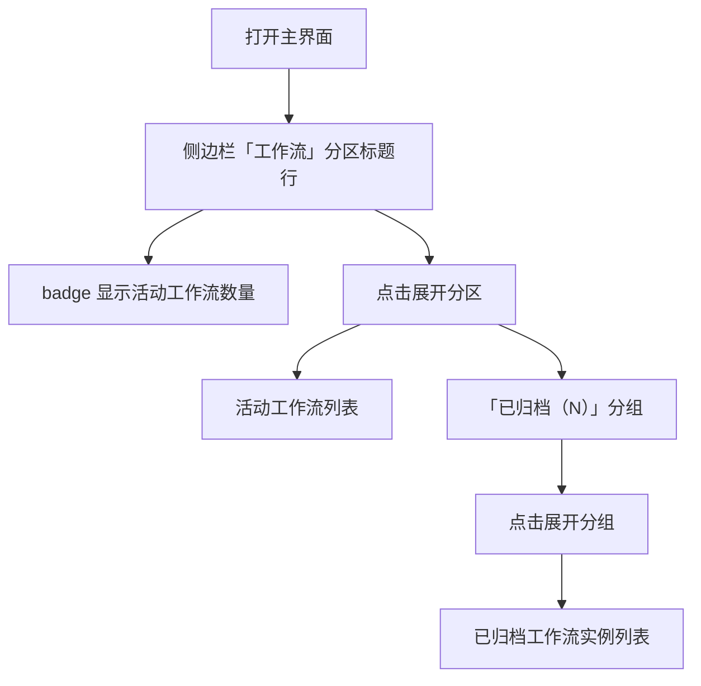

# 侧边栏数字 Badge 优化

**功能名称**: 侧边栏数字 Badge 优化（活动数量口径）
**PRD 版本**: v1.0
**创建日期**: 2026-11-07
**作者**: ZeroAsh Agent（需求来源：Deliay）

## 背景与目标

### 1.1 背景

需求来源：GitHub Issue [Deliay/z-agent-gear#462](https://github.com/Deliay/z-agent-gear/issues/462)「侧边栏数字badge优化」。

侧边栏「工作流」分区标题行的数字 badge 当前显示的是**总量（活动 + 已归档）**。典型场景：badge 展示 200，但展开分区后只有 2 个活动的工作流，其余 198 个均为已归档。badge 数字与用户展开后第一眼看到的内容（活动列表）严重不符，失去了「一眼判断当前有多少工作流在跑」的参考价值。

用户期望：badge 数字分开展示——分区标题行 badge 只显示活动数量，已归档数量在分区内的「已归档」分组上单独展示：

> - 工作流 [2]
>   - 已归档 [198]

侧边栏其余分区的现状口径核对：

- 「会话」分区 badge 已只统计活动会话，已归档会话由分区内「已归档（N）」分组单独计数展示——与期望口径一致，无需变更。
- 「主机」「网关」分区无归档概念，badge 口径保持不变。

### 1.2 目标

1. 「工作流」分区标题行的数字 badge 仅显示活动工作流数量，不再计入已归档工作流。
2. 已归档工作流数量继续由分区内的「已归档（N）」分组标题承载，保持现有的分开展示形态。
3. 只调整 badge 数字口径，不改变任何其他逻辑（数据加载、排序、分组、展开/折叠、点击跳转等全部保持现状）。

### 1.3 成功标准

| 指标 | 目标值 |
|------|--------|
| 工作流 badge 口径 | 存在 2 个活动 + 198 个已归档工作流时，「工作流」分区 badge 显示 2（不再显示 200） |
| 已归档分开展示 | 已归档数量仍在分区内「已归档（N）」分组标题上展示，N 为已归档数量 |
| 口径一致性 | 侧边栏各分区 badge 均只反映「活动/可用」对象数量，不含已归档对象 |
| 零回归 | 分区展开/折叠、聚合列表内容、已归档分组交互、条目点击跳转等现有行为完全不变 |

## 用户分析

### 2.1 目标用户

使用本产品编排与跟踪多个工作流的开发者用户，尤其是工作流实例数量大、历史归档多的重度用户。

### 2.2 用户场景

| 场景 | 用户角色 | 目标 | 痛点 |
|------|----------|------|------|
| 扫一眼侧边栏判断当前有多少工作流在进行 | 开发者 | badge 数字 = 实际活动的工作流数量 | badge 显示总量 200，实际只有 2 个活动的，数字失去参考意义 |
| 回顾历史工作流 | 开发者 | 需要时展开「已归档」分组查看历史实例 | 现有能力保留，无痛点 |

## 功能需求

### 3.1 功能概述

侧边栏「工作流」分区标题行的数字 badge 由「活动 + 已归档总量」改为仅显示活动工作流数量；已归档数量保持由分区内「已归档（N）」自折叠分组单独展示。除此之外不改变任何现有逻辑。

### 3.2 功能列表

#### 功能点 1: 工作流分区数字 badge 仅显示活动数量

- **描述**: 「工作流」分区标题行的数字 badge 统计口径由「活动 + 已归档总量」改为「仅活动数量」。分区收起状态下，用户仅凭 badge 即可知道当前有多少活动工作流。
- **用户价值**: badge 数字与展开后看到的活动列表一致，一眼可信；已归档的历史实例不再干扰对当前工作量的判断。
- **验收标准**:
  - [ ] 有活动与已归档工作流并存时，badge 数字 = 活动工作流数量（不含已归档）
  - [ ] 仅有已归档工作流、无活动工作流时，badge 显示 0
  - [ ] 全部为空时 badge 显示 0，分区形态不变

#### 功能点 2: 已归档数量保持分开展示

- **描述**: 已归档工作流数量继续由分区列表尾部的「已归档（N）」自折叠分组标题承载，交互（默认折叠、点击展开查看归档实例）保持现状不变。
- **用户价值**: 已归档数量仍可查看，但与活动数量在视觉上分离，互不混淆。
- **验收标准**:
  - [ ] 存在已归档工作流时，分区内展示「已归档（N）」分组，N 为已归档数量
  - [ ] 分组默认折叠，点击展开后可见已归档实例条目
  - [ ] 无已归档工作流时不渲染该分组

### 3.3 用户操作流程

### 3.4 页面/界面描述

| 页面 | 描述 | 关键元素 |
|------|------|---------|
| 主界面侧边栏 | 「工作流」分区标题行 badge 仅显示活动工作流数量；桌面端与移动端侧边栏口径一致 | 分区标题、数字 badge、「已归档（N）」分组 |

### 3.5 异常与边界情况

| 情况 | 预期行为 |
|------|---------|
| 无活动工作流、存在已归档工作流 | badge 显示 0；「已归档（N）」分组正常展示 |
| 活动与已归档均为空 | badge 显示 0；不渲染「已归档」分组 |
| 数据尚未加载完成 | 沿用现有聚合数据的加载与轮询刷新节奏，数字随数据到达更新，不引入新的加载态 |
| 已归档数量变化（归档/取消归档） | badge（活动数量）不受影响；「已归档（N）」分组数字随数据刷新更新 |

## 四、非功能需求

### 4.1 性能要求

- 本需求为纯展示口径调整，不新增任何数据请求，对页面性能无影响。

### 4.2 安全性要求

- 不改变任何数据的可见性口径：活动与已归档列表的数据范围与现状完全一致。

### 4.3 兼容性要求

- 桌面端与移动端侧边栏共用同一展示口径，均生效。
- 深色/浅色主题下 badge 展示无变化要求（沿用现有样式）。

## 五、依赖与约束

### 5.1 依赖

- 侧边栏现有数据口径已把活动工作流与已归档工作流作为两个独立集合下发，无需新增数据或接口。

### 5.2 约束

- 只改 badge 数字口径，不改其他逻辑：数据加载、排序、分组结构、展开/折叠、点击跳转、样式布局全部保持现状。
- 「已归档（N）」分组的展示形态与交互不变。

## 六、相关文档

- 需求来源：[Deliay/z-agent-gear#462](https://github.com/Deliay/z-agent-gear/issues/462)
- [[20261030-ui-optimization-phase4]] — UI 优化四期（侧边栏四分区与跨环境聚合、已归档分组）
- [[20261104-session-management-optimization]] — 会话管理优化（会话归档与侧边栏已归档分组）
