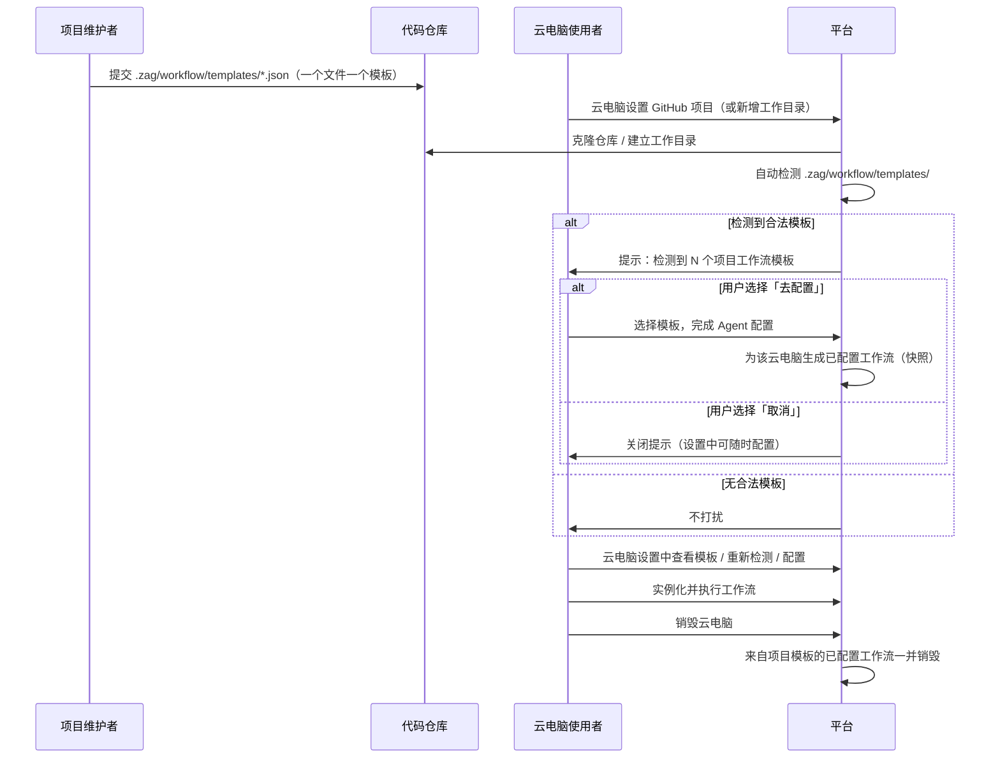
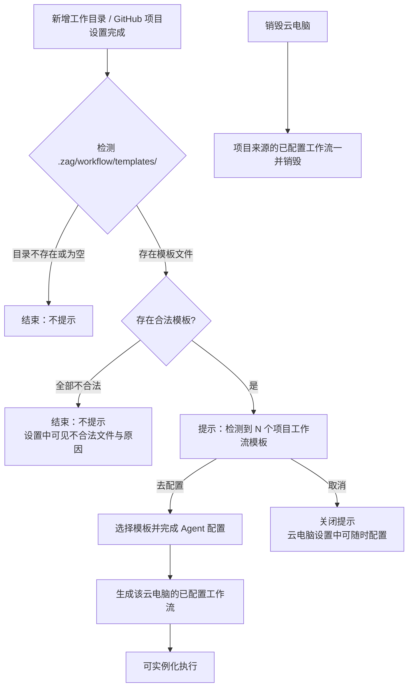

# 工作流模板项目持久化

**功能名称**: 工作流模板项目持久化（项目内工作流模板）
**PRD 版本**: v1.0
**创建日期**: 2026-11-07
**作者**: ZeroAsh Agent

## 背景与目标

### 1.1 背景

平台已具备完整的 Agent 工作流体系：工作流模板 → 已配置工作流 → 实例化的三级结构（见 [[../../released/20260808-agent-workflow]]、[[20260811-agent-workflow-phase2]]）。但目前工作流模板完全由平台托管——要么在平台设置页手工创建，要么使用平台内置模板，模板与项目代码仓库完全脱节。

实际上，每个项目有各自的工作流程：可能是这个项目特有的开发流程，也可能是那个项目的部署流程。项目的工作流程天然属于项目本身，最合理的存放位置是项目的代码仓库——随仓库分发、随仓库版本管理、团队成员克隆仓库即获得。同时，云电脑是一次性的临时工作环境（创建即启动、停止即销毁，见 [[20261023-cloud-container-optimization-phase2]]），为某台云电脑临时配置的工作流也不应永久留存在平台上，其生命周期应跟随这台云电脑。

### 1.2 目标

- 支持把工作流模板放置在代码仓库的约定目录 `.zag/workflow/templates/` 中，一个 JSON 文件对应一个工作流模板；平台读取该目录的文件列表，在系统中展示对应的工作流模板。
- 在云主机（云电脑）上新增工作目录（或完成 GitHub 项目设置）之后，自动做一次检测：如果该目录中包含合法的工作流模板文件，提示用户配置工作流；用户可以取消，之后仍可在云电脑的设置中随时进行配置。
- 用户可以为这一台云电脑临时配置工作流（基于项目模板完成 Agent 配置并落到该台云电脑）；这些已配置工作流的生命周期跟着这台云电脑走，销毁云电脑时，这些已配置工作流同时被销毁。

### 1.3 成功标准

- 项目仓库的 `.zag/workflow/templates/` 目录中放置合法的工作流模板 JSON 后，在云电脑设置中可以看到对应的工作流模板列表（含模板名称、节点数量、来源文件名）。
- 新增工作目录（或设置 GitHub 项目）完成后，若目录中存在合法模板，用户会收到配置提示；选择配置则进入配置流程，选择取消则不配置，且之后仍可在云电脑设置中随时配置。
- 基于项目模板配置完成的工作流出现在该云电脑的已配置工作流列表中，可正常实例化执行。
- 销毁云电脑后，为该云电脑临时配置的（来自项目模板的）已配置工作流一并消失；平台托管的模板与已配置工作流不受影响。
- 不合法（无法解析或校验不通过）的模板文件不会被静默忽略：用户能看到哪个文件不合法以及原因。
- 未在仓库中放置模板目录的项目，行为与现状完全一致，无回归。

## 用户分析

### 2.1 目标用户

- **项目维护者**：在仓库中维护项目专属的工作流模板（开发流程、部署流程等），希望模板随仓库分发给所有协作者。
- **云电脑使用者**：为项目拉起云电脑工作，希望克隆仓库后直接获得项目预定义的工作流，而不必在平台手工重建模板。
- **团队协作者**：加入同一个项目的不同成员，希望各自云电脑上使用同一套项目工作流程，保证流程一致。

### 2.2 用户场景

| 场景 | 用户角色 | 目标 | 痛点 |
|--|--|--|--|
| 在仓库中维护工作流模板 | 项目维护者 | 把项目的工作流程以模板文件形式写进仓库，随版本演进 | 模板只能存在平台里，与项目脱节，无法随仓库分发与评审 |
| 克隆项目后获得工作流 | 云电脑使用者 | 设置 GitHub 项目后立刻感知项目自带的工作流模板并一键配置 | 不知道项目有没有预定义流程，只能手工对照文档在平台重建 |
| 随时查看/配置项目工作流 | 云电脑使用者 | 在云电脑设置中随时查看项目模板、配置或补配工作流 | 取消一次提示后入口丢失，只能去平台设置从头配置 |
| 临时环境用完即弃 | 云电脑使用者 | 云电脑销毁后，为它临时配置的工作流不残留平台 | 临时配置的工作流永久留存，越积越多且与已销毁主机失去关联 |
| 多项目使用不同流程 | 团队协作者 | A 项目用开发流程、B 项目用部署流程，互不干扰 | 平台模板是全局列表，项目间流程混杂难以区分 |

## 功能需求

### 3.1 功能概述

支持把Agent 工作流模板以 JSON 文件形式放置在项目代码仓库的 `.zag/workflow/templates/` 目录中（一个文件对应一个工作流模板）。在云电脑上新增工作目录（含完成 GitHub 项目设置）后，平台自动检测该目录并展示其中的工作流模板；检测到合法模板时提示用户配置工作流（可取消，云电脑设置中可随时配置）。基于项目模板为云电脑配置的工作流是这台云电脑的临时资产：在云电脑销毁时一并销毁。

### 3.2 功能列表

#### 功能点 1: 项目工作流模板放置规范

- **描述**: 约定项目工作流模板的放置路径为仓库根目录下的 `.zag/workflow/templates/`。该目录下每一个 `.json` 文件对应一个工作流模板；文件内容描述一个完整的工作流模板（名称、描述、节点图等，与平台工作流模板同构）。模板文件随仓库提交、评审与分发；仓库中没有该目录时，该项目不提供工作流模板。
- **用户价值**: 项目流程以代码形式沉淀在仓库中，评审、版本演进、团队分发都沿用既有的代码协作方式。
- **验收标准**:
  - [ ] `.zag/workflow/templates/` 目录下的每个 `.json` 文件被识别为一个工作流模板。
  - [ ] 非法 JSON、或合法 JSON 但不满足工作流模板结构/校验规则的文件，被标记为不合法并给出原因，不作为可配置模板展示。
  - [ ] 目录不存在或目录为空时，视为项目无工作流模板，不产生任何提示。

#### 功能点 2: 新增工作目录后的自动检测与配置提示

- **描述**: 在云电脑上新增工作目录之后（含通过「GitHub 项目设置」克隆仓库建立工作目录、以及在云电脑中新增工作目录），平台自动对该工作目录做一次模板检测：
  - 检测到至少一个合法的工作流模板时，向用户展示提示（告知检测到多少个模板），并提供「去配置」与「取消」两个选择；
  - 用户选择「去配置」则进入工作流配置流程（见功能点 3）；选择「取消」则本次不配置，提示关闭，之后仍可在云电脑设置中随时配置（见功能点 4）；
  - 没有检测到合法模板时不打扰用户（不展示提示）。
- **用户价值**: 项目自带流程在第一次接触项目时主动呈现，零发现成本；取消权在用户手中，不打断当前工作。
- **验收标准**:
  - [ ] 新增工作目录（或设置 GitHub 项目）完成后自动触发检测；检测到合法模板时展示配置提示。
  - [ ] 提示中可选择「去配置」进入配置流程，或「取消」关闭提示。
  - [ ] 取消后，云电脑设置中仍可随时查看模板并完成配置。
  - [ ] 无模板、模板全部不合法、目录不存在时均不展示提示。

#### 功能点 3: 从项目模板为云电脑配置工作流

- **描述**: 用户从项目模板列表中选择一个模板，为该台云电脑配置工作流：确认工作流名称，并为其中的 AI 节点选择 Agent 配置（Harness 工具，可选模式与模型，与平台「配置工作流」体验一致）。配置完成后生成一个归属于这台云电脑的「已配置工作流」，出现在该云电脑的已配置工作流列表中，可正常实例化执行。已配置工作流是配置时刻的快照：项目仓库中的模板文件之后再修改，不影响已配置完成的工作流。
- **用户价值**: 一键把项目流程变成这台云电脑上可执行的工作流；快照语义保证仓库后续改动不打断进行中的工作。
- **验收标准**:
  - [ ] 配置界面以项目模板为基础，要求为每个 AI 节点选择 Agent 配置（Harness 工具必选，模式/模型可选）。
  - [ ] 配置完成后，该云电脑的已配置工作流列表中出现对应条目，并可实例化执行。
  - [ ] 已配置工作流能识别出来自项目模板（展示来源信息），与平台模板配置的工作流可区分。
  - [ ] 项目模板文件后续变更不影响已配置的工作流。

#### 功能点 4: 云电脑设置中的项目工作流区块

- **描述**: 云电脑的设置中新增项目工作流区块，随时可见可用：
  - 展示当前工作目录下检测到的项目工作流模板列表（模板名称、来源文件名、节点数量；不合法的文件单独标示并给出原因）；
  - 提供「重新检测」入口，模板文件在仓库中更新后可手动刷新；
  - 每个合法模板提供「配置」入口（进入功能点 3 的配置流程）；
  - 同时列出已为这台云电脑配置的（来自项目模板的）已配置工作流，可查看、删除。
- **用户价值**: 配置的完整入口常驻云电脑设置，不依赖一次性提示；模板更新后可主动刷新并补配。
- **验收标准**:
  - [ ] 云电脑设置中可见项目工作流区块：模板列表（含不合法文件标示与原因）与已配置工作流列表。
  - [ ] 「重新检测」后模板列表按仓库当前文件刷新。
  - [ ] 合法模板可随时进入配置流程。
  - [ ] 云电脑未运行（已停止/已销毁）时该区块不可操作（仅展示历史配置记录或明确不可用提示）。

#### 功能点 5: 已配置工作流生命周期跟随云电脑

- **描述**: 来自项目模板的已配置工作流是云电脑的临时资产，生命周期跟着这台云电脑走：销毁（删除）云电脑时，这些已配置工作流同时被销毁，不再出现在任何列表中。平台托管的工作流模板、以及从平台模板配置的已配置工作流不受云电脑销毁影响。已由这些工作流实例化产生的工作流实例与历史记录保留可查（实例自包含快照，不受影响）。
- **用户价值**: 临时环境的一切临时配置随环境一起消失，平台资产列表保持整洁，不留无主残留。
- **验收标准**:
  - [ ] 销毁云电脑后，为该云电脑配置的（来自项目模板的）已配置工作流一并删除，列表中不再出现。
  - [ ] 平台工作流模板与平台来源的已配置工作流不受影响。
  - [ ] 已创建的工作流实例及其历史在销毁后仍可查看（只读）。

### 3.3 用户操作流程

### 3.4 页面/界面描述

| 页面 | 描述 | 关键元素 |
|------|------|---------|
| 模板检测提示弹窗 | 新增工作目录后检测到合法模板时弹出 | 检测到的模板数量与名称列表、「去配置」「取消」按钮 |
| 云电脑设置 - 项目工作流区块 | 项目模板与已配置工作流的常驻入口 | 模板列表（名称/来源文件名/节点数量/合法性标示与原因）、「重新检测」、每模板「配置」入口、该云电脑的项目来源已配置工作流列表（查看/删除） |
| 工作流配置弹窗 | 基于项目模板完成配置 | 工作流名称（默认取模板名）、节点图预览、每个 AI 节点的 Agent 配置（Harness 工具/模式/模型）、确认/取消 |
| 已配置工作流列表（该云电脑） | 含项目来源的工作流 | 来源标示（项目模板 / 平台模板）、模板版本或文件名信息、实例化入口 |
| 工作流实例详情页 | 实例执行与历史 | 与现状一致（实例自包含，云电脑销毁后只读可查） |

### 3.5 异常与边界情况

| 情况 | 预期行为 |
|------|---------|
| 仓库中没有 `.zag/workflow/templates/` 目录 | 视为无模板，不提示，设置区块展示空态 |
| 目录存在但没有任何 `.json` 文件 | 视为无模板，不提示 |
| 模板文件为非法 JSON | 不作为可配置模板；设置区块中单独标示该文件不合法及原因；全部为非法时不弹配置提示 |
| 模板 JSON 合法但不符合工作流模板校验规则（如首节点非人类节点、存在循环依赖） | 同上：标示不合法与原因，不可配置 |
| 新增工作目录时云电脑不在运行中 | 检测无法进行，本次不提示；之后云电脑运行时可在设置中手动检测 |
| 用户取消配置提示 | 不配置任何工作流；设置中随时可再配置 |
| 同一模板被重复配置 | 允许：每次配置生成一个独立的已配置工作流（快照），名称可由用户调整 |
| 模板文件在仓库中被修改/删除 | 不影响已配置的工作流（快照）；「重新检测」后模板列表按当前文件刷新 |
| 云电脑停止（未删除） | 已配置工作流保留，云电脑恢复可用前不可操作；设置区块仅展示 |
| 云电脑销毁 | 项目来源的已配置工作流一并删除；工作流实例历史保留只读 |
| 工作目录被删除 | 为该目录检测模板的能力随之失效；已配置的工作流保留（仍归属云电脑），云电脑销毁时统一清理 |
| 本地控制器（非云电脑）的工作目录 | 本期不提供项目模板检测与临时配置（仅云电脑场景） |

## 四、非功能需求

### 4.1 性能要求

- 模板检测（读取目录与文件、解析校验）在秒级完成；新增工作目录后的提示在操作完成后立即出现。
- 模板文件大小与数量应有合理上限，单个超大文件或超量文件不应拖垮检测。

### 4.2 安全性要求

- 模板检测只读取约定目录 `.zag/workflow/templates/` 下的 `.json` 文件，不读取仓库其他内容。
- 模板文件内容作为数据对待：其中即使包含可执行语义的内容，也只按工作流模板结构解析，不产生任何直接执行。
- 配置、检测能力仅对云电脑归属用户（及其所在工作区成员，与既有可见性口径一致）开放。

### 4.3 兼容性要求

- 未放置模板目录的项目、未配置项目工作流的云电脑，行为与现状完全一致。
- 平台既有的工作流模板、已配置工作流、实例化与执行链路零回归。
- 旧版本云电脑工作环境不支持模板检测时优雅降级：不提示、设置区块提示需升级，不影响其他功能。

## 五、依赖与约束

### 5.1 依赖

- Agent 工作流体系（模板、已配置工作流、实例化）：[[../../released/20260808-agent-workflow]]、[[20260811-agent-workflow-phase2]]。
- 云电脑与 GitHub 项目设置（工作目录建立）：[[20261021-github-workload]]、[[20261023-cloud-container-optimization-phase2]]。
- 云电脑生命周期（创建即启动、停止即销毁、删除）：[[20261025-cloud-container-unlimited-lifetime]] 等。

### 5.2 约束

- 模板放置路径固定为 `.zag/workflow/templates/`，仅识别该目录下的 `.json` 文件（不递归子目录）。
- 一个 JSON 文件对应一个工作流模板；模板结构与校验规则与平台工作流模板一致。
- 本期仅覆盖云电脑（云主机）场景；本地控制器不在本期范围。
- 已配置工作流为配置时刻快照，不提供与仓库模板文件的自动同步。
- 生命周期跟随仅覆盖「来自项目模板的已配置工作流」；平台模板与其配置的已配置工作流不随云电脑销毁。

## 六、相关文档

- [[../../released/20260808-agent-workflow]] — Agent 工作流
- [[20260811-agent-workflow-phase2]] — Agent 工作流二期
- [[20261021-github-workload]] — Github 工作负载与云主机 Git 项目设置
- [[20261023-cloud-container-optimization-phase2]] — 云容器优化二期
- [[20261025-github-issues-workflow]] — 云电脑 GitHub Issues 联动工作流
- 技术提案：`docs/engineering/proposals/20261107-feat-workflow-template-project-persistence.md`
- 需求来源：GitHub Issue [Deliay/z-agent-gear#469](https://github.com/Deliay/z-agent-gear/issues/469)
