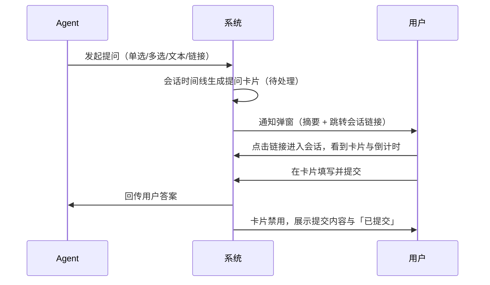
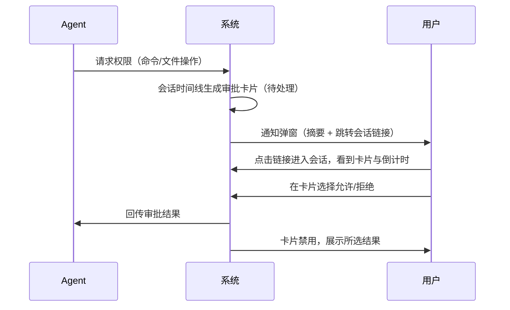
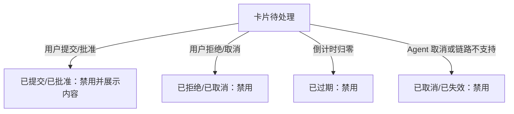
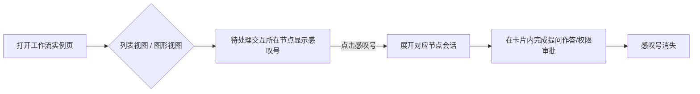

# 会话中的提问表单与权限审批作为会话内容出现

**功能名称**: 会话交互卡片（提问表单与权限审批）
**PRD 版本**: v1.0
**创建日期**: 2026-11-12
**作者**: z-agent-bot
**关联 Issue**: https://github.com/Deliay/z-agent-gear/issues/490

## 背景与目标

### 1.1 背景

Agent 在与用户对话过程中，会通过两类交互向用户请求信息或授权：

- **提问表单（Elicitation）**：Agent 向用户请求结构化输入，例如单选、多选、文本框填写，或要求打开一个外部链接完成授权。
- **权限审批（Ask Permission）**：Agent 在执行命令、修改文件等敏感操作前，请求用户批准或拒绝。

目前这两类交互以「弹窗」形式呈现：弹窗弹出时用户必须立即处理，弹窗关闭或超时后便无法找回。由此产生一系列问题：

1. **不可回溯**：提问/审批不是会话内容的一部分，用户在会话里看不到「Agent 什么时候问了我什么、我回答了什么」，对话上下文断裂。
2. **易错过**：用户暂时离开时弹窗超时消失，回到电脑前无法补答，也不知道 Agent 曾等待输入。
3. **工作流场景不可见**：工作流多个节点并行执行时，某个节点的会话在等待审批，用户只能在待办列表里看到一条通知，无法直观看出是哪个工作流节点被卡住，需要逐个打开节点会话排查。

### 1.2 目标

1. 提问表单与权限审批成为**会话内容**：随会话持久化保存，在对话时间线中以卡片形式展示，可随会话回看。
2. 卡片具备**完整状态迁移**：从「触发（等待用户输入）」到「已提交/已拒绝/已取消/已过期/已失效」，每个状态按时间顺序正确渲染；已终结的卡片表单禁用，并如实展示用户当时提交的内容。
3. 卡片展示**过期倒计时**，用户对「还剩多久可以作答」一目了然。
4. 弹窗保留但**降级为通知**：仅提示「某会话有新的提问/审批」并提供一个跳转到对应会话的链接，不再承载表单。
5. 工作流实例中，凡是有待处理审批/提问的节点，在**列表视图与图形视图**上都显示感叹号标记，点击感叹号即展开对应会话。

### 1.3 成功标准

- 所有提问/审批事件 100% 在对应会话的时间线中留下卡片记录，刷新页面后仍可见、状态正确。
- 用户无需弹窗即可在会话内完成提问作答与权限审批的全部操作；弹窗仅作为到达通知与跳转入口存在。
- 已提交/已拒绝/已取消/已过期的卡片不可再操作，且准确展示最终结果（含用户提交的内容）。
- 工作流实例页面上，用户一眼即可识别等待审批的节点，且从点击标记到进入对应会话不超过 1 次点击。
- 通知到达能力不退化：现有的待办通知（铃铛）链路继续工作，用户不会漏掉新的提问/审批。

## 用户分析

### 2.1 目标用户

- 使用 Agent 会话完成开发、运维等任务的个人用户（本地控制器与云电脑场景）。
- 使用工作流编排、需要及时人工介入（审批、补全信息）的用户。

### 2.2 用户场景

| 场景 | 用户角色 | 目标 | 痛点 |
|--|--|--|--|
| Agent 发起单选/多选/文本提问 | 会话用户 | 在对话中直接作答并留下记录 | 弹窗作答后无痕迹，无法回看自己答了什么 |
| Agent 请求执行命令/修改文件 | 会话用户 | 在会话内批准或拒绝，并留下审批记录 | 弹窗审批无痕迹，事后无法审计「谁批准的」 |
| 用户暂时离开座位 | 会话用户 | 回来后补看并处理等待中的交互 | 弹窗超时消失，不知道 Agent 还在等输入 |
| 工作流多节点并行 | 工作流用户 | 快速定位「哪个节点在等我处理」 | 只能看到一条通知，不知对应哪个节点，需逐个打开会话排查 |
| 会话已结束 | 会话用户 | 回看历史上所有的提问与审批结果 | 历史会话中完全没有这类记录 |

## 功能需求

### 3.1 功能概述

把 Agent 的提问表单（Elicitation）与权限审批（Ask Permission）从「一次性弹窗」升级为「会话时间线中的持久化卡片」：触发即在会话中生成一张可交互卡片，用户作答后卡片定格为最终状态并展示提交内容；通知弹窗降级为跳转入口；工作流节点上以感叹号标记等待处理的会话。

### 3.2 功能列表

#### 功能点 1: 会话内提问卡片

- **描述**: Agent 发起提问（单选、多选、文本、数字、开关、打开链接等）时，在会话时间线中按触发时刻插入一张提问卡片。卡片展示提问说明与对应表单控件，用户在卡片内直接填写并提交；也可拒绝或取消。链接模式的提问卡片展示目标链接与确认入口。
- **用户价值**: 提问成为对话的一部分，作答过程与结果都可随会话回看，不再依赖一次性弹窗。
- **验收标准**:
  - [ ] 提问触发后，会话时间线中实时出现对应卡片，位置与对话消息的时间顺序一致。
  - [ ] 单选、多选、文本、数字、开关等表单形态均可正确渲染与填写，必填项未填时不可提交。
  - [ ] 链接模式卡片展示链接并提供打开确认。
  - [ ] 提交成功后卡片表单禁用，并展示用户提交的内容与「已提交」状态。
  - [ ] 刷新页面/重新进入会话后，卡片及其状态保持正确。

#### 功能点 2: 会话内权限审批卡片

- **描述**: Agent 请求权限（执行命令、读写文件等）时，在会话时间线中插入审批卡片。卡片展示请求权限的操作内容（工具名称、命令/文件摘要、涉及位置）与审批选项按钮（如允许一次、总是允许、拒绝），用户在卡片内完成批准或拒绝。
- **用户价值**: 审批行为随会话留痕，批准了什么、何时批准的都有据可查。
- **验收标准**:
  - [ ] 权限请求触发后，会话时间线中实时出现审批卡片，展示操作摘要与全部审批选项。
  - [ ] 用户选择任一选项后，卡片立即禁用并展示所选结果与「已批准/已拒绝」状态。
  - [ ] 审批结果正确回传给 Agent，Agent 按结果继续或终止对应操作。
  - [ ] 刷新页面后卡片状态与所选结果保持正确。

#### 功能点 3: 卡片状态迁移与时序渲染

- **描述**: 每张卡片具有完整状态机：待处理（等待用户输入）→ 已提交/已批准/已拒绝/已取消/已过期/已失效。状态迁移过程完整记录，渲染严格按时间顺序：只有「触发」记录时卡片等待输入；出现「提交」记录后卡片禁用并展示提交内容；超时、Agent 取消、链路不支持等情况各自呈现对应终态。
- **用户价值**: 卡片状态永远真实可信，不会出现「显示可作答但实际已过期」的误导。
- **验收标准**:
  - [ ] 卡片状态随事件实时迁移（无需刷新页面）：待处理 → 各终态。
  - [ ] 同一交互只可能从「待处理」迁移到一个终态，不会出现状态回退或重复作答。
  - [ ] 已过期的卡片即使仍在倒计时显示窗口内到达终态，也立即禁用操作。
  - [ ] 历史会话中的卡片展示最终状态与提交内容，不提供操作入口。

#### 功能点 4: 过期倒计时

- **描述**: 待处理状态的卡片展示剩余可作答时间倒计时；倒计时归零后卡片自动进入「已过期」状态并禁用操作。
- **用户价值**: 用户对作答时限有明确预期，避免「填到一半已超时」。
- **验收标准**:
  - [ ] 待处理卡片展示实时倒计时（分:秒）。
  - [ ] 倒计时归零后卡片立即禁用并展示「已过期」。
  - [ ] 倒计时时长与 Agent 实际等待时限一致（卡片显示可作答的时间内提交一定有效）。

#### 功能点 5: 通知弹窗降级为跳转入口

- **描述**: 现有的提问/审批弹窗保留，但不再承载表单与审批按钮；弹窗仅展示「哪个会话有新的提问/审批」的摘要信息，以及一个跳转到对应会话的链接（按钮）。点击后进入对应会话并定位到待处理卡片。
- **用户价值**: 不打开会话时仍能即时收到提醒，且一次点击即可到达处理现场；表单只存在卡片一处，避免两处作答互相打架。
- **验收标准**:
  - [ ] 新提问/审批到达时，通知（弹窗/待办）照常出现，不依赖会话页是否打开。
  - [ ] 通知中提供跳转链接，点击后进入对应会话并定位到待处理卡片。
  - [ ] 通知内不再提供表单填写或审批按钮。
  - [ ] 用户在会话内卡片完成处理后，对应通知同步变为已处理状态。

#### 功能点 6: 工作流节点待审批感叹号

- **描述**: 工作流实例页面中，凡是其会话存在「待处理提问/审批」的节点，在节点上显示感叹号标记。列表视图与图形视图均需展示。点击感叹号即展开（打开）对应节点的会话，用户可直接处理。
- **用户价值**: 工作流哪里卡住了人一眼可见，一次点击直达处理现场。
- **验收标准**:
  - [ ] 列表视图中，待处理交互所在节点显示感叹号标记。
  - [ ] 图形视图中，待处理交互所在节点卡片同样显示感叹号标记。
  - [ ] 点击感叹号后展开对应节点的会话，且待处理卡片可见。
  - [ ] 交互处理完成后（或过期后），感叹号标记消失。
  - [ ] 节点无会话（未启动）或会话无待处理交互时，不显示感叹号。

### 3.3 用户操作流程

提问（Elicitation）主流程：

权限审批主流程：

超时与取消分支：

工作流待审批定位流程：

### 3.4 页面/界面描述

| 页面 | 描述 | 关键元素 |
|------|------|---------|
| 会话页 | 对话时间线中插入提问卡片与审批卡片，随消息流按时间排列 | 卡片标题、提问说明/操作摘要、表单控件或审批按钮、状态徽标、倒计时、提交结果展示 |
| 通知弹窗 | 降级后的通知形态，不再承载表单 | 摘要文案（哪个会话、什么类型的请求）、「前往会话处理」链接按钮 |
| 待办列表 | 保持现有通知入口能力 | 提问/审批待办条目，处理状态同步 |
| 工作流实例页-列表视图 | 节点行内展示待审批标记 | 节点名称旁感叹号图标，点击展开会话 |
| 工作流实例页-图形视图 | 节点卡片上展示待审批标记 | 节点卡片上的感叹号图标，点击展开会话 |

### 3.5 异常与边界情况

| 情况 | 预期行为 |
|------|---------|
| 倒计时归零后用户点击提交 | 卡片已禁用，无法提交；卡片展示「已过期」 |
| 用户在通知弹窗未关闭时已在会话卡片内作答 | 卡片与通知同步为已处理状态，不重复作答 |
| 同一交互重复触发（网络重试等） | 会话中只出现一张卡片，状态以第一次触发为准 |
| Agent 在用户作答前主动取消提问 | 卡片迁移为「已取消」并禁用，保留在会话时间线中 |
| 会话已结束/已归档，存在历史卡片 | 卡片只读展示最终状态与提交内容，不提供任何操作 |
| 链接模式提问的链接地址 | 仅允许 http/https 地址，其他协议不渲染为可点击链接 |
| 工作流节点尚未启动（无会话） | 不显示感叹号 |
| 交互处理完成或过期后 | 工作流节点感叹号消失（允许轮询级别的短暂延迟） |
| 旧会话（功能上线前创建） | 不补历史卡片，会话展示与行为保持不变 |
| 权限审批超时 | 与提问一致：卡片迁移为「已过期」，Agent 侧按用户未响应处理 |

## 四、非功能需求

### 4.1 性能要求

- 卡片渲染不阻塞会话消息的加载与滚动；会话历史加载耗时不因卡片而明显增加。
- 倒计时刷新仅影响卡片自身的倒计时文本，不引起整页或整条时间线重渲染。
- 通知到卡片出现的延迟在秒级以内（与现有消息实时性一致）。

### 4.2 安全性要求

- 只有会话归属用户本人可以查看卡片内容并作答；任何情况下不允许代替他人审批。
- 已过期待处理、已终结的卡片，服务端必须拒绝迟到的作答，不能仅依赖前端禁用。
- 链接模式仅允许 http/https 协议，防止恶意协议链接。
- 审批结果一经确定不可更改。

### 4.3 兼容性要求

- 旧版本 Agent/控制器不产生新卡片时，会话行为与现有弹窗链路保持一致，无回归。
- 功能上线前的历史会话不补卡片，展示不受影响。
- 移动端与桌面端会话页均可正常展示与操作卡片；工作流列表/图形视图标记在两种终端均可用。

## 五、依赖与约束

### 5.1 依赖

- Agent 提问（Elicitation）与权限请求（Ask Permission）事件的现有接入链路（事件到达、响应回传）继续复用。
- 会话消息的持久化与实时推送能力（卡片需要随会话保存并实时出现）。
- 工作流实例与节点会话的关联关系（节点 → 会话）用于待审批标记定位。
- 现有待办通知链路（铃铛/待办列表）继续作为通知载体。

### 5.2 约束

- 弹窗必须保留（作为通知与跳转入口），不得整体移除通知能力。
- 卡片作答时限以 Agent 实际等待时限为准，页面倒计时不得给出「仍可作答」的错误预期。
- 状态迁移必须单调：待处理只能迁移到终态，终态不可再变。
- 不改变 Agent 协议本身（提问/权限请求的事件格式不变），仅改变平台侧的呈现与留存方式。

## 六、相关文档

- 关联 Issue：https://github.com/Deliay/z-agent-gear/issues/490
- 技术提案：`docs/engineering/proposals/20261112-feat-session-interaction-cards.md`
