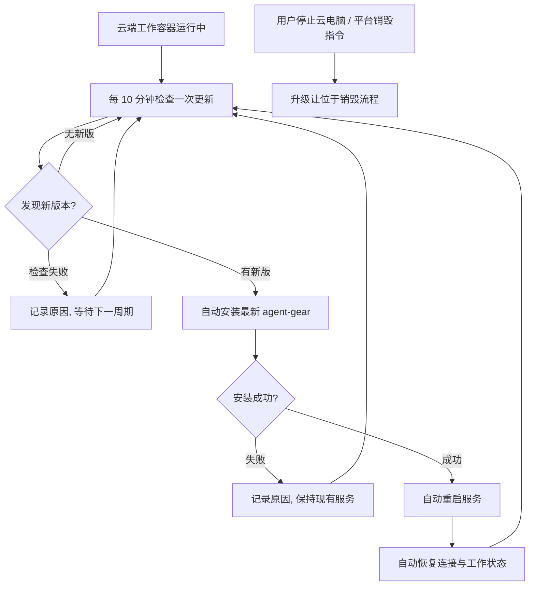

# 云环境 agent-gear 自动升级

**功能名称**: 云环境 agent-gear 自动升级
**PRD 版本**: v1.0
**创建日期**: 2026-11-13
**作者**: ZeroAsh

## 背景与目标

### 1.1 背景

云端工作容器（含云电脑）内的 agent-gear 包只在容器启动时安装/更新一次：容器启动后，只要 agent-gear 进程持续健康运行，其版本就被固定在整个容器生命周期内。随着云电脑取消最长运行时间限制，长期在线的云电脑会越来越多地停留在旧版本上：

- 平台发布新版 agent-gear（新能力、缺陷修复、协议增强）后，存量运行中的云电脑无法获得，用户只能销毁重建云电脑才能升级，工作现场被迫放弃。
- 存量环境版本长期分化，旧版本触发最低版本门禁被拒之、或缺少新协议能力的风险持续累积，最终仍需管理员介入清理。
- 云电脑已支持保活与断线重连，进程重启对用户的代价已经很低，具备「在线升级」的基础条件。

来源：GitHub Issue [Deliay/z-agent-gear#496](https://github.com/Deliay/z-agent-gear/issues/496)。

### 1.2 目标

- 运行中的云端工作容器自动保持 agent-gear 为最新版：每 10 分钟检查一次更新，发现新版本则安装最新版并重启服务。
- 升级全过程自动化，无需用户或管理员进入容器执行任何操作。
- 升级失败可收敛：不影响当前正在运行的服务，不产生重启风暴，下一周期自动重试。
- 升级重启后连接自动恢复，用户会话与工作环境继续使用。

### 1.3 成功标准

- 新版 agent-gear 发布后，运行中的云电脑在一个检查周期（10 分钟）加上安装与重启耗时内自动切换到新版本，全程无人工介入。
- 检查失败或安装失败时，容器内现有服务不受影响，日志记录可读原因，下一检查周期自动重试。
- 升级重启完成后，云电脑自动恢复在线，用户可继续既有会话与操作。
- 无新版本时不产生任何安装或重启动作；升级相关日志可完整追溯每次检查与升级决策。
- 既有能力不回归：云电脑创建、初始化、会话、保活、版本门禁与销毁流程行为与现状一致。

## 用户分析

### 2.1 目标用户

- **前台用户（云电脑使用者）**：长时间使用同一台云电脑运行会话与任务，期望环境自动保持最新，不因版本落后被迫销毁重建。
- **平台维护人员**：发布 agent-gear 新版本，期望存量运行环境快速、自动收敛到最新版，降低版本分化带来的兼容与运维成本。

### 2.2 用户场景

| 场景 | 用户角色 | 目标 | 痛点 |
|--|--|--|--|
| 平台发布新版 agent-gear | 平台维护人员 | 存量运行中的云电脑自动升级到最新版 | 旧版本长期滞留，只能等用户销毁重建或人工清理 |
| 用户长期运行同一台云电脑 | 前台用户 | 环境自动保持最新，工作不中断 | 版本固定，新能力与修复不可得，升级需放弃工作现场 |
| 升级源暂时不可用 | 平台维护人员 | 现有服务不受影响，恢复后自动继续升级 | 担心升级机制把健康环境变成不可用 |
| 升级后新版自身异常 | 平台维护人员 | 异常可观测、可经版本回滚自动恢复 | 担心升级后服务不可用且无法自愈 |

## 功能需求

### 3.1 功能概述

为云端工作容器增加 agent-gear 运行期自动升级能力：容器运行期间每 10 分钟检查一次是否有新版本，发现新版本则自动安装最新版 agent-gear 并重启服务，重启后自动恢复连接与工作状态；检查或安装失败仅记录并在下一周期重试，不影响现有服务。

### 3.2 功能列表

#### 功能点 1: 周期性更新检查

- **描述**: 云端工作容器运行期间，每 10 分钟自动检查一次 agent-gear 是否有新版本（与当前运行版本比较）。检查节奏固定为 10 分钟，平台运维可按环境需要调整或关闭。
- **用户价值**: 新版本发布后存量环境在一个检查周期内即可感知，无需等待容器重建。
- **验收标准**:
  - [ ] 容器启动后按 10 分钟周期持续检查更新，容器存活期间持续生效。
  - [ ] 每次检查在容器日志中留有记录（检查时间、当前版本、最新版本）。
  - [ ] 检查失败（如升级源不可达）时不影响当前运行服务，下一周期自动重试。
  - [ ] 无新版本时不执行任何安装或重启动作。

#### 功能点 2: 自动安装最新版本

- **描述**: 检查发现新版本后，容器自动从既定软件来源安装最新的 agent-gear 包；安装过程幂等，重复执行不产生重复环境。
- **用户价值**: 升级动作完全自动，用户与管理员无需进入容器操作。
- **验收标准**:
  - [ ] 发现新版本后自动开始安装，日志中可见安装开始与完成后的版本号。
  - [ ] 安装来源与容器既有安装口径一致，不引入新的下载渠道。
  - [ ] 安装失败时记录可读原因，当前运行的旧版本服务不受影响，下一周期重试。
  - [ ] 同一时刻不会并发执行多个安装，重复触发被正确合并。

#### 功能点 3: 安装后自动重启服务

- **描述**: 新版本安装成功后自动重启 agent-gear 服务；重启后自动恢复与云端的连接，用户会话与工作环境继续使用。重启造成的连接中断为秒级。
- **用户价值**: 升级即刻生效，云电脑无需销毁重建即可获得新版本能力。
- **验收标准**:
  - [ ] 安装成功后服务自动重启，并以新版本恢复连接、正常在线。
  - [ ] 重启期间平台侧表现为短暂断连并自动恢复，云电脑不因此被判定销毁。
  - [ ] 重启后已完成的初始化（已安装工作负载、环境配置）不重复执行。
  - [ ] 用户主动停止云电脑或平台销毁指令到达时，升级与重启动作让位于销毁流程，不再重新拉起服务。

#### 功能点 4: 失败收敛与可观测

- **描述**: 检查、安装、重启任一环节失败均有明确日志；失败不构成重试风暴（重试节奏始终受 10 分钟检查周期约束）；升级全过程不输出密钥、令牌等敏感信息。
- **用户价值**: 平台维护人员可区分「无新版」「检查失败」「安装失败」「重启失败」，快速定位问题；异常环境有明确表现而非静默恶化。
- **验收标准**:
  - [ ] 每次检查的结果（无新版/发现新版/检查失败）均有日志。
  - [ ] 安装与重启结果（成功版本号/失败原因）均有日志。
  - [ ] 连续失败时服务保持既有行为，日志按周期产出，无高频重复动作。
  - [ ] 日志不包含控制器密钥、连接令牌等敏感内容。

### 3.3 用户操作流程

### 3.4 页面/界面描述

| 页面 | 描述 | 关键元素 |
|------|------|---------|
| 云电脑列表/详情 | 无界面变更；升级重启期间云电脑短暂断连后自动恢复在线 | 云电脑状态 |
| 容器运行日志 | 展示周期检查、自动安装与重启过程 | 当前版本、最新版本、安装结果、重启记录、失败原因 |

### 3.5 异常与边界情况

| 情况 | 预期行为 |
|------|---------|
| 升级源不可达或检查请求失败 | 记录原因，当前服务不受影响，下一周期自动重试 |
| 安装失败（网络中断、包损坏等） | 记录原因，继续运行旧版本，下一周期自动重试 |
| 安装的新版本自身存在缺陷无法正常运行 | 按既有保活语义退避重启保持容器存活；发布侧将「最新版」指回稳定版本后，下一检查周期自动安装该版本并恢复 |
| 升级重启与正在执行的初始化/工作负载重叠 | 重启按既有的进程中断语义处理：重连后不重复初始化，被中断任务按既有裁决与超时兜底处理 |
| 升级重启瞬间用户正在会话 | 连接秒级中断后自动恢复，会话可继续；正在进行的一次模型调用可能按既有中断语义结束 |
| 检查到新版时恰好收到销毁指令 | 销毁优先：停止升级与重启，容器按既有销毁流程退出 |
| 容器处于重启退避窗口时到达检查点 | 本轮仅做检查与安装（如有新版），由既有保活重启链路自然带出新版本，不强制打断退避节奏 |
| 运维关闭自动升级 | 不再执行周期检查与安装，启动时的安装/更新与保活行为保持现状 |

## 四、非功能需求

### 4.1 性能要求

- 单次检查为轻量查询，不产生可感知的容器资源占用，不影响会话与任务执行。
- 检查节奏固定为 10 分钟，不因失败而缩短间隔；安装仅在发现新版本时执行。

### 4.2 安全性要求

- 安装来源与容器既有 agent-gear 安装口径完全一致，不允许升级机制引入任意下载地址或执行任意脚本。
- 升级相关日志不输出控制器密钥、连接令牌、模型密钥等敏感信息。

### 4.3 兼容性要求

- 存量运行中的旧容器不具备本能力，维持现状；重建（停止后重新创建）后的新容器自动获得本能力，不涉及数据迁移。
- 云电脑创建、初始化、保活、版本门禁、会话与销毁等既有功能行为不回归。
- 自动升级始终安装「最新版」，与平台最低版本门禁方向一致（向上升级），不引入降级行为；发布侧回滚最新版指针后，容器按同一机制自然回落到该版本。

## 五、依赖与约束

### 5.1 依赖

- 依赖容器运行环境既有的保活、自更新与版本门禁链路（进程退出自动拉起、启动时安装/更新、最低版本校验与一次性自升级）。
- 依赖容器可访问既定的内部软件来源获取 agent-gear 最新版本。
- 依赖云电脑断线重连与初始化去重能力，保证升级重启后状态正确恢复。

### 5.2 约束

- 本期仅覆盖云端工作容器（云电脑与普通工作容器）内的 agent-gear 自动升级，不改变本地控制器的行为。
- 不新增用户界面与管理页面；升级状态经容器日志体现。
- 检查周期默认为 10 分钟；重启策略为「安装成功即重启」，「空闲时重启」等更细粒度策略不在本期范围。
- 自动升级不扩展为通用依赖更新机制，仅处理 agent-gear 包本身。

## 六、相关文档

- 需求来源：[GitHub Issue Deliay/z-agent-gear#496 — 云环境支持自动升级](https://github.com/Deliay/z-agent-gear/issues/496)
- 技术提案：[[../../engineering/proposals/20261113-feat-cloud-agent-gear-auto-upgrade.md]]
- [[20261025-cloud-host-keepalive.md]] — 云电脑保活与 worker 用户
- [[20261017-controller-version-requirement.md]] — 云端工作容器控制器版本兼容与自动恢复
- [[../shipping/20261025-cloud-container-unlimited-lifetime.md]] — 云电脑取消最长运行时间限制
