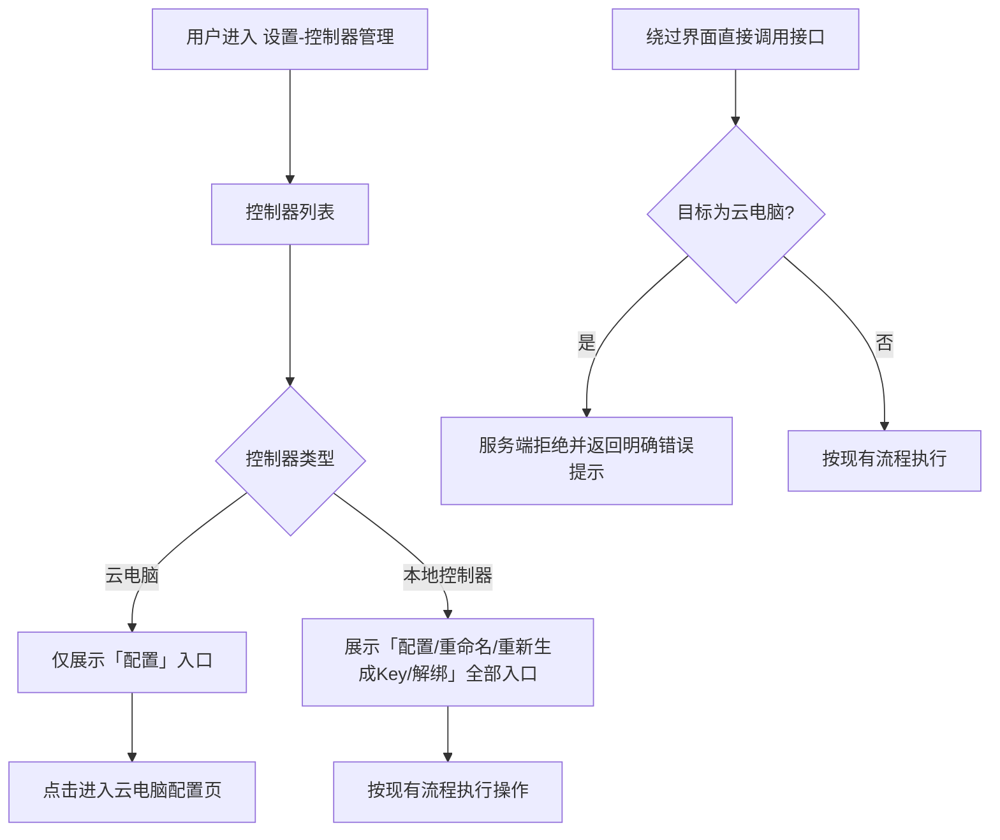

# 设置中控制器的操作按钮优化

**功能名称**: 云控制器操作按钮优化
**PRD 版本**: v1.0
**创建日期**: 2026-11-13
**作者**: ZeroAsh Agent（需求来源：Deliay）

## 背景与目标

### 1.1 背景

需求来源：GitHub Issue [Deliay/z-agent-gear#489](https://github.com/Deliay/z-agent-gear/issues/489)「设置中控制器的操作按钮优化」。

云电脑（云控制器）是由平台统一创建、运行与回收的托管主机：名称在创建时确定、连接凭据随实例下发、生命周期（启动、停止、销毁、删除）由平台按云电脑管理流程统一编排。

当前「设置-控制器管理」把云电脑与本地控制器一并列出，并提供完全相同的操作入口：「重命名」「重新生成Key」「解绑/删除」。这三个操作与云电脑的托管属性冲突：

1. **重命名**：云电脑名称由创建流程确定，并在云电脑各管理视图中统一展示；在控制器管理中单独改名会造成两处信息不一致。
2. **重新生成Key**：云电脑实例内的连接凭据在创建时固化下发，重新生成后旧凭据立即失效，而运行中的实例无法获取新凭据，云电脑将永久离线、不可恢复。
3. **解绑/删除**：该操作直接移除控制器的连接凭据与管理档案，云电脑随即失联；但云端实例可能仍在运行并持续计费，且该路径绕过了云电脑「停止/删除」的正规生命周期管理（计费结算、会话收尾、记录留档）。

### 1.2 目标

1. 云电脑在「设置-控制器管理」中不再展示「重命名」「重新生成Key」「解绑/删除」三个操作入口。
2. 服务端拒绝针对云电脑的这三个操作，并返回明确的错误提示——前端隐藏只是展示收敛，服务端拒绝才是权威约束。
3. 本地控制器及其他非云电脑类型控制器的现有操作与体验完全不变。
4. 云电脑的生命周期管理继续由云电脑自身的「停止/删除」流程承担，不受本需求影响。

### 1.3 成功标准

| 指标 | 目标值 |
|------|--------|
| 操作入口收敛 | 云电脑条目不展示「重命名」「重新生成Key」「解绑/删除」入口，「配置」入口保留可用 |
| 服务端拒绝 | 通过接口直接对云电脑发起三个操作，均被拒绝并返回明确的错误提示 |
| 本地零回归 | 本地控制器的重命名、重新生成Key、解绑/删除与配置功能全部保持现状 |
| 生命周期闭环 | 云电脑的停止、删除仍由云电脑管理流程独立完成，不依赖控制器管理入口 |

## 用户分析

### 2.1 目标用户

- **云电脑使用者**：在「设置-控制器管理」中查看自己名下的主机（本地控制器与云电脑），需要对云电脑进行配置查看，但不应通过通用控制器操作破坏云电脑的托管状态。
- **平台运营方**：需要保证云电脑的名称、凭据、生命周期在全平台一致、可追溯。

### 2.2 用户场景

| 场景 | 用户角色 | 目标 | 痛点 |
|------|----------|------|------|
| 查看云电脑配置 | 云电脑使用者 | 从控制器管理进入云电脑配置页，查看工作区、可用工具等 | 无（「配置」入口保留） |
| 误操作云电脑 | 云电脑使用者 | 在控制器列表中对云电脑点了「重新生成Key」或「解绑」 | 云电脑立即失联且不可恢复，但云端实例可能仍在计费运行 |
| 管理本地控制器 | 本地控制器使用者 | 对自己的本地控制器执行重命名、重新生成Key、解绑 | 无（保持现状） |

## 功能需求

### 3.1 功能概述

「设置-控制器管理」中的云电脑条目不再展示「重命名」「重新生成Key」「解绑/删除」三个操作入口；服务端同步拒绝针对云电脑的这三个操作并返回明确提示。本地控制器的全部操作保持现状。

### 3.2 功能列表

#### 功能点 1: 云电脑操作入口收敛

- **描述**: 在「设置-控制器管理」的控制器列表中，云电脑条目不展示「重命名」「重新生成Key」「解绑/删除」操作入口，仅保留「配置」入口；本地控制器条目展示全部现有操作入口。
- **用户价值**: 从界面上消除对云电脑的破坏性误操作入口，用户不会误触导致云电脑失联。
- **验收标准**:
  - [ ] 云电脑（无论在线、离线、启动中、已停止待删除）在控制器列表中不展示「重命名」「重新生成Key」「解绑/删除」入口
  - [ ] 云电脑条目保留「配置」入口，点击可正常进入配置页
  - [ ] 本地控制器条目仍展示「配置」「重命名」「重新生成Key」「解绑」（未绑定时为「重新生成Key」「删除」）入口

#### 功能点 2: 服务端操作拒绝

- **描述**: 服务端对针对云电脑的「重命名」「删除（解绑）」「重新生成Key」三个操作一律拒绝执行，返回明确的错误提示，且不产生任何副作用（凭据不失效、档案不删除、实例不收到关机指令）。
- **用户价值**: 即使绕过界面直接调用接口，云电脑也不会被破坏，托管状态始终一致。
- **验收标准**:
  - [ ] 对云电脑执行重命名，操作被拒绝并返回明确错误提示，云电脑名称不变
  - [ ] 对云电脑执行删除（解绑），操作被拒绝并返回明确错误提示，控制器档案与连接凭据保持不变，云电脑实例不收到任何指令
  - [ ] 对云电脑执行重新生成Key，操作被拒绝并返回明确错误提示，旧凭据仍然有效，云电脑连接状态不变
  - [ ] 对不存在的控制器执行三个操作，行为与现状一致（按「不存在」处理）

#### 功能点 3: 本地控制器零变化

- **描述**: 本地控制器（及其他非云电脑类型控制器）的三个操作与「配置」入口保持现状，不受本需求影响。
- **用户价值**: 本地控制器用户的既有使用习惯不受打扰。
- **验收标准**:
  - [ ] 本地控制器可正常重命名、重新生成Key、解绑/删除，行为与现状一致
  - [ ] 本地控制器重新生成Key 后旧 Key 立即失效、可重新连接的现有行为不变

### 3.3 用户操作流程

### 3.4 页面/界面描述

| 页面 | 描述 | 关键元素 |
|------|------|---------|
| 设置-控制器管理 | 控制器列表中，云电脑条目仅展示「配置」操作入口；本地控制器条目展示全部现有操作入口 | 控制器列表、云电脑标识、「配置」按钮 |

### 3.5 异常与边界情况

| 情况 | 预期行为 |
|------|---------|
| 云电脑离线 / 启动中 / 停止中 | 与在线状态无关，同样不展示三个操作入口、服务端同样拒绝 |
| 云电脑已销毁 | 已销毁云电脑本就不在控制器列表展示，无新增行为 |
| 绕过界面直接调用接口 | 服务端拒绝并返回明确错误提示，无任何副作用 |
| 团队工作区成员视角 | 成员可见的云电脑同样不展示三个操作入口、服务端同样拒绝（对所有成员生效） |
| 历史已被重命名的云电脑 | 名称保持现状，不回填、不迁移 |
| 不存在的控制器 | 按现有「不存在」口径处理，行为不变 |

## 四、非功能需求

### 4.1 性能要求

- 本需求为展示收敛与操作拒绝，不新增数据请求，对页面与接口性能无影响。

### 4.2 安全性要求

- 服务端拒绝是权威约束：即使前端入口被绕过，云电脑的凭据与档案也不会被修改或删除。
- 拒绝操作不产生任何副作用：不使凭据失效、不删除档案、不向云电脑实例下发指令。

### 4.3 兼容性要求

- 不涉及数据迁移：存量云电脑与本地控制器数据完全不变。
- 云电脑实例内运行的工作组件无需升级。

## 五、依赖与约束

### 5.1 依赖

- 云电脑管理功能（已上线）：云电脑的停止、删除由云电脑管理流程承担。
- 控制器管理功能（已上线）：本需求在其上收敛操作入口。

### 5.2 约束

- 仅收敛云电脑的三个操作入口与服务端许可，不改变云电脑的其他展示（状态、版本、最后心跳等）与「配置」入口。
- 本地控制器及其他非云电脑类型控制器的行为零变化。
- 云电脑的生命周期操作（停止、删除）仍只在云电脑管理流程中提供，不在控制器管理中新增入口。

## 六、相关文档

- 需求来源：[Deliay/z-agent-gear#489](https://github.com/Deliay/z-agent-gear/issues/489)
- [[20260517-agent-controller-v1]] — Agent 控制器管理 v1
- [[20260830-regenerate-controller-key]] — 控制器Key重新生成
- [[20261014-cloud-agent-phase2]] — 云Agent二期（K8s 云端工作容器）
