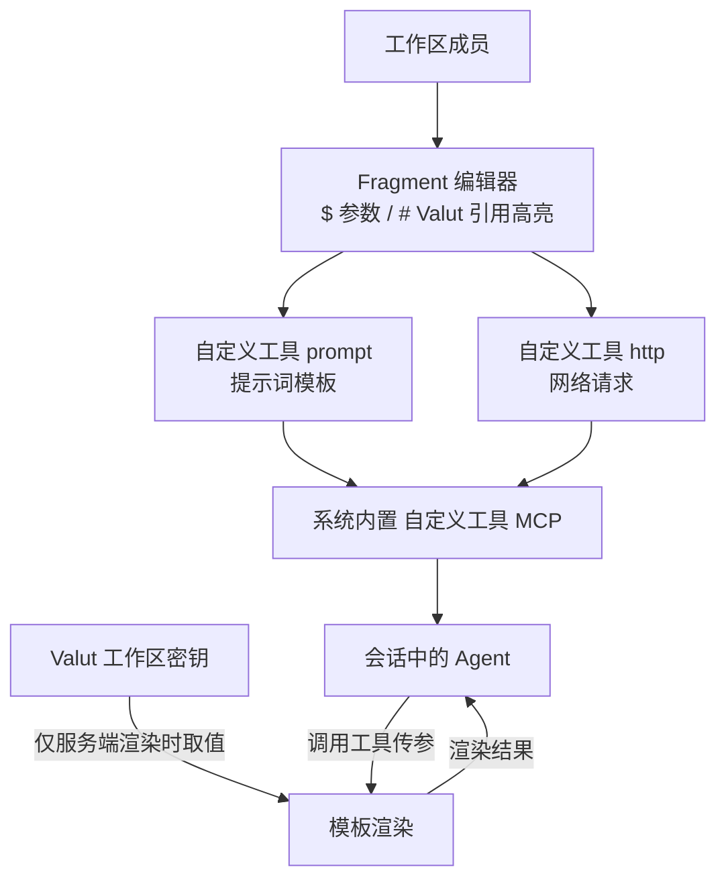
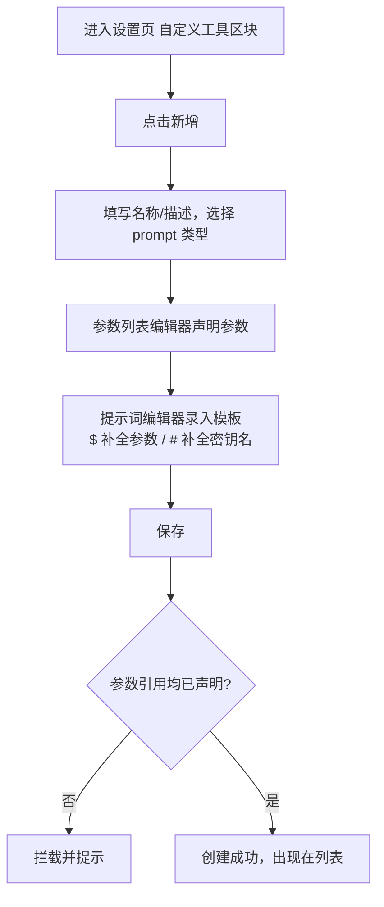
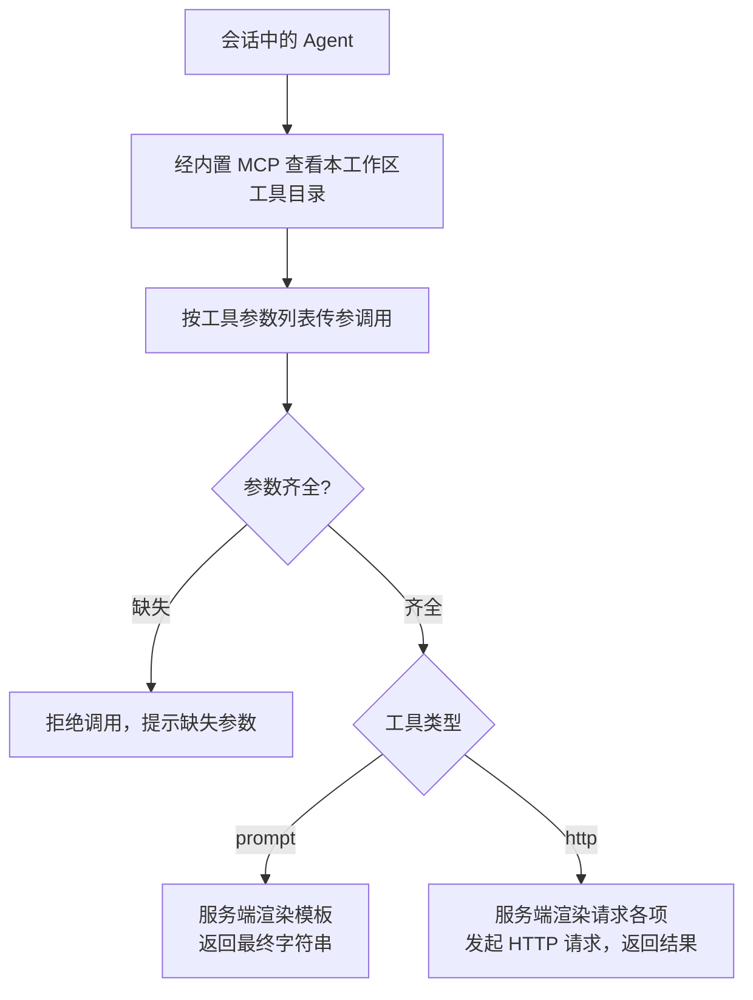
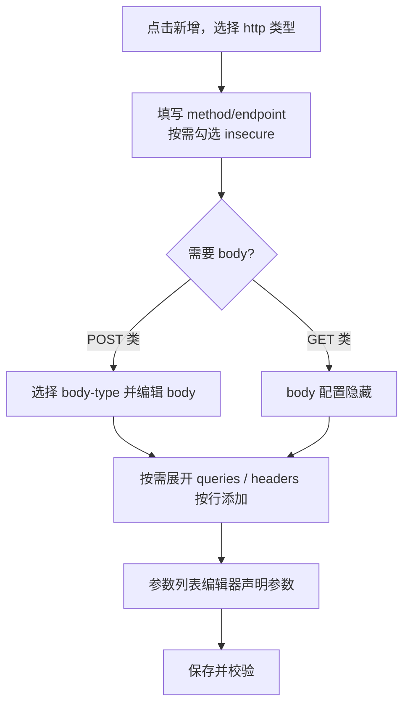

# 自定义渲染模板 + 自定义工具 MCP

**功能名称**: 自定义渲染模板 + 自定义工具 MCP
**PRD 版本**: v1.0
**创建日期**: 2026-11-13
**作者**: z-agent-bot
**需求来源**: [GitHub Issue Deliay/z-agent-gear#449](https://github.com/Deliay/z-agent-gear/issues/449)

## 背景与目标

### 1.1 背景

Valut（#448）落地后，平台具备了工作区级加密密钥底座，但密钥目前只能被「自定义 MCP 的 Bearer 凭据」单点消费。用户在驱动 Agent 工作时仍有两类高频诉求无法满足：

1. **在文本中安全地引用密钥与参数**：例如「拉取 `https://foo.bar/{城市}/weather/{月份}`」这类带参数的请求地址、需要内嵌 token 的提示词。目前要么把密钥明文贴进提示词（泄露面大），要么完全无法参数化复用。
2. **把可复用的「动作」沉淀为工具**：同一工作区内反复使用的「一段提示词模板」「一次固定 HTTP 请求」无法沉淀为 Agent 可调用的工具，每次都要在会话里手工重复描述。

本期引入「自定义渲染模板」——一套把**纯文本 / Valut 引用 / 参数引用**三类片段（Fragment）按声明的格式渲染为一个字符串的标准能力，以及承载它的「自定义工具 MCP」：工作区成员可以把一段提示词或一次 HTTP 请求封装为工具，经系统内置 MCP 提供给本工作区会话中的 Agent 调用。

### 1.2 目标

- **标准模板渲染**：提供统一的 Fragment 渲染能力——纯文本原样输出；Valut 引用在服务端按当前工作区取值，取不到即报错；参数引用取调用方传入的对应参数，缺失即报错。输出格式支持 Generic（原样）/ Json（JSON 转义）/ Uri（URL 编码），格式集合可随需求扩展。
- **可复用 Fragment 编辑器**：一个标准编辑器组件，支持单行与多行两种模式，纯文本、Valut 引用名、参数名混合高亮展示；输入 `$` 弹出可用参数补全、输入 `#` 弹出当前工作区可用 Valut 密钥名补全（仅限手动创建的密钥）。编辑器**绝不对引用求值**，只展示引用的名称；求值只发生在服务端渲染时。
- **Valut MCP**：会话中的 Agent 可以通过系统内置 MCP 看到本会话租户+工作区内可用的 Valut 密钥名单（仅名称），但**不提供任何获取密钥值的工具**。
- **自定义工具 MCP（工作区）**：工作区成员可创建两类自定义工具——prompt 类型（把声明的参数代入提示词模板，渲染后返回字符串）与 http 类型（由服务端发起一次 HTTP 请求并返回结果）；工具经系统内置 MCP 对本工作区的会话提供，参数缺失时拒绝调用。

### 1.3 成功标准

- 用户可在设置页按工作区管理自定义工具（新增/编辑/删除），权限口径与 Valut 一致（全局工作区仅管理员可编辑、普通工作区全部成员可编辑、非成员不可见）。
- prompt 工具被 Agent 调用时：参数齐全则返回模板替换完成的字符串；缺少任一声明参数时调用被拒绝并明确提示缺失的参数。
- http 工具被调用时由服务端发起请求：endpoint/headers/queries/body 中的 Valut 引用与参数被正确渲染并按声明格式编码；请求的状态与响应内容回传给 Agent；勾选 insecure 时不校验目标证书。
- 任何界面、接口返回、日志中均不出现 Valut 明文值；Agent 侧只能经工具调用结果间接获得渲染产物，无法经 MCP 直接取密钥值。
- 会话中的 Agent 能列出当前工作区可用 Valut 密钥名（仅手动创建的密钥），但没有任何途径经 MCP 取得密钥值。
- Fragment 编辑器在 prompt 工具表单与 http 工具表单（body/endpoint/headers/queries 各处）中复用；参数列表编辑器在 prompt 与 http 两种工具类型间复用。

## 用户分析

### 2.1 目标用户

- **团队管理员**：在全局工作区统一维护团队共享的自定义工具（如内部信息查询、固定 webhook 触发），供全租户成员的会话使用。
- **团队开发 / 个人用户**：在自己的工作区沉淀项目级提示词模板与 HTTP 请求工具，让 Agent 按固定口径执行重复动作。

### 2.2 用户场景

| 场景 | 用户角色 | 目标 | 痛点 |
|--|--|--|--|
| 参数化提示词 | 开发者 | 把「查某城市某月天气」封装为工具，调用时只传城市与月份 | 每次在会话里手写整段提示词，口径漂移 |
| 请求中引用密钥 | 开发者 | HTTP 工具的 header 中引用 Valut 里的 token，Agent 调用时自动带出 | 明文 token 贴进提示词，泄露面大且轮换困难 |
| 团队共享工具 | 团队管理员 | 在全局工作区维护内部查询工具，全员会话可用 | 工具说明靠文档流转，Agent 无法直接调用 |
| 查看可用密钥 | 开发者 | 让 Agent 知道工作区里有哪些密钥可引用 | 密钥名单靠人脑记忆，引用名写错无法及时发现 |
| 内网自签服务调用 | 开发者 | 调用自签证书的内网接口 | 默认证书校验失败，无法发起请求 |

## 功能需求

### 3.1 功能概述

本期包含四块能力：**标准 Fragment 渲染**（Plain/Valut/Parameter 三类片段 × Generic/Json/Uri 三种格式的统一渲染规则，求值只发生在服务端）、**可复用 Fragment 编辑器**（单行/多行、引用名高亮、`$`/`#` 自动补全、三种编辑器模式、编辑器不求值）、**Valut MCP**（系统内置 MCP 向会话提供当前工作区可用密钥名单，不提供取值工具）、**自定义工具 MCP**（工作区级 prompt / http 两类工具的创建、编辑、删除，经系统内置 MCP 对本工作区会话提供动态工具目录）。

### 3.2 功能列表

#### 功能点 1: 标准 Fragment 渲染

- **描述**: 一段模板由若干 Fragment 组成，每个 Fragment 包含：类型（Plain 纯文本 / Valut 密钥引用 / Parameter 参数引用）、值（纯文本内容 / 引用的密钥名 / 引用的参数名）、格式（Generic / Json / Uri）。渲染规则：
  - 类型为 Plain：直接输出值，值为空则省略；
  - 类型为 Valut：以值作为密钥名，在当前工作区的**手动创建密钥**中取值，取不到即报错（渲染失败）；
  - 类型为 Parameter：从调用方传入的参数中取同名参数值，取不到即报错（渲染失败）；
  - 格式为 Generic：渲染结果原样输出；
  - 格式为 Json：对渲染结果做一次 JSON 字符串转义（仅对 Valut/Parameter 类型有意义）；
  - 格式为 Uri：对渲染结果做 URL 编码。
  格式集合为可扩展设计，后续可按需求增加（如 Base64），本期交付 Generic / Json / Uri 三种。
- **用户价值**: 一处定义、处处一致的模板渲染语义，密钥只在服务端内存中出现。
- **验收标准**:
  - [ ] 三类片段按上述规则渲染；Valut 取不到、参数缺失时渲染失败并给出明确错误（指明是哪个引用失败）
  - [ ] Generic/Json/Uri 三种格式输出正确（Json 结果为合法 JSON 字符串字面量、Uri 结果经正确 URL 编码）
  - [ ] 渲染只在服务端发生；任何客户端请求都不会返回密钥明文（除工具调用本身的最终渲染产物）
  - [ ] Valut 引用取值范围仅限当前工作区的**手动创建密钥**，引用服务托管密钥名视为取不到

#### 功能点 2: 可复用 Fragment 编辑器

- **描述**: 提供一个标准的可复用编辑器组件，承载 Fragment 内容的录入与展示：
  - 支持**单行**与**多行**两种模式；
  - 以纯文本为基础，Valut 引用与参数引用以高亮标记（引用块）混合展示——**只展示引用的名称，绝不求值**；
  - 输入 `$` 弹出参数补全列表（来自当前工具声明的参数及其描述），选中后插入参数引用块；
  - 输入 `#` 弹出当前工作区可用的 Valut 密钥名补全列表（仅限**手动创建**的密钥），选中后插入 Valut 引用块；
  - 引用块可整体删除（按一次退格删除整个引用块），不可在块内编辑；
  - 编辑器模式三选一：**Generic**（默认，插入的引用块格式为 Generic）、**Json**（插入的 Valut/Parameter 引用块格式为 Json，纯文本仍为 Generic）、**Uri**（插入的引用块格式为 Uri，纯文本仍为 Generic）。
- **用户价值**: 以接近纯文本的录入体验写出结构化模板，引用名所见即所得，杜绝密钥值出现在任何界面。
- **验收标准**:
  - [ ] 单行模式下回车不产生换行；多行模式支持换行
  - [ ] 纯文本、Valut 引用、参数引用混合展示且两类引用高亮样式可区分（如不同颜色标记）
  - [ ] `$` 补全仅列出当前工具已声明的参数；`#` 补全仅列出手动创建的 Valut 密钥名
  - [ ] 编辑器内容可完整保存并在再次打开时原样还原（含引用块类型与格式）
  - [ ] 编辑器任何状态下不展示、不请求密钥值

#### 功能点 3: Valut MCP（名单可见、不可取值）

- **描述**: 系统内置 MCP 向会话提供「当前会话租户+工作区内可用的 Valut 密钥名单」能力：Agent 可列出当前工作区**手动创建**密钥的名称；**不提供任何获取密钥值的工具**。名单随会话所属工作区解析，跨工作区的密钥不可见。
- **用户价值**: Agent 知道「有哪些密钥可引用」，引导用户在模板中使用正确的引用名，同时密钥值零暴露。
- **验收标准**:
  - [ ] 会话中的 Agent 可获取当前工作区手动创建密钥的名称列表
  - [ ] 名单只含名称信息，任何 MCP 工具都不返回密钥值
  - [ ] 名单口径为会话所属工作区；切换工作区后会话可见名单随之不同
  - [ ] 服务托管的密钥（如 `service-*` 分组）不出现在名单中

#### 功能点 4: 自定义工具基础管理（工作区）

- **描述**: 设置页新增「自定义工具」区块（标题带「工作区」badge），按当前工作区展示自定义工具列表（名称、类型、描述、更新时间），支持新增、编辑、删除。工具基础属性：名称（工作区内唯一）、描述（可选）、类型（prompt / http）、参数列表、类型对应配置，以及归属工作区、租户、创建人与创建/更新时间。权限口径与 Valut 一致：全局工作区的工具仅管理员可编辑、全员可用；普通工作区的工具全部成员可编辑、成员可用；非成员不可见。
- **用户价值**: 工具按工作区沉淀与共享，团队与个人场景权限清晰。
- **验收标准**:
  - [ ] 设置页出现「自定义工具」区块，标题带「工作区」badge，列表随当前工作区切换
  - [ ] 新增工具时名称在工作区内唯一，重名被拒绝
  - [ ] 全局工作区中非管理员的一切新增/编辑/删除被拒绝；普通工作区非成员按「不存在」处理
  - [ ] 删除工具有二次确认；删除后本会话及后续会话中该工具不再可被调用

#### 功能点 5: prompt 类型自定义工具

- **描述**: prompt 类型工具把「一段提示词模板」封装为工具。配置为一段 Fragment 内容（多行编辑器）。调用时要求传入参数列表中声明的全部参数，缺少任一参数即拒绝调用并提示缺失项；参数齐全时将模板中的参数引用与 Valut 引用渲染为最终字符串返回给 Agent。例如工具「查询天气」声明参数 `city`、`month`，模板为「下面是查询目标城市的链接，你使用 webfetch 进行拉取 `https://foo.bar/$city/weather/$month`」，调用时传入 city 与 month，返回替换完成的字符串。
- **用户价值**: 提示词模板一次沉淀、反复调用，口径不再漂移；密钥引用随渲染注入、不明文外流。
- **验收标准**:
  - [ ] 新增工具选择 prompt 类型后，表单出现「参数列表」与「提示词（Fragment 编辑器，多行）」两个组件，并展示提示文案「这个工具会要求 AI 输入参数列表中的参数，并将提示词的内容进行模板替换」
  - [ ] 模板中引用的参数必须已在参数列表中声明，未声明的引用保存时被拦截
  - [ ] Agent 调用时缺少任一声明参数，调用被拒绝并提示缺失的参数名
  - [ ] 参数齐全时返回渲染完成的字符串；Valut 引用取不到时调用失败并提示是哪个引用失败

#### 功能点 6: http 类型自定义工具

- **描述**: http 类型工具把「一次网络请求」封装为工具，由**服务端**发起请求。配置项：
  - **method**：常用 HTTP Method 下拉选择，支持自定义输入；
  - **endpoint**：Fragment 内容（单行，Uri 模式）；
  - **insecure**：勾选项，指示是否无视证书（不校验目标服务 TLS 证书）；
  - **body**：body-type 支持 text（text/plain）/ json（application/json）/ form（multipart/form-data）。text 与 json 使用 Fragment 编辑器（json 启用 Json 编辑器模式）；form 使用键值行编辑器，每行含 key（单行文本）、type（文本 / 文件，**本期不做文件支持，保留 type 字段做扩展**）、value（Fragment 编辑器）；GET 类操作隐藏 body 配置，POST 类操作默认 body-type 为 json；
  - **headers**：KeyValuePair 列表，默认折叠为一个勾选项，勾选后展开按行添加；key 做基础 header 校验（如 Cookie 只允许一个等重复性校验），value 使用 Fragment 编辑器（单行），渲染后正确编码；
  - **queries**：KeyValuePair 列表，同样勾选展开；key 做基础 query 校验，value 使用 Fragment 编辑器（Uri 模式），渲染后正确编码；
  - 表单布局：`[method][endpoint][insecure]` / `[body]` / `[queries]` / `[headers]` / `[保存][取消]`。
  调用时服务端渲染全部 Fragment 内容后发起请求，把请求结果（状态与响应内容）返回给 Agent。
- **用户价值**: 固定口径的网络请求沉淀为工具；密钥经 header/query/body 引用注入，全程不离开服务端；自签证书的内网服务也能接入。
- **验收标准**:
  - [ ] method 下拉含常用 Method 且可自定义输入合法方法名
  - [ ] GET 类方法不展示 body 配置；POST 类方法 body-type 默认 json
  - [ ] headers/queries 折叠为勾选项，勾选后展开按行编辑；key 的重复性校验生效（如 Cookie 只允许一个）
  - [ ] form 的 type 字段仅可选「文本」，「文件」选项保留但本期不可用并明确提示
  - [ ] insecure 勾选后请求不校验证书；未勾选时自签证书请求失败并返回可理解的错误
  - [ ] 调用结果包含请求状态与响应内容；请求不可达/超时时返回明确错误
  - [ ] 密钥与参数引用在 endpoint/headers/queries/body 各处均被正确渲染与编码

#### 功能点 7: 参数列表编辑器（通用复用）

- **描述**: prompt 与 http 两类工具共用同一个「参数列表编辑器」组件：按行维护参数（标识、名称、描述），支持新增、编辑、删除、排序；参数标识在工具内唯一。该组件在两种工具类型的表单中复用，行为一致。
- **用户价值**: 参数维护体验一致，一处学会处处可用。
- **验收标准**:
  - [ ] 参数列表编辑器在 prompt 与 http 表单中为同一组件，交互一致
  - [ ] 参数标识重复时被拦截；参数标识需为合法标识符（可用于 `$` 引用与工具入参）
  - [ ] 删除参数时，若模板中仍引用该参数，保存被拦截并提示先移除引用

### 3.3 用户操作流程

新增 prompt 自定义工具流程：

Agent 调用自定义工具流程：

新增 http 自定义工具流程：

### 3.4 页面/界面描述

| 页面 | 描述 | 关键元素 |
|------|------|---------|
| 设置页 - 自定义工具区块 | 工作区级自定义工具管理（标题带「工作区」badge） | 工具列表（名称、类型徽标、描述、更新时间）、新增/编辑/删除入口、空态引导 |
| 自定义工具新增/编辑对话框 | 配置一个自定义工具 | 名称、描述、类型选择（prompt/http）、参数列表编辑器、类型专属配置区、提示文案、保存/取消 |
| prompt 配置区 | 录入提示词模板 | 多行 Fragment 编辑器、提示「这个工具会要求 AI 输入参数列表中的参数，并将提示词的内容进行模板替换」 |
| http 配置区 | 配置一次网络请求 | method 下拉（可自定义）、endpoint（单行 Fragment 编辑器）、insecure 勾选、body 区（按方法与 body-type 切换编辑器）、queries/headers 勾选展开区 |
| Fragment 编辑器 | 可复用模板录入组件（多处复用） | 纯文本录入、Valut/参数引用块高亮、`$`/`#` 自动补全弹层、单行/多行模式、Generic/Json/Uri 编辑器模式 |

### 3.5 异常与边界情况

| 情况 | 预期行为 |
|------|---------|
| 模板引用了未声明的参数 | 保存时被拦截并提示具体引用名；无法保存 |
| 删除仍被模板引用的参数 | 保存被拦截，提示先移除模板中的引用 |
| 调用时缺少声明参数 | 调用被拒绝，明确提示缺失的参数名 |
| 渲染时 Valut 引用取不到（不存在/被删除/服务托管密钥名） | 调用失败并提示是哪个引用失败；不返回部分内容 |
| Agent 尝试通过 Valut MCP 取密钥值 | 不存在此类工具；任何取值诉求均无入口 |
| `#` 补全列表 | 仅含当前工作区手动创建的密钥名；服务托管密钥不出现 |
| 引用块内编辑 | 不支持；引用块为整体，可整体删除后重新插入 |
| http 工具目标不可达/超时/自签证书（未勾 insecure） | 调用返回明确错误，不影响其他工具与会话 |
| form 的 type 选择「文件」 | 本期不可用并提示；保存被拦截 |
| headers 中重复添加 Cookie 等唯一性 header | 保存被拦截并提示 |
| 同名工具 | 工作区内重名被拒绝 |
| 全局工作区非管理员编辑 | 操作被拒绝并提示无权限；查看与使用不受影响 |
| 非成员访问普通工作区工具 | 一律按「不存在」处理，不泄露存在性 |
| 删除工具后，进行中会话继续调用 | 调用失败并提示工具不存在 |
| 切换工作区 | 自定义工具区块与 Valut 补全名单随当前工作区切换 |

## 四、非功能需求

### 4.1 性能要求

- 自定义工具列表、编辑器补全列表的加载响应时间与既有设置区块相当，无明显可感知劣化。
- http 工具调用的请求超时有明确上限，长时间不响应的目标不会拖垮调用方。

### 4.2 安全性要求

- **值不可见是安全红线**：Valut 的 value 在任何前端界面、接口响应、日志输出中都不得出现明文；渲染求值只发生在服务端内部。
- Valut MCP 与任何 MCP 工具都不提供获取密钥值的能力；Agent 只能经工具调用结果间接获得最终渲染产物。
- http 工具由服务端发起请求：密钥与渲染中间过程不离开服务端；请求与响应内容不进入日志（沿用平台脱敏口径）。
- 工作区权限为安全红线：任何跨工作区访问按「不存在」处理，不泄露存在性。
- insecure 仅影响证书校验，且为显式勾选行为，界面给出风险提示。

### 4.3 兼容性要求

- 既有 Valut、自定义 MCP、会话 MCP 下发链路不受影响；本期新增能力为纯增量。
- 存量工作区零迁移负担：自定义工具为全新能力，无存量数据。
- Fragment 编辑器为新增可复用组件，不改变任何既有页面行为。

## 五、依赖与约束

### 5.1 依赖

- 依赖 Valut（#448）已落地的工作区密钥底座（手动创建密钥的名单与取值能力）。
- 依赖多租户二期已落地的工作区体系（全局工作区/普通工作区、租户角色）——自定义工具的权限构造复用该体系。
- 依赖既有「系统内置 MCP 对会话提供工具」的通道（会话装配与转发链路）。

### 5.2 约束

- Valut 引用取值范围仅限当前工作区**手动创建**的密钥；服务托管密钥不可被模板引用。
- Fragment 编辑器绝不对引用求值；求值只发生在服务端渲染时。
- 本期自定义工具仅 prompt / http 两种类型；http 的 form body 不做文件支持（保留 type 字段做扩展）。
- 自定义工具仅对本工作区的会话可见可用；本期不做跨工作区共享/继承。
- 格式集合本期交付 Generic / Json / Uri；后续格式（如 Base64）按需求逐次增加。
- http 工具由服务端发起请求，目标地址不做内网/外网限制（与既有自定义 MCP 转发同口径）；insecure 由用户显式勾选。

## 六、相关文档

- 需求来源：[GitHub Issue Deliay/z-agent-gear#449 — 自定义渲染模板+自定义工具MCP](https://github.com/Deliay/z-agent-gear/issues/449)
- 依赖需求：[GitHub Issue Deliay/z-agent-gear#448 — MCP+Valut功能迭代](https://github.com/Deliay/z-agent-gear/issues/448)
- 技术提案：[[../../engineering/proposals/20261113-feat-fragment-template-custom-tools.md]]
- 关联文档：[[20261104-mcp-valut-iteration.md]]（Valut 工作区密钥底座，本期 Valut 引用与名单能力的来源）
- 关联文档：[[20261028-multi-tenant-phase2.md]]（工作区与角色权限体系，本期「（工作区）」权限模式的基础）
