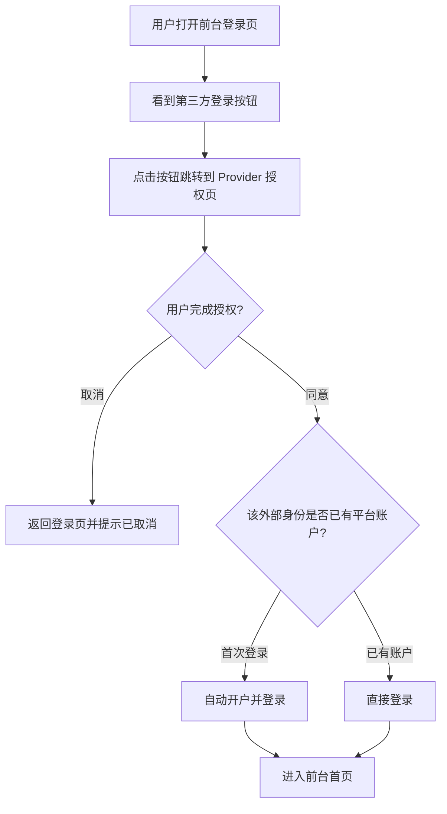
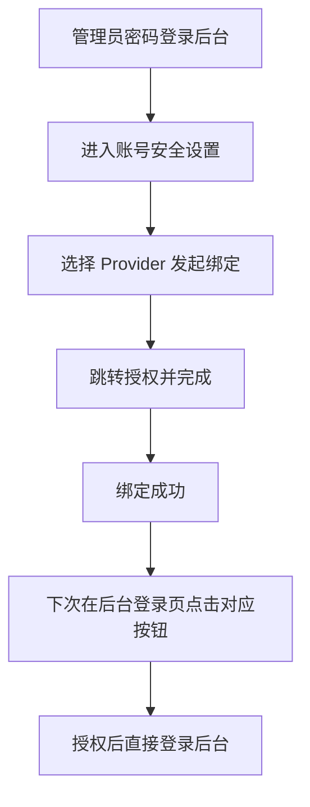

# 支持自定义 OIDC 登录和 GitHub OAuth 登录

**功能名称**: 自定义 OIDC 登录与 GitHub OAuth 登录
**PRD 版本**: v1.0
**创建日期**: 2026-11-13
**作者**: z-agent-bot
**来源**: GitHub Issue [Deliay/z-agent-gear#503](https://github.com/Deliay/z-agent-gear/issues/503)

## 背景与目标

### 1.1 背景

平台目前仅支持「用户名 + 密码」登录：前台用户由管理员在后台开户，后台管理员使用内置种子帐号。对于已经拥有统一身份认证体系（如企业 IdP、Keycloak、Authentik、Azure AD 等）的团队，以及习惯使用 GitHub 帐号身份的团队，密码登录带来两套帐号体系并存、密码管理负担与入职/离职帐号生命周期无法联动的问题。

Issue #503 提出：需要支持 OIDC 和 GitHub OAuth 登录，由后台统一配置，并在前台、后台登录界面展示额外的跳转登录按钮。

### 1.2 目标

1. 管理员可在管理后台配置全局的 OIDC Provider（可多个），并分别指定其是否可用于前台用户登录、后台管理员登录。
2. 管理员可在管理后台方便地配置 GitHub OAuth（单条），并分别指定其是否可用于前台、后台登录。
3. 前台、后台登录界面在 OIDC Provider / GitHub OAuth 启用后，展示额外的跳转登录按钮，用户点击后经授权完成登录。
4. 前台首次使用外部身份登录时自动完成开户，无需管理员手工介入。
5. 现有用户名密码登录能力完全保留，作为兜底的本地登录方式。

### 1.3 成功标准

- 管理员能在 5 分钟内完成一个 OIDC Provider 或 GitHub OAuth 的配置并启用。
- 用户在前台登录页可见所有「适用于前台」的第三方登录入口，点击后可完成登录并进入首页。
- 管理员在后台登录页可见所有「适用于后台」的第三方登录入口，已完成绑定的管理员可完成登录并进入后台。
- 停用某个 Provider 后，对应登录入口立即从登录页消失，且该身份不再能登录。
- 已有密码登录用户的登录流程零变化。

## 用户分析

### 2.1 目标用户

- **平台管理员（运维）**：负责部署与配置平台，希望将平台登录接入团队既有的身份认证体系。
- **前台用户（团队成员）**：使用云电脑、会话、工作流等能力的开发者，希望用公司统一帐号或 GitHub 帐号登录。
- **后台管理员**：管理模型、容器、租户、计费的管理人员，希望用统一身份登录后台而非记忆独立密码。

### 2.2 用户场景

| 场景 | 用户角色 | 目标 | 痛点 |
|--|--|--|--|
| 企业接入 SSO | 平台管理员 | 配置企业 IdP 的 OIDC Provider，让团队成员用公司帐号登录 | 目前只能逐个手工开户并分发密码，离职无法统一吊销 |
| 开源团队用 GitHub 身份 | 平台管理员 | 配置 GitHub OAuth，让成员用 GitHub 帐号登录前台 | 成员已有 GitHub 身份，不愿维护新密码 |
| 成员日常登录 | 前台用户 | 在登录页点击「使用 GitHub 登录」，跳转授权后进入平台 | 首次需要管理员开户并告知密码，流程割裂 |
| 管理员登录后台 | 后台管理员 | 用自己的企业帐号/ GitHub 帐号登录后台 | 后台仅一组种子帐号密码，无法区分操作者身份 |

## 功能需求

### 3.1 功能概述

平台新增「第三方登录」能力：管理员在管理后台统一配置 OIDC Provider（可多条）与 GitHub OAuth（单条），并按「前台登录 / 后台登录」两个应用场景分别启用；启用后前台与后台登录页展示对应跳转登录按钮，完成授权后即完成登录。前台首次登录自动开户；后台登录要求管理员预先绑定外部身份。

### 3.2 功能列表

#### 功能点 1: 后台配置 OIDC Provider

- **描述**: 管理后台新增「登录认证」配置入口，管理员可新增、编辑、启用/停用、删除 OIDC Provider。每条 Provider 包含：显示名称、Issuer 地址、Client ID、Client Secret（仅写入、不回显）、应用范围（可用于前台登录 / 可用于后台登录，可多选）、启用开关。支持配置多条 OIDC Provider。配置页展示平台各端回调地址，便于在 IdP 侧登记。
- **用户价值**: 团队可将平台登录接入自有身份认证体系，统一帐号生命周期管理。
- **验收标准**:
  - [ ] 管理员可成功新增一条 OIDC Provider，Client Secret 保存后不可被读取回显。
  - [ ] 可编辑、停用、删除已有 Provider；停用/删除后登录页不再展示对应入口。
  - [ ] Issuer 地址、Client ID 等关键字段缺失或格式非法时给出明确校验提示。
  - [ ] 应用范围未勾选任何一端时，该 Provider 不出现在任何登录页。
  - [ ] 配置页展示前台与后台的回调地址，可直接复制。

#### 功能点 2: 后台配置 GitHub OAuth

- **描述**: 在同一「登录认证」配置入口，管理员可配置 GitHub OAuth（Client ID、Client Secret、应用范围、启用开关），全平台仅一条。同样展示回调地址。Client Secret 仅写入、不回显。
- **用户价值**: 面向开发者团队，零成本启用 GitHub 帐号登录。
- **验收标准**:
  - [ ] 管理员可配置并启用 GitHub OAuth，保存后 Secret 不可回显。
  - [ ] 停用后前台/后台登录页不再展示 GitHub 登录入口。
  - [ ] 应用范围可按前台/后台分别勾选。

#### 功能点 3: 前台登录页第三方登录与自动开户

- **描述**: 前台登录页在密码登录表单之外，展示所有「已启用且适用于前台」的登录按钮（每个 OIDC Provider 一个按钮，文案为「使用 {Provider 显示名称} 登录」；GitHub 启用时展示「使用 GitHub 登录」）。点击后跳转至对应授权页，用户授权完成后回到前台并自动登录进入平台。若该外部身份首次出现，平台自动为其创建前台账户（自动开户），并赋予一个可后续修改的初始用户名；再次登录时直接进入已有账户。
- **用户价值**: 成员无需等待管理员开户，授权即可使用平台；体验与主流 SaaS 一致。
- **验收标准**:
  - [ ] 登录页按钮与实际启用的 Provider 列表一致（启用/停用即时生效）。
  - [ ] 完成授权后新用户可正常进入前台首页，且后台租户列表可见其自动开通的账户。
  - [ ] 同一外部身份再次登录进入同一账户，不重复开户。
  - [ ] 自动开户用户名冲突时自动派生唯一用户名，不报错。
  - [ ] 用户在授权页取消授权时，返回登录页并给出「已取消授权」提示。
  - [ ] 密码登录表单与流程保持原样。

#### 功能点 4: 后台登录页第三方登录与管理员绑定

- **描述**: 后台登录页展示所有「已启用且适用于后台」的登录按钮。出于安全考虑，外部身份必须事先与某个管理员账户绑定后方可登录后台：管理员先使用密码登录后台，在「账号安全」设置中选择某个已启用的 Provider 发起绑定，完成授权后该外部身份与其管理员账户建立关联；之后可在登录页点击对应按钮直接登录后台。未绑定的外部身份尝试登录后台时，给出「该身份未绑定任何管理员账户」的明确提示。管理员亦可在「账号安全」中解除绑定。
- **用户价值**: 管理员可以用日常身份登录后台，同时避免「IdP 中任何人都能成为平台管理员」的安全风险。
- **验收标准**:
  - [ ] 后台登录页按钮与实际启用且适用于后台的 Provider 列表一致。
  - [ ] 管理员可在登录状态下完成绑定，绑定后即可用该身份从登录页登录后台。
  - [ ] 未绑定的外部身份登录后台被明确拒绝并提示原因。
  - [ ] 同一外部身份不能绑定到多个管理员账户。
  - [ ] 解绑后该身份立即无法登录后台，本地密码登录不受影响。

### 3.3 用户操作流程

前台用户第三方登录流程：

管理员绑定与登录流程：

### 3.4 页面/界面描述

| 页面 | 描述 | 关键元素 |
|------|------|---------|
| 管理后台「登录认证」配置页 | 统一管理第三方登录配置 | OIDC Provider 列表（新增/编辑/停用/删除）、GitHub OAuth 配置卡片、启用开关、应用范围勾选、回调地址展示与复制 |
| 前台登录页 | 现有密码登录 + 第三方登录入口 | 密码表单（原有）、第三方登录按钮区（按启用配置动态展示）、错误提示区 |
| 后台登录页 | 现有密码登录 + 第三方登录入口 | 密码表单（原有）、第三方登录按钮区、错误提示区 |
| 后台「账号安全」设置 | 管理员管理自己的外部登录绑定 | 已绑定身份列表（Provider、外部帐号名、绑定时间）、绑定入口、解绑入口 |

### 3.5 异常与边界情况

| 情况 | 预期行为 |
|------|---------|
| 用户在授权页取消授权 | 返回对应登录页并提示「已取消授权」，无副作用 |
| Provider 被停用或删除 | 登录页不再展示入口；已建立的绑定关系保留但不可用于登录，提示联系管理员 |
| IdP / GitHub 服务不可达或返回错误 | 返回登录页并展示明确错误提示，不卡死、不白屏 |
| 自动开户时用户名冲突 | 自动派生唯一用户名（加后缀），登录不受影响 |
| GitHub 用户未公开邮箱 | 不影响登录（不依赖邮箱作为身份标识） |
| 未绑定管理员的外部身份登录后台 | 明确拒绝并提示「该身份未绑定任何管理员账户」 |
| 同一外部身份重复完成绑定流程 | 幂等处理，不产生重复绑定 |
| 配置错误（如 Issuer 地址无法访问） | 点击登录按钮后得到明确错误提示；配置保存不做强制连通性校验 |

## 四、非功能需求

### 4.1 性能要求

- 登录页第三方入口列表加载不阻塞密码登录表单的展示与使用。
- 第三方登录全流程（点击按钮到完成登录）在网络正常时应保持在秒级。

### 4.2 安全性要求

- Client Secret 等敏感配置加密存储，任何接口不得回显明文。
- 第三方登录流程必须具备防 CSRF（跨站请求伪造）与防重放能力。
- 授权码仅在服务端一次性使用，不在浏览器端暴露访问令牌。
- 平台登录凭证的生成与校验仍在服务端完成，第三方仅承担身份认证。
- 后台第三方登录必须经绑定关系授权，不得仅凭外部身份自动获得管理员权限。

### 4.3 兼容性要求

- 现有用户名密码登录（前台、后台）行为完全不变。
- 存量账户、会话、计费数据不受任何影响。
- 未配置任何第三方登录时，前后台登录页与当前版本完全一致。

## 五、依赖与约束

### 5.1 依赖

- 管理员在 IdP 侧（企业 IdP / GitHub）注册应用并获取 Client ID / Client Secret。
- 平台对外可访问地址固定，以便在 IdP 侧登记回调地址。

### 5.2 约束

- GitHub OAuth 全平台仅支持一条配置。
- 本期不提供「已有密码账户绑定外部身份」的前台自助能力（前台外部身份首次登录自动开户），该能力列入后续迭代方向。
- 本期不实现「仅允许第三方登录、关闭密码登录」的全局开关。

## 六、相关文档

- [技术提案](../../engineering/proposals/20261113-feat-oidc-github-oauth-login.md)
- [GitHub Issue #503](https://github.com/Deliay/z-agent-gear/issues/503)
