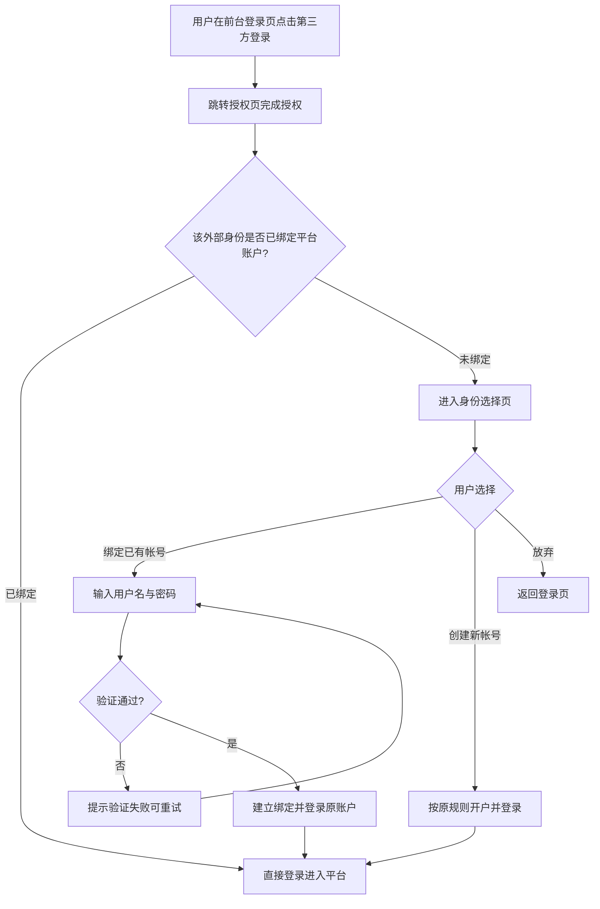
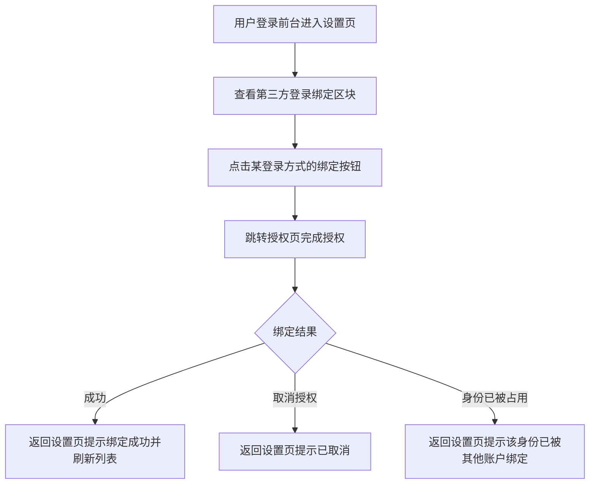

# OIDC 绑定优化

**功能名称**: OIDC 绑定优化（外部身份首次登录身份选择与前台自助绑定管理）
**PRD 版本**: v1.0
**创建日期**: 2026-11-14
**作者**: z-agent-bot
**来源**: GitHub Issue [Deliay/z-agent-gear#510](https://github.com/Deliay/z-agent-gear/issues/510)

## 背景与目标

### 1.1 背景

平台已上线「自定义 OIDC 登录与 GitHub OAuth 登录」（见 [[20261113-oidc-github-oauth-login.md]]）：管理员在后台配置第三方登录方式后，前台用户可点击登录页按钮跳转授权完成登录；**外部身份首次出现时平台直接自动开通一个全新的平台账户**。

该策略在实际使用中暴露两类问题：

1. **重复开户、数据割裂**：不少用户在平台已有管理员开通的密码账户（其中有历史会话、工作区、配置等数据），首次改用 OIDC 登录时被静默开通了一个全新的空账户，原有数据无法触达，用户困惑「我的东西去哪了」。
2. **绑定关系不可见、不可管理**：用户无法查看自己的账户绑定了哪些外部身份，也无法在登录状态下自助绑定新的外部身份或解除已有绑定；一旦外部身份侧发生变更（更换 IdP 帐号、IdP 停用），用户没有任何自助手段。

Issue #510 提出两点优化：新外部身份进入时由用户选择「绑定已有帐号」还是「创建新帐号」；前台支持查看与绑定到 IdP，并支持在设置中手动绑定、解绑。

### 1.2 目标

1. 外部身份首次登录前台时，不再静默自动开户，而是向用户展示身份选择页：可「绑定已有帐号」（验证该帐号的用户名密码后建立绑定并登录），也可「创建新帐号」（沿用原自动开户结果）。
2. 前台设置中提供「第三方登录绑定」管理能力：查看当前账户已绑定的外部身份列表，对平台已启用的登录方式发起手动绑定，并可解除已有绑定。
3. 全链路安全兜底：绑定已有帐号必须验明该帐号的用户名密码；同一外部身份全平台唯一归属；不得因解绑导致账户永久无法登录。

### 1.3 成功标准

- 已有密码账户的用户首次点击 OIDC 登录，可选择「绑定已有帐号」，验证密码后进入原账户并看到既有数据。
- 新用户首次点击 OIDC 登录，可选择「创建新帐号」，进入平台后的账户状态与优化前自动开户结果一致。
- 用户可在设置页看到已绑定的外部身份（来源、外部帐号名、绑定时间），并完成绑定新的登录方式与解绑已有绑定。
- 绑定/解绑的异常路径（票据过期、身份已被他人绑定、密码错误、解绑最后一个登录方式等）均有明确提示，不产生脏数据。
- 已绑定外部身份的用户再次登录流程与优化前完全一致（一键授权即登录）。

## 用户分析

### 2.1 目标用户

- **已有密码账户的平台用户**：希望改用企业 IdP / GitHub 身份登录，同时保留原账户的全部数据。
- **纯外部身份用户**：通过第三方登录开户的用户，希望管理自己绑定的外部身份（如同时绑定 GitHub 作为备用登录方式）。
- **平台管理员**：间接受益——减少「帐号重复开通」的咨询与手工合并成本。

### 2.2 用户场景

| 场景 | 用户角色 | 目标 | 痛点 |
|--|--|--|--|
| 老用户改用企业 SSO | 已有密码账户的用户 | 用公司 IdP 登录并进入原账户 | 首次 OIDC 登录被开了新账户，原数据看不到 |
| 新成员入职 | 新用户 | 用公司 IdP 一键开户进入平台 | 无（保持现有自动开户体验） |
| 绑定备用登录方式 | 已登录用户 | 在设置中把 GitHub 身份也绑定到当前账户 | 目前无法自助绑定，只能找管理员 |
| 离职前整理账户 | 已登录用户 | 解绑公司 IdP，保留其他登录方式 | 目前无法自助解绑 |
| 误操作兜底 | 已登录用户 | 解绑时得到防呆保护 | 担心解绑后账户再也登不上 |

## 功能需求

### 3.1 功能概述

将前台外部身份首次登录由「静默自动开户」改为「用户二选一」（绑定已有帐号 / 创建新帐号），并在前台设置中新增「第三方登录绑定」管理区块，支持查看、手动绑定与解绑外部身份。

### 3.2 功能列表

#### 功能点 1: 首次登录身份选择页

- **描述**: 用户在前台登录页点击第三方登录按钮并完成授权后，若该外部身份尚未关联任何平台账户，不再直接开户，而是进入「身份选择」页。页面展示当前外部身份的来源（登录方式名称）与外部帐号名，并提供两个选项：
  - **绑定已有帐号**：展示用户名、密码输入框；用户输入平台已有账户的用户名与密码，验证通过后该外部身份与此账户建立绑定，并直接登录进入该账户。
  - **创建新帐号**：用户确认后按原有自动开户规则创建新账户并登录（用户可看到将为其创建的帐号形态说明）。
  - 用户也可以放弃本次登录，返回登录页。
- **用户价值**: 老用户不再被静默开出重复账户，外部身份与既有数据自然汇合；新用户保留一键开户体验。
- **验收标准**:
  - [ ] 外部身份首次登录时进入身份选择页，页面正确展示登录方式名称与外部帐号名。
  - [ ] 选择「绑定已有帐号」并输入正确的用户名密码后，进入原账户，且能看到原账户的既有数据（会话、工作区等）。
  - [ ] 用户名或密码错误时给出与登录页一致的失败提示，可重试；身份选择上下文在重试期间保持有效。
  - [ ] 选择「创建新帐号」后进入新账户，账户初始化结果与优化前自动开户一致。
  - [ ] 选择页长时间停留（身份凭证过期）后提交，给出「登录状态已过期，请重新登录」提示并引导重新发起登录。
  - [ ] 同一外部身份已被其他账户绑定时，无论选择哪个选项都给出明确拒绝提示，不产生重复绑定。
  - [ ] 该外部身份完成绑定或开户后，下次第三方登录直接进入账户，不再出现选择页。

#### 功能点 2: 设置中查看与管理外部身份绑定

- **描述**: 前台设置页「帐号」区块新增「第三方登录绑定」管理：
  - **查看列表**：展示当前账户已绑定的外部身份，每条包含登录方式名称、外部帐号名、绑定时间、最近登录时间。
  - **手动绑定**：对平台已启用且适用于前台的每种登录方式提供「绑定」入口；点击后跳转对应授权页完成授权，返回设置页并提示绑定结果。每种登录方式在同一账户下最多绑定一个外部身份；已绑定的登录方式展示为「已绑定」状态，不重复提供绑定入口。
  - **解绑**：每条绑定提供「解绑」入口，二次确认后解除绑定。
- **用户价值**: 用户对自己的登录方式有完整的可见性与自助管理能力，无需联系管理员。
- **验收标准**:
  - [ ] 列表完整展示当前账户的全部绑定，信息与实际情况一致。
  - [ ] 点击「绑定」完成授权后返回设置页，列表中出现新绑定；绑定入口与平台当前启用的登录方式保持一致（停用后不再出现）。
  - [ ] 解绑经二次确认后生效，列表即时移除该条；解绑后该外部身份不再能登录本账户。
  - [ ] 同一账户对同一登录方式重复发起绑定时，得到明确提示且不产生重复绑定。
  - [ ] 待绑定的外部身份已被平台其他账户绑定时，绑定失败并提示该身份已被占用。
  - [ ] 绑定流程中途取消授权，返回设置页并提示已取消，不产生任何绑定。

#### 功能点 3: 解绑防呆保护

- **描述**: 为防止账户失去全部可用登录方式，解绑时进行保护性校验：若待解绑的外部身份是账户的**最后一个登录方式**（账户没有可用密码且仅剩下这一条外部身份绑定），则拒绝解绑并说明原因，引导用户先绑定其他登录方式或联系管理员。
- **用户价值**: 避免用户因误操作把账户置于永远无法登录的状态。
- **验收标准**:
  - [ ] 拥有密码的账户解绑任意外部身份均不受限制（密码登录始终兜底）。
  - [ ] 无可用密码的账户在仅剩一条外部身份绑定时，解绑被拒绝并展示明确原因。
  - [ ] 无可用密码的账户绑定多个外部身份时，可解绑到仅剩一条。

### 3.3 用户操作流程

首次外部登录的身份选择流程：

设置中手动绑定流程：

### 3.4 页面/界面描述

| 页面 | 描述 | 关键元素 |
|------|------|---------|
| 身份选择页（登录链路新页面） | 外部身份首次出现时展示 | 外部身份摘要（登录方式名称、外部帐号名）、「绑定已有帐号」区域（用户名输入框、密码输入框、确认按钮）、「创建新帐号」区域（说明文案、确认按钮）、返回登录页入口、错误提示区 |
| 前台登录页 | 保持不变 | 密码登录表单、第三方登录按钮区（原有） |
| 设置页「帐号」区块 | 新增「第三方登录绑定」管理 | 已绑定身份列表（登录方式、外部帐号名、绑定时间、最近登录时间、解绑按钮）、可绑定登录方式列表（绑定按钮/已绑定状态）、操作结果提示、解绑二次确认弹窗 |

### 3.5 异常与边界情况

| 情况 | 预期行为 |
|------|---------|
| 身份选择页上下文过期（停留过久或重复使用） | 提示「登录状态已过期，请重新登录」，引导回登录页重新发起 |
| 绑定已有帐号时用户名或密码错误 | 提示与登录页一致的失败文案，可重试，不消耗身份选择上下文（过期时间独立计算） |
| 外部身份在等待选择期间被其他账户绑定 | 提交时明确拒绝并提示该身份已被绑定，引导重新登录 |
| 外部身份已在身份选择页完成过绑定/开户，再次提交 | 幂等拒绝，提示身份状态已变化，引导重新登录 |
| 已绑定用户授权页取消授权 | 返回登录页并提示「已取消授权」（原有行为不变） |
| 绑定流程中取消授权 | 返回设置页并提示已取消，不产生绑定 |
| 同一账户对同一登录方式重复绑定 | 明确提示该登录方式已绑定，不产生重复记录 |
| 待绑定身份已被其他账户占用 | 绑定失败并明确提示 |
| 无密码账户解绑最后一个外部身份 | 拒绝解绑并说明原因，引导先绑定其他登录方式或联系管理员 |
| 登录方式被管理员停用/删除 | 绑定入口不再出现；已建立的绑定保留展示但不可用于登录（提示该登录方式已停用） |
| 自动开户失败（如平台内部服务异常） | 提示开户失败并引导重试或联系管理员，不产生半成品账户 |

## 四、非功能需求

### 4.1 性能要求

- 身份选择页的进入与提交保持秒级响应；绑定/解绑操作即时反馈。
- 设置页绑定列表加载不阻塞设置页其他区块。

### 4.2 安全性要求

- 绑定已有帐号必须验证目标账户的用户名与密码，严禁仅凭外部身份直接并入既有账户。
- 身份选择上下文为一次性、短时效凭证，不得长期有效或被重复使用；凭证不得泄露外部身份之外的任何平台账户信息。
- 同一外部身份在全平台唯一归属一个前台账户；同一账户对同一登录方式最多绑定一个外部身份。
- 解绑防呆保护在服务端强制执行，前端仅作展示层呼应。
- 原有第三方登录安全要求（防 CSRF、防重放、令牌不出服务端等）全部保持。

### 4.3 兼容性要求

- 已绑定外部身份的用户再次登录流程零变化。
- 密码登录、后台第三方登录与管理员绑定流程零变化。
- 存量自动开户账户与绑定关系数据不受影响。
- 未配置任何第三方登录方式时，登录页与设置页与当前版本完全一致（不展示绑定区块）。

## 五、依赖与约束

### 5.1 依赖

- 依赖已上线的「自定义 OIDC 登录与 GitHub OAuth 登录」能力（[[20261113-oidc-github-oauth-login.md]]）：登录方式配置、授权跳转与回调、自动开户等基础设施直接复用。

### 5.2 约束

- 本期仅覆盖前台（用户侧）的绑定优化；后台管理员的绑定管理沿用既有能力，不在本期变更。
- 本期不提供「忘记密码 / 重置密码」能力；无密码账户的解绑防呆以保护性拒绝实现。
- 本期不提供账户合并能力（两个已存在账户的数据合并不在范围）。
- 同一账户对同一登录方式仅绑定一个外部身份；更换绑定需先解绑再重新绑定。

## 六、相关文档

- [技术提案](../../engineering/proposals/20261114-feat-oidc-binding-optimization.md)
- [[20261113-oidc-github-oauth-login.md]] — 前置需求：自定义 OIDC 登录与 GitHub OAuth 登录
- [GitHub Issue #510](https://github.com/Deliay/z-agent-gear/issues/510)
