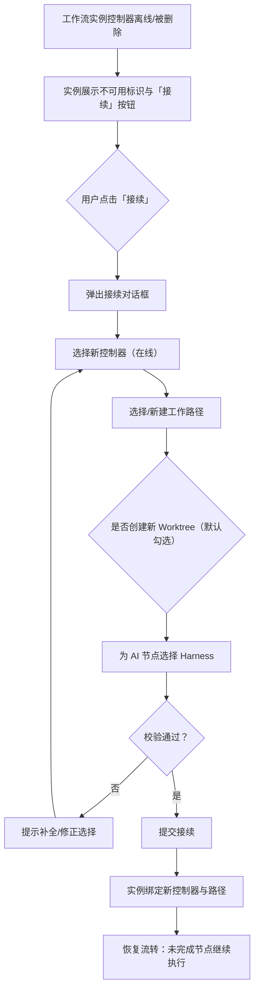

# 已实例化的工作流接续

**功能名称**: 已实例化的工作流接续
**PRD 版本**: v1.0
**创建日期**: 2026-11-14
**作者**: Agent（来源：GitHub Issue Deliay/z-agent-gear#513）

## 背景与目标

### 1.1 背景

工作流实例在实例化时绑定一个控制器与一个工作路径，后续全部节点的执行都发生在该控制器上。当这个控制器离线（断开连接）或被用户删除后，已实例化的工作流实例随之不可用：

- 进行中的节点无法继续执行，等待中的节点无法启动；
- 用户既不能更换执行环境，也不能把已有的流程进度（节点状态、黑板产物）迁移走；
- 实例只剩下删除一条路，已产生的进度与产物面临废弃。

用户需要一个「接续」能力：在控制器不可用之后，把工作流实例转移到新的控制器与新的工作路径上，让流程从中断处继续流转。

### 1.2 目标

- 控制器离线或被删除的工作流实例，在界面上有明确的不可用标识与「接续」入口；
- 用户可以通过一次对话框操作完成接续：选择新控制器、新工作路径、是否创建新 Worktree（默认勾选）、以及工作流 AI 节点使用的 Harness；
- 接续完成后，实例在新控制器上恢复可用，未完成的节点可以继续流转，已完成的节点状态与产物完整保留。

### 1.3 成功标准

- 控制器离线或被删除的实例 100% 展示「接续」入口，可用实例不出现该入口；
- 接续操作一次成功率（用户按引导完成对话框并提交后实例恢复可用）≥ 95%；
- 接续后已完成节点的状态、黑板产物、关联记录零丢失；
- 接续后实例可正常执行到全部节点完成（人工验证至少一条多节点工作流全链路）。

## 用户分析

### 2.1 目标用户

使用工作流编排 AI 节点执行任务的平台用户，尤其是：

- 使用本地控制器的用户：本地机器关机、网络中断导致控制器离线；
- 使用云端控制器的用户：云电脑被销毁或回收后控制器被删除；
- 需要把流程从一台机器转移到另一台机器继续执行的用户。

### 2.2 用户场景

| 场景 | 用户角色 | 目标 | 痛点 |
|--|--|--|--|
| 本地控制器离线，工作流跑到一半 | 工作流使用者 | 换一台在线控制器继续跑完 | 实例卡死，无法转移，只能删除重来 |
| 云电脑销毁，控制器被删除 | 工作流使用者 | 把实例接续到新环境保留进度 | 控制器记录消失，实例成为孤儿 |
| 主动迁移执行环境 | 工作流使用者 | 把流程迁到性能更好/位置更近的控制器 | 缺少迁移入口 |

## 功能需求

### 3.1 功能概述

为控制器离线或被删除的工作流实例提供「接续」能力：用户通过对话框选择新控制器、新工作路径、是否创建新 Worktree 及 AI 节点 Harness，系统将实例迁移到新环境并恢复流转能力。

### 3.2 功能列表

#### 功能点 1: 不可用实例识别与「接续」入口

- **描述**: 当工作流实例绑定的控制器处于离线状态或已被删除时，实例判定为「不可用」。不可用的实例在工作流列表与实例详情中展示明确的不可用标识，并提供「接续」按钮。不可用的实例不允许执行流转类操作（如启动、重启节点），但归档、删除、查看历史产物不受影响。
- **用户价值**: 用户能一眼识别实例为何卡住，并且有明确的自救入口，而不是面对一个永远不动的流程。
- **验收标准**:
  - [ ] 控制器离线时，其下实例展示不可用标识与「接续」按钮
  - [ ] 控制器被删除后，其下实例同样展示不可用标识与「接续」按钮
  - [ ] 控制器在线的实例不出现「接续」按钮，展示与行为与现状一致
  - [ ] 不可用实例的归档、删除、查看功能正常

#### 功能点 2: 接续对话框（新控制器 + 新工作路径 + Worktree 选项）

- **描述**: 点击「接续」弹出对话框，依次让用户选择：
  1. **新控制器**：从当前用户可用的在线控制器中选择（离线控制器不可作为目标）；
  2. **新工作路径**：在目标控制器上选择已有工作路径，或浏览目录创建新的工作路径；
  3. **是否创建新 Worktree**：勾选项，默认勾选；仅当新工作路径是 Git 仓库时可用，非 Git 目录时选项隐藏或置灰并说明原因。
- **用户价值**: 一次操作完成迁移决策，默认勾选的 Worktree 保证接续后的执行与目标目录主分支隔离，不污染新环境。
- **验收标准**:
  - [ ] 对话框中仅能选择在线且属于当前用户的控制器
  - [ ] 选定控制器后可选择其下已有工作路径，也可浏览目录并新建工作路径
  - [ ] 「创建新 Worktree」默认勾选；目标路径非 Git 仓库时不可勾选并给出提示
  - [ ] 未选齐必填项时确认按钮不可用

#### 功能点 3: AI 节点 Harness 选择

- **描述**: 在接续对话框中，为工作流的 AI 节点选择目标 Harness。可选范围来自所选目标控制器的可用能力清单；默认沿用各节点原 Harness（若目标控制器支持），不支持时需用户另行选择。同一实例内多个 AI 节点统一为所选 Harness（逐个节点差异化配置可在接续完成后通过既有的节点编辑能力调整）。
- **用户价值**: 原控制器的 Harness 在新控制器上可能不存在，用户在接续时一次性确认执行工具，避免接续后节点启动才发现能力缺失。
- **验收标准**:
  - [ ] Harness 选项实时来自目标控制器能力清单，目标控制器不具备的类型不可选
  - [ ] 原 Harness 在目标控制器可用时默认选中，不可用时明确提示需改选
  - [ ] 未选择 Harness 时无法提交接续

#### 功能点 4: 接续生效与流转恢复

- **描述**: 提交后实例与新控制器、新工作路径绑定；勾选了创建 Worktree 时在新工作路径下创建全新的工作流 Worktree。接续完成后：
  - 已完成节点的状态、产物与历史记录保持不变；
  - 未完成节点在新环境上可继续流转；接续前处于进行中状态的节点，由用户在接续后按既有方式重启执行；
  - 原控制器上可能残留的 Worktree 目录随原控制器不可达而不再由平台管理，不做远程清理（界面给出说明）。
- **用户价值**: 进度不丢、产物不丢，流程从中断点继续，而不是从头再来。
- **验收标准**:
  - [ ] 接续成功后实例不可用标识消失，恢复常规操作能力
  - [ ] 已完成节点状态与黑板产物逐条核对一致
  - [ ] 勾选创建 Worktree 时，新环境存在新建的工作流 Worktree；未勾选时直接使用新工作路径
  - [ ] 接续历史（时间、原控制器、新控制器）可查询

### 3.3 用户操作流程

### 3.4 页面/界面描述

| 页面 | 描述 | 关键元素 |
|------|------|---------|
| 工作流列表 | 不可用实例卡片展示不可用标识与「接续」按钮 | 不可用徽标（控制器离线/已删除）、「接续」按钮 |
| 工作流实例详情 | 顶部展示不可用提示条与「接续」按钮；流转类操作禁用 | 提示条、「接续」按钮、禁用的启动/重启操作 |
| 接续对话框 | 分步或单页表单完成接续选择 | 控制器选择器、工作路径选择/浏览新建、Worktree 勾选（默认勾选）、Harness 选择器、确认/取消 |

### 3.5 异常与边界情况

| 情况 | 预期行为 |
|------|---------|
| 目标控制器在接续过程中离线 | 接续失败并提示，实例保持原不可用状态，不产生半迁移数据 |
| 新工作路径非 Git 仓库且勾选创建 Worktree | 阻止提交并提示改为非 Git 路径不支持，或取消勾选 |
| 原 Harness 在目标控制器全部不可用且用户未改选 | 阻止提交并提示必须选择 Harness |
| 实例已完成（全部节点 DONE） | 不提供接续入口（无需继续执行），仅保留归档/删除/查看 |
| 实例已删除 | 不提供接续入口 |
| 控制器仅短暂离线后恢复在线 | 不可用标识消失，「接续」按钮隐藏，实例恢复常规状态 |
| 同一实例重复接续 | 允许：只要实例仍处于不可用状态即可再次发起接续 |
| 原控制器上残留 Worktree | 平台不远程清理，接续成功提示中说明需用户自行处理 |

## 四、非功能需求

### 4.1 性能要求

- 实例可用性判定随列表/详情查询实时返回，不引入额外的轮询请求；
- 接续提交在常规网络条件下 5 秒内返回结果（含创建 Worktree 的场景除外，该场景给出进行中反馈）。

### 4.2 安全性要求

- 仅实例归属用户本人可发起接续；
- 目标控制器必须归属当前用户且在线，防止接续到他人或不可用环境。

### 4.3 兼容性要求

- 存量可用实例行为零变化；
- 接续前的历史产物、评审记录、Pull Request 关联在接续后继续有效。

## 五、依赖与约束

### 5.1 依赖

- 依赖控制器在线状态与能力清单的现有机制；
- 依赖工作区（工作路径）的浏览与创建能力；
- 依赖工作流 Worktree 的现有创建机制。

### 5.2 约束

- 接续仅改变实例的执行环境绑定，不改变节点图结构与节点定义；
- 已完成的节点不可因接续而改变状态；
- 原控制器上的文件内容（含旧 Worktree）不做跨控制器拷贝，接续是新环境上的继续执行而非文件搬家。

## 六、相关文档

- 来源 Issue：https://github.com/Deliay/z-agent-gear/issues/513
- [[20260808-agent-workflow.md]]（工作流一期，released）
- [[20261103-feat-workflow-iteration.md]]（工作流迭代，draft）
- [[20261103-feat-workflow-node-interrupt-retry.md]]（工作流节点中断处理迭代，draft）
- 技术提案：[[../../engineering/proposals/20261114-feat-workflow-instance-continuation.md]]
